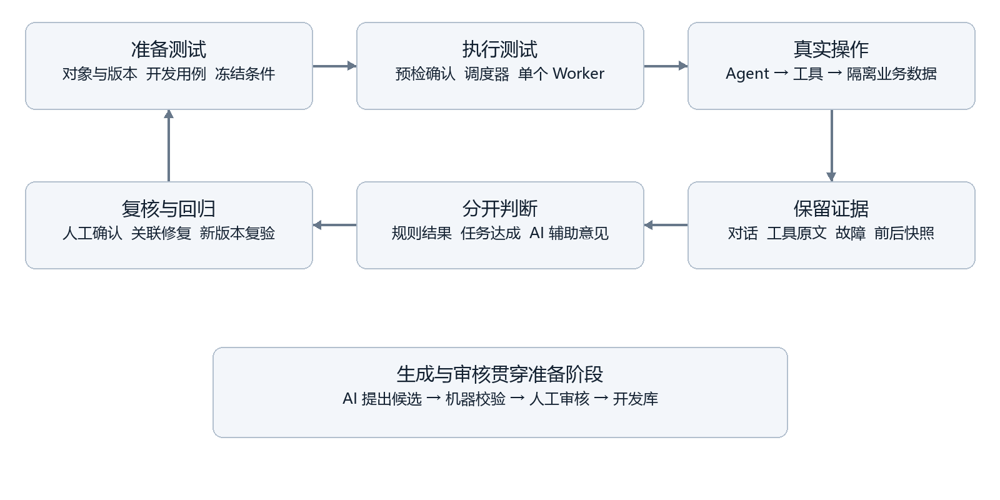

# AgentChaos 智能体可靠性测试平台

AgentChaos 用于测试能够调用工具并改变业务数据的 Agent。平台支持**场地预约**与**模拟订单退款**，关联多轮输入、确认草稿、工具轨迹、故障及业务前后快照，分别记录规则结论、任务达成和 AI 辅助意见。退款不连接真实支付平台。两个参考 Agent 均由本项目开发者实现，尚未验证独立外部 Agent 接入。

- [数据库 SQL](database/)与[接口契约](docs/architecture/contracts.md)

## 功能与链路

| 板块 | 用途 |
| --- | --- |
| 项目概览 | 对象、用例和最近运行，新建运行入口 |
| 对象与版本 | 核对当前源码及配置，查看差异并显式登记版本 |
| 开发用例库 | 阅读已审核开发修订、逐轮输入、前置条件与预期 |
| 测试工作台 | 选择对象和用例，预检确认，读取结果、链路、调用与断言 |
| Agent 测试 | 预约与退款自由聊天、草稿确认、状态读取和测试记录 |
| AI生成与审核 | 按对象生成候选，机器检查，人工通过或修改后入库 |
| 辅助评价与校准 | 独立人工标注、封存、裁判调用和分歧复核 |
| 缺陷与报告 | 缺陷复核、关联修复、比较、失败对话提炼及证据导出 |
| 工程环境 | 服务状态及匹配环境的 Worker/Dispatcher 实时回执 |
| 平台测试助手 | 解释当前用例和运行证据，提供导航，不代替提交或审核 |

**对象版本 → 开发用例 → 运行配置 → 预检确认 → 执行与取证 → 规则和任务判断 → 人工复核 → 修复登记 → 可比复验。**



## 环境要求

| 组件 | 要求或已验证环境 |
| --- | --- |
| Python | 3.12，后端依赖锁为 `backend/uv.lock` |
| Node.js | `^22.12.0` 或 `>=24.0.0`，前端使用 `package-lock.json` |
| MySQL | SQL 包已验证 8.0.39；依赖 JSON、CHECK、触发器及 `utf8mb4_0900_ai_ci`，不能直接用于 MariaDB/SQLite |
| Redis | 必须支持 JSON 和 Search，只有 PING 成功不够 |
| 执行服务 | Celery Worker、Dispatcher；团队 Windows 脚本使用已配置的 Docker Linux 引擎 |
| 模型 | 服务端 DeepSeek API；真实调用需要对应角色的授权和持久账本 |

团队 Windows Redis 运行时位于外部 `D:\RedisSearch`，执行服务另需已有 Docker Linux 环境。启动脚本不会安装它们。根目录 `compose.yaml` 是早期模板，`deploy/cloud/compose.yaml` 使用团队私有构建镜像，均不是已验证的空白机器一键安装。

## 获取源码与私有配置

```powershell
git clone https://github.com/shenyong-dev/AgentChaos.git
cd AgentChaos
python scripts/init_env.py
cd backend
uv sync --locked --python 3.12
cd ../frontend
npm ci --no-fund --no-audit
cd ..
```

`init_env.py` 只在 `.env` 不存在时创建配置和随机密码，不覆盖既有文件、不打印密码。填写实际 MySQL、Redis 地址和凭据；团队本机 Redis 为 `16380`，模板默认端口不代表运行时已安装。API 密钥只能放服务端，不能放 `VITE_*` 或提交到仓库。

由维护者新建独立数据库（例如 `agentchaos_demo`），给专用账号配置该库的建表、触发器和运行读写权限，将连接填入 `.env` 的 `MYSQL_*` 字段。不要将演示导入指向工作库或云端历史库。

```sql
CREATE DATABASE agentchaos_demo
  CHARACTER SET utf8mb4 COLLATE utf8mb4_0900_ai_ci;
```

## SQL 文件与初始化

| 文件 | 内容 |
| --- | --- |
| `database/schema.sql` | 从全部 Alembic 升级生成，含16张业务表、`alembic_version`、索引、约束及触发器；修订 `20261107_0007` |
| `database/demo_data.sql` | 4条预约参考用例、8条退款参考用例、6项故障；不含密码、历史运行、订单或独立标签 |
| `database/verify.sql` | 只读核对版本、账号角色、对象、用例、故障和空历史 |
| `database/manifest.json` | SQL SHA256、迁移源指纹及预期数量 |

**建表 SQL 仅用于新空库。已有库使用迁移或原备份恢复，不能重复灌表。MySQL DDL 不支持整包事务回滚，出错须停止检查，不要忽略错误或使用 `--force` 继续。**

演示材料是开发者参考种子，不是新完成的真人独立标注。预约使用 `DEMO-T13-*` 新编号，退款沿用 `T18-*` 参考目录；技术上的 `approved` 和审核种子账号不代表真人做过新的审核。云端原有60条预约开发材料及8条退款参考，与本 SQL 的12条起步材料不是同一份数据库快照。

### 推荐导入方式

先确认 `.env` 指向新空库，从项目根目录执行：

```powershell
cd backend
.venv\Scripts\python.exe scripts/database_setup.py import-schema --empty-database
.venv\Scripts\python.exe scripts/database_setup.py prepare-demo --reference-data
.venv\Scripts\python.exe scripts/database_setup.py verify
```

三步依次执行：

1. 核对 SQL 指纹、实际检查库为空，导入 `schema.sql`，拒绝覆盖已有表。
2. 用本机私有 `DEMO_SEED_PASSWORD` 创建 `demo_operator`、`demo_reviewer`，初始化规则和三个房间，导入 `demo_data.sql`，登记两个对象的当前源码版本。
3. 检查迁移结构、12条用例哈希、6项故障、账号角色，以及工作台里两个当前可执行对象。

成功回执应显示选中的数据库名、修订 `20261107_0007`、`targets: 2`、`development_cases: 12`、`fault_profiles: 6`、`model_calls: 0`。导入不启动服务、不调用模型、不创建测试运行。重复准备不会覆盖、清空或重置已有数据。

### 手工导入方式

需要直接使用 SQL 文件时，按以下顺序操作，**不再重复执行上面的 `import-schema` 或 `prepare-demo`**：

1. 在 MySQL Workbench 选中新空库，打开并完整执行 `database/schema.sql`。脚本含 `DELIMITER`，不能按每个分号机械拆开触发器。
2. `.env` 指向同一个库，在 `backend` 执行 `.venv\Scripts\python.exe scripts/manage_db.py seed`，使用私有随机密码创建账号、规则和房间。
3. 回到同一个数据库，完整执行 `database/demo_data.sql`。数据文件依赖第2步的审核种子账号。
4. 在 `backend` 执行 `.venv\Scripts\python.exe scripts/database_setup.py finalize-demo --reference-data`，核对导入材料并登记实际源码版本；否则退款对象和当前版本未必出现在选择器。
5. 执行 `database_setup.py verify`，并可在客户端运行 `database/verify.sql`。

MySQL 命令行也可在连接到目标库后使用 `SOURCE`，路径替换为实际项目位置：

```sql
SOURCE D:/AgentChaos/database/schema.sql;
-- 先完成 Python seed，再执行下一行
SOURCE D:/AgentChaos/database/demo_data.sql;
SOURCE D:/AgentChaos/database/verify.sql;
```

SQL 不包含账号密码、`CREATE USER`、固定 `USE` 或 `CREATE DATABASE`；由维护者选择数据库和身份。

### 已有库升级与 SQL 包维护

已有库先备份，再在 `backend` 执行：

```powershell
.venv\Scripts\python.exe scripts/manage_db.py migrate
.venv\Scripts\python.exe scripts/manage_db.py check
```

`seed` 遇到不同的已有密码或规则会拒绝覆盖。SQL 与 Alembic 是两种建表入口；SQL 已包含迁移版本，无需重复从零建表，后续仍可正常迁移。

维护 SQL 交付包时，在 `backend` 执行下列命令。生成过程只读迁移和公开参考材料，不连接或导出工作数据库：

```powershell
.venv\Scripts\python.exe scripts/export_database_sql.py
.venv\Scripts\python.exe scripts/export_database_sql.py --check
```

SQL 不能恢复 Redis 检查点、模型授权账本、未知请求、退款 SQLite 历史或私有附件。完整恢复须使用相互匹配的组件备份，不能用新空库解释原结果0笔。

## 已配置 Windows 环境的启动与停止

先确认 MySQL、Redis 外部运行时和 Docker Linux 引擎可用，在项目根目录执行：

```powershell
powershell -File scripts/start-redis.ps1
powershell -File scripts/start-dev.ps1
powershell -File scripts/workers.ps1 -Action status
powershell -File scripts/workers.ps1 -Action start
```

前端 `http://127.0.0.1:5173`，API `http://127.0.0.1:8000`，本机接口文档 `/docs`。用 `demo_operator` 或 `demo_reviewer` 登录，密码来自本机 `.env` 的 `DEMO_SEED_PASSWORD`。云端凭据另行提供。

进入“工程环境”重新检测，核对 API、数据库、Redis 模块、匹配源码/数据库/队列的 Worker 回执及 Dispatcher 扫描。仅进程存在不代表就绪。

```powershell
powershell -File scripts/workers.ps1 -Action logs
powershell -File scripts/workers.ps1 -Action status
# 确认没有在途任务或未知提交后再停止
powershell -File scripts/workers.ps1 -Action stop
powershell -File scripts/stop-dev.ps1
```

`stop-dev` 只停止其管理的 API 和前端，不删除数据库。端口冲突时先核对归属，不自动杀死其他进程。

## 完成第一次测试

1. **先读材料。** 新库没有历史运行，先打开开发参考用例；有历史时可直接从概览读取旧结果。
2. **核对版本。** 选对象核对当前源码，变化后显式登记；版本ID不同于修订号，登记不部署代码。
3. **选用例。** 在运行向导先选对象，再按编号或目的搜索；新用例在前，“清空选择”在顶部。
4. **配置预检。** 初次一个用例、一次重复、无故障；预算大于0且覆盖峰值预留。最终确认才创建真实任务，仅排队不会启动 Worker。
5. **看同一执行。** 结果概览 → 链路诊断 → 调用轨迹 → 判定结果。核对最终回答和真实写入；运行结束、规则通过和任务达成不是同一个状态，缺证据保留未知。
6. **比较与复验。** 核对版本、用例、预期、种子和限制等条件。故障未激活不能算恢复；回执未知先查原请求，不换键重提。

自由聊天从“Agent 测试”选择两个对象，先查条件、看草稿，再明确确认。预约撤销释放原时段，退款始终是模拟入账，新会话不等于撤销旧业务。

AI候选须由审核员通过或修改后通过才进入开发库。裁判先独立标注封存再调用；12条协议样本不满足执行级30条校准门槛。助手只读解释和导航，不代替提交、人审或独立标签。

## 模型权限与云端

新环境真实调用默认关闭。配置 `DEEPSEEK_API_KEY` 和模型名称后，还需相应角色开关、授权标识和持久账本；聊天、批量、生成器、裁判、助手分别受控，由维护者按环境完成初始化。SQL 不授予模型额度。

团队云端已有“不限累计金额与次数”的明确授权，单次请求、会话、运行、批次和资源限制仍在；不能通过 SQL 继承到新机器。禁止借用旧实验授权、复制真人标签或清空 Redis 获得额度。项目估算不等于供应商账单。

团队 HTTPS 地址和账号由私有渠道提供。部署使用 Alibaba Cloud Linux 4 LTS、Nginx 和私有 MySQL/Redis/API/Worker/Dispatcher；配置在 `deploy/cloud/`，私有镜像及凭据不在仓库。实际内存约1.63 GiB，单 Worker 与全角色模型单并发，Swap 不作为容量保证。恢复须同时保留 MySQL、Redis、退款 SQLite、私有配置与授权初始化绑定。

## 验证范围与材料

SQL 包已在临时 MySQL 8.0.39 库验证实际导入、结构、用例哈希和工作台可见性；不代表已在空白电脑完成全部软件独立安装，该项此前由用户选择跳过。

历史结论保留实际分母：T16两版本各160次执行、规则通过146/145，未证明V1整体改善；T17B为12条受控裁判观察；T17L/M/N为构造缺陷、缩减和故障配对；T18为同开发者退款参考；T19真人对照提前结束，未证明助手效率改善。云端核心链路有实测及团队使用反馈，宿主重启和长期SLA未验证。各项记录见 `docs/evidence/`。

前端在 `frontend` 执行 `npm run build`。后端在 `backend` 执行针对性 `python -m pytest`、`python -m ruff check app tests`；数据库集成检查必须使用隔离机制，不对工作库运行破坏性测试。

```text
backend/app/          API、Agent、领域工具、执行、证据和复核
backend/alembic/      迁移和不可变约束
backend/scripts/     初始化、SQL生成和导入工具
backend/tests/       控制与隔离集成测试
frontend/src/        页面、组件、主题和类型
database/            SQL和文件指纹
datasets/            公开候选材料及分区
knowledge/           自建预约规则
scripts/             本机启动停止与执行服务管理
deploy/cloud/        团队云端配置
docs/competition/images/ 平台界面、架构和测试链路插图
docs/evidence/       历史实验摘要及公开证据
```

源码和依赖分别以实际工作区、锁文件为准。`.env`、API密钥、私钥、私有备份及未公开真人记录不纳入提交。
