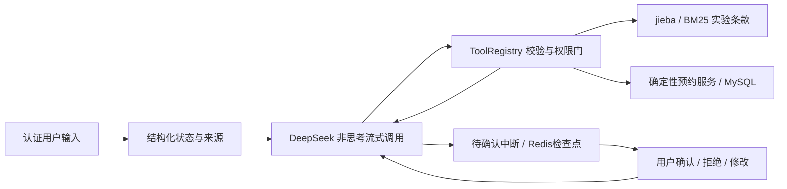

# T04 预约 Agent 基线

仅实现交互式原型。FastAPI 创建认证会话，LangGraph 在 Redis 保存状态；工具通过既有确定性服务读写 MySQL。Worker、任务租约和正式事件/SSE 由 T05/T06逐项实现，当前不声明这些能力已通过。

## 模型边界

DeepSeek 官方 Chat Completion，`deepseek-flash`，显式 `thinking.type=disabled`，流式聚合到最终消息。未设置 temperature/top_p，也未将思考模式写成已验证。响应只观察到模型别名，厂商所列底层修订不等于独立锁定的服务版本。请求不自动重试，缺少 usage 或超时保留预算预留，不能按零费用退款。

agent 本轮最多1美元，case_generator/judge为0。授权标识为 T04-20261025-agent-1；跨进程 Redis Lua 原子预留和结算，不随启动清零。全输入按官方高峰未命中价、输出按高峰价估算，这是保守估算，不是账单。输入上限65536 UTF-8字节，输出上限1024 token，单轮最多12次模型调用、120秒总时限，当前会话最多50轮；授权内再加400次调用总上限。SDK timeout控制单请求，数据库仍沿用T03分项超时；这些上限不代替T05跨进程任务取消和租约。

实际模型发出的 tool_call_id 与 ToolMessage 一一配对。确认是用户输入/中断恢复，不伪造一个模型未请求的工具回执。工具参数 Schema、函数白名单和可信 BookingContext 分开：模型无权传 actor/scope/session/confirmed/grant。

## 状态、来源与确认

字段保存 value/source_turn/source_quote/source_kind。模型仅提出提取值；服务端核实引文在当前输入中并与日期/时间/人数解析相符。“下午”不等于14:00，A101不等于101人。未修改字段保留原来源；用户明确给出时长才由服务端推导结束时间。具体时间使用 Asia/Shanghai。

新的明确时长撤销旧结束时间，新的明确结束时间撤销旧时长；同轮明确提供两者却不一致时拒绝并澄清，不能静默挑一项提交。修改待确认草稿后重新查空闲并生成新稿，只有真实提交需要用户确认。

会话 owner 由 Basic 认证身份绑定，公开创建接口只接受空对象。session_id 为服务端UUID，每个新输入携带 request_id 与 expected_revision：Redis短期会话锁拒绝并发输入，revision阻止旧版本，request_id+参数哈希避免相同输入重复执行。相同输入重放返回第一次响应快照，继续操作前 GET 最新会话状态。

预览不等于提交。待确认节点只做 interrupt；恢复节点检查当前草稿、哈希与确认修订，再生成服务端 grant。确认、拒绝与字段变更分开，变更/拒绝撤销旧草稿和授权。拒绝后普通回顾不会自动重开预约；当前原型使用明确的“重新预约/继续预约/现在想预约”等短语恢复预约意图，其他表达可能需要再澄清。实际写入由T03幂等键和事务保护，本轮只允许一次自动写尝试。未知提交保留原请求标识，不能换键、改字段或生成新稿。查证未发现记录也不能说确定失败。

既有 sb_booking_drafts 增加可空 session_id 与索引，迁移20261025_0002。T03直接接口仍为NULL，旧哈希兼容；T04同一用户的不同会话各保留自己的草稿。MySQL依然保存预约事实，Redis保存对话与协调状态。已知回执在查询会话时重新查MySQL；无法查到时返回unknown，不能用旧缓存冒充有效预约。

## 上下文整理与检索

完整原始消息保留在检查点。模型上下文保留完整 Human/AI/Tool 块，按保守UTF-8字节上界选择近轮次；18k为整理目标，单个当前块不可拆时允许超过目标，60k为该层硬边界，再受网关65k整个请求限制。结构化字段及来源、拒绝、业务回执、未查清的请求与本轮已执行工具独立保留，整理不覆盖MySQL事实。摘要与消息选择记录在本地审计，T06再统一事件落库。当前不提供无限长历史或长期记忆。

`knowledge/booking-rules-v1.md` 是自建实验设定。从不可变知识修订加载，验证正文SHA256；按标题加条目分块，返回 document_revision/source_ref/document_hash/chunk_hash/chunk_id。固定jieba0.42.1、rank-bm25 0.2.2、自定义词典、别名/停词及BM25 k1=1.5、b=0.75、epsilon=0.25，top3、最低分0.01，清单保存索引哈希。分数只用于排序，不是置信度。

区分 supported/no_lexical_match/low_relevance/no_applicable_evidence/evidence_conflict；只有房间编号命中而费用等问题没有实质词依据时返回低相关，不能把容量条款当收费依据。仅是词法基线，不承诺理解所有同义词，也不替代T09的引用支持性评测。固定旧修订仍可在其有效条件内使用；相同文档键的不同内容同时适用则拒绝选择。实时空闲和预约事实始终查询业务工具。

## 检查点兼容与恢复限制

锁定 langgraph-checkpoint-redis 0.5.2 在本机观察到：interrupt写入存在，但检查点 has_writes 为false，原 get_tuple 快路径漏读该中断。SessionRedisSaver 仅对会话恢复读取路径强制检查真实写入注册表/搜索回退，不修改厂商包。集成测试同时重现原读取漏失与修正后的读取，并用独立子进程恢复真实待确认对话。

此结论不确认 has_writes 不一致的底层根因，也不声称修复上游所有历史列表接口。依赖升级前必须重跑该回归。当前没有T05 Worker故障恢复保证；Redis数据丢失、会话锁过期、进程在工具副作用与检查点之间退出等更强故障场景仍需后续任务验证。原生Windows开发版Redis的十天受控重启限制仍然存在。

## 接口与证据

六个接口位于 `/api/v1/demo/sessions`：创建、读取、messages、resume、retry、history。401/404隐藏身份外的会话；409表示版本/确认/并发冲突；429表示步数或预算限制；模型超时504、模型服务错误503与工具slot_conflict分别记录。retry只恢复已失败节点，不自动增加付费重试。同步HTTP交互可能等待一整轮，不提供token SSE。

工具契约见 [agent-tools.schema.json](agent-tools.schema.json)，HTTP契约见 [openapi.json](openapi.json)。V0清单同时固定源码、迁移、uv.lock、提示词、知识、分词/索引、工具与可观察模型配置。代码或知识清单改变后不能直接继续旧会话，应登记新版本并新建会话。

真实模型对话、离线模型替身回归、故障来源和历史失败分别登记到 [T04验收记录](../acceptance/T04.md)。开发对话不是T13正式测试集，勾选实施完成也不代替团队验收。

参考：[DeepSeek工具协议](https://api-docs.deepseek.com/guides/tool_calls/)、[官方价格](https://api-docs.deepseek.com/quick_start/pricing/)、[LangGraph中断](https://docs.langchain.com/oss/python/langgraph/interrupts)、[Redis检查点实现](https://github.com/redis-developer/langgraph-redis)、[jieba](https://github.com/fxsjy/jieba)、[BM25](https://github.com/dorianbrown/rank_bm25)。实际兼容结论来自本项目证据。
