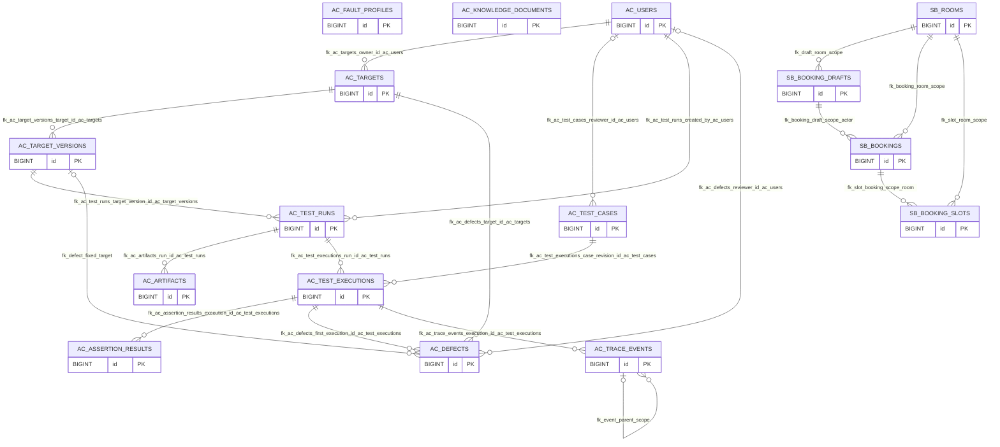

# T02—T04 数据库字段字典与关系

迁移：`20261025_0002`。12张平台表+4张实验业务表；另有Alembic自身的版本表。

由 backend/scripts/export_database_docs.py 生成；约束/索引为应用显式声明。MySQL可能自动建立外键支持索引；初始结构见T02，当前session字段及实际结构见T04验收记录。

所有表为InnoDB/utf8mb4；符号标识使用区分大小写的utf8mb4_bin。UTCDateTime要求带时区输入，转UTC存DATETIME(6)，读取时补UTC。JSON赋值复制并拒绝NaN；修改可变JSON字段应赋新值。

固定版本/审核后用例/运行清单及证据由迁移中的22个触发器保护；规则见 docs/database-operations.md。Pydantic冻结或ORM字段本身不能代替数据库保护。

## ER图

复合外键作为一组表达同scope/actor/room的关联；图不替代字段与约束清单。

## ac_fault_profiles

版本化故障配置；T07实现注入

| 字段 | MySQL类型 | NULL | 默认值 |
|---|---|---|---|
| `profile_key` | `VARCHAR(80) COLLATE utf8mb4_bin` | 否 | `—` |
| `revision` | `INTEGER` | 否 | `—` |
| `fault_type` | `VARCHAR(3)` | 否 | `—` |
| `trigger_stage` | `VARCHAR(32) COLLATE utf8mb4_bin` | 否 | `—` |
| `target_tool` | `VARCHAR(128) COLLATE utf8mb4_bin` | 否 | `—` |
| `parameters_json` | `JSON` | 否 | `—` |
| `seed` | `INTEGER` | 否 | `—` |
| `max_triggers` | `INTEGER` | 否 | `—` |
| `enabled_for_test` | `BOOL` | 否 | `True` |
| `id` PK | `BIGINT UNSIGNED` | 否 | `—` |
| `created_at` | `DATETIME(6)` | 否 | `CURRENT_TIMESTAMP(6)` |

约束：

- `ck_fault_revision`（check）：revision >= 1
- `ck_fault_triggers`（check）：max_triggers >= 1
- `ck_fault_type`（check）：fault_type IN ('F01','F02','F03','F04')
- `uq_fault_revision`（unique）：profile_key, revision

## ac_knowledge_documents

有来源与适用条件的不可变规则修订

| 字段 | MySQL类型 | NULL | 默认值 |
|---|---|---|---|
| `document_key` | `VARCHAR(128) COLLATE utf8mb4_bin` | 否 | `—` |
| `revision` | `INTEGER` | 否 | `—` |
| `title` | `VARCHAR(255)` | 否 | `—` |
| `source_type` | `VARCHAR(32) COLLATE utf8mb4_bin` | 否 | `—` |
| `source_ref` | `VARCHAR(512)` | 否 | `—` |
| `valid_from` | `DATETIME(6)` | 是 | `—` |
| `valid_to` | `DATETIME(6)` | 是 | `—` |
| `applicability_json` | `JSON` | 否 | `—` |
| `content` | `LONGTEXT` | 否 | `—` |
| `content_hash` | `VARCHAR(64) COLLATE utf8mb4_bin` | 否 | `—` |
| `id` PK | `BIGINT UNSIGNED` | 否 | `—` |
| `created_at` | `DATETIME(6)` | 否 | `CURRENT_TIMESTAMP(6)` |

约束：

- `ck_knowledge_revision`（check）：revision >= 1
- `ck_knowledge_validity`（check）：valid_to IS NULL OR valid_from IS NULL OR valid_to > valid_from
- `uq_knowledge_revision`（unique）：document_key, revision

## ac_users

本地演示账号与operator/reviewer角色

| 字段 | MySQL类型 | NULL | 默认值 |
|---|---|---|---|
| `username` | `VARCHAR(64) COLLATE utf8mb4_bin` | 否 | `—` |
| `password_hash` | `VARCHAR(255)` | 否 | `—` |
| `role` | `VARCHAR(16)` | 否 | `—` |
| `enabled` | `BOOL` | 否 | `1` |
| `id` PK | `BIGINT UNSIGNED` | 否 | `—` |
| `created_at` | `DATETIME(6)` | 否 | `CURRENT_TIMESTAMP(6)` |

约束：

- `ck_users_role`（check）：role IN ('operator','reviewer')
- `uq_ac_users_username`（unique）：username

## sb_rooms

按scope隔离的场地和开放时间

| 字段 | MySQL类型 | NULL | 默认值 |
|---|---|---|---|
| `scope_id` | `VARCHAR(64) COLLATE utf8mb4_bin` | 否 | `—` |
| `room_code` | `VARCHAR(32) COLLATE utf8mb4_bin` | 否 | `—` |
| `capacity` | `INTEGER` | 否 | `—` |
| `opening_hours_json` | `JSON` | 否 | `—` |
| `enabled` | `BOOL` | 否 | `True` |
| `id` PK | `BIGINT UNSIGNED` | 否 | `—` |
| `created_at` | `DATETIME(6)` | 否 | `CURRENT_TIMESTAMP(6)` |

约束：

- `ck_room_capacity`（check）：capacity > 0
- `uq_room_code_scope`（unique）：scope_id, room_code
- `uq_room_scope_id`（unique）：scope_id, id

## ac_targets

被测对象登记，不表示已实现Agent

| 字段 | MySQL类型 | NULL | 默认值 |
|---|---|---|---|
| `name` | `VARCHAR(128)` | 否 | `—` |
| `adapter_type` | `VARCHAR(64) COLLATE utf8mb4_bin` | 否 | `—` |
| `description` | `TEXT` | 否 | `—` |
| `capabilities_json` | `JSON` | 否 | `dict` |
| `owner_id` | `BIGINT UNSIGNED` | 否 | `—` |
| `archived_at` | `DATETIME(6)` | 是 | `—` |
| `id` PK | `BIGINT UNSIGNED` | 否 | `—` |
| `created_at` | `DATETIME(6)` | 否 | `CURRENT_TIMESTAMP(6)` |

约束：

- `fk_ac_targets_owner_id_ac_users`（foreign_key）：owner_id → ac_users.id

## ac_test_cases

用例修订、家族/划分、审核和独立预期

| 字段 | MySQL类型 | NULL | 默认值 |
|---|---|---|---|
| `case_key` | `VARCHAR(80) COLLATE utf8mb4_bin` | 否 | `—` |
| `revision` | `INTEGER` | 否 | `—` |
| `family_key` | `VARCHAR(100) COLLATE utf8mb4_bin` | 否 | `—` |
| `category` | `VARCHAR(32) COLLATE utf8mb4_bin` | 否 | `—` |
| `dataset_split` | `VARCHAR(16)` | 否 | `—` |
| `source` | `VARCHAR(255)` | 否 | `—` |
| `turns_json` | `JSON` | 否 | `—` |
| `fixture_json` | `JSON` | 否 | `—` |
| `expected_json` | `JSON` | 否 | `—` |
| `review_status` | `VARCHAR(16)` | 否 | `draft` |
| `reviewer_id` | `BIGINT UNSIGNED` | 是 | `—` |
| `reviewed_at` | `DATETIME(6)` | 是 | `—` |
| `content_hash` | `VARCHAR(64) COLLATE utf8mb4_bin` | 否 | `—` |
| `id` PK | `BIGINT UNSIGNED` | 否 | `—` |
| `created_at` | `DATETIME(6)` | 否 | `CURRENT_TIMESTAMP(6)` |

约束：

- `ck_case_approval_audit`（check）：review_status <> 'approved' OR (reviewer_id IS NOT NULL AND reviewed_at IS NOT NULL)
- `ck_case_category`（check）：category IN ('normal','tool_execution','memory_and_tool','retrieval','security','robustness')
- `ck_case_review`（check）：review_status IN ('draft','approved','rejected')
- `ck_case_revision`（check）：revision >= 1
- `ck_case_split`（check）：dataset_split IN ('dev','calibration','holdout')
- `fk_ac_test_cases_reviewer_id_ac_users`（foreign_key）：reviewer_id → ac_users.id
- `uq_case_revision`（unique）：case_key, revision
- 索引 `ix_case_family`：family_key
- 索引 `ix_case_filter`：dataset_split, review_status, category

## sb_booking_drafts

绑定身份/场地/参数哈希的确认草稿

| 字段 | MySQL类型 | NULL | 默认值 |
|---|---|---|---|
| `draft_uuid` | `VARCHAR(36) COLLATE utf8mb4_bin` | 否 | `—` |
| `scope_id` | `VARCHAR(64) COLLATE utf8mb4_bin` | 否 | `—` |
| `actor_key` | `VARCHAR(64) COLLATE utf8mb4_bin` | 否 | `—` |
| `session_id` | `VARCHAR(36) COLLATE utf8mb4_bin` | 是 | `—` |
| `room_id` | `BIGINT UNSIGNED` | 否 | `—` |
| `start_at` | `DATETIME(6)` | 否 | `—` |
| `end_at` | `DATETIME(6)` | 否 | `—` |
| `attendees` | `INTEGER` | 否 | `—` |
| `payload_hash` | `VARCHAR(64) COLLATE utf8mb4_bin` | 否 | `—` |
| `status` | `VARCHAR(16)` | 否 | `pending` |
| `expires_at` | `DATETIME(6)` | 否 | `—` |
| `confirmed_at` | `DATETIME(6)` | 是 | `—` |
| `id` PK | `BIGINT UNSIGNED` | 否 | `—` |
| `created_at` | `DATETIME(6)` | 否 | `CURRENT_TIMESTAMP(6)` |

约束：

- `ck_draft_status`（check）：status IN ('pending','confirmed','expired','superseded','rejected')
- `ck_draft_values`（check）：end_at > start_at AND attendees > 0
- `fk_draft_room_scope`（foreign_key）：scope_id, room_id → sb_rooms.scope_id, sb_rooms.id
- `uq_draft_scope_actor_room`（unique）：scope_id, actor_key, room_id, id
- `uq_sb_booking_drafts_draft_uuid`（unique）：draft_uuid
- 索引 `ix_draft_session`：scope_id, actor_key, session_id, status

## ac_target_versions

不可变对象/模型/工具/知识配置修订

| 字段 | MySQL类型 | NULL | 默认值 |
|---|---|---|---|
| `target_id` | `BIGINT UNSIGNED` | 否 | `—` |
| `version_no` | `INTEGER` | 否 | `—` |
| `model_config_json` | `JSON` | 否 | `—` |
| `prompt_hash` | `VARCHAR(64) COLLATE utf8mb4_bin` | 否 | `—` |
| `graph_revision` | `VARCHAR(128) COLLATE utf8mb4_bin` | 否 | `—` |
| `kb_manifest_json` | `JSON` | 否 | `—` |
| `tool_revision` | `VARCHAR(128) COLLATE utf8mb4_bin` | 否 | `—` |
| `adapter_revision` | `VARCHAR(128) COLLATE utf8mb4_bin` | 否 | `—` |
| `config_hash` | `VARCHAR(64) COLLATE utf8mb4_bin` | 否 | `—` |
| `id` PK | `BIGINT UNSIGNED` | 否 | `—` |
| `created_at` | `DATETIME(6)` | 否 | `CURRENT_TIMESTAMP(6)` |

约束：

- `ck_target_version_positive`（check）：version_no >= 1
- `fk_ac_target_versions_target_id_ac_targets`（foreign_key）：target_id → ac_targets.id
- `uq_target_version`（unique）：target_id, version_no
- `uq_target_version_owner`（unique）：target_id, id

## sb_bookings

预约事实、稳定幂等键和草稿唯一性

| 字段 | MySQL类型 | NULL | 默认值 |
|---|---|---|---|
| `booking_uuid` | `VARCHAR(36) COLLATE utf8mb4_bin` | 否 | `—` |
| `scope_id` | `VARCHAR(64) COLLATE utf8mb4_bin` | 否 | `—` |
| `actor_key` | `VARCHAR(64) COLLATE utf8mb4_bin` | 否 | `—` |
| `room_id` | `BIGINT UNSIGNED` | 否 | `—` |
| `draft_id` | `BIGINT UNSIGNED` | 否 | `—` |
| `start_at` | `DATETIME(6)` | 否 | `—` |
| `end_at` | `DATETIME(6)` | 否 | `—` |
| `attendees` | `INTEGER` | 否 | `—` |
| `status` | `VARCHAR(16)` | 否 | `confirmed` |
| `idempotency_key` | `VARCHAR(128) COLLATE utf8mb4_bin` | 否 | `—` |
| `payload_hash` | `VARCHAR(64) COLLATE utf8mb4_bin` | 否 | `—` |
| `id` PK | `BIGINT UNSIGNED` | 否 | `—` |
| `created_at` | `DATETIME(6)` | 否 | `CURRENT_TIMESTAMP(6)` |

约束：

- `ck_booking_status`（check）：status IN ('confirmed','cancelled')
- `ck_booking_values`（check）：end_at > start_at AND attendees > 0
- `fk_booking_draft_scope_actor`（foreign_key）：scope_id, actor_key, room_id, draft_id → sb_booking_drafts.scope_id, sb_booking_drafts.actor_key, sb_booking_drafts.room_id, sb_booking_drafts.id
- `fk_booking_room_scope`（foreign_key）：scope_id, room_id → sb_rooms.scope_id, sb_rooms.id
- `uq_booking_draft`（unique）：draft_id
- `uq_booking_idempotency`（unique）：scope_id, actor_key, idempotency_key
- `uq_booking_scope_room`（unique）：scope_id, room_id, id
- `uq_sb_bookings_booking_uuid`（unique）：booking_uuid

## ac_test_runs

冻结运行清单与可变运行状态

| 字段 | MySQL类型 | NULL | 默认值 |
|---|---|---|---|
| `run_uuid` | `VARCHAR(36) COLLATE utf8mb4_bin` | 否 | `—` |
| `target_version_id` | `BIGINT UNSIGNED` | 否 | `—` |
| `created_by` | `BIGINT UNSIGNED` | 否 | `—` |
| `status` | `VARCHAR(16)` | 否 | `queued` |
| `manifest_json` | `JSON` | 否 | `—` |
| `manifest_hash` | `VARCHAR(64) COLLATE utf8mb4_bin` | 否 | `—` |
| `budget_json` | `JSON` | 否 | `—` |
| `started_at` | `DATETIME(6)` | 是 | `—` |
| `finished_at` | `DATETIME(6)` | 是 | `—` |
| `summary_json` | `JSON` | 是 | `—` |
| `id` PK | `BIGINT UNSIGNED` | 否 | `—` |
| `created_at` | `DATETIME(6)` | 否 | `CURRENT_TIMESTAMP(6)` |

约束：

- `ck_run_status`（check）：status IN ('queued','running','cancelling','completed','failed','cancelled')
- `fk_ac_test_runs_created_by_ac_users`（foreign_key）：created_by → ac_users.id
- `fk_ac_test_runs_target_version_id_ac_target_versions`（foreign_key）：target_version_id → ac_target_versions.id
- `uq_ac_test_runs_run_uuid`（unique）：run_uuid
- 索引 `ix_run_creator_created`：created_by, created_at
- 索引 `ix_run_status_created`：status, created_at

## sb_booking_slots

按scope/场地/30分钟占用片防冲突

| 字段 | MySQL类型 | NULL | 默认值 |
|---|---|---|---|
| `scope_id` | `VARCHAR(64) COLLATE utf8mb4_bin` | 否 | `—` |
| `room_id` | `BIGINT UNSIGNED` | 否 | `—` |
| `slot_start` | `DATETIME(6)` | 否 | `—` |
| `booking_id` | `BIGINT UNSIGNED` | 否 | `—` |
| `id` PK | `BIGINT UNSIGNED` | 否 | `—` |
| `created_at` | `DATETIME(6)` | 否 | `CURRENT_TIMESTAMP(6)` |

约束：

- `ck_slot_alignment`（check）：MINUTE(slot_start) IN (0,30) AND SECOND(slot_start)=0 AND MICROSECOND(slot_start)=0
- `fk_slot_booking_scope_room`（foreign_key）：scope_id, room_id, booking_id → sb_bookings.scope_id, sb_bookings.room_id, sb_bookings.id
- `fk_slot_room_scope`（foreign_key）：scope_id, room_id → sb_rooms.scope_id, sb_rooms.id
- `uq_room_slot_scope`（unique）：scope_id, room_id, slot_start

## ac_artifacts

不可变证据/报告清单，文件下载在后续实现

| 字段 | MySQL类型 | NULL | 默认值 |
|---|---|---|---|
| `run_id` | `BIGINT UNSIGNED` | 否 | `—` |
| `kind` | `VARCHAR(64) COLLATE utf8mb4_bin` | 否 | `—` |
| `relative_path` | `VARCHAR(512)` | 否 | `—` |
| `sha256` | `VARCHAR(64) COLLATE utf8mb4_bin` | 否 | `—` |
| `size_bytes` | `BIGINT UNSIGNED` | 否 | `—` |
| `generated_by_revision` | `VARCHAR(128) COLLATE utf8mb4_bin` | 否 | `—` |
| `metadata_json` | `JSON` | 否 | `—` |
| `id` PK | `BIGINT UNSIGNED` | 否 | `—` |
| `created_at` | `DATETIME(6)` | 否 | `CURRENT_TIMESTAMP(6)` |

约束：

- `ck_artifact_size`（check）：size_bytes >= 0
- `fk_ac_artifacts_run_id_ac_test_runs`（foreign_key）：run_id → ac_test_runs.id

## ac_test_executions

独立计划执行、scope/session、恢复attempt及租约

| 字段 | MySQL类型 | NULL | 默认值 |
|---|---|---|---|
| `execution_uuid` | `VARCHAR(36) COLLATE utf8mb4_bin` | 否 | `—` |
| `run_id` | `BIGINT UNSIGNED` | 否 | `—` |
| `case_revision_id` | `BIGINT UNSIGNED` | 否 | `—` |
| `repeat_no` | `INTEGER` | 否 | `—` |
| `attempt_no` | `INTEGER` | 否 | `1` |
| `attempt_history_json` | `JSON` | 否 | `list` |
| `seed` | `INTEGER` | 否 | `—` |
| `scope_id` | `VARCHAR(64) COLLATE utf8mb4_bin` | 否 | `—` |
| `session_id` | `VARCHAR(128) COLLATE utf8mb4_bin` | 否 | `—` |
| `status` | `VARCHAR(16)` | 否 | `queued` |
| `task_outcome` | `VARCHAR(24)` | 是 | `—` |
| `lease_token` | `VARCHAR(64) COLLATE utf8mb4_bin` | 是 | `—` |
| `lease_until` | `DATETIME(6)` | 是 | `—` |
| `input_snapshot_json` | `JSON` | 否 | `—` |
| `before_state_json` | `JSON` | 是 | `—` |
| `after_state_json` | `JSON` | 是 | `—` |
| `final_output_json` | `JSON` | 是 | `—` |
| `timing_json` | `JSON` | 是 | `—` |
| `usage_json` | `JSON` | 是 | `—` |
| `error_json` | `JSON` | 是 | `—` |
| `id` PK | `BIGINT UNSIGNED` | 否 | `—` |
| `created_at` | `DATETIME(6)` | 否 | `CURRENT_TIMESTAMP(6)` |

约束：

- `ck_execution_numbers`（check）：repeat_no >= 1 AND attempt_no >= 1
- `ck_execution_outcome`（check）：task_outcome IS NULL OR task_outcome IN ('fulfilled','safely_degraded','unknown','not_fulfilled')
- `ck_execution_status`（check）：status IN ('queued','running','waiting_input','passed','failed','inconclusive','error','cancelled','skipped')
- `fk_ac_test_executions_case_revision_id_ac_test_cases`（foreign_key）：case_revision_id → ac_test_cases.id
- `fk_ac_test_executions_run_id_ac_test_runs`（foreign_key）：run_id → ac_test_runs.id
- `uq_ac_test_executions_execution_uuid`（unique）：execution_uuid
- `uq_execution_plan`（unique）：run_id, case_revision_id, repeat_no
- `uq_execution_scope`（unique）：scope_id
- `uq_execution_session`（unique）：session_id
- 索引 `ix_execution_lease`：status, lease_until
- 索引 `ix_execution_run_status`：run_id, status

## ac_assertion_results

追加式规则/AI/人工判定；T08实现断言引擎

| 字段 | MySQL类型 | NULL | 默认值 |
|---|---|---|---|
| `execution_id` | `BIGINT UNSIGNED` | 否 | `—` |
| `assertion_key` | `VARCHAR(100) COLLATE utf8mb4_bin` | 否 | `—` |
| `metric_name` | `VARCHAR(100) COLLATE utf8mb4_bin` | 否 | `—` |
| `evaluator_kind` | `VARCHAR(16)` | 否 | `—` |
| `evaluator_version` | `VARCHAR(64) COLLATE utf8mb4_bin` | 否 | `—` |
| `verdict` | `VARCHAR(16)` | 否 | `—` |
| `expected_json` | `JSON` | 否 | `—` |
| `actual_json` | `JSON` | 是 | `—` |
| `evidence_refs_json` | `JSON` | 否 | `—` |
| `reason` | `TEXT` | 否 | `—` |
| `judge_usage_json` | `JSON` | 是 | `—` |
| `id` PK | `BIGINT UNSIGNED` | 否 | `—` |
| `created_at` | `DATETIME(6)` | 否 | `CURRENT_TIMESTAMP(6)` |

约束：

- `ck_assertion_kind`（check）：evaluator_kind IN ('rule','ai','human')
- `ck_assertion_verdict`（check）：verdict IN ('passed','failed','inconclusive','error','na')
- `fk_ac_assertion_results_execution_id_ac_test_executions`（foreign_key）：execution_id → ac_test_executions.id
- `uq_assertion_evaluator`（unique）：execution_id, assertion_key, evaluator_kind, evaluator_version

## ac_defects

缺陷归并与人工复核，不覆盖原始判定

| 字段 | MySQL类型 | NULL | 默认值 |
|---|---|---|---|
| `defect_key` | `VARCHAR(80) COLLATE utf8mb4_bin` | 否 | `—` |
| `target_id` | `BIGINT UNSIGNED` | 否 | `—` |
| `first_execution_id` | `BIGINT UNSIGNED` | 否 | `—` |
| `category` | `VARCHAR(64) COLLATE utf8mb4_bin` | 否 | `—` |
| `severity` | `VARCHAR(16)` | 否 | `—` |
| `fingerprint` | `VARCHAR(64) COLLATE utf8mb4_bin` | 否 | `—` |
| `status` | `VARCHAR(16)` | 否 | `open` |
| `evidence_refs_json` | `JSON` | 否 | `—` |
| `suspected_cause` | `TEXT` | 是 | `—` |
| `reviewer_id` | `BIGINT UNSIGNED` | 是 | `—` |
| `review_note` | `TEXT` | 是 | `—` |
| `fixed_version_id` | `BIGINT UNSIGNED` | 是 | `—` |
| `id` PK | `BIGINT UNSIGNED` | 否 | `—` |
| `created_at` | `DATETIME(6)` | 否 | `CURRENT_TIMESTAMP(6)` |

约束：

- `ck_defect_status`（check）：status IN ('open','confirmed','fixed','verified','rejected')
- `fk_ac_defects_first_execution_id_ac_test_executions`（foreign_key）：first_execution_id → ac_test_executions.id
- `fk_ac_defects_reviewer_id_ac_users`（foreign_key）：reviewer_id → ac_users.id
- `fk_ac_defects_target_id_ac_targets`（foreign_key）：target_id → ac_targets.id
- `fk_defect_fixed_target`（foreign_key）：target_id, fixed_version_id → ac_target_versions.target_id, ac_target_versions.id
- `uq_ac_defects_defect_key`（unique）：defect_key
- 索引 `ix_defect_fingerprint`：target_id, fingerprint

## ac_trace_events

追加式可观察事件与证据；T06实现记录器

| 字段 | MySQL类型 | NULL | 默认值 |
|---|---|---|---|
| `event_uuid` | `VARCHAR(36) COLLATE utf8mb4_bin` | 否 | `—` |
| `execution_id` | `BIGINT UNSIGNED` | 否 | `—` |
| `attempt_no` | `INTEGER` | 否 | `—` |
| `seq_no` | `INTEGER` | 否 | `—` |
| `event_type` | `VARCHAR(64) COLLATE utf8mb4_bin` | 否 | `—` |
| `node_name` | `VARCHAR(128) COLLATE utf8mb4_bin` | 是 | `—` |
| `node_visit_no` | `INTEGER` | 是 | `—` |
| `tool_call_id` | `VARCHAR(128) COLLATE utf8mb4_bin` | 是 | `—` |
| `parent_event_uuid` | `VARCHAR(36) COLLATE utf8mb4_bin` | 是 | `—` |
| `occurred_at` | `DATETIME(6)` | 否 | `—` |
| `payload_json` | `JSON` | 否 | `—` |
| `payload_hash` | `VARCHAR(64) COLLATE utf8mb4_bin` | 否 | `—` |
| `id` PK | `BIGINT UNSIGNED` | 否 | `—` |
| `created_at` | `DATETIME(6)` | 否 | `CURRENT_TIMESTAMP(6)` |

约束：

- `ck_event_sequence`（check）：attempt_no >= 1 AND seq_no >= 1
- `ck_event_visit`（check）：node_visit_no IS NULL OR node_visit_no >= 1
- `fk_ac_trace_events_execution_id_ac_test_executions`（foreign_key）：execution_id → ac_test_executions.id
- `fk_event_parent_scope`（foreign_key）：execution_id, attempt_no, parent_event_uuid → ac_trace_events.execution_id, ac_trace_events.attempt_no, ac_trace_events.event_uuid
- `uq_ac_trace_events_event_uuid`（unique）：event_uuid
- `uq_event_parent_scope`（unique）：execution_id, attempt_no, event_uuid
- `uq_event_sequence`（unique）：execution_id, attempt_no, seq_no
- 索引 `ix_event_cursor`：execution_id, id
