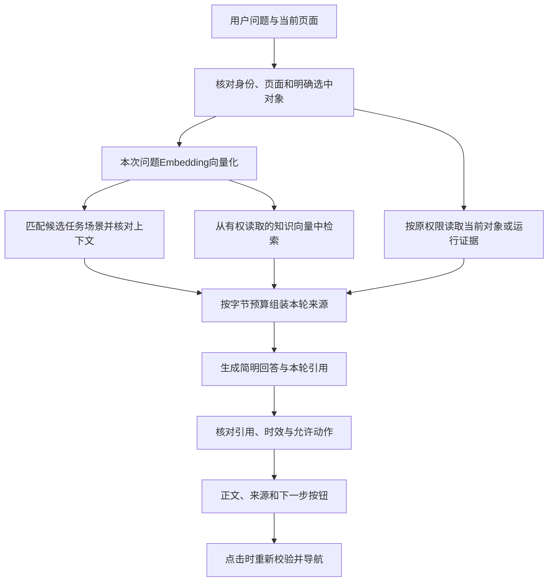

# 助手知识检索与自然回答设计

2026-11-16实施更新：P04-R1—R4首版已接入本地实际助手，39知识/12场景与正式向量、引用已接线，详见[实施验收](../../acceptance/COPILOT-RAG.md)。下文保留设计v0.2时点，“未实现/未索引”不覆盖本条。原12文档候选未全部人工核对发布，实际运行语料另列于app/copilot/knowledge.json。R5独立参考/真人效果未完成，云端未更新。

2026-11-16 · 设计稿 v0.2 · 对应规划 v1.73 / P04-R1—R5。**本稿定义下一轮实现；尚未接入平台、建立索引、调用模型或验证效果。**

用户已明确助手不使用BM25，改用语义向量RAG。本版覆盖v0.1的关键词检索选择，旧设计原字节保存在本地审计；现有业务Agent的历史检索实现保持原样。

目标是让用户看懂当前问题、能查依据，并明确下一步做什么。用户补充要求采用细致的引导式回复，助手需从问题识别相应任务场景。首版继续使用当前助手与导航体系，新增独立的操作知识检索与场景引导。旧P04封存、T19结果和业务Agent检索不作为这次新效果结果。

## 1. 已核对的现状与设计决定

| 现有能力 | 本次设计 |
|---|---|
| SourceTools按身份/当前页面提供指南、选中对象、运行证据、比较条件 | 增加服务端绑定问题的操作知识检索；维持原对象/工具范围 |
| guidance/catalog.json是页面、术语、动作的共同来源 | 从同一目录提取知识；按钮名称与路径仍由原目录提供 |
| 预约业务KnowledgeRetriever有冻结的中文BM25、词典与时效规则 | 助手新建独立语义向量RAG；不复用或修改原业务检索、词典、P05题目或原成绩 |
| 回复是带引用的facts/possible_causes/missing_evidence/next_steps/action_ids | 保留审计结构；默认以简明正文、紧邻引用和一个主要下一步呈现 |
| 原回执/usage/请求键/未知防重、对象绑定、会话配置指纹已存在 | 复用原请求链；知识版本纳入新配置指纹，旧会话和回执保持原样 |

首版采用Embedding语义向量检索，再由现有助手结合命中原文回答；不使用BM25、关键词融合或隐式关键词回退。Embedding模型负责把文字转为向量，原对话模型负责解释与指引，两者分别记录模型配置和用量。小知识量先用本地持久化向量矩阵与精确余弦检索，不新增常驻向量数据库或本地Embedding推理进程；重排序待新问题验证后再决定。实施时核对实际配置，不在设计阶段更换对话模型或调高随机性。

## 2. 两类信息各自负责什么



操作知识解释用途、流程、术语和排障方法；运行工具说明当前是否排队、有没有执行、业务发生了什么。历史案例始终携带历史身份，不充当当前平台状态。来源冲突时保留差异：例如文档说明某项能力应可用，但当前检查失败，则解释检查结果，给排障下一步，不宣称正常。

问题处理按实际需要组合：

| 问题 | 取证顺序 | 回答目标 |
|---|---|---|
| “怎么开始测试？” | 当前页指南＋操作知识 | 解释当前要做的一步，给现有导航 |
| “这条用例测什么？” | 当前已审核dev用例完整结构＋必要术语 | 先分析声明条件，真实执行状态单独说明 |
| “为什么这次没跑起来？” | 当前页面允许的运行证据＋排障知识 | 只确认有证据的阻塞项；需要其他页检查时导航过去 |
| “完成了就是成功吗？” | 结果语义知识；已选运行则再查规则/业务事实 | 分清结束、规则与业务目标，不合成权威总分 |
| “那下一步呢？” | 同对象最近讨论仅作语境＋重新读取的本轮来源 | 承接当前任务，给最新可用动作 |
| 无资料、无对象、目标含糊 | 返回可知范围；必要时问一个关键问题 | 不以最高分片段硬凑结论，也不只说不知道 |

这不是一个自动放宽工具权限的意图分类器。现有read_environment仅在环境页可用，设计不让别的页面借知识检索调用它。独立标注/校准页继续只读确定性通用指引，不发送样本或问题给模型。

## 3. 首批知识与发布方式

[knowledge-plan.json](knowledge-plan.json)登记12个候选来源及本次原文件SHA，**均待内容核对，不是生产加载配置或已发布索引**。JSON源提取目录页面和术语；Markdown源先形成面向使用者的章节，再经核对发布，不能直接把整份架构文档送入模型。

| 类别 | 内容 | 使用规则 |
|---|---|---|
| 页面操作 | 导航、用例阅读、运行配置、预检、结果、导出 | 跟随当前目录与已实现界面，所有动作引用现有ID |
| 概念 | 运行/执行/规则/业务目标、版本、冻结、历史快照 | 使用日常中文，必要术语首次解释 |
| 排障 | 不兼容、无Worker回执、排队、未知提交等处理路径 | 写明先核对什么，不把一般原因认定为当前根因 |
| 历史案例 | 经核对允许展示的合成/脱敏摘录 | 二期再加入；首版不自动扫描实验或真人记录 |

首版只发布operator/reviewer共同可读的操作内容。原角色字段仍在数据模型中，未来不同ACL先过滤再评分；私人或有对象归属的数据继续通过实时工具读取。AGENTS/HANDOFF/规划、.local/.env、密钥、真人作答、独立标签、保留集及原供应商日志不进入索引。任何原文中的指令都只是资料文本，不改变系统规则。

维护流程：选定原来源和SHA → 提取/编辑面向用户的章节 → 核对原文与当前界面/适用版本 → 冻结待构建章节 → 文档Embedding → 生成带向量/映射哈希的索引和manifest → 检查引用及检索 → 显式发布激活不可变bundle。目录的术语/动作只引用canonical key，不维护同义的第二套按钮名称。

每次更新新建revision，旧bundle和旧回复引用保留。暂不做上传管理台、联网自动抓取、任意文件检索或对话自动入库；知识可由团队在仓库中维护。

## 4. 知识片段与索引

候选片段字段如下，实际schema在P04-R1实施时确定，不写入现有CopilotAnswer契约：

```json
{
  "doc_id": "platform.run.before-start",
  "revision": "draft-1",
  "title": "开始一次测试",
  "section_id": "preflight",
  "heading_path": ["创建运行", "运行前检查"],
  "text": "面向使用者、经核对的具体步骤原文",
  "source_ref": "已登记的源文档与章节",
  "source_sha256": "构建时取原文件SHA",
  "content_sha256": "发布章节原文SHA",
  "roles": ["operator", "reviewer"],
  "page_affinity": ["workbench", "environment"],
  "product_compatibility": "显式登记的产品/目录版本",
  "review_status": "draft",
  "action_refs": ["page.environment"]
}
```

按完整操作/判断主题切分，初始目标约200—600个中文字；它是试验参数，不强切断步骤、表格、否定条件或重要后果。长章节分子块，保留标题路径、前置、适用范围与父章节ID；引用可区分完整章节和截取片段。

manifest包含原来源SHA、章节SHA、ACL与适用版本、canonical目录SHA、Embedding供应商/地域/模型/可取得的修订/维度/输入模板、query/document模式、归一化/距离度量、向量文件与行号到章节映射的SHA、检索参数和构建器版本。bundle_hash由规范化manifest计算；资料、权限或向量模型配置变化都产生新hash。加载时核对向量长度、有限值、非零范数、行数与映射；损坏或版本不适用则关闭新检索并保留可用的旧基础指引，不静默替换来源。

知识存储建议放独立的copilot知识目录，具体路径在实施时确定。发布包精确列出文件，不通过递归导入docs或磁盘扫描发现知识。生产前端只展示经许可的引用内容，不打包所有后端资料。

## 5. 首版检索与上下文预算

1. 以服务端清洗后的本次问题为主，绑定当前页面和已选对象类型。最近两轮仅用于理解代词，不当事实，不读取其他对象/账号的讨论。
2. 先按已发布状态、角色、适用产品版本过滤。页面相关性用于提升排序，不能硬过滤掉必要的跨页操作。
3. 将清洗后的本次问题以query模式转为向量，文档按固定标题路径＋章节原文模板以document模式建向量。保留原问句、否定、错误码和标识，不依赖人工同义词替换。两端固定同一Embedding模型/维度与兼容配置，不能把旧模型文档向量和新模型问题向量混用。
4. 对已通过角色/版本过滤的候选向量做L2归一化后的余弦相似度检索；页面相关性只在已达到相关性要求的近似并列候选中作为稳定次序参考，不将关键词分数混入语义分数。初选不超过8块，去重后通常取1—3块。相关性/分差/拒答参数使用新开发问题确定，不先写死“0.7就是有答案”，也不把余弦相似度当回答正确概率。
5. 没有实质匹配、版本冲突或所有候选都不适用时，返回明确no_match/version_mismatch，不把“排名第一”当作答案。向量服务失败返回embedding_unavailable，不假称无匹配，也不回退到BM25。首版每问正常最多一次query向量请求，失败不隐式重发；生成仍最多3调用，Embedding与生成共享原120秒总截止，不能用预取绕过时限。索引文档向量请求在离线构建中另计。
6. 新知识片段总预算初始最多4800 UTF-8字节，且服从原32768序列化请求字节上限；候选数和4800均为待验证配置。组装器必须计算System、历史、工具schema、来源正文及元数据的总字节，不能简单相加各正文上限。
7. 必要系统规则和当前对象证据优先，历史先缩减，知识按相关性递减加入。加入不下时减少知识块或明确context_budget，不能静默裁掉关键前置/否定条件、伪称完整或放宽网关上限。必要资料无法容纳时说明缺口并提供原指引。

索引在同一服务进程内按bundle_hash与embedding_profile_hash缓存；首版设构建内容/片段数上限，小语料用本地持久化向量矩阵、元数据及精确余弦计算。容量和时延以实际候选章节测量后固定。后续规模需要时可换FAISS等索引实现，但保持片段映射、过滤和引用契约；首版不因此安装或部署新服务，也不宣称当前云端容量验证通过。

### 5.1 Embedding模型与调用范围

首选候选为百炼`text-embedding-v4`、初始1024维；这是待接入验证的设计配置，不是账户/地域权限或中文召回效果已通过。已有语音Key不自动证明具有Embedding权限；实施时核对现有账户的地域/业务空间/可用接口，凭据仍从私有配置进入内存，文档不写Key。

对已审核的帮助章节批量生成document向量；用户明确询问时才生成本次问题query向量。保护页、未授权身份或无可用知识范围时不发送Embedding请求；私人运行记录、真人答案和独立标签不送入Embedding库。所有请求含独立模型名、用途、输入摘要hash、回执/usage/失败记录，建库与在线问题用量分开，不混为对话模型token。此次修订不发请求、建账本或使用语音额度。

在线Embedding纳入同一原问题request_id的持久尝试记录：已有向量结果复用原结果；状态未知先查原记录，不把原问题再发一遍。缓存绑定实际输入hash、身份范围与Embedding配置，不能跨模型或知识版本冒用。模型/维度或输入模板改变必须重建兼容索引；供应商若不提供不可变修订则显式记录限制，固定探针发现明显向量漂移时停用旧索引并重新核对，不能仅以模型名相同保证向量空间长期不变。

## 6. 接入现有助手

计划新增内部知识读取方法，查询来自服务端本轮question，角色/页/对象来自原绑定；模型不传路径、其他对象ID或任意过滤条件。可在ask中预取，使常见知识问答无需额外一轮模型选择工具。现有SourceTools全是空参数工具，接入应显式区分预取与invoke白名单，不悄悄放宽现有参数校验。

每个最终知识块生成本轮独立source，除原source_id/hash/locator/时间外，增加source_kind=knowledge、doc_id/revision/section_id/bundle_hash、匹配原因和截断状态。对象/运行来源分别标成声明或运行观察。新增source类型需同步前端types与CopilotSourceContent，不能仅塞进通用JSON展示。

无匹配、版本冲突或上下文不足也生成本轮检索状态source，source_kind=retrieval_status，记录实际检索范围、bundle/过滤条件和状态。它只能支持“本轮在该范围没有找到资料/没有纳入片段”等检索事实，不能证明功能不存在、业务失败或某个操作正确。保留现有必需引用约束；关键追问可用原missing_evidence字符串表达，next_steps可为空，不为满足schema伪造文档来源。

首版继续采用原60秒来源快照与回执机制，知识不可变版本另存，不修改旧来源过期校验或延长运行观察时效。历史回执展示原引用，当前动作仍要重新核验。整份引用存在及hash校验仍只证明来源绑定，不证明语义支持。

新knowledge bundle_hash、embedding_profile_hash、检索参数和回答策略加入助手配置指纹。旧会话按现有版本漂移流程拒绝继续；已交付的前端历史讨论仅在当前页面内存中可只读查看，刷新不保证保留，旧回执不重写。当前服务端read_turn也调用load，源码变化后可能409，不能假定旧查询接口仍可重读。实施前核对旧回执保全/授权只读快照；长期保全需明确归档，不能把前端内存当持久存储。缺失时显示不可读取，不为历史查看解除身份/对象权限或恢复旧调用。新问题新建符合当前版本的讨论。若新app内文件导致全局源码/Worker指纹变化，实施须另行处理兼容版本与实际就绪，设计本身不登记版本或更新Worker。

## 7. 自然回答与下一步

采用[场景识别与引导式回复](guided-replies.md)，[12类场景草案](scenario-plan.json)覆盖开始使用、理解用例、创建测试、环境排障、进度、结果、依据、版本、比较、导出、复测和接入。问题语义为主，当前页/明确对象/同对象讨论辅助；场景仅帮助选取可用资料与回答路径，不放宽工具权限。一次query向量可复用于场景描述和知识检索，不额外增加一轮意图分类模型调用。未匹配或目标互斥时澄清一个关键点，不承诺任意问题都能自动解决。

回复先说当前情况，再给当前一步的明确操作、完成后应核对的区块/字段/状态，以及卡住时的对应分支。用户说找不到时缩小到具体入口，不复读整套说明；能取证的先查，确实需要本人补充才追问。第一处专业词用日常语言解释，细节来自真实已核对的界面和来源，不靠增加口号或常驻辅助说明。

保留现有CopilotAnswer的字段和每条引用，先不添加自由Markdown或由模型生成的链接。默认正文1—3段、一个最相关的下一步；复杂问题可以展开步骤，不设机械字数截断。空的原因/缺口组不渲染，不在每次回答前堆固定辅助标签。

风格规则：先回答本次问题；用简洁、温和的中文；确实看到用户卡住时说清“卡在哪、先看哪项”；把术语翻译为动作和能看到的结果；不重复寒暄、夸奖或免责声明。只讨论有依据的条件变化；面对不足，说明能确定什么、缺哪一项、怎样补齐。实际操作有费用或不可逆后果时，必要后果紧邻动作显示。

知识解释可以引用章节；当前状态判断必须引用相应本轮观察。相关检查按已见清单说明，不能用“唯一/全部”作无支持概括。示例见[examples.md](examples.md)，全部为设计合成内容，不能当模型实测或参考答案。

按钮名称来自canonical导航目录，action_refs只作为候选，与tools.allowed_actions取交集。主动作默认一项；明确多步时次要动作低层级呈现。没有许可动作时给可执行的文字下一步，不编造“重启/提交/重新运行”按钮。点击只导航，不自动问AI、付费、创建运行或确认业务。图例中的按钮只演示局部展开。

## 8. 界面草图

继续现有AC品牌、蓝色主动作、深浅主题与全局助手抽屉。结构为当前对象 → 用户问题 → 自然回复与紧邻引用 → 一项主要下一步；来源按需展开，显示资料章节或本轮观察，校验值收在details。

本次会话附四场景交互草图：用例讲解、操作受阻、结果查证、资料不足。使用一个场景选择器切换，不增加实际产品常驻教学栏；按钮打开草图中的相关原文，明确为示例数据。草图不读平台、无模型或网络请求，不代表新增真人入口。手机可单列，键盘可切换、展开和关闭；错误/未知不能只用颜色表达。

等待状态只展示后端已确认的阶段，知识命中数量来自实际返回；不伪造打字速度或随机停顿。首版可保留现有通用忙碌提示，细分阶段要新增真实进度事件后再做，不把设计动画当取证进度。

## 9. 拆分实施与验收

| 编号 | 实施产物 | 验收重点 | 当前状态 |
|---|---|---|---|
| P04-R1 | 核对首批操作章节、Embedding配置和不可变manifest | 来源/版本/角色/导航绑定清楚，公开内容与私有数据分离 | 设计完成，内容核对与实现未开展 |
| P04-R2 | 文档/问题Embedding与独立向量检索 | 中文口语/精确码、无答案、模型空间一致、版本/ACL、坏索引和向量接口失败 | 设计完成，未实现 |
| P04-R3 | 向量预取、候选场景/上下文核对、引导式回答与配置指纹 | 场景适用、当前步骤/预期/卡住分支、字节上限、本轮引用与防重 | 设计完成，未实现 |
| P04-R4 | 原抽屉知识引用、主要下一步及按场景追问 | 操作具体、键盘/手机/主题、追问仅填草稿、不自动付费或写入 | 原合成交互草图保留，生产与新增引导交互未实现 |
| P04-R5 | 新任务/新来源冻结和效果记录 | 检索命中、引用支持、动作有效与真人完成分别记录 | 验收方法已设计，问题未编制/冻结/执行 |

按R1→R2→R3→R4→R5实施，R1/R2可先用明确向量替身做免费机械控制；真实Embedding建库/查询与生成分别计量，替身不能证明语义召回。R3/R4可用明确替身验证管线，随后用新问题核对真实向量检索与回答。重排序依据实际新问题再决定；不加入BM25融合或回退，不扩为P06或T24。

新检索开发集建议覆盖操作、概念、排障、口语、无答案、权限/版本和文档与状态冲突；题数在编制时确定。先冻结问题和应见来源再执行，调优题与后续效果题分开。逐题记录命中块/额外块/拒答与时间，不拿P05原18题改成绩。

真实模型检查另记录来源、原输出、usage和失败，不以结构校验替代语义。真人使用记录判断、引用位置、下一步是否完成及求助；未观察不填0，实现者样本不冒称独立金标准。旧U01/P04-P01仅已知问题来源，不重跑后称独立提升。

用户已授权P04累计金额/次数不限；后续真实调用需明确新版本/新任务的记录绑定，保留原账本/nonce和每请求资源/未知守卫，不重开原冻结轮，也不重复索要已明确的累计预算。本次只设计，不建立任何新真人/模型轮或预算。

## 10. 本轮范围和参考

本轮只新增设计文件、交互草图并更新规划/交接。未修改app、Prompt、原词表/知识、数据库、Redis、预算、服务或云端，不登记对象版本，不运行模型、真人题、Git或赛事包。T22/T23继续团队接管，T24未触发。草图和设计核对不当平台功能验收。

资料参考与本项目推导分开：

- [Anthropic Contextual Retrieval](https://www.anthropic.com/research/contextual-retrieval)：借鉴保留块上下文和重排序需评估，不套用其改善数字；其混合检索建议不覆盖用户明确的纯向量选择。
- [百炼文本向量同步接口](https://help.aliyun.com/zh/model-studio/text-embedding-synchronous-api)：核对候选text-embedding-v4/1024维及query/document输入类型，账户与地域仍待实际核对。
- [FAISS距离说明](https://github.com/facebookresearch/faiss/wiki/MetricType-and-distances)：参考归一化后内积与余弦相似度的关系；不表示本轮安装FAISS。
- [Google对话语言指南](https://developers.google.com/assistant/conversation-design/language)：借鉴简短、常用词和自然语气；具体按钮定位仍由本项目实时目录提供。
- [微软RAG设计与评估](https://learn.microsoft.com/en-us/azure/architecture/ai-ml/guide/rag/rag-solution-design-and-evaluation-guide)：借鉴按分块、检索、生成和用户结果分别评估，不需要采用Azure服务。
- [Anthropic官方Cookbook](https://github.com/anthropics/claude-cookbooks)：后续实现可参考检索与工具调用示例，不引入其整套依赖或更换当前模型。
