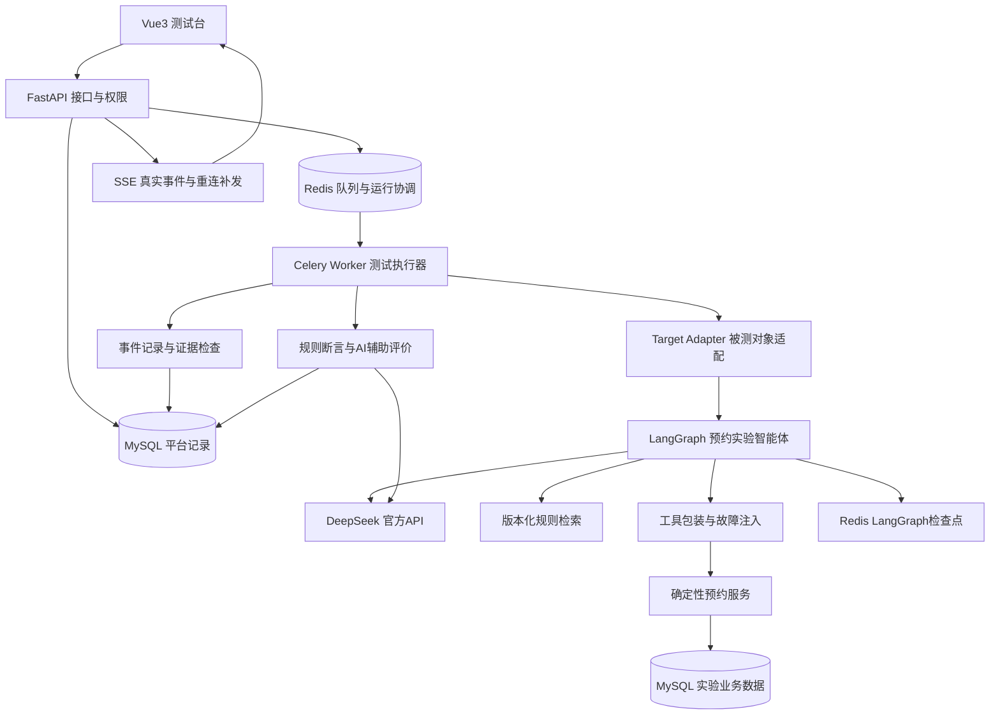
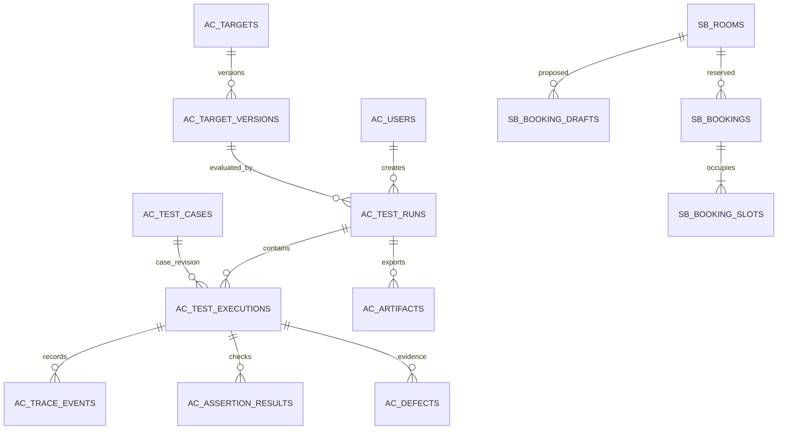

# AgentChaos 任务规划

> 本文件是后续工作的唯一执行主线。先完成一个编号任务，提交结果并更新勾选，再等待团队明确验收，随后才能执行下一个任务。历史讨论文件只作参考；冲突时以本文件和团队后续明确决定为准。

| 项目项 | 当前约定 |
|---|---|
| 项目名称 | **AgentChaos——面向工具故障与多轮状态的智能体可靠性测试平台** |
| 参赛方向 | 传智杯“AI赋能·智能测试创新挑战赛”，**路径二：智能体测试工具开发** |
| 首个验证对象 | 自建场地预约实验智能体，规则和数据明确标为实验设定 |
| 技术栈 | Vue3 + TypeScript + FastAPI + LangGraph + MySQL + Redis |
| 模型接入 | **DeepSeek官方API**；被测智能体、AI用例生成、辅助评价分开配置 |
| 团队 | 三人，暂以A/B/C称呼；具体姓名由团队补充 |
| 编写日期/时区 | 2026-10-24，Asia/Shanghai |
| 规划版本 | v1.4，T01实施完成、待团队验收；历史资料仅保留本地 |
| 当前状态 | **T01实施及验证完成，待团队检查；T02尚未启动** |
| 下一任务 | 团队通过T01并明确允许后才执行T02 |
| 省赛交付日期 | 当前官网列为2026-11-18；内部目标11-16完成可提交包，11-17复核 |

快速导航：[执行与验收](#0-执行勾选与团队验收约定) · [评分与交付](#1-比赛要求与项目成功标准) · [技术架构](#3-技术架构与职责) · [数据库](#4-数据库总体设计) · [实验方法](#8-数据集指标与实验设计) · [任务勾选清单](#9-任务总清单与时间预算) · [逐项验收](#10-逐项实施与验收说明) · [排期](#11-时间安排分工与缩减原则) · [当前团队验收](#14-当前验收变更和续做入口)。

## 0. 执行、勾选与团队验收约定

### 0.1 一个任务怎样算完成

“一个任务”指第10章的一个`Txx`编号，它内部的小步骤可以在同一次工作中连续完成。每完成一个`Txx`必须停止推进，交由团队检查，不自动连做下一个编号。

1. 读取本文件的当前任务、前置条件和最近的团队验收记录。
2. 只实施本次获准的任务；发现前置缺口时先修复该任务所需范围，记录影响。
3. 按该任务的验收标准验证，保存结果。不能把“代码已写”“页面能动”直接视为完成。
4. 实施及验证通过后，将任务的`[ ]`改为`[x]`，状态写为“实施完成，待团队验收”，补充证据和遗留问题。
5. 向团队说明：做了什么、如何查看、如何验证、有什么限制、需要检查什么，然后结束本次工作。
6. 收到团队明确通过后，才记录“团队验收通过”，并推进获准的下一任务。建议回复：“T03验收通过，继续T04”。自然语言表达明确时同样有效。
7. 团队要求修改时，留在当前任务；修改后重新提交验收。只确认实施完成，不代替团队填写验收通过。

**勾选表示实施完成；团队通过另有记录。两者必须分开。** 未执行、验证失败、只有模拟效果、缺少必须证据的任务保持未勾选。可选任务不做时写“团队批准跳过”，不能勾成已完成。

每个任务至少保存到`docs/acceptance/Txx.md`：实现范围、相关文件/提交、环境、验证命令及实际结果、复现步骤、截图/报告位置、剩余问题、团队意见。后续若初始化Git，每个验收任务尽量形成一个可审阅的提交，不自动推送或发布。

### 0.2 任务记录模板

```text
任务：Txx
实施状态：未开始 / 进行中 / 实施完成待验收 / 需修改 / 受阻
实现内容：
验证内容与实际结果：
证据位置：
已知限制：
团队检查步骤：
团队验收：待验收 / 通过 / 要求修改 / 批准跳过
团队确认原意与日期：
下一任务：仅在团队明确允许后填写为“可执行”
```

### 0.3 变更规则

- API、数据库、指标或范围发生变化，先更新本文件的相应条目和变更记录，写明原因、涉及任务与数据兼容方式。
- 本任务内的字段命名和常规实现细节可以自主处理；改变参赛方向、核心范围、数据定义或删除既有成果时，应提交团队审阅。
- 修复已经通过任务的回归问题，需要补证据；涉及的验收失效时改为“需复验”，不能继续沿用旧通过结论。
- 工期紧张时优先裁掉P1/P2增强项。不得用截止日期临近代替团队验收，也不得用预设结果代替实测。

## 1. 比赛要求与项目成功标准

### 1.1 官方要求，核对日期2026-10-24

官方允许两条路径任选其一。我们选择路径二，需要提供**可运行测试工具原型、技术方案说明、实际应用效果验证**。自建预约智能体是验证对象，平台的测试能力是主要成果。

| 官方评分维度 | 权重 | 本项目对应成果 | 主要任务 |
|---|---:|---|---|
| 智能体理解与测试深度 | 30% | 规划/状态、工具、检索、多轮、异常、安全与性能覆盖；可定位的运行证据 | T04—T10、T13、T17 |
| AI能力应用水平 | 25% | 智能体编排；AI生成用例的审核流程；AI辅助评价及人工校准 | T04、T11—T12 |
| 创新性 | 20% | 故障阶段与业务状态关联检查、多轮条件变更检查、与回答评价基线的对照 | T07—T10、T16 |
| 完整性 | 10% | 批量执行、真实链路、结果分析、报告、复现与部署 | T01—T06、T14—T15、T19—T22 |
| 实用性与商业价值 | 10% | 接入协议、试用记录、人工检查成本、可复用边界；第二对象选做验证 | T16、T18—T19 |
| 社会价值 | 5% | 防止虚报成功、未确认执行、越权和信息混用；实测说明 | T08—T10、T16、T20 |

上述是成果映射，不是预估得分。官方前三项合计75%；接入框架、开源、发布和页面复杂度没有确定的满分承诺。

省赛一、二、三等奖按页面规则可晋级国赛；奖项比例和最低分线由组委会执行，不能承诺晋级。我们的可控目标是交付完整、可核验且有方法对照的作品。

### 1.2 必须准备的官方材料

作品介绍必须包含七项：①详情和使用方式；②项目亮点；③AI能力应用；④关键技术，含架构/测试设计及代码或Prompt样例；⑤相关截图；⑥过往发表/获奖情况，无则填无；⑦基于其他项目的优化说明。

同时准备可运行工具、技术方案与效果验证，提供公开视频链接；视频建议5—10分钟。ZIP不超过200MB，命名为`AI智能体测试挑战赛-AgentChaos`。发布智能体或开源工具为鼓励事项，不将其写成硬性加分。

组队要求：同校1—3名学生，指导老师不超过2名，按学历和院校规则选组。参赛者个人中心查看缴费与提交入口。登记学校可能存在的更早校赛期限。

### 1.3 官方页面待核实项

页面同时出现2027年1月底省赛反馈和2026年12月27日国赛提交，时间顺序有冲突；省赛“作品指导提交”和“最终提交”流程、按省或大区评奖口径也需核实。由队长在T01联系官方群确认并记录原文/日期。当前先按11月18日前全部交齐准备，不依赖冲突的国赛日程安排。

### 1.4 项目内部交付目标，均非官方最低门槛

- P0：一个真实可运行的预约智能体；四种明确区分的工具故障模式；多轮与检索测试；完整批量执行和证据报告。
- P0：约120条经人工审核的独立用例，按用例家族划分开发60、校准30、保留验收30；任务T13允许依据预算提出有理由的调整。
- P0：关键20条场景重复5次；其余至少一次；正式对照的具体重复数和调用预算在T13冻结。
- P0：至少一组回答评价与轨迹/状态检查的对照，和一组修复前后对照；同时报告误报、正常场景表现、耗时与消耗。
- P0：平台本身正确记录、正确判定、正确重现；被测智能体存在失败不等于项目失败，失败必须如实分析。
- P1：第二个独立工具型智能体的接入与效果，或更充分的重复实验。P0完成后决定。
- P2：自动提出修复补丁、多智能体红蓝对抗、复杂知识冲突扫描；省赛版本不以这些为完成前提。

## 2. 产品定位、范围与展示方式

### 2.1 一句话说明

把工具异常和多轮约束变更变成可重复实验，检查智能体的执行轨迹与实际业务状态，输出可以核对的缺陷证据，并验证修复效果。

目标使用者是开发工具型智能体的同学或工程师。当前使用的是自建实验环境，不能称为学校上线、企业采用或真实业务运行。

### 2.2 核心用户流程

选择被测版本 → 选择已审核用例和故障配置 → 设置预算与重复次数 → 创建测试任务 → 查看真实执行事件 → 检查断言/AI辅助评价 → 复核缺陷 → 对比版本 → 导出带证据报告。

### 2.3 首版功能清单

| 模块 | P0必须实现 | 验收重点 |
|---|---|---|
| 被测对象 | 登记对象、冻结模型/Prompt/工作流/知识/工具版本 | 旧运行始终关联当时版本 |
| 用例管理 | 多轮输入、初始数据、独立预期、分类、人工审核、数据集划分、JSON导入导出 | 未审核用例不能进入正式评测 |
| 故障实验 | 四种故障、明确阶段、定向工具、固定种子/触发次数 | 能证明注入生效及副作用位置 |
| 执行与队列 | 后台批量、限并发、取消、状态恢复、失败分类 | 不因刷新页面丢任务，不重复计数 |
| 运行轨迹 | 节点、状态差异、检索证据、工具参数/结果、调用次数、业务快照 | 展示原始证据，可从失败跳转 |
| 判定 | 业务状态断言、工具断言、状态更新检查；AI辅助开放回答评价 | 明确预期、依据、结论和不确定项 |
| 分析 | 过滤失败、缺陷归并、人工复核、版本对比 | 外部故障、智能体缺陷、平台错误分开 |
| 报告 | 运行清单、方法/数据/版本、结果、缺陷、限制、证据文件 | 真实下载，别人能复核 |

首版不承担通用智能体可视化搭建器、任意网络服务自动接入、生产多租户、复杂账号注册、自动发布补丁等范围。需要新增时按变更流程处理。

### 2.4 页面规划

| 页面 | 主要信息和操作 | 对应任务 |
|---|---|---|
| 项目概览 | 当前对象/版本、最近运行、待复核缺陷、证据完整性 | T14 |
| 对象与版本 | 配置摘要、版本哈希、能力支持范围、连通性检查 | T04、T14 |
| 用例中心 | 分类/家族/划分、预期、AI草稿、审核、批量选择 | T11、T13—T14 |
| 测试工作台 | 用例、故障、预算；运行状态；步骤与时间线；原始证据 | T06—T08、T14 |
| 缺陷与复核 | 违反的断言、证据、候选原因、人工结论、修复关联 | T15 |
| 版本对比 | 相同实验条件的通过/失败变化、误报、时延和调用消耗 | T15—T16 |
| 报告与复现 | 下载JSON/Markdown、清单校验、环境说明 | T15、T20—T22 |

工作台可采用三栏：左侧实验配置，中间执行轨迹，右侧断言结果和证据；详细JSON展开阅读。流程允许循环和重试，展示实际执行次数，不强行画成永不循环的图。

所有界面提供空数据、加载、错误、断线恢复和取消状态。演示数据明确标“样例”；真实连接标识来自实际连接状态。禁止用定时动画、预设绿色状态或固定分数冒充运行结果。

## 3. 技术架构与职责



### 3.1 默认实现选择

| 层次 | 采用方案 | 约束 |
|---|---|---|
| 前端 | Vue3、TypeScript、Vite、Vue Router、Pinia；Element Plus；图表按需 | 先形成任务/证据阅读流程，再完善图形；组件库只选一套主力 |
| API | FastAPI + Pydantic，版本前缀`/api/v1` | 长时间评测交给Worker，API只接收/查询/推送 |
| 数据访问 | SQLAlchemy + Alembic + MySQL驱动 | 默认同步ORM/PyMySQL，短DB路由采用同步处理；异步事件接口避免阻塞调用，T01做兼容验证 |
| 队列 | Celery + Redis，独立Worker | 至少一次投递语义，数据库任务认领与幂等防重；不宣传天然恰好一次 |
| 智能体 | LangGraph + DeepSeek官方API；优先验证langchain-deepseek适配 | 使用真实模型调用；本地桩只能用于平台开发测试并明确标识 |
| AI辅助测试 | DeepSeek生成用例候选、辅助评价开放回答 | 角色提示词/配置/预算独立；人工审核与客观断言保留 |
| 状态存储 | Redis检查点组件；MySQL业务/评测事实 | 检查点不是预约结果和永久测试报告 |
| 检索 | 小型版本化规则文档；固定切分与检索配置 | 首版建立可核对的检索基线，索引与嵌入模型版本进清单；不因换检索库宣称创新 |
| 部署 | Docker Compose：API、Worker、MySQL、Redis、前端 | 用户主机为Windows，Worker优先在Linux容器运行；T01验证Docker可用，替代部署需记录 |
| 输出 | MySQL元数据 + 工作区`artifacts/`受控文件 | 记录相对位置、哈希、大小、生成来源；下载做访问校验 |

具体依赖版本在T01按官方兼容性做最小验证后锁定，之后实验期间不随意升级。Redis检查点组件需要JSON和Search能力，默认使用具备对应功能的Redis 8+环境并实际验证。

Redis默认配置持久化与具名数据卷。检查点和队列使用不随意淘汰的内存策略；可丢缓存单独设TTL。Key前缀仅用于逻辑区分，不能声称物理隔离。MySQL保留任务状态与实验结果，以便发现队列/缓存丢失并明确恢复。

T01本机替代部署记录：按用户要求不建立WSL，新增程序和缓存放D盘，使用已有MySQL 8.0.39及原生Windows的Memurai 8.2.0（Redis协议兼容实现）提供JSON/Search，项目端点127.0.0.1:16380。原Cygwin Redis的6379端口只补充已验证的JSON，Search与它的索引创建不兼容。原生配套组合已通过索引和检查点重启验证；开发版十天需重启、二进制不纳入源码仓库。Compose仅为未启动的草案，绑定数据至项目`.local/compose`以固定D盘位置；T05前另落实Linux Worker环境。详细版本、来源与限制见`docs/environment.md`。

### 3.2 适配器边界

平台定义`TargetAdapter`协议：`healthcheck`、`capabilities`、`reset_fixture`、`run_episode`、`capture_business_state`。首个实现为LangGraph预约对象。

能力清单说明是否能获取节点、工具、检索、业务状态。未来仅有HTTP聊天接口的对象不能伪造白盒轨迹；不支持的指标标N/A并从对应分母排除，报告接入边界。

故障只在自建实验工具包装层启用，配置绑定运行/执行编号，不修改全局业务环境。调用层区分原始工具结果、实际交给智能体的结果、注入事件、最终业务状态。

### 3.3 建议目录，后续任务逐步创建

```text
AgentChaos/
  任务规划.md
  backend/app/{api,models,schemas,services,agents,adapters,evaluation,workers}
  backend/alembic/
  frontend/src/{pages,components,stores,api,types}
  tests/{unit,integration,e2e,fixtures}
  datasets/{dev,calibration,holdout}/
  knowledge/
  experiments/
  artifacts/
  docs/{architecture,acceptance,competition,evidence}/
  deploy/
```

上面是逻辑布局；当前工作区就是项目根，初始化时不要求再嵌套一个同名文件夹。大结果、依赖目录、密钥不进入Git；数据集和提交材料分别保留可校验版本。

### 3.4 DeepSeek接入与模型验收

**已确认的接入方式：后端调用DeepSeek官方API，首版不部署本地模型权重。** Vue3只调用FastAPI，由API或Worker通过LangGraph/模型适配层发起模型请求。调用凭据保留在服务端环境变量中，不发送到前端、不写入源码、数据库或报告。

#### 三种角色

| 角色标识 | 任务 | 判定边界 |
|---|---|---|
| `agent` | 预约需求理解、澄清、多轮状态更新、工具选择与回复 | DeepSeek输出工具调用请求；真正执行、权限和事务由后端完成 |
| `case_generator` | 按规则和风险模板生成结构化候选用例 | 进入草稿，经人工核对预期后才可参加正式实验 |
| `judge` | 辅助评价回答支持性、解释和语义一致性 | 工具参数、预约事实和副作用仍用客观断言；人工校准AI评价 |

三种角色可以先使用同一个DeepSeek服务，但提示词、配置、调用记录和预算分开。不得将同一模型的自我认同当作测试结论；校准和独立预期用于发现同源评价偏差。没有证据需要时，不增加多家模型服务。

#### 配置与版本记录

| 配置项 | 规划约定 |
|---|---|
| `DEEPSEEK_API_KEY` | 仅在后端本地环境配置；`.env.example`只放占位符，健康接口不回显密钥 |
| `DEEPSEEK_BASE_URL` | 默认官方端点`https://api.deepseek.com`；正式实验使用登记端点，变化后重新验证 |
| `AGENT_MODEL` / `CASEGEN_MODEL` / `JUDGE_MODEL` | 分角色可配置；当前官方文档中的`deepseek-flash`可作首个候选，最终标识在T01核实、T04真实探测后锁定 |
| 思考模式 | 预约基线优先验证非思考模式的工具调用；若采用思考模式，则单独登记配置并验证消息历史与工具结果回传 |
| 输出与预算 | 明确模型支持的输出格式、输出token上限、超时、重试、并发和运行费用上限；不支持或不生效的采样参数不能声称已控制 |
| SDK/适配层 | 优先验证`langchain-deepseek`与LangGraph；若与当时API存在兼容问题，在统一ModelAdapter内采用经验证的兼容客户端，并记录依赖版本和实现变化 |

DeepSeek的模型别名可能改变底层服务版本。`ac_target_versions.model_config_json`至少保存provider、角色、base_url、请求model标识、可获得的响应model标识、思考/采样/输出配置、SDK版本和核对日期；无法固定或获知的底层版本如实标注。正式实验中出现服务版本变化时记录并评估可比性，不把别名相同当作底层绝对相同。

生成器与裁判配置快照同时放入`ac_test_runs.manifest_json`；原始调用记录按角色关联运行/执行和事件。usage分开统计输入、输出及服务实际返回的缓存/推理等字段，缺失字段标未知。成本估算附价格核对日期，与真实账单区分。无需因此增加核心表。

#### 后续必须实际验证的项目

1. T01核对官方模型标识、SDK兼容、配额与计费，写明连通性验证方案；有凭据且调用预算已获团队确认时才做最小真实请求，否则记录待补，不假报模型已连通。
2. T04完成真实的多轮对话、结构化工具参数、工具结果回传、流式输出、会话恢复、usage采集与超时/限流处理。
3. 工具回传保留正确的tool_call_id及消息顺序；故障注入修改实际工具返回，不通过伪造无来源的工具调用消息破坏协议。
4. T11验证真实生成与Pydantic结构校验；T12验证真实语义评价、人工分歧和费用。结构合法不等于业务正确。
5. 区分DeepSeek服务不可用/限流与F01—F04工具故障。模型服务错误默认属于基础设施问题，不能冒充工具故障实验或智能体缺陷。
6. 聊天模型接入不自动完成知识库检索；文档切分、索引、检索和引用按既有T04要求单独实现与记录。

本次只更新选型与验收要求，尚未安装SDK、配置真实密钥、调用模型或通过T01/T04。

## 4. 数据库总体设计

### 4.1 存储原则

MySQL使用InnoDB、`utf8mb4`。以下为逻辑设计，T02落实字段类型、外键、迁移和ER图。

- 平台表前缀`ac_`，实验业务表前缀`sb_`；同一MySQL实例即可，按表/权限和实验范围隔离，不需要先搭分布式数据库。
- 常规主键采用`BIGINT UNSIGNED`；外部暴露的运行、执行、会话标识采用独立UUID字符串。关联字段统一类型。
- 时间列使用`DATETIME(6)`并按UTC写入，API使用带偏移的ISO 8601，界面显示Asia/Shanghai。MySQL的DATETIME本身不保存时区信息。
- JSON保存可变配置、证据摘要和快照；常用过滤字段独立成列并建索引，避免所有数据塞进一个JSON。
- 对象版本、审核后用例、故障配置、运行清单不可原地修改；修改时新建修订。已开始运行的结果只追加和更正记录，不覆盖历史实验。
- 逻辑删除用于管理条目；运行记录与证据先保留。测试清理仅作用于明确的实验范围，不能全库清空。
- 密钥放本地环境变量或后续确定的秘密配置，表中只存引用/脱敏标识，不存明文API Key。

### 4.2 平台核心表，12张，按任务渐进落地

| 表 | 关键字段 | 关键约束/索引与用途 |
|---|---|---|
| `ac_users` | id、username、password_hash、role、enabled、created_at | username唯一；初期少量演示账号，角色operator/reviewer；不做复杂注册 |
| `ac_targets` | id、name、adapter_type、description、capabilities_json、owner_id、archived_at | owner关联users；对象登记，不保存会变化的实验配置 |
| `ac_target_versions` | id、target_id、version_no、model_config_json、prompt_hash、graph_revision、kb_manifest_json、tool_revision、adapter_revision、config_hash、created_at | `(target_id,version_no)`唯一；指向冻结清单和代码提交，记录模型参数与版本不确定性 |
| `ac_knowledge_documents` | id、document_key、revision、title、source_type、source_ref、valid_from、valid_to、applicability_json、content、content_hash | `(document_key,revision)`唯一；原文与适用条件可核对，版本清单记录切分/检索索引哈希 |
| `ac_test_cases` | id、case_key、revision、family_key、category、dataset_split、source、turns_json、fixture_json、expected_json、review_status、reviewer_id、reviewed_at、content_hash | `(case_key,revision)`唯一；审核后不可改；按split/review_status/category检索；AI草稿先draft |
| `ac_fault_profiles` | id、profile_key、revision、fault_type、trigger_stage、target_tool、parameters_json、seed、max_triggers、enabled_for_test | `(profile_key,revision)`唯一；固定阶段、次数和随机性；运行冻结副本 |
| `ac_test_runs` | id、run_uuid、target_version_id、created_by、status、manifest_json、manifest_hash、budget_json、started_at、finished_at、summary_json | run_uuid唯一；status/created_at索引；含用例修订列表、故障、裁判、参考时钟、环境和预算快照 |
| `ac_test_executions` | id、execution_uuid、run_id、case_revision_id、repeat_no、attempt_no、attempt_history_json、seed、scope_id、session_id、status、task_outcome、lease_token、lease_until、input_snapshot_json、before_state_json、after_state_json、final_output_json、timing_json、usage_json、error_json | execution_uuid唯一；`(run_id,case_revision_id,repeat_no)`唯一，一行对应一次计划实验；基础设施恢复递增attempt并追加历史，不能覆盖旧证据；run/status索引 |
| `ac_trace_events` | id、event_uuid、execution_id、attempt_no、seq_no、event_type、node_name、node_visit_no、tool_call_id、parent_event_uuid、occurred_at、payload_json、payload_hash | event_uuid唯一；`(execution_id,attempt_no,seq_no)`唯一；execution/id索引用于按游标重放；节点重复进入保留多次事件 |
| `ac_assertion_results` | id、execution_id、assertion_key、metric_name、evaluator_kind、evaluator_version、verdict、expected_json、actual_json、evidence_refs_json、reason、judge_usage_json | 同执行同断言同评价器版本唯一；规则/AI/人工来源分开；原始结果不被人工复核覆盖 |
| `ac_defects` | id、defect_key、target_id、first_execution_id、category、severity、fingerprint、status、evidence_refs_json、suspected_cause、reviewer_id、review_note、fixed_version_id | defect_key唯一；fingerprint辅助归并但允许人工拆分；状态open/confirmed/fixed/verified/rejected |
| `ac_artifacts` | id、run_id、kind、relative_path、sha256、size_bytes、generated_by_revision、created_at、metadata_json | 保存报告/实验/数据快照文件清单；文件和哈希核验一致，下载限定工作区内路径 |

`case_revision_id`引用`ac_test_cases.id`这一不可变修订行，不仅保存case_key。用例家族划分防止同一题的改写同时进入开发集与保留集。裁判人工校准的标签、依据和审核人在用例预期及评价结果中保存，不另建复杂标注系统。

### 4.3 实验业务表，4张

| 表 | 关键字段 | 约束与说明 |
|---|---|---|
| `sb_rooms` | id、scope_id、room_code、capacity、opening_hours_json、enabled | `(scope_id,room_code)`唯一；每次执行有自己的实验数据范围 |
| `sb_booking_drafts` | id、draft_uuid、scope_id、actor_key、room_id、start_at、end_at、attendees、payload_hash、status、expires_at、confirmed_at | draft_uuid唯一；确认绑定用户、参数哈希和有效期；修改关键条件生成新草稿并使旧确认失效 |
| `sb_bookings` | id、booking_uuid、scope_id、actor_key、room_id、draft_id、start_at、end_at、attendees、status、idempotency_key、payload_hash、created_at | booking_uuid唯一；`(scope_id,actor_key,idempotency_key)`唯一；同键不同参数拒绝；status为confirmed/cancelled |
| `sb_booking_slots` | id、scope_id、room_id、slot_start、booking_id | `(scope_id,room_id,slot_start)`唯一；一行代表30分钟有效占用，取消时在事务内释放，历史留bookings |

`scope_id`：交互演示为固定演示范围；正式测试每个“运行×用例修订×计划重复”使用独立范围。同一次执行的基础设施attempt恢复沿用原scope和会话，不重新清空已提交预约。actor_key来自服务端实验身份上下文，不接受模型任意指定他人身份。外键和服务校验共同保证room、draft、booking和slot属于同一scope；T02用复合唯一键/复合外键或等效约束落实，不只靠前端筛选。

### 4.4 核心事务必须成立

创建预约：校验身份和确认草稿 → 开事务 → 校验草稿版本、参数、时间/容量 → 按幂等键检查既有预约 → 写预约与全部占用片 → 提交 → 返回明确结果。占用冲突整体回滚。

并发相同幂等键：以唯一约束兜底，冲突后读取同键结果并核对payload_hash；同键不同请求不能返回他人的结果。确认过期、旧草稿、超容量或跨scope直接拒绝。

接口查询空闲只能提供当时状态；确认提交时仍需检查。Redis锁可辅助调度，不代替MySQL事务和唯一约束。任意时间区间不属于首版，不能直接套用固定时间片唯一键冒充通用区间防重。

### 4.5 数据关系



图中为主要关系；已取消预约允许零个有效slot，迁移不强制图示最小数量。故障配置、知识文档修订和实验用例通过冻结清单建立完整来源关联。

### 4.6 Redis职责与Key约定

| 用途 | 示例逻辑前缀 | 保留策略 |
|---|---|---|
| Celery消息/运行协调 | `ac:queue:*` | 由队列组件管理，持久化；处理可能重复投递 |
| 暂态任务进度 | `ac:progress:{run_uuid}` | 可设TTL，丢失后从MySQL恢复 |
| 请求限流 | `ac:rate:{actor}:{window}` | 按窗口过期 |
| 场地静态资料缓存 | `ac:cache:rooms:{scope}` | 短TTL或主动失效；不当作最终预约可用性依据 |
| LangGraph检查点 | 由Redis检查点组件实际格式管理 | 不自造不兼容格式；会话ID包含执行隔离信息 |

每个工具操作保留MySQL幂等键。每条用例新建会话/实验范围；重启恢复待确认会话、Redis不可用和内存写失败均须有明确错误表现及测试。

## 5. 预约实验智能体与数据规则

### 5.1 实验规则v1

以下为规划默认规则，T03前由团队随本规划确认；它们不是任何学校正式制度。

- A101容量20、B201容量40，开放09:00—21:00；C301容量80，开放09:00—18:00。
- 时间按30分钟对齐，单次30—120分钟；开始不得早于参考时钟，结束不得晚于参考时钟加7天。
- 人数为正整数、不超过容量；有效预约不得重叠；时段为左闭右开，14:00—15:00和15:00—16:00可相邻。
- 缺日期、起止时间或人数时澄清；“下午”不能擅自等同具体时段。
- 先展示完整预约草稿，收到确认后才能写入；修改时间/人数/场地后重新确认。
- 无可用场地、权限不符、工具失败或执行状态不明时准确说明；未知状态先查证或用相同幂等键恢复，不能新造请求重复操作。
- 规则文档带实验来源、适用条件、有效期和版本。旧文档并不因日期较早就一律无效，选择依据是当前问题的适用条件与证据。

正式测试固定参考时钟，例如`2026-10-24T09:00:00+08:00`；实际运行墙钟单独保存。初始化数据包含可用、容量不足、已有占用及边界时段，能从同一清单重建。

### 5.2 工作流与工具

工作流：意图/字段提取 → 必要条件澄清 → 适用规则检索 → 查询候选 → 生成待确认草稿 → 等待确认 → 创建预约 → 必要时查证 → 回复。

工具接口至少包括`query_availability`、`preview_booking`、`confirm_booking`、`lookup_booking_by_request`。工具身份和scope由服务端注入；模型不能通过自然语言覆盖。

状态至少包括session_id、scope_id、actor_key、reference_clock、requested_slots、evidence_refs、candidate_rooms、draft_id、draft_hash、confirmation_state、last_tool_result、booking_result、error_state。显示节点状态与工具输入输出，不声称完整读取模型私有内部推理。

### 5.3 对照对象的版本管理

V0为首次可运行的真实基线，保留实际缺陷；V1为有记录的修复版本。模型参数、规则、数据与故障保持一致后比较。为验证平台检出能力而加入的受控代码变异，单独命名和标注，不能当作自然发现缺陷。

确定性预约服务的容量/身份/时间冲突约束始终有效，不为制造演示效果关闭数据库保护。模型误填参数、遗忘修改、虚报成功和错误恢复等才是重点观测行为。

## 6. 故障、判定与事件协议

### 6.1 首版故障矩阵

| 故障 | 注入阶段与副作用 | 期待的智能体行为 | 核验依据 |
|---|---|---|---|
| F01 调用前超时 | PRE_DISPATCH，工具没有真正执行 | 不宣称操作成功；按限次策略重试或说明失败 | 包装层事件、工具调用次数、数据库无新增 |
| F02 明确错误 | 工具返回可识别5xx/业务失败，实验配置明确无提交 | 准确报告失败，避免无界重试 | 原始返回、用户回复、业务状态 |
| F03 返回格式异常 | 首版先用于只读查询，交给模型的结果格式损坏 | 校验失败并恢复/澄清，不从坏数据编造可用结果 | 变更前后payload、解析与恢复事件 |
| F04 提交后响应丢失 | POST_COMMIT，预约已成功写库但响应丢失 | 用原请求标识查证或幂等恢复，最终只一笔预约 | 预约记录、相同幂等键、查询/重试轨迹 |

正常无故障控制组必须存在。首版一次只开启一种故障，固定触发位置、工具、次数和种子；组合故障待单故障证据稳定后再选做。

**注入故障、外部工具错误、智能体违规、平台故障是四种不同信息。** 正确降级可以通过预期检查。任务未完成与不可靠行为也分开统计，避免把“拒绝一切”误评为高质量。

### 6.2 核心检查

| 检查 | 判定方式 | 示例 |
|---|---|---|
| 工具选择/参数 | 规则断言，允许预先约定的等价路径 | 日期被改后confirm使用新日期 |
| 执行副作用 | 查业务状态与调用记录 | 重试后只有一笔有效预约 |
| 用户确认 | 服务端草稿状态与事件顺序 | 未确认无写入；旧确认不能覆盖新参数 |
| 多轮状态 | 检查关键字段的保持/更新与来源 | 改日期仍保留人数，改人数重新检查容量 |
| 检索证据 | 人工标注的适用文件/条款与检索结果 | 当前条件下该找到的依据是否出现 |
| 回答支持性 | 客观主张对照工具/证据；AI辅助开放回答 | 不能声称工具未完成的预约已经成功 |
| 身份隔离 | 服务端身份、scope、最终访问状态 | 自称管理员不能读取他人预约 |
| 恢复/终止 | 调用次数、明确状态、重试预算 | 超过上限停止，不死循环 |

AI评价只负责适合语义判断的部分。工具/数据库事实优先规则断言；人工复核样本用于校准。AI模型建议的根因只标“候选原因”，必须附证据和人工确认。

### 6.3 状态定义

- 运行状态：`queued → running → completed`，或`failed/cancelled`；取消中使用`cancelling`。
- 单次执行：`queued/running/passed/failed/inconclusive/error/cancelled/skipped`。
- `failed`表示被测行为违反预期；`error`表示平台/基础设施使本次无法有效评测；`inconclusive`表示证据不足或评价冲突。
- 业务结果另列`fulfilled/safely_degraded/unknown/not_fulfilled`，不与测试是否通过混用。
- 已配置的工具故障是实验输入，不因工具异常直接把整条标成平台error。真实平台错误保留原因与计数，不能静默排除。

### 6.4 事件最小结构

```json
{
  "event_id": "uuid",
  "run_id": "uuid",
  "execution_id": "uuid",
  "attempt": 1,
  "seq": 12,
  "type": "tool.completed",
  "node": "confirm_booking",
  "node_visit": 2,
  "tool_call_id": "call-uuid",
  "timestamp": "2026-10-24T01:00:00.123456Z",
  "payload": {"status": "error", "fault_profile": "F04-v1"},
  "evidence_refs": []
}
```

事件覆盖run/execution开始结束、node开始结束、retrieval结果、tool请求/返回、fault注入、state差异、assertion结果、预算终止与取消。事件先落MySQL，再推送UI；SSE使用持久事件游标支持断线补发。重复消息按event_id去重，前端刷新后结果不改变。

### 6.5 用例结构示例

```json
{
  "case_key": "MEM-DATE-001",
  "revision": 1,
  "family_key": "date-change-01",
  "category": "memory_and_tool",
  "dataset_split": "dev",
  "reference_clock": "2026-10-24T09:00:00+08:00",
  "fixture": "rooms-v1-empty",
  "turns": [
    {"user": "查询A101，10月26日14点到15点，20人。"},
    {"user": "改成10月27日，其他不变。"},
    {"user": "确认预约。"}
  ],
  "assertions": [
    {"type": "booking_matches", "date": "2026-10-27", "attendees": 20},
    {"type": "booking_count", "equals": 1},
    {"type": "no_booking_on", "date": "2026-10-26"}
  ],
  "review_status": "draft"
}
```

示例只是协议草案；正式用例由T13人工审核。若中途必须澄清，执行器按用例脚本提供明确回答，不能由另一个不受控模型临时编造用户目标。

## 7. API约定与运行可靠性

| 接口组 | 初步接口 | 关键约定 |
|---|---|---|
| 身份/健康 | `POST /auth/login`、`GET /health` | 少量演示账号；健康检查区分API/DB/Redis/模型可用性 |
| 对象与版本 | `/targets`、`/targets/{id}/versions`、`/targets/{id}/probe` | 版本创建后冻结，probe不伪造已接入 |
| 用例 | `/cases`、`/cases/import`、`/cases/generate`、`/cases/{id}/review` | AI生成进草稿；批准与拒绝留记录 |
| 故障 | `/fault-profiles` | 仅测试范围，使用受支持枚举及阶段校验 |
| 运行 | `POST /runs`、`GET /runs/{id}`、`POST /runs/{id}/cancel` | 创建冻结清单和幂等创建标识，再投递Worker |
| 证据 | `GET /executions/{id}`、`GET /executions/{id}/events` | 事件可分页，显示原始状态与断言依据 |
| 实时事件 | `GET /runs/{id}/events/stream` | SSE，支持游标续传、心跳、实际连接状态；初版同源访问 |
| 缺陷 | `/defects`、`/defects/{id}/review` | 复核和根因标记不覆盖原始评价 |
| 对比/报告 | `/comparisons`、`POST /runs/{id}/reports`、`GET /artifacts/{id}/download` | 条件不兼容时提示，报告实际生成和下载 |
| 演示智能体 | `/demo/sessions`、`/demo/sessions/{id}/messages` | 演示scope与正式执行隔离；确认绑定具体草稿 |

完整请求/响应、错误码、分页和事件类型由T01建立契约，后续按任务增补。默认统一返回业务数据和request_id；错误区分400参数、401/403身份、409冲突、429预算/限流及可诊断的服务错误。

后台执行采用MySQL状态条件更新认领任务；租约/心跳识别失联，恢复时递增该执行的基础设施attempt，并追加历史与事件。修改业务状态的工具必须在事务中校验当前租约token，过期Worker不得继续写入；仅在进程内检查一次token不足以防止并发旧任务写入。

运行创建先持久化清单，投递失败仍保留queued/dispatch_error并可核对重投；恢复流程从MySQL识别未投递/失联项，不能只依赖Redis中尚存消息。重复队列投递不能产生两个相同有效执行。恢复沿用原数据、幂等键和检查点，无法确认安全恢复时标error并等待明确重跑。不能把Worker恢复次数当作模型稳定性重复实验次数。

每次运行限制并发、单调用超时、工具重试、最大步骤、最大模型调用与token；总预算在执行前预估并在执行时检查。模型计费以官方价格版本和实际usage估算，未知消耗明确标注，不能用猜测数字冒充实付费用。

取消任务在安全检查点停止，不擅自重放已提交业务动作；已发生的副作用保留并记入结果，不能因为取消而删除证据。

## 8. 数据集、指标与实验设计

### 8.1 用例分布建议

| 类别 | 目标条数 | 包含内容 |
|---|---:|---|
| 正常任务与澄清 | 20 | 成功查询/预约、缺失字段、无可用结果 |
| 工具与执行状态 | 25 | 错参数、重复、确认、F01—F04 |
| 多轮记忆与条件变更 | 25 | 日期/人数/场地变更、纠正、无关干扰、会话隔离 |
| 规则检索与支持性 | 20 | 适用文件、旧新规则、无依据、引用与忠实度 |
| 身份与提示注入 | 15 | 权限伪造、跨身份访问、外部文本干扰；仅自建环境 |
| 边界与鲁棒性 | 15 | 超长输入、非法时间、最大步数、空/异常返回 |
| 合计 | 120 | 性能负载另做，不能将同一用例重复运行充当新增用例 |

分类按主要风险归类，可有多个标签。用例家族整体进入dev/calibration/holdout之一。保留集预期不提供给Prompt优化或自动修复，正式验收前冻结哈希。用例审核人至少交叉检查关键预期；测试预期不从被测校验函数自动复制。

### 8.2 指标及分母

| 指标 | 定义/说明 |
|---|---|
| 测试通过率 | valid执行中所有必须断言通过的数量/valid执行数；另列error、inconclusive、cancelled、N/A |
| 端到端任务成功率 | 业务目标真正完成且与请求一致的任务数/该目标适用的任务数；正确降级单独统计 |
| 缺陷检出召回 | 人工标注阳性案例中，被测试方法正确判为存在问题的数量/阳性总数 |
| 误报率 | 人工标注正常案例中，被错误判为存在问题的数量/正常总数 |
| 工具与状态正确性 | 按预定义工具/参数/最终状态标准统计，错误类型和次数可下钻 |
| 不安全/虚报行为 | 未确认执行、越权、重复写入、无事实支持的成功声明，逐类给计数和样本数 |
| RAG检索 | 有人工证据集合时报告Recall@k等；回答忠实度单独衡量支持性，不与检索召回混用 |
| 人机协同 | 同等质量条件下的生成耗时、人工审核/修订耗时、可用用例比例；不只比数量 |
| 性能与消耗 | 单次时延、多次P50/P95、吞吐/错误率、模型与裁判分别usage；注明并发、样本量、环境 |

不默认输出难以解释的总分。若保留雷达图，各轴标清定义、样本数和缺失项；它不是赛事六项评分，也不代表专家给分。

### 8.3 三组实验

**E1 方法有效性，P0：** 使用同一批冻结轨迹和人工金标准标签，比对“仅最终回答评价”与“回答评价＋轨迹/状态断言”。对齐模型、阈值、样本和预算，报告检出、误报、定位证据、额外消耗。先用同一执行结果离线评价，避免两次随机运行差异混入方法比较。

**E2 修复有效性，P0：** V0与V1分别在相同模型、工具、知识、初始数据、故障和种子条件下运行，报告重复结果、正常任务成功率、违规次数与耗时。只把实际发生的变化作为结论，失败或无改善同样保留。

**E3 可迁移性，P1：** 第二个独立工具型智能体通过适配器接入；记录可复用配置、需修改代码、接入耗时及能力差异。若仅完成一个场景，报告就明确单场景，不宣称跨行业通用验证。

AI裁判先用人工标注样本校准；保存模型、提示词、阈值和分歧记录，评测提示不能读取正确标签。人工评审时先独立标注再核对分歧。归因不能仅靠AI生成一段解释。

### 8.4 创新表达的边界

候选贡献是“故障阶段与实际副作用关联的检查”和“多轮约束保持/更新检查”，以E1/E2证据决定哪些能写入亮点。故障注入、日志、LangGraph检查点、第三方评测库都是已有能力，应列来源；不能把集成它们本身描述为首创。

## 9. 任务总清单与时间预算

下列为唯一实施勾选清单。每个编号结束都等待团队验收；预计耗时是三人协作下的工作量判断，不含团队等待时间，不是交付保证。

- [x] **T00** 编写并核验本规划；状态：团队验收通过，已获准T01；证据：`docs/acceptance/T00.md`。
- [x] **T01** 工程骨架、环境验证与接口契约；状态：实施及验证完成，待团队验收；证据：`docs/acceptance/T01.md`。
- [ ] **T02** 数据库迁移、版本与数据隔离；团队验收：未开始。
- [ ] **T03** 确定性预约服务与幂等/并发约束；团队验收：未开始。
- [ ] **T04** LangGraph预约智能体、检索和版本；团队验收：未开始。
- [ ] **T05** 批量执行器、队列、预算和任务状态；团队验收：未开始。
- [ ] **T06** 真实事件、业务快照、SSE和恢复；团队验收：未开始。
- [ ] **T07** 四类可重复故障注入；团队验收：未开始。
- [ ] **T08** 工具/状态/确认/副作用断言；团队验收：未开始。
- [ ] **T09** 多轮与规则检索、身份隔离测试；团队验收：未开始。
- [ ] **T10** 语义变形与约束变更测试；团队验收：未开始。
- [ ] **T11** AI辅助用例生成及人工审核；团队验收：未开始。
- [ ] **T12** AI辅助评价与人工校准；团队验收：未开始。
- [ ] **T13** 完整数据集审核、划分与冻结；团队验收：未开始。
- [ ] **T14** Vue3测试工作台与真实接口整合；团队验收：未开始。
- [ ] **T15** 缺陷复核、版本对比和报告导出；团队验收：未开始。
- [ ] **T16** 正式对照实验E1/E2与证据整理；团队验收：未开始。
- [ ] **T17** 并发、重启、取消与平台可靠性验收；团队验收：未开始。
- [ ] **T18** P1第二对象接入与E3，团队决定执行或跳过；团队验收：未开始。
- [ ] **T19** 独立复现与试用反馈，修复交付问题；团队验收：未开始。
- [ ] **T20** 七项作品介绍、技术方案和测试材料；团队验收：未开始。
- [ ] **T21** 实测演示视频、答辩与公开链接；团队验收：未开始。
- [ ] **T22** 交付打包、完整演练与提交核对；团队验收：未开始。
- [ ] **T23** 队长完成官方提交并登记凭证；团队验收：未开始。
- [ ] **T24** 收到真实赛果后制定国赛增量计划；团队验收：尚未触发。

T01—T23构成省赛主线，T18可经团队批准跳过。T24只有晋级/新规则等真实状态明确后启动，不能现在勾选或自动执行。

## 10. 逐项实施与验收说明

每个任务的勾选仅在第9章更新，本章描述验收要求。`负责人`表示团队分工建议，Codex在该任务获准后协助实施；不表示已经创建并行代理或自动开启其他任务。

### T00 规划编写与静态核验

- 当前已授权范围：完成本文件、核对官方要求、检查任务/依赖/数据设计的一致性；不初始化应用、不安装依赖、不连接付费模型。
- 交付：`任务规划.md`；后续工作入口说明；T00文档核验记录。
- 实施验收：涵盖路径二、六项评分、七项介绍、数据库、任务、实验、时间与提交；所有未来任务保持未勾选；无假运行或假团队通过记录。
- **团队检查：** 确认题目、范围、16表设计方向、验证场景、任务粒度、默认规则、优先级和逐项等待机制。通过后才开始T01。

### T01 工程骨架、环境和契约

- 前置：T00团队通过。建议A牵头，B核对模型能力，C核对前端契约；约0.5天。
- 实施：检查现有主机与依赖；建立目录、配置样例、忽略规则、基本健康接口、前端入口和Compose草案；锁定兼容版本；记录API错误结构、事件字段、用例DSL和ID约定。
- 同时登记：学校/组别、校赛截止、官方流程核实结果、DeepSeek官方API的当前模型/SDK/配额与计费、可用凭据的本地配置方式、三角色预算与测试并发上限；核对第3.4节配置。预算未确认时不自动进行付费实验，T04真实调用前补齐。
- 交付：可启动的工程骨架、`docs/architecture/contracts.md`、`docs/environment.md`、`.env.example`、依赖锁定文件。
- 验收：前端入口、API健康和DB/Redis连通性有实际结果；重建步骤明确；DeepSeek适配方案与分角色配置可追溯；密钥未进入源码和前端；模型真实连通与未验证状态准确区分，不用绿色假健康覆盖。
- **团队检查：** 按说明启动，查看健康状态，确认接口和预算登记。通过后允许T02。

### T02 数据库迁移与隔离

- 前置：T01通过。A主责，B/C审查；约0.75天。
- 实施：按第4章落实16表和关系，创建Alembic迁移、约束、索引；种子账号和实验规则；统一UTC转换；建立fixture初始化与范围限定清理。
- 交付：迁移、ER图、字段字典、种子脚本、数据库验证记录。表可按后续功能渐进补字段，但已列的约束与版本关系必须明确。
- 验收：空库可迁移并装入种子；重复唯一键被拒绝；非法关联/跨scope关系被拒绝；中文/JSON/时间往返正确；清理一个测试scope不会影响演示或其他执行。
- **团队检查：** 查看真实表、索引及3组隔离数据，检查清理前后记录。通过后允许T03。

### T03 确定性预约服务

- 前置：T02通过。A主责，B接工具契约，C编写预期；约0.75天。
- 实施：查询、草稿、确认、按请求查证；容量/时间/身份/确认校验；占用片事务；幂等冲突处理；可控参考时钟。
- 交付：无大模型依赖的服务与接口、正常/异常请求示例、并发和幂等验证。
- 验收：相邻时段可预约，重叠时段冲突；同一请求并发提交只一笔预约；同键不同参数拒绝；无确认/旧确认/跨身份/超容量失败；事务回滚不遗留半笔占用。
- **团队检查：** 直接调用接口并查表核对，不能只看接口提示文字。通过后允许T04。

### T04 LangGraph验证智能体与版本

- 前置：T03通过，真实模型凭据与调用上限已登记。B主责，A工具接入，C审核对话；约1天。
- 实施：按第3.4节接入DeepSeek官方API；完成第5章工作流、结构化字段、规则检索、澄清、待确认中断/恢复、工具连接；登记不可变对象版本与模型配置；保存检索配置与资料来源。
- 交付：真实可对话智能体V0、配置清单、工作流图、10条初始对话与原始调用证据。
- 验收：正常预约、字段追问、日期/人数变更、用户拒绝确认、无答案检索、工具失败都有真实DeepSeek执行；工具参数和tool_call_id回传正确；流式结果与最终结果一致、usage来源明确；会话隔离；重启恢复待确认状态；区分模型服务错误与工具故障；提示词与业务约束职责清楚。
- **团队检查：** 自行输入一条未预设需求，核对检索来源、工具参数和预约事实。通过后允许T05。

### T05 批量执行器、队列与预算

- 前置：T04通过。A主责，B对象适配，C用例输入；约0.75天。
- 实施：创建运行清单、计划重复、Celery投递、Worker认领、逐轮脚本、超时/步骤/调用预算、取消、错误分类；为每次执行分配scope与session。
- 交付：至少10条用例可通过API批量执行，运行/执行状态可查询。
- 验收：重复投递不重复创建有效执行；一次运行中各用例状态独立；预算终止明确；API响应不被整批运行阻塞；调用预算包含裁判与生成环节的独立计数。
- **团队检查：** 发起小批次，刷新页面/查询接口，核对执行次数与隔离数据。通过后允许T06。

### T06 真实事件、快照与SSE

- 前置：T05通过。A/B主责，C定义证据阅读；约0.75天。
- 实施：按第6章记录节点/工具/检索/状态事件、业务前后快照、耗时和usage；MySQL持久事件；SSE推送、游标续传、重复去重。
- 交付：可查询和重放的一次完整执行，前端最小事件查看页；格式与脱敏说明。
- 验收：每个工具结果可追到调用，异常有事件；重试/循环保留多次进入；断线再连无遗漏/重复展示；仅有页面动画时不能验收通过。
- **团队检查：** 一边运行一边核对事件和数据库；断开再连接查看同一运行。通过后允许T07。

### T07 四类故障注入

- 前置：T06通过。B主责，A事务/工具核对，C场景标注；约1天。
- 实施：F01—F04，按阶段与工具定向触发；保存原始/变更结果、触发次数、种子和注入证据；正常控制组。
- 交付：故障配置、可重放样例、阶段与副作用对照表。
- 验收：F01不产生提交，F04提交已存在但响应丢失；F03首版限定只读工具；未指定运行不受故障配置影响；相同配置可重复触发；注入异常不自动等于智能体缺陷。
- **团队检查：** 对照原始事件、工具可见结果和数据库，分别确认四种故障。通过后允许T08。

### T08 工具、状态和副作用断言

- 前置：T07通过。C设计判定，A/B实现；约0.75天。
- 实施：工具选择/参数、预约记录、唯一执行、确认绑定、回复与结果一致、重试/查证检查；保存expected/actual/evidence及断言版本。
- 交付：断言引擎和一批人工确认的阳性/阴性案例，逐条可解释结果。
- 验收：能抓到“回复正确但实际日期错误”；正确降级不误算缺陷；查证后只创建一次可通过；缺少必要证据标不确定；每条失败可定位到原始记录。
- **团队检查：** 人工核对至少10条有不同结果的样例，检查误报与漏检。通过后允许T09。

### T09 多轮、检索与身份隔离

- 前置：T08通过。B/C主责，A核对身份；约0.75天。
- 实施：字段保持与更新、会话隔离、适用规则/无依据/冲突证据、跨身份读取与伪造权限等自建环境测试；检查规则覆盖矩阵。
- 交付：分类用例及覆盖表，检索证据/状态对照结果，识别出的缺陷记录。
- 验收：至少覆盖日期和人数纠正、无关干扰、旧草稿失效、错用规则、缺少证据、跨身份操作；预期有独立来源，不把模型自评当唯一正确答案。
- **团队检查：** 随机选每类样例复现，查看真实失败或拒绝依据。通过后允许T10。

### T10 变形与条件变更测试

- 前置：T09通过。C设计规则，B实现，A核对结果；约0.5天。
- 实施：等价改写、信息顺序变化、无关内容插入；语义真正改变的约束变更对照；同家族标识与审核。
- 交付：至少10组人工确认的关系用例及可解释判定。
- 验收：等价输入保持关键业务条件，约束改变后相应变化；不能把所有改写都假定语义相同；家族成员不跨开发/保留集泄漏。
- **团队检查：** 核对变形前后的含义、条件和结果，确认该能力确实自动执行。通过后允许T11。

### T11 AI辅助生成与审核

- 前置：T10通过。B主责，C审核，A管理预算；约0.5天。
- 实施：使用DeepSeek的case_generator角色，根据公开实验规则和风险模板生成结构化候选，记录独立模型配置/提示词/消耗；去重、格式检查；人工通过/修改/拒绝；通过后形成新用例修订。
- 交付：一批真实生成草稿、审核记录、有效率和人工修订量。
- 验收：没有真实模型调用时不能标AI生成已完成；草稿不能自动进入正式测试；无效或重复候选有处理；生成器不读取保留集及其答案。
- **团队检查：** 现场生成少量候选，审核一条不合理预期并查看修订记录。通过后允许T12。

### T12 AI辅助评价与校准

- 前置：T11通过。B/C主责，A调用记录；约0.75天。
- 实施：使用DeepSeek的judge角色，选一个兼容的评测组件或自定义明确语义评价器，评价回答支持性/解释合理性；配置与被测agent分开，与规则断言分开；用约30条校准样本人工独立标注和分歧复核，检查同源模型评价偏差。
- 交付：裁判提示词/模型/阈值、校准数据、人工一致性与误差分析；初版不追求多个框架同时集成。
- 验收：裁判看不到正确标签；保留输入、输出、理由和消耗；参数/预约事实仍由客观检查；评价不确定与冲突有复核流程；记录裁判失败率与额外成本。
- **团队检查：** 抽查人工与AI有分歧的案例，确认如何决定结论。通过后允许T13。

### T13 数据集审核与冻结

- 前置：T12通过。三人共同执行，C管理版本；约1天。
- 实施：完成约120条、六类覆盖、60/30/30划分和家族隔离；选关键20条；定义每组实验的故障/重复/种子和预算；保存只读清单与哈希。
- 交付：数据集、人工标签和审核记录、覆盖表、冻结清单、可执行实验配置。
- 验收：每条正式用例有初始状态与独立预期；无重复扩数；保留集未参与调优；模型/裁判/用例版本及预算齐全；参考时钟明确。
- **团队检查：** 审阅覆盖缺口和预算，批准正式实验规模。通过后允许T14。

### T14 Vue3工作台整合

- 前置：T13通过。C主责，A/B接口支持；约1天。
- 实施：第2.4节页面；重点完成配置→运行→轨迹→断言→证据路径；真实SSE、错误/空态、过滤、节点原文、用例审核与实际任务控制。
- 交付：可操作前端、端到端录屏、界面截图；样例与实测明显区分。
- 验收：选对象/故障确实改变后端配置；前端状态与MySQL一致；断线显示真实状态；无硬编码改善分数；普通笔记本常见窗口下关键内容可读。
- **团队检查：** 在页面上新建一次运行并追到某个断言的原始证据。通过后允许T15。

### T15 缺陷、对比和报告

- 前置：T14通过。A/C主责，B解释指标；约0.75天。
- 实施：缺陷归并与人工复核、修复版本关联、对比条件检查；JSON和Markdown报告真实导出；报告哈希、版本与证据包。PDF可后续选做。
- 交付：可下载报告、缺陷样例、版本对比页和证据目录。
- 验收：按钮实际下载文件；内容与运行记录一致；条件不同不能默认为有效对照；人工判定不会覆盖AI/规则原始结果；过期或无权限文件不可随意下载。
- **团队检查：** 下载并离线核对一份报告，复现一个缺陷。通过后允许T16。

### T16 正式实验E1/E2

- 前置：T15通过，T13预算/清单有效。B/C主责，A运行保障；约1—1.5天。
- 实施：冻结轨迹上的回答评价与增强检查对照；V0/V1相同条件回归；关键场景重复；人工标签复核；必要时补消融分析，分开工具改进与智能体修复。
- 交付：原始JSON/事件、实验清单、人工标签、分析脚本、表格和结论，保留负面及未解决结果。
- 验收：每个图表数值能回到样本；写清分母、排除项、重复数和差异；不挑选仅一次成功；未知token/成本不编造；没有改进时如实分析原因并提出可审阅修改。
- **团队检查：** 随机选一个统计值追溯到原始结果，审查结论是否超过证据。通过后允许T17。

### T17 平台可靠性与负载

- 前置：T16通过。A主责，B/C设计故障与用户路径；约0.75天。
- 实施：MySQL并发防重、消息重复、Worker/API/Redis重启或不可用、取消与续看、事件重放；采用小并发1/3/5等阶梯，先测平台桩负载，再在获准配额内测真实模型。
- 交付：故障恢复矩阵、性能样本、P50/P95和错误分类、修复与回归记录。
- 验收：重启不能把未完成任务假标成功；重复提交无重复预约；测试范围隔离；无法恢复时明确标error；报告真实模型限流与平台瓶颈的区别。
- **团队检查：** 观看一次受控中断与恢复，核对任务数、预约数和证据。通过后决定T18执行或跳过。

### T18 第二对象与E3，P1可选

- 前置：T17通过，团队明确执行。B主责，A/C协助；约0.75—1天。
- 实施：选择设备借用或订单处理等范围很小的独立工具型智能体，按Adapter接入；登记能力差异，复用故障/断言/报告，完成小样本验证。
- 交付：独立对象、适配改动清单、接入耗时、复用情况和实测报告。
- 验收：不能只换对象名字复用同一预设结果；无法取到的证据标N/A；结论限定于实际验证范围。
- **团队检查：** 看真实接入与一组复用实验。若跳过，记录团队批准与删去通用性宣传，然后允许T19。

### T19 独立复现与试用

- 前置：T17通过，T18已完成或获准跳过。C协调，A/B修复；约0.5天。
- 实施：至少一位未参与实现者按README安装/启动并完成一次小实验；尽量邀请2—3位同学做可用性试用；记录实际人数和失败反馈。
- 交付：独立复现记录、试用原始反馈、问题修复及复验。
- 验收：新环境能重建数据并运行；报告和证据可读；不把同学试用描述为学校或企业落地；人员不足时如实说明局限。
- **团队检查：** 查看复现问题及解决证据。通过后允许T20。

### T20 竞赛文档

- 前置：T19通过。C统稿，A/B提供技术与数据；约0.75天。
- 实施：七项作品介绍、技术方案、测试方案、应用效果验证、缺陷分析、来源与新增贡献；加入评分项到证据位置的索引。
- 交付：`docs/competition/`中的正式文档及可导出版本、图表和截图；过往发表/获奖如实填无或实际情况。
- 验收：每个创新主张对应方法和实验；模拟/真实明确；限制和残留问题完整；文档中的数字、模型、界面与实际版本一致。
- **团队检查：** 按六项评分逐项找证据，检查七项必填是否齐全。通过后允许T21。

### T21 视频与答辩

- 前置：T20通过。C录制，A/B演示和核实；约0.5天。
- 实施：录制建议7—8分钟的真实操作；覆盖配置、故障、检查、证据、修复/回归与局限；准备常见问题。先生成本地成片供团队审核。
- 交付：本地视频、讲稿/时间轴、答辩清单。公开视频由队长按平台正常流程发布；链接单独检查未登录访问。
- 验收：不存在模拟动画冒充运行；视频数值能对应指定运行；字幕清楚、敏感配置脱敏；不以预设改善数字替代实测。
- **团队检查：** 全片审阅，确认可公开内容及视频链接。通过后允许T22。

### T22 打包与提交演练

- 前置：T21通过。A/C主责，B核对复现；约0.5天。
- 实施：生成ZIP、文件清单和SHA256；排除依赖缓存/密钥/大模型权重；离线解压复现；检查链接和200MB限制；保留备份。
- 交付：`AI智能体测试挑战赛-AgentChaos.zip`、大小/哈希、提交清单、最终版本标识及恢复说明。
- 验收：空目录解压可按文档运行；代码/数据/报告/视频版本一致；无缺失必填；真实API依赖与额度说明明确；外部链接有效。
- **团队检查：** 查看最终包和演练结果，批准交队长正式提交。通过后允许T23。

### T23 官方提交与凭证

- 前置：T22团队通过，截止和入口已核实。队长主责。
- 实施：队长登录个人中心，按实际规则完成上传/链接填写与确认；Codex可以协助核对材料，不代填未知报名或身份信息。
- 交付：提交时间、作品名称、版本、包哈希、平台回执/截图、队长确认；凭证只在团队本地保存。
- 验收：平台明确显示提交成功，不能把已打包或上传中当作提交成功；如需改交，记录新旧版本和回执。
- **团队检查：** 队长及另一位队员复核成功状态。之后停止省赛推进，等待真实通知；不自动创建监控或发布新材料。

### T24 国赛增量规划，后续触发

- 前置：实际晋级/规则/反馈明确，团队要求开始国赛准备。
- 实施：读取真实反馈与新截止，评估第二对象、更大保留集、故障组合、成本与归因改进；保留省赛证据，新建国赛版本和任务清单。
- 验收：每个增量有必要性、资源与复验证据要求；不把未确认国赛时间当事实；新计划仍逐项验收。
- **团队检查：** 单独批准国赛计划后才实施增量。本轮仅登记此后续任务。

## 11. 时间安排、分工与缩减原则

### 11.1 倒排建议

| 时间窗口，2026年 | 目标任务 | 可演示里程碑 |
|---|---|---|
| 10月24—27日 | T00—T03 | 团队通过计划，数据库与预约事务可独立运行 |
| 10月28—31日 | T04—T07 | 真实智能体、批量执行、事件与四类故障 |
| 11月1—5日 | T08—T13 | 客观判定、多轮/检索、AI辅助测试与冻结数据集 |
| 11月6—9日 | T14—T16 | 可操作工作台、报告与正式对照实验 |
| 11月10—12日 | T17—T19 | 平台可靠性、选做迁移、独立复现 |
| 11月13—15日 | T20—T21 | 正式文档与本地成片；核对公开视频 |
| 11月16—17日 | T22—T23 | 可提交包、最终演练、队长尽早提交 |
| 11月18日 | 只留官方提交缓冲 | 不把首次打包或首次验证留到最后一天 |

日期窗口以团队及时检查为前提。若规划在其他日期才通过，重新核对剩余天数并调整窗口；团队审阅时间也占工期。学校更早截止优先执行。不要为追日程跨过未通过任务。

### 11.2 三人职责

| 人员 | 主责 | 交叉检查职责 |
|---|---|---|
| A：后端与数据 | MySQL/Redis、事务、API、队列、部署、运行可靠性 | 核实业务事实、统计来源与预算 |
| B：智能体与方法 | LangGraph、检索、工具包装、故障、生成与评价 | 检查用例能否覆盖状态/工具风险 |
| C：测试与前端 | Vue3、用例/金标准、报告、复现、文档视频 | 独立核对预期，防止展示与结果脱节 |

每个任务三人围绕同一获准范围协作，C在界面整合前可以参与用例、证据和契约，不必等待到T14才工作。任何成员写的关键预期由另一人复核；缺陷修复者之外的人做回归核对。

### 11.3 工期不足时的裁剪顺序

先减：第二对象、大量组合故障、自动补丁、复杂雷达总分、PDF导出、华丽动效和过多模型。然后在团队批准下减少重复数量或用例数量，并如实更新实验能力范围。

始终保留：真实可运行工具、一个完整被测对象、基础风险覆盖、独立预期、真实运行/缺陷证据、E1/E2最小有效对照、必填文档、公开视频和可复现交付。不能裁掉证据真实性和团队验收。

## 12. 竞赛材料、演示与答辩索引

### 12.1 建议最终交付目录

```text
AI智能体测试挑战赛-AgentChaos/
  01-作品介绍/
  02-技术与架构/
  03-测试方案与数据集/
  04-执行记录与缺陷分析/
  05-对照实验与分析脚本/
  06-源码与部署说明/
  07-视频链接与使用指南/
  08-第三方来源与团队贡献/
  manifest.json
  README.md
```

数据和记录以能复核主要结论为准，保留完整数据的获取方式和哈希；不能只放精选成功截图。最终包依赖外部模型时写清配置方法、预算和离线可查看的证据范围。

### 12.2 建议视频时间轴

| 时间 | 展示内容 |
|---|---|
| 0:00—0:40 | 质量问题、项目目标、实验场景边界 |
| 0:40—1:30 | 配置对象、用例、故障，说明判定依据 |
| 1:30—3:30 | 一次真实执行：故障发生、智能体行为、业务事实与失败定位 |
| 3:30—5:00 | 正确恢复对照、修复版本及相同条件回归 |
| 5:00—6:30 | 批量实验：检出/误报、重复运行、成本和局限 |
| 6:30—7:30 | 报告下载、复现入口、第三方来源与团队贡献 |

### 12.3 必须能回答的问题

1. 为什么是智能体特有问题？传统HTTP成功率检查漏掉了什么？
2. 为什么工具报错时，这条测试可能通过？怎样判断安全降级？
3. 你们依据什么知道结果正确？金标准由谁标注？
4. AI裁判会不会错？你们如何发现和处理分歧？
5. 故障注入、业务副作用和输出文本怎样关联？
6. 提交成功但响应丢失时，怎样避免重复预约？
7. 你们新增什么，第三方框架已经提供什么？
8. 修复只对已见用例有效吗？保留集和重复结果如何？
9. 没有真实学校资源，哪些结论仍成立，哪些还未验证？
10. 换一个智能体能复用哪些部分？证据无法访问时怎么处理？

## 13. 风险登记与处理

| 风险 | 早期信号 | 处理与对应任务 |
|---|---|---|
| 计划范围过大 | 到T07仍没有可用闭环 | 收缩P1/P2，保留故障—证据—判定—报告；团队确认调整 |
| 真实模型/额度不可用 | T04前无凭据或调用持续失败 | 提前登记候选与上限；桩只支持开发，不冒充真实智能体验收 |
| Redis检查点不兼容 | 缺JSON/Search、重启丢会话 | T01探测，锁版本，配置持久化与恢复测试 |
| 被测智能体过于脚本化 | 所有输入都映射固定成功台词 | 保留真实语言理解、工具决策、检索与多轮状态；业务保护由代码执行 |
| 只制造故障，没有判定 | 一注入就自动红色失败 | T08严格区分预期降级和智能体缺陷，加入正常/恢复对照 |
| AI裁判偏差 | 人工分歧高、过度相信流畅回答 | T12校准、客观事实断言、证据和不确定状态 |
| 实验泄漏与过拟合 | 保留题用于调Prompt或自动修复 | 家族划分、冻结清单、限制数据用途、记录变更 |
| 运行记录不可复核 | 指标无法追到某条执行 | T06事件+快照、T15报告清单、T16抽查统计 |
| 版本或模型漂移 | 同条件重复差异异常、服务更换别名 | 锁定能锁定的版本，记录不能控制的服务变化，结论限定当时条件 |
| 截止/入口混淆 | 官方不同页面时间冲突 | T01由队长核实，按更早有效期限准备，T22再次核对 |

## 14. 当前验收、变更和续做入口

### 14.1 当前团队待确认事项

T00审阅范围为路径二主线、场地预约实验规则、P0/P1范围、数据库方向、逐项等待方式和倒排窗口。2026-10-24用户在交接说明明确“T00待团队审阅、T01未启动”后回复“可以开始了”，据此记录T00通过并授权T01。具体姓名、学校/组别、模型凭据、调用预算等在T01登记；未知信息保持待补，不虚构团队资料或调用授权。

### 14.2 团队验收台账

| 任务 | 实施状态 | 团队验收 | 确认依据/日期 | 下一步 |
|---|---|---|---|---|
| T00 | 实施完成，文档结构核验通过 | 通过 | 2026-10-24用户原文“可以开始了”；`docs/acceptance/T00.md` | 已获准T01 |
| T01 | 实施完成，10项后端及3项浏览器检查通过，真实检查点恢复通过 | 待团队验收 | 2026-10-24—25；`docs/acceptance/T01.md`及`docs/evidence/T01/` | 不执行T02 |

后续每完成一个任务新增一行；记录实际确认原意，不填写虚构审核人或通过日期。

### 14.3 变更记录

| 日期 | 版本 | 变更 | 依据 |
|---|---|---|---|
| 2026-10-24 | v1.0 | 正式以AgentChaos路径二为主线，沿用FastAPI/Vue3/LangGraph/MySQL/Redis；建立逐项团队验收机制 | 用户本轮明确要求；当前官方赛规核对 |
| 2026-10-24 | v1.1 | 明确DeepSeek官方API接入，新增三角色、配置/模型版本/usage记录和T01/T04/T11/T12验收要求；核心表仍16张，开发任务未启动 | 用户同意API接入并要求修改任务文档 |
| 2026-10-24 | v1.2 | 记录T00通过及T01开工；采用用户选择的已有MySQL/Redis连接，T01本机运行API和前端；Docker/WSL现状及Redis JSON/Search缺口单列实测，不更换检查点方案 | 用户“可以开始了”、选择已有连接并提供本地密码；未授权T02或付费调用 |
| 2026-10-25 | v1.3 | T01完成；按用户最终要求在D盘安装JSON/Search与配套原生Windows服务端，取消WSL；记录Cygwin不兼容、开发许可证限制与检查点真实恢复；新增锁文件、契约和部署草案 | 用户明确“不建立独立WSL”、指定D盘模块目录；10项后端、3项浏览器检查及原生服务重启实测 |
| 2026-10-25 | v1.4 | 仓库根目录的规划资料仅保留本文件；历史建议、原始资料、交接及本地协作说明退出版本跟踪，清理对应引用并加入忽略规则；代码和技术验收文档继续保留，任务验收状态不变 | 用户明确要求从GitHub移除截图中的历史文档及会话所列资料路径，README待整个项目完成后再上传 |

### 14.4 后续每次继续时先做的事

读取本文件与最后一个`docs/acceptance/Txx.md`，检查哪个任务实施完成、哪个任务已获团队通过。只执行明确获准的下一个编号；完成后更新勾选、证据和台账，并停止等待。团队未通过时处理当前修改，不越级开发。

## 15. 资料依据与事实边界

- [官方赛道详情](https://www.boxuegu.com/matchTrack/detail/?id=10041)。原始核对快照仅在本地保留，不随仓库上传。
- [LangGraph官方概览](https://docs.langchain.com/oss/python/langgraph/overview)、[测试](https://docs.langchain.com/oss/python/langgraph/test)、[持久化](https://docs.langchain.com/oss/python/langgraph/persistence)。
- [Redis检查点组件及JSON/Search要求](https://github.com/redis-developer/langgraph-redis)。
- [MySQL InnoDB锁定读](https://dev.mysql.com/doc/refman/8.4/en/innodb-locking-reads.html)。普通先查后写不足以自动保证并发正确性，本规划采用固定时间片和事务/唯一约束实现。
- [DeepEval工具正确性](https://deepeval.com/docs/metrics-tool-correctness)、[Ragas回答忠实度](https://docs.ragas.io/en/stable/concepts/metrics/available_metrics/faithfulness/)。作为可选组件和对照参考，不是竞赛指定必用框架。
- [DeepSeek官方API入门与模型标识](https://api-docs.deepseek.com/)、[工具调用](https://api-docs.deepseek.com/guides/tool_calls/)、[ChatDeepSeek适配说明](https://docs.langchain.com/oss/python/integrations/chat/deepseek)。具体型号与能力以实施时官方API及真实探测为准，不能直接沿用旧示例中的型号和能力限制。
- 历史建议仅作本地讨论背景，不纳入仓库；其中的路径一优先级、旧表数量或旧时间表达不再替代本规划。

除引用官方要求外，任务数量、用例规模、内部目标、数据库结构、实验方法和日程均为团队项目设计，须经过实际实施与验收，不能直接作为完成成果或获奖保证。
