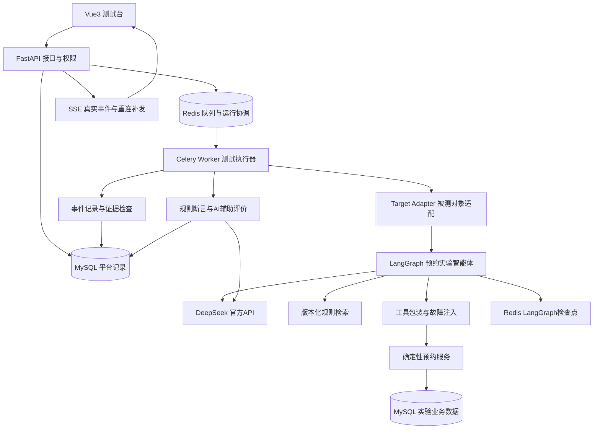
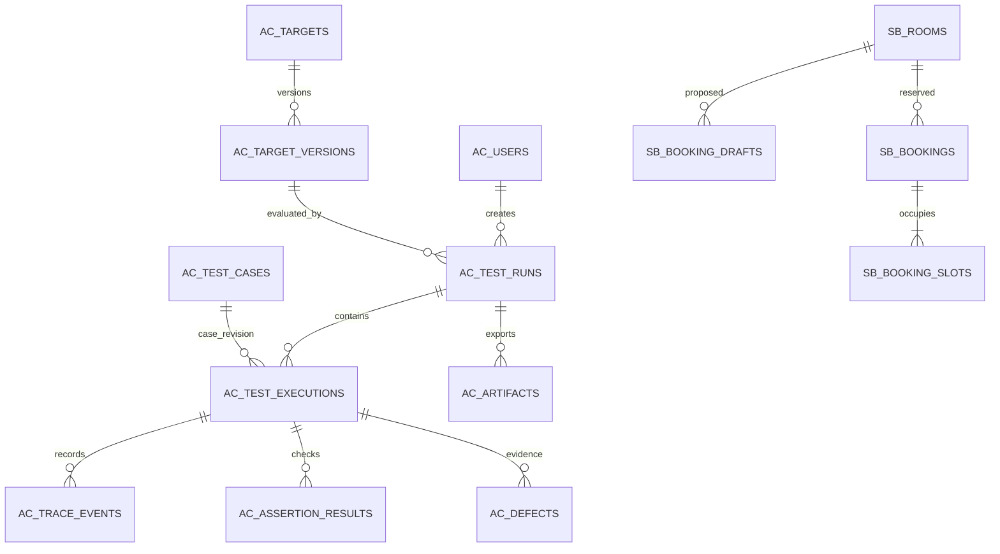

# AgentChaos 任务规划

> 2026-11-11 T22A团队云端部署，v1.50（已上线，长时验收待收尾）：用户明确跳过T19独立安装复现，该项为跳过/未验证；随后授权完整云端与真实调用、不设累计金额/请求数上限，采用HTTPS和两个独立团队账号。已部署Alibaba Cloud Linux 4上的Nginx、MySQL、Redis JSON/Search、API、Worker、Dispatcher；复用有效SSL，单并发及逐次/运行/批次/资源守卫保留，独立云端四角色账本不随重启重置。预约/退款真实聊天、确认与原回执、各一条真实批量执行、报告/SSE/导出、助手和两领域生成已实测；开发库显示60条原审核预约dev与8条同开发者退款参考，单独导入清单不伪造正式冻结或人工标签。MySQL隔离恢复后重导出与备份字节完全相同，Redis隔离恢复和5份SQLite快照通过，并将私有备份下载D盘校验。1 Mbps禁缓存单次浏览登录界面2.73秒可用。当前r4源码/配置和旧失败均留档；本地.env字节及21旧账本逐字段核对保持。未宣称60分钟长时浏览、目标评委网络、宿主重启或独立AI校准通过，T22A保留待验收、不自动T20/Git。地址、账号、配置与恢复细节仅团队私有交接。

> 2026-11-10 T19B参与者提前结束与实用性反馈，v1.48：用户明确第四项不再回答，不要求补答或本人封存。协调者报告参与三项，原链实际三次开始/两项保存，第三项未保存、第四项未开始；行政停止另存，不补造标签。两次AI问题共4供应商请求、9329输入+1328输出、4394微美元估算/held0。实际回复以SQL/断言及case.read等术语复述，取证只含摘要而无完整轮次；受控页未显示动作按钮，不能全部归因为主产品。E4对照不完整，不宣称增益/正确率；原A/旧成绩及账本不改。优先T19-F04完整用例上下文与直答/具体下一步、F05友好导航/字段错误/提前退出；新版本另验，不用余额自动补测。仅关闭P01试用采集器，主服务保持，不自动云部署/Git。报告docs/evidence/T19/e4-early-stop.md。

> 2026-11-10 T19B E4受控试用准备与启动，v1.47：用户批准独立copilot总1美元/72请求，每题0.10美元/12请求、4问题，每问题3请求/120秒，单请求45秒/1536输出token。四条新用例、两组设计配对、不同题目交叉AI顺序、独立判断/证据字段和五维人审判据已冻结；最多3人/6个固定AI会话，其他角色0。批准包cbf41e3a98de，记录页独立hash46236d47；原阶段A保持，不当无AI基线。51后端/HTTP控制、标签修复后6补验、3浏览器控制通过，均机械/模型替身。首次同当前模型审查初始化丢账本重发额度P2已修，批准后新增入口作必要补充审查无确定P1/P2。原20账本、17主表、.env及应用源码保持；新第21份根账本只初始化，准备窗口0真实调用。P01新轮已开始，待封存后按原判据复核，不宣称E4增益或T19完成。入口与原批准/源码/审计仅.local/t19b，交接docs/acceptance/T19B.md；无Git或云部署。

> 2026-11-10 T19阶段A收到反馈并复核，v1.46：P01五项原答案已封存，11事件连续哈希链及冻结协议/来源核对通过；自报4完成/1阻塞、求助12次，回答缺客观判断与证据位置，不计算正确率；B01使用AI/中断，不作为无AI基线。助手无法作答的原问题/回执未取得，根因未定位，不认定上下文丢失。同期主库新增预约运行095ddbff、8次日常agent调用/15238微美元估算，未独立归因，单列且不回滚/重跑/计为T19预设实验。其他19账本、20限额/.env/源码保持。本轮只读复核和文档，没有应用修改或新自动模型请求；阶段A报告docs/evidence/T19/phase-a-review.md，原记录和备份仅.local。完整T19/E4/干净安装仍未完成，不自动云部署或Git。

> 2026-11-10 云端评审规划与T19启动，v1.45：用户确认继续T19，并要求把已备案阿里云服务器部署列入规划。截图配置为2 vCPU、2 GiB、1 Mbps，系统/磁盘/现有业务及域名接入仍待实际核对，不能据截图承诺整套服务可常驻。新增第18章，推荐顺序T19 → T22A轻量云端评审部署 → T20 → T21 → T22最终打包/演练 → T23；T22A沿用T22部署范围提前独立验收，不重排旧编号。当前只规划云端，不连接或变更服务器、不新增云资源或费用；本轮开始T19免费准备，用户已确认可转交未参与实现者。真人试用、干净环境复现、E4及校准分别登记，未完成项不得以自动化替代；新实验模型调用仍按3.4单独确认。原v1.44字节保存在.local/t19/planning-v1.44-before.md，SHA256=544dff6b881e1b2169f434a5f5a5586f2a4927dfe26aeea5d01fb834bd3d78c4，旧实验/标签/账本/本地常开偏好保留。

> 2026-11-08 T18交付，v1.44：用户继续确认T17N，明确暂无独立对象并选择同一开发者模拟退款参考Agent，批准独立agent总1.50美元/160请求、每执行0.10美元/20请求。已完成白名单Python适配端口、独立SQLite事实、确认/原键幂等、运行/事件/故障/报告接入和领域前端。固定8次真实执行：7规则通过，F01一组待输入后行政取消保留未知；F04实际触发并原键查证1笔。47请求/47usage、71378输入+4168输出、26435微美元≈¥0.177527、held0。67后端专项及预约故障/报告回归、3契约、9UI/只读入口、类型构建/Ruff通过；一次完成的同当前模型review两项P2已修复，非后端全量。24导出/8ZIP、8账本副本和17表SQL恢复核对后仅清自有实验库用户；原冻结176来源保留，付费后仅等价格式与上下文元数据纠正，业务/提示不变、免费补验、不重跑模型。主预约ID71/退款ID72，157/163来源；保留过渡版本，新增参考用例8、故障2、目标1。真实批次前后主表/旧19账本相同；整轮另有未归因日常预约2请求和3房间变化，单列保留，不回滚。旧限额、.env五开关和本地不限次数保持。验收docs/acceptance/T18.md，报告docs/evidence/T18/final-report.md/json，只读http://127.0.0.1:18033/。同开发者小样本，不代表独立外部接入、通用准确率或真人语义金标准。T18待团队验收，下一项T19，不自动、不Git。

> 2026-11-07 T17N交付，v1.43：用户继续确认T17M并批准独立agent总1.50美元/240请求、每执行0.10美元/20请求。新增原报告比较页正常/故障模式，只读核对冻结条件、独立scope/session、真实注入、原始/可见返回、原键查证、SQL与原判定。最终46后端专项及报告/故障回归、3契约、8界面检查与类型构建/Ruff通过；同当前模型唯一独立review的2项P2已修复。真实6组12执行：正常6次完成、故障6次触发，完整对照3组恢复3次，另3组未知/排除，未补发输入或追加采样，不外推总体恢复率。92请求/92usage、531488输入+11898输出、173768微美元≈¥1.166956、held0；独立第19账本，旧18账本和.env原字节/五开关保持。36导出/12ZIP及17表SQL恢复哈希核对后精确清自有实验库用户，旧记录不删。主仅新增66兼容版本/150源，真实批次前后主17表相同；主Worker/Dispatcher刷新源码并保持开启。验收docs/acceptance/T17N.md，报告docs/evidence/T17N/final-report.md/json，只读http://127.0.0.1:18031/。T17N待团队验收，下一项T18选做需团队决定，不自动执行、不Git。

> 2026-11-07 T17M交付，v1.42：用户继续确认T17L并批准T17M独立agent总1美元/180请求、每执行0.10美元/20请求，另确认两份删除候选语义。完成确定性删除、绑定原失败/SQL对象与评价器的签名、三次复验、防重/部分恢复及T11待审核草稿；新增私有试验草稿的SQL触发器约束，不放松普通用例审批。最终48项后端专项及数据库/生成审核回归、8项新界面、原修复界面回归、26内存契约/类型构建/Ruff通过，非后端全量；唯一同当前模型独立review的1项P2已修复补验。真实9执行：4/3/2轮三组各3/3同签名、未知0，形成已验证两轮版而非全局最短；仅一类隔离构造缺陷，不代表生产越权或总体准确率。67请求、368598+7340token、119421微美元≈¥0.801984、held0；新增第18账本，旧17账本/.env保持。真实回归草稿仅隔离归档待人工审核，未自动发布主开发库。27导出/9ZIP及17表SQL恢复哈希核对后清自有实验库用户，旧证据不删。主库仅版本65及本项迁移更新，五日常开关保持，七操作ready；主Worker/Dispatcher刷新当前源码保持运行。验收docs/acceptance/T17M.md，结果docs/evidence/T17M/final-report.md/json，只读http://127.0.0.1:18029/。T17M待团队验收，不自动T17N、不Git。


> 2026-11-06 T17L交付，v1.41：用户确认T17K并批准独立agent总1美元/120请求、每执行0.10美元/20请求。完成4类已知缺陷的隔离变体与健康对照、冻结目录/源码/原评价器、预算与激活oracle、随机盲包及真人独立封存。21项专项、最终8次免费SQL/Redis接线（4激活检出/4健康无告警）、6项盲标注界面控制通过；唯一当前模型独立审查3项P2已接力修复验证，不冒充后端全量。真实8执行：2已激活缺陷检出、0漏检、1未激活、2未知、3健康SQL控制无告警；检出2/2、条件误报0/3，不外推总体准确率或V1改善。真人8条原标签封存，2条实际副作用仅凭回答均未被识别；1信息不足、2实验未知保留，可比明确判断与SQL一致3/5，不称裁判准确率。48请求/48usage、224168+6601token、峰值估算约¥0.504959、未知预留0；新增独立第17账本，旧授权不扩、不重置。原142生产源码/61版本/评价器与26契约保持，无主服务或Worker启停；SQL归档恢复17表哈希一致后精确清自有库用户，旧记录与日志备份不清理。真实批次前后主表及原16账本一致，整轮另观察到主运行2→3、事件29→53、预约1→2及日常账本15→24请求，调用者未独立归因、另列audit、不算本实验调用或回滚；不得声称整轮主库完全不变。验收docs/acceptance/T17L.md，结果docs/evidence/T17L/final-report.md/json；本地只读对照http://127.0.0.1:18027/。当前T17L待团队验收，不自动T17M/N、不Git；历史v1.40原字节保存在.local/t17l/previous-source.zip。

> 2026-11-06 T17K交付，v1.40：用户“开始下一步”确认T17J并授权本项。复用既有缺陷/复核/比较与创建预检，完成原失败—关联修复—复测草稿—条件核对—人工验证历史；只读核对与最终保存共用判据，拒绝未完成/不匹配版本/陈旧输入/其他规则失败，不自动运行或确认修复。31项后端相关检查通过（非全量，含11项新增），26项界面检查一轮通过，另1真实主运行报告只读检查通过；类型/生产构建/ruff通过。唯一当前模型独立审查发现1项有效P2：原始预期与规范化DSL默认字段造成误判陈旧；已改用冻结DSL并用带省略默认字段的实际SQL/Redis执行覆盖，真实快照变更负控制仍拒绝。旧失败/错误日志保留。当前61/142源/hash97038ad5325ecd5efebeebe163841a167a42f9499e611b76430a427dfb746d9c，旧60与历史版本保留；新主动模型0，原五开关与账本保持，主Worker原脚本刷新且保持开启，具体就绪与保全以本项audit为准。验收docs/acceptance/T17K.md，契约docs/architecture/repair-workflow.md，结果docs/evidence/T17K/final-report.json。受控离线流程不冒充真实模型修复；当前停T17K待团队检查，不自动T17L/M/N、不Git。

> 2026-11-06质量方法与参赛效果规划增补，v1.39：用户“ok，把你说的这些写进任务规划中。慢慢一步一步来”确认将本轮建议任务化。第17章新增T17L已知缺陷检出验证、T17M最小失败对话提炼、T17N正常/故障成对实验；推荐顺序T17J验收 → T17K → T17L → T17M → T17N → T18（选做）→ T19—T23。加强既有T18外部独立Agent接入、T19人工校准/陌生人试用、T22可部署与资源治理，不重复建任务。T17L为效果验证优先项，M/N为P1渐进增强；每个编号独立实施验收，时间不足须明确记录延期及宣传边界。本次仅规划，不将T17J待检查改成已通过，不开工K/L/M/N、不调用模型、不变更本地常开配置/原账本/服务、不Git。修改前v1.38原字节及SHA256保存在.local/planning/2026-11-06-quality-roadmap；旧T16无改善、T17B受限辅助及原始证据继续保留。

> 2026-11-06 T17J交付，v1.38：用户“开始下一步”确认T17E及专项反馈并授权本项。运行默认结果概览、完整证据与保存输入指纹核对、六维实际覆盖、按来源/分区/评价器分组及原事件/断言版本/SQL跳转完成待团队检查。35后端专项与相关回归通过（非全量），22界面检查一轮通过，另1真实主运行只读检查通过；类型构建/ruff/26内存契约通过。唯一当前模型独立review的2项P2已修复并验证。主新增60兼容版本/141源，旧59及139源核对；其余主表、16账本与.env保持，新主动模型0，五开关true，Worker/Dispatcher匹配就绪。原T16无改善、T17B受限辅助、真人标签及主运行原异常保留；上轮用例库与助手精简改动不归本项。验收docs/acceptance/T17J.md，结果docs/evidence/T17J/final-report.json。当前停T17J待团队检查，不自动T17K、不Git。

> 2026-11-05 发布整理，v1.37：统一登录与会话管理（T17F）、开发用例说明（T17G）、Worker管理/新建与复现（T17H）、板块指引（T17I）、全局只读AI助手（T17E）及后续界面反馈统一提交。预约入口改为聊天首轮发送创建，增加新建与历史记录；运行详情增加真实链路诊断、节点取证、规则与SQL分列、人民币估算和部分视图导出。后端当前57/139源保持，最新41专项通过；诊断8项检查、44项原有回归及1项真实只读主页面验证分阶段通过，具体来源和发布离线检查见docs/releases/2026-11-05.md。旧480全量属于55，不当成57重跑；模型语义局限和历史原标签保持。本地五调用开关按用户日常偏好开启，公共模板保留关闭默认，额度/账本不重置；用户日常本地预约独立累计不限额不扩大其他角色。原完整实验日志/重复截图/源码归档/数据库备份保留本地，仓库提交必要源码、测试、契约、验收与精简结果。下方旧“五开关false”“不Git”和临时地址均为历史时点，不覆盖本条。此发布不启动T17J/K或新付费实验。

> 2026-11-05 T17E交付，v1.36：用户确认T17I及前端反馈并批准copilot独立1美元/60请求。全局按上下文只读取证、引用定位、安全导航、身份隔离、原回执和预算完成待团队检查。最终480后端0失败错误跳过564.98秒、35不同实际UI分阶段通过、类型构建/ruff/318格式/94锁/26契约通过。累计34真实copilot调用/34usage、102680token、峰值估算0.042091美元/held0，旧14账本保持。首16问题13完成3失败保留，最终5新协议补验完成，但R03空SQL解释和E015引用语义问题不掩盖，不称语义全通过或独立准确率。原E007夹具错误、E020准入拒绝保留；环境旧“未实现”已补免费状态接线并按55重跑。主53/54/55仅追加，旧52版本/14208历史文件/原业务保持；同期新增artifact及房间另记，不回滚。只读验收5190至今天12:22上海，精确期限见最新指针；默认日常五开关false，不启动Worker。报告docs/evidence/T17E/final-report.md，验收docs/acceptance/T17E.md。停T17E待团队检查，不自动J/K、不Git。

> 2026-11-04 T17I交付，v1.35：用户“开始下一步”确认T17H并授权I。11类页面基础指引、16术语/16固定安全导航、身份对象时效校验、静态离线阅读、未提交配置带入与独立标注隔离完成待团队检查。448后端0失败错误跳过801.62秒；20不同实际UI（新轮11过1失败后同断言单项补验通过，另8原回归；不是单轮20/20）、类型构建/ruff/309格式/94锁/23契约通过。主新兼容52/hash8360aad91068、132源码，旧51及14账本、14,030历史文件与H原seal保持，新增模型0。期间本轮未发起的主运行取消/三报告导出/主Worker启动另记保留，不回滚为queued；原数据保持按观察基准核对，不虚称全库初始不变。H临时5189已导出核验后关闭，当前使用主5173；主Worker不自动更新。验收docs/acceptance/T17I.md，报告docs/evidence/T17I/final-report.md，原v1.34在I previous-source.zip。停T17I待团队检查，不T17E/J/K、不Git。

> 2026-11-03 T17H交付，v1.34：用户“不错，进行下一步”确认T17G并授权本项。既有D盘Linux Worker/Dispatcher一键管理、2/4/8秒三次退避及主动停止保持、真实绑定与扫描/容量观察、创建前后预检、60秒配置与有界排队、原配置再次运行/差异复制、实际模式与原回执防重完成。431后端全量0失败错误跳过（594.09秒），16不同实际UI（新7项及修正夹具/请求Origin后的1项补验，另8既有回归；不是单轮16/16）、类型构建/ruff/301格式/94锁/21内存契约通过。实际4次独立Worker异常注入，前三次恢复、第四次达上限，人工停止保持。主新兼容51/hashdcb77019f2e8、127源码；中间50/430项原结果保留，旧49版本/原业务/14账本及13,943历史证据文件保持，新模型调用0。原控制用例DSL遗漏另存修订2，原失败不删；首批导出表名错误导致临时SQL未完整保留的遗漏单列，后续导出核验成功才清自有库。当前免费入口5189到11月4日02:12上海，精确信息.local/t17h/latest-review.json；主8000/5173现有用户进程保持、无主Worker。用户另明确授权清MySQL日志，已将关闭82/83两份共2,148,014,002字节备份D盘并校验后精确PURGE，保留84及以后，17主表不变、共享日志仅本地。验收docs/acceptance/T17H.md，结果docs/evidence/T17H/final-report.md。v1.33及前置源码在本项previous-source.zip，旧seal不改；停T17H待团队检查，不T17I/E、不Git。

> 2026-11-03 Worker日常运行规划增补，v1.33：用户确认将一键启动/停止Worker与Dispatcher、异常自动重启、真实状态与运行前检查加入T17H。先补齐日常执行环境管理，再实施原有创建/复现与模式识别，任务编号和F→G→H→I→E顺序不变。本次仅修订规划，不实施或启动服务、不启用模型/预算、不Git；T17G仍待团队检查。T17G封存的v1.32原规划已逐字节保存到docs/evidence/planning/2026-11-03-worker/previous-planning.zip，原清单不改。

> 2026-11-03 T17G交付，v1.32：用户“开始下一步”确认T17F复核修正并授权T17G。60条六类开发用例只读说明、逐轮输入/对照、前置条件、业务目标和断言证据解释完成；56条基础知识匹配、4条保持知识条件限制。406后端全量0失败错误跳过（425.33秒）、7专项、8不同实际UI（4新+4既有，拒绝场景另复验1项）、类型构建/280格式/94锁/19契约通过。主兼容49/hash5186924d613b，旧48版本/原业务记录/14账本及13,914历史证据文件保持，新模型调用0。入口5173/library，验收docs/acceptance/T17G.md；待团队检查，不T17H/E、不Git。v1.31原规划与源码在本项previous-source.zip。

> 2026-11-03 T17F复核修正，v1.31：用户确认“修改”，修复无活动状态查询续期与跨标签恢复竞态；隐藏标签不标记活动，恢复/聚焦/心跳按身份代次去重并隔离旧响应。401后端全量0失败错误跳过（417.12秒）、28专项、4项客户端控制及14个不同浏览器检查通过（首轮13项及修正清理后的1项复验，原清理失败与429保留），类型构建/273格式/94锁/19契约通过。主兼容48/hash9c04641d184f，原47版本/业务记录/14账本保持，新模型调用0；原67项seal不改，演进原字节和新证据在docs/evidence/T17F/review-fixes-20261103/。仅T17F修正，待团队检查，不T17G、不Git。

> 2026-11-03 T17F交付，v1.30：用户“开始今天任务，进行下一步”按既定顺序确认T17D并授权T17F。统一平台身份、HttpOnly可撤销会话、Origin/CSRF、闲置30分钟/绝对8小时、角色/账号切换与旧响应/SSE隔离完成；398后端全量0失败错误跳过、24专项、13实际UI、类型构建/ruff/273格式/94锁/19契约通过。首轮匿名兼容失败保留并修复，主兼容47（中间46保留），原45版本/业务记录/14账本及13,822历史文件保持，新模型调用0。入口主8000/5173，无主Worker、四付费开关false；验收docs/acceptance/T17F.md。T17F待团队检查，T17G/E未开始，无Git。v1.29原规划在本项previous-source.zip。

> 2026-11-02发布复检：用户“提交代码到git上呢，今天休息了”授权提交T17C/T17D、主题/卡片与v1.29规划成果。376后端全量、27只读页面、类型构建/ruff/265格式/94包锁/19契约复检通过；主库记录、14账本和旧实验保持，新增模型调用0。发布记录docs/releases/2026-11-02.md，内容/索引审计docs/evidence/releases/2026-11-02/。README/交接/历史/密钥/.local/依赖缓存及数据库与binlog备份排除；本次Git授权不启动新开发。

> 2026-11-02产品规划增补，v1.29：用户要求将本次全部建议任务化并采用推荐顺序。第16章追加完整任务档；新增T17F—T17K，顺序调整为T17D团队通过 → T17F统一登录 → T17G用例说明 → T17H新建/复现 → T17I板块指引 → T17E只读助手 → T17J可靠性证据展示 → T17K修复复测闭环 → T18（选做）→ T19—T23。仅规划获准，T17D仍待团队检查，新任务未开始；无新模型调用、预算或Git发布。旧编号/实验/标签/账本/清单保持，v1.28原字节已另存本地。第16章与本条覆盖下方历史执行顺序。

> 2026-11-02 T17D交付，v1.28：用户“开始下一步”确认T17C及前端主题/卡片反馈并授权本项，另批准独立agent1美元/120请求、每会话0.10美元/20请求。交互/字段来源/工具/草稿确认/SQL/回执与实际数据库隔离完成；最终376后端、5新UI+27原回归+2真实只读、类型构建/ruff/265格式/19契约通过。8类开发验收含6真实对话+2免费API控制，49请求/49usage、256342token、峰值估算0.083189美元/held0非账单；生成器/裁判0、旧13账本保持。主新兼容45/hash9a591f272b2a，原44版本/123用例/4artifact/原queued记录/0预约缺陷保持。入口API18021/UI5188/interactive到11月3日04:05上海，日常四开关false。原字节已归档，T16旧结论不改。验收docs/acceptance/T17D.md；待团队检查，不T17E、不Git。

> 2026-10-31 T17C，v1.27：用户“开始下一步”确认T17B并授权环境就绪与首次使用引导。仅实施本项，常规检查与独立验证不调用付费模型；旧13份账本与冻结实验保持。新增按操作检查、真实Worker回执、60秒有效期/失败撤绿、API不可达基础指南；实施验证完成待团队检查：363后端、11前端及2相关复验、类型构建/ruff/251格式/94包锁/18契约通过；主新兼容44，旧43版本/123用例/4artifact/原queued执行及13账本保持，新付费调用0。步骤docs/acceptance/T17C.md，契约docs/architecture/environment-readiness.md。不T17D/T17E，不Git。

> 2026-10-30发布复检：用户明确要求“整理项目，提交今天任务到git”，授权将T17/T17A/T17B成果提交并推送指定AgentChaos的main。342后端/8前端、类型构建/ruff/241格式/94包锁/17契约通过；13份账本与主库业务记录不变，新增付费调用0。发布范围与证据见docs/releases/2026-10-30.md及docs/evidence/releases/2026-10-30/。README/AGENTS/交接/历史/.env/.local与数据库备份继续排除；根Markdown仅任务规划。T17B封存时的本规划与属性原字节另存发布证据ZIP，旧交付清单不重写。本条覆盖下面交付时“不Git”的历史状态，不启动T17C。

> T17B最终交付，v1.26（2026-10-30）：用户已封存12条新真人标签并确认“接受受限辅助边界，按报告验收”。新协议12/12首答与最终结构有效，无修复/重试；原人工支持6/12、解释7/12一致，7分歧与B003/B012边界保留，不能作准确率或旧T16改善对照。12请求/12usage结算、18832token、峰值估算0.007078美元/held0非账单，0.50美元/12请求独立授权已用完调用数；agent/生成器0、旧12账本保持。340后端全量加2新增封存控制、8前端及只读恢复后相关2项复验、类型构建/ruff/241格式/94锁/17契约通过。主新源码兼容43/hash064792ef892229340021f99074e74b8ffc94ad27262c22e0e2baae25b85ae93b，旧42版本/123用例/4artifact及原queued运行执行不变，16表23触发器0006。T16/T17/T17A清单及9009/133/70份历史文件保持，原标签/AI/主统计不改；本12条不开放执行级自动裁判。只读API18019/UI5186，batch30df7075-dc30-4671-9676-944c739c0600，exec40279到10月31日03:22上海，精确stop_file见.local/t17b/latest-review.json；原标注库已导出后精确清理，恢复核对一致且新调用0。HTTP无模型密钥/Worker/写入能力，关闭只清自有恢复库/用户/进程，不改原ZIP/账本。报告docs/evidence/T17B/final-report.md，验收docs/acceptance/T17B.md。停T17B，不自动T17C、不Git；下方进行中段是历史快照。

> 2026-10-30 T17B进行中，v1.26：用户“开始下一步”确认T17A并授权裁判协议修复与新校准；另批准独立judge0.50美元/最多12请求/每次45秒及1536输出token，agent与生成器0、旧12账本保留。已冻结新编12条受控样本（6回答视图/6附观察），严格JSON模式/嵌套Schema/合法不足空引用/坏引用及结论守卫实施，27专项与3尺寸只读UI、类型构建/ruff通过，完整回归进行中。标注入口API18019/UI5186，batch30df7075-dc30-4671-9676-944c739c0600，到10月31日03:07上海；无模型密钥或HTTP付费入口。待真人独立12标签封存后才调用judge，当前不宣称校准完成；主源码兼容43，旧42版本及原queued运行不变。不T17C、不Git。方案docs/fixtures/T17B/execution-proposal.md，步骤docs/acceptance/T17B.md；后面旧“未T17B”为当时快照。

> T17A最终交付，v1.25（2026-10-30）：实施及验证完成，待团队检查。人数按完整输入/数词/单位/符号与否定校验，明确新人数字段先使旧值失效；修复拒绝后明确重新给出/生成/创建草稿的恢复，仍须新确认。321后端0失败错误跳过、6现有前端只读回归、16机械验收控制、类型构建/ruff/227格式/94包离线锁及16契约通过。首批真实7/8与恢复失败保留；新源码仅补验负数/恢复两项均符合检查，不拼成最终版8/8。用户先批准60请求、后批准同一账本增至80，金额仍1美元/每run0.10美元；累计68调用全部usage结算，350802 token、峰值估算0.113545美元、held0，非账单，生成器/judge0、旧11账本保持。主新版本42/hash901911e6491bb8abc21a66c467b6537a2477fd2aa95c0661ba966e9d095db724，旧41版本/123用例/4数据artifact及原1run/1execution queued不变，主预约/缺陷0，16表23触发器0006。T16/T17清单原字节及其9009/133份历史记录核对通过，原源码另存可校验归档。只读API18018/UI5185到10月31日00:32上海，exec70532、精确stop_file见.local/t17a/latest-review.json；无模型密钥/Worker，关视图不删原始归档或账本。主8000/5173由用户热重载进程管理、已识别42，未按旧PID强杀。报告docs/evidence/T17A/final-report.md，步骤docs/acceptance/T17A.md。停T17A待检查，不T17B、不Git；README/AGENTS/交接/历史/.env继续本地。

> 2026-10-30 T17A开工：用户“可以，开始下一步工作”承接v1.24，记录T17团队通过并授权T17A；另明确批准agent独立1美元/60请求/每run0.10美元，生成器与裁判0，旧11份账本保留。本轮仅T17A，方案`docs/fixtures/T17A/execution-proposal.md`，预算`authorization.json`，进展`docs/acceptance/T17A.md`。不执行T17B、不Git；后面的“待T17通过/预算未批准”为当时快照。

> 2026-10-30规划扩展，v1.24：用户确认将环境引导、智能体交互调试和测试助手加入规划。在T17之后、T18/T19之前插入T17A—T17E，依次处理人数来源、裁判协议与新校准、环境就绪检查、预约Agent调试窗口、只读测试助手；T19增加E4助手使用效果验证。原T00—T24编号、T16冻结实验和原始结论保持。当前仅完成规划修订，五项扩展均未开始；T17实施完成、团队验收仍待确认，未授权新付费调用或Git发布。T17交付时v1.23原字节另存本地`.local/planning/2026-10-30-assistant/任务规划-v1.23.md`（SHA256 `e410fd1c9b816bc0e017ee69b47224995aea76ebff3f2c21e59450678019957d`），原T17交付清单不重写；本次新规划不冒充旧清单内的版本。

> T17最终交付（2026-10-30）：实施及验证完成，待团队检查。260后端/6前端、类型构建/ruff/216格式/94锁/16契约通过；最终离线45负载+12中断/SSE执行，真实9对话+2中断，共11请求9usage、2未知继续持有。估算结算0.007626美元、预留0.019570美元，旧十账本保持。修复独立事件间隙死锁、复合读快照和容量冷却；旧开放授权兼容已回归。保留暂停SQL事务锁1205及所有失败，非自动释放活连接。主兼容V0=41，旧40版本/123用例/4artifact/零运行预约不变，历史13260对象保持。只读UI5184/API18017到18:20上海，步骤docs/acceptance/T17.md；T16冻结源码/结果不改，T17无Agent语义质量提升结论，不T18、不Git。

> T17预算追加：2026-10-30用户明确批准agent独立上限1美元/最多60请求/每run0.10美元，生成器和裁判0。旧十账本与原限制保留；仅本轮自有Worker临时启用，日常.env四开关false。下文最新授权段的“预算待确认”为批准前状态，已由本条覆盖。

> 2026-10-30最新授权：用户“那你现在开始下一步的任务吧”记录T16团队通过并授权T17平台可靠性。保持T16失败/未知及无改善结果，不当作质量合格。T17先列矩阵、复现并发事件死锁并验证真实SQL/Redis/Linux Worker的并发1/3/5、中断/恢复/取消/SSE；新模型预算仍待单独确认，日常四付费开关false。准备快照docs/evidence/T17/preparation.json，方案docs/fixtures/T17/execution-proposal.md，验收docs/acceptance/T17.md。新证据一次归档，不重复复制录屏；不清理旧.local/旧证据，不T18、不Git。旧T16交付时任务规划的原字节以Git提交0f26016中的文件保留，旧delivery-manifest不改。

> 最新交付（覆盖下文进行中快照）：2026-10-29 T16实施与实验完成，待团队验收。正式320观察/160条件配对一致，V0规则146通过/5失败/9等待，V1为145/7/8，无改善结论。G1/G2原60条真人标签均先封存后裁判；正式60评45结构错误/15有效，三方法相对原4阳性主召回均0/4，不将弃权算通过。另C校准30保留。G1按用户要求另存助手21建议修改/9维持，原标签和主统计不变。最终253后端通过，类型/构建/静态/锁/契约和封存后桌面手机UI通过；Agent2961/judge90均有usage及结算，冻结费率估算合计5.498436美元、held0，非账单。旧4209文件/8账本/主库/冻结源码保持，90盲评原始输入/调用及2527个run artifact核对通过。人数负号来源缺口、裁判协议问题和全部失败保留，未冻结后补丁重跑。报告docs/evidence/T16/final-report.md，验收docs/acceptance/T16.md，SHA清单delivery-manifest.json。视图5183约10月30日05:12上海到期，精确.local/t16/latest-review.json；无付费开关/模型密钥，关闭不删库/账本。停T16等待检查，不T17、不Git。

> 2026-10-29 23:12 T16进行中：用户确认G1已封存并要求助手核对修改。真实30标签seal=29c25f63de94，judge0；原字节先导出。逐条辅助修正21/维持9，JSON/Markdown及SQL独立assistant_analysis已保存，页面原标签与助手意见分开显示，不冒充新增独立真人标签，主E1仍用原封存。G1-019条件回顾不全，019/026草稿作废状态证据不足保留。2服务测试/真实1440和390只读UI/类型构建通过。正式串行继续，23:12为268/320；G2尚未齐备，两批封存前不调用60judge。标签API/UI受控重启到10月30日05:12左右，关闭只停止视图；精确stop_file见.local/t16/latest-review.json。完整步骤/证据见docs/acceptance/T16.md，逐条复核docs/fixtures/T16/G1-assisted-review.md。T16未完成，不T17、不Git。

> 2026-10-29 22:54 T16进行中：正式158/320导出、79配对条件一致。G1真实30条金标准已开放 http://127.0.0.1:5183/judging/34e8cd5e-5852-5ad4-9bee-8c2adf851da2 （hash bd88edbd507a），三项必选、无预填/AI，实际页面与HTTP检查通过；已请求真人独立封存，G2尚未齐备。两批全封存前不调用60条judge。串行付费队列仍由既有监督进程继续，不重跑/不重置账本，保留T16上限。243旧全量及最终13专项通过，253测试库存；197格式/94锁/类型构建通过；4209旧证据/8账本/主库/两源码和正式执行器不变。231诊断原始调用已追加同字节归档，持久断言另存。20份binlog已按用户授权精确purge、D备份保留。标签视图约10月30日04:23到期、关闭不删数据，精确stop_file见.local/t16/latest-review.json。详见docs/acceptance/T16.md与docs/architecture/formal-experiments.md。T16未完成，不T17、不Git。

> 2026-10-29 22:30 T16续做：20份已验证D盘备份的关闭binlog已按用户明确授权精确PURGE TO 000075，保留075+，主数据仍C盘。正式串行320计划沿用，99条已导出（22:29快照），不重跑已完成。独立E1执行金标准增加第三项execution_problem，与回答两项分离；G批仍0标签/0裁判，规则及分母已冻结。C原30标签/30AI及辅助提案分开保持。标签API18016/UI5183已受控重启至10月30日04:23左右，无模型密钥/付费，精确stop_file见.local/t16/latest-review.json。进展/证据/命令见docs/acceptance/T16.md和docs/architecture/formal-experiments.md。T16仍进行中，不T17、不Git。

> 2026-10-29 T16进行中：用户确认T15/前端通过，并将方案决定交由助手推荐；已采用单调用V1候选（归档1b3898d69d26）及独立agent54.30美元/judge1.35美元上限，生成器0，旧8账本不改。T13 V0与V1各12配置只读核对，V1仅在正式隔离库登记，主库仍40版本。并行试跑出现ac_trace_events的1213死锁，35条试跑计划/34条完成及1条认领失败全部保留；已统一另建串行正式队列V0/V1各160，试跑不混入320分母，费用同账本不追加。30条新仅回答校准已由demo_reviewer真实独立封存，hash=77c285a51f9d；30次真实裁判9结构有效/21协议错误，支持初始2/9、解释4/9一致，不能当作30条准确率。用户另要求助手核对；30条辅助提案另存docs/fixtures/T16/calibration-assisted-review.md，不覆盖原标签/AI/统计，不冒充独立金标准。当前正式串行实验仍运行，60条关键轨迹真人金标准尚未采集，不勾选T16、不T17、不Git。当前标签入口http://127.0.0.1:5183/judging/6878b16b-71c6-53b2-a67a-34c228cd969a，约10月30日02:51上海到期，.local/t16/latest-review.json给出精确stop_file；关闭视图不删正式库/证据/账本。

> 2026-10-29 最新授权：用户“可以前端不错，如果后面前端还需要修改就叫你，现在可以开始下一步了”确认T15及前端整体调整通过，授权T16正式实验。当前T16进行中，先审计冻结包/旧源码/独立版本和实验工具；T13的55.65美元仅为已批准规划，新T16角色账本及真实调用仍待本轮额度明确。旧8账本/40版本/123历史用例/4数据artifact及4209旧证据文件保留，准备快照docs/evidence/T16/preparation.json。不进入T17、不Git发布；旧文中“停T15/不T16”为当时快照，由本条覆盖。

> 最新前端反馈：2026-10-29 T15前端整体体验反馈完成，待用户检查。按用户本地视觉/交互文档，在既有Vue3/Element Plus上统一蓝灰主题/14px正文/卡片表格与弹窗，重排概览，13处原生下拉统一组件并保留选项值/审核空值，新增Ctrl/Cmd+K真实页面跳转。8专项（24.9秒，1440/768/390/320）及5+2既有非付费回归、类型/构建通过；历史校准仅显式只读重放，不保存标签。80原命名函数核对，唯一UI差异为登录busy防重复；后端/4235旧文件/40版本/8账本/依赖及主库数据保持，业务API写入/模型新调用0。主UI5173及免费T15报告UI5182热更新，无需新安装或重启。设计与步骤见docs/architecture/frontend-experience.md和docs/acceptance/T15.md追加节；证据docs/evidence/T15/frontend-redesign/。仍T15反馈待检查，不T16、不Git发布，HEAD/索引保持。

> 最新交付：2026-10-29 T15实施与验证完成，待团队检查。用户“可以开始下一步了”确认T14及UI反馈通过并授权T15。本轮实现缺陷归并/独立复核审计/修复版本与实际通过执行验证、条件核对与分母、JSON/Markdown/证据ZIP真实下载。240后端全量、最终10项专项、6项T15实际UI、5项既有非付费前端回归、类型/构建/ruff/163格式/94包离线锁/契约/HTTP通过。16表/23触发器/0006不变；旧39版本/123用例/4数据artifact/8账本/3711旧文件逐字段或字节保持，主库运行/执行/断言/预约/缺陷0。仅追加源码兼容V0=40/hash=2fe0332d3afe4efb25cd725271b70dfcdf33871688ecc297ea91498ee1a94468，无真实V1或T16正式实验；T13旧源码只读重建12配置一致。免费验收库7run/7execution/199持久事件/11artifact、SQL仅1笔、2候选；1次UI拒绝为明确机械控制，非团队独立标签。真实SQL/Redis/工具/HTTP配明确离线模型，新增三角色调用0，无新预算，四付费开关false。验收入口http://127.0.0.1:5182/reports，demo_operator/密码读本地DEMO_SEED_PASSWORD；约2026-10-29T22:23:49.964934+08:00到期，精确stop_file见.local/t15/latest-review.json。主API8000/UI5173已按归属受控重启到T15。收尾遇16380/8000/5173及旧验收端口无监听，已按既有D盘脚本恢复，未归因未经确认的重启；旧cb975库核对导出7run/199事件/11文件后精确清理，恢复回执保留。最终证据docs/evidence/T15/offline-807d918abcfc/live-export，入口/操作/异常及限制见docs/acceptance/T15.md。本轮停T15待团队检查，不执行T16、不Git发布；HEAD仍5c6bb0124ec0cc96bd145fa9baa7c2e01fb8b95a，索引空。

> 当前授权，2026-10-29：用户“可以开始下一步了”确认T14及UI反馈通过，授权T15缺陷、对比和报告。只实施T15，保持四付费开关关闭；不运行T16、不Git发布。旧证据/账本/版本保留，准备快照docs/evidence/T15/preparation.json。

> 2026-10-29 T14侧栏反馈：联网参考shadcn/ui、Langfuse和Twenty，改为浅色分组导航、统一图标、桌面折叠与手机抽屉；7入口/3尺寸/键盘只读检查、2项既有页面回归及类型构建通过，无新调用/运行或后端变更。详见T14验收及sidebar-redesign证据；仍不T15、不Git。

> 2026-10-29 T14外观反馈：语义执行下拉改为Element Plus可搜索选择器，用例/中文状态/完整ID分行，适配手机；两尺寸真实只读界面复查和类型/构建通过，新模型调用0，详见T14验收追加节。仍停T14。

> 2026-10-29 T14团队反馈修复：补齐Dialog的Overlay样式依赖，修正等待输入弹窗被故障条/筛选框遮挡，长内容内部滚动；7项工作台UI回归、类型/构建通过，新模型调用0。详见docs/acceptance/T14.md及docs/evidence/T14/dialog-overlay-fix/。仍待T14验收，不进入T15、不提交Git；旧交付计数为当时快照，临时控制库此后会增长。

> 本文件是后续工作的唯一执行主线。先完成一个编号任务，提交结果并更新勾选，再等待团队明确验收，随后才能执行下一个任务。历史讨论文件只作参考；冲突时以本文件和团队后续明确决定为准。

| 项目项 | 当前约定 |
|---|---|
| 项目名称 | **AgentChaos——面向工具故障与多轮状态的智能体可靠性测试平台** |
| 参赛方向 | 传智杯“AI赋能·智能测试创新挑战赛”，**路径二：智能体测试工具开发** |
| 首个验证对象 | 自建场地预约实验智能体，规则和数据明确标为实验设定 |
| 技术栈 | Vue3 + TypeScript + FastAPI + LangGraph + MySQL + Redis |
| 模型接入 | **DeepSeek官方API**；现有被测智能体、AI用例生成、辅助评价分开配置；T17E规划新增独立测试助手角色 |
| 团队 | 三人，暂以A/B/C称呼；具体姓名由团队补充 |
| 编写日期/时区 | 2026-10-24，Asia/Shanghai |
| 规划版本 | v1.50，团队云端已上线、核心流程实测，长时验收待收尾 |
| 当前状态 | **T22A已部署并通过两对象真实核心链路及隔离恢复检查；T19独立安装按用户要求跳过，原不完整E4不补造结论** |
| 下一任务 | 收尾T22A长时稳定性及团队外网检查；确认后再T20，不自动Git或新实验 |
| 发布记录 | 2026-11-02授权提交T17C/T17D、主题与v1.29规划；376后端/27页面等通过，详见docs/releases/2026-11-02.md；旧发布记录保留 |
| 省赛交付日期 | 原规划记录2026-11-18及内部11-16/11-17目标；本轮未重核官方/校内截止，T20前确认，旧目标不作为新交付承诺 |

快速导航：[执行与验收](#0-执行勾选与团队验收约定) · [评分与交付](#1-比赛要求与项目成功标准) · [技术架构](#3-技术架构与职责) · [数据库](#4-数据库总体设计) · [实验方法](#8-数据集指标与实验设计) · [任务勾选清单](#9-任务总清单与时间预算) · [逐项验收](#10-逐项实施与验收说明) · [排期](#11-时间安排分工与缩减原则) · [当前团队验收](#14-当前验收变更和续做入口) · [新增产品任务档与顺序](#product-roadmap)。

## 0. 执行、勾选与团队验收约定

### 0.1 一个任务怎样算完成

“一个任务”指第10章或第16章的一个`Txx`编号（包括T17A—T17K等扩展编号），它内部的小步骤可以在同一次工作中连续完成。每完成一个编号必须停止推进，交由团队检查，不自动连做下一个编号。

1. 读取本文件的当前任务、前置条件和最近的团队验收记录。
2. 只实施本次获准的任务；发现前置缺口时先修复该任务所需范围，记录影响。
3. 按该任务的验收标准验证，保存结果。不能把“代码已写”“页面能动”直接视为完成。
4. 实施及验证通过后，将任务的`[ ]`改为`[x]`，状态写为“实施完成，待团队验收”，补充证据和遗留问题。
5. 向团队说明：做了什么、如何查看、如何验证、有什么限制、需要检查什么，然后结束本次工作。
6. 收到团队明确通过后，才记录“团队验收通过”，并推进获准的下一任务。建议回复：“T03验收通过，继续T04”。自然语言表达明确时同样有效。
7. 团队要求修改时，留在当前任务；修改后重新提交验收。只确认实施完成，不代替团队填写验收通过。

**勾选表示实施完成；团队通过另有记录。两者必须分开。** 未执行、验证失败、只有模拟效果、缺少必须证据的任务保持未勾选。可选任务不做时写“团队批准跳过”，不能勾成已完成。

每个任务至少保存到`docs/acceptance/Txx.md`：实现范围、相关文件/提交、环境、验证命令及实际结果、复现步骤、截图/报告位置、剩余问题、团队意见。后续若初始化Git，每个验收任务尽量形成一个可审阅的提交，不自动推送或发布。

### 0.2 任务记录模板

```text
任务：Txx
实施状态：未开始 / 进行中 / 实施完成待验收 / 需修改 / 受阻
实现内容：
验证内容与实际结果：
证据位置：
已知限制：
团队检查步骤：
团队验收：待验收 / 通过 / 要求修改 / 批准跳过
团队确认原意与日期：
下一任务：仅在团队明确允许后填写为“可执行”
```

### 0.3 变更规则

- API、数据库、指标或范围发生变化，先更新本文件的相应条目和变更记录，写明原因、涉及任务与数据兼容方式。
- 本任务内的字段命名和常规实现细节可以自主处理；改变参赛方向、核心范围、数据定义或删除既有成果时，应提交团队审阅。
- 修复已经通过任务的回归问题，需要补证据；涉及的验收失效时改为“需复验”，不能继续沿用旧通过结论。
- 工期紧张时优先裁掉P1/P2增强项。不得用截止日期临近代替团队验收，也不得用预设结果代替实测。

### 0.4 本轮确认与后续执行入口，2026-10-25

此前用户回复“可以，做好任务规划，一步一步来”，确认将架构评审建议整理进本文件。该次v1.5修订仅改规划，不等同于T01团队验收通过或T02启动，不增加付费模型调用授权。

后续执行授权：用户在上述逐项验收入口说明后回复“可以开始工作”，据此记录T01通过、允许实施T02。仅执行T02，不自动进入T03；付费模型调用授权不变。

T03授权：用户在T02完成并停止待验收的交付后回复“可以开始下一步”，据此记录T02通过并允许实施T03。本轮只做确定性预约服务与接口，T04及付费模型调用未获准。

T04授权：用户在T03交付后回复“继续下一步，完成的不错”，记录T03通过并获准T04；随后明确选择“允许，agent本轮上限1美元”。仅agent可付费调用，生成器/裁判预算仍0；授权标识T04-20261025-agent-1，预算跨进程保留，失败/未知用量保守预留，不自动扩额。

提交授权：2026-10-25用户随后要求再次检查项目，检查通过后将今天完成的任务提交至GitHub。据此复检并发布T02—T04当前成果；README、密钥、交接/历史资料继续排除。T04团队验收仍待明确确认，T05未获准。

2026-10-26续做授权：用户“开始今天的工作，进行下一步”，承接T04交付/发布后的逐项入口，记录T04通过并授权T05；另明确“允许，T05 agent上限1美元”。只使用T05独立授权账本，保留T04原用量，生成器/裁判仍0。已有Docker Desktop Linux引擎已连通，数据盘位于D:\docker-desktop\data\wsl，不建立独立WSL。仅实施T05，不自动提交推送或进入T06。

2026-10-26发布授权：T06交付后，用户要求“再次整理项目，然后可以把今天完成的任务提交到github了”，授权复检并发布今天T05—T06成果至既定origin/main。128后端、5项非付费前端检查、构建/ruff/锁文件/契约/真实只读HTTP及数据库复检通过；补齐Compose API/Worker共享证据目录并用两个非root Linux容器验证，原始验收文件按原字节保留。未增加模型调用或修改旧账本，README/本地资料继续排除。详情见docs/releases/2026-10-26.md；发布不替代T06团队验收，不启动T07。

| 顺序 | 当前应做的事 | 完成后交给团队检查什么 |
|---|---|---|
| 当前 | T17N实施验证完成待团队检查，v1.43 | 核对6组对照中的触发、恢复及3条未知；下一项T18选做需团队决定 |
| T02 → T03 | 先落实16表、隔离和确定性预约服务 | 真实约束、并发幂等、确认绑定、按请求标识查证 |
| T04 | 接通真实Agent、结构化状态、规则基线和工具 | 新输入、多轮修改、拒绝确认、工具调用与会话恢复 |
| T05 → T06 | 建立可靠运行和可追溯证据 | 任务认领、预算、取消、事件落库和断线补发 |
| T07 → T13 | 逐项完成故障、断言、上下文/检索测试、AI辅助及数据冻结 | 原始/可见结果、副作用、独立预期、校准和预算 |
| T14 → T17 | 整合工作台、报告和正式实验，复验恢复能力 | 用例—轨迹—断言联动、同条件对照、可靠性矩阵 |
| T17A → T17E | 修复质量缺口，补环境引导、交互调试和只读助手 | 新旧版本/结论分开、就绪状态可信、真实工具与SQL、助手解释可追溯 |
| T17K → T17N | 修复复测、平台检出验证、最小失败与成对实验，逐项推进 | 缺陷证据、漏检/误报、缩减可复现性、正常/故障差异；详见第17章 |
| T18 → T23 | 决定可选第二对象，独立复现并形成交付 | 外部接入、真人试用、可部署性、文档/视频/包与正式提交凭证 |

表中箭头只表示依赖顺序，每个Txx结束仍须停止，不整阶段自动连做。进入获准任务时，先列本项实施顺序、验证方法和所需资源；本项内允许连续完成小步骤，但不得替团队填写验收结论。

代码与技术验收文档继续保留在仓库。历史资料、交接、本地协作说明和研究报告按既有规则仅保留本地；根目录README在团队明确确认整个项目完成后再按授权上传。修订规划不自动提交或推送。

## 1. 比赛要求与项目成功标准

### 1.1 官方要求，核对日期2026-10-24

官方允许两条路径任选其一。我们选择路径二，需要提供**可运行测试工具原型、技术方案说明、实际应用效果验证**。自建预约智能体是验证对象，平台的测试能力是主要成果。

| 官方评分维度 | 权重 | 本项目对应成果 | 主要任务 |
|---|---:|---|---|
| 智能体理解与测试深度 | 30% | 规划/状态、工具、检索、多轮、异常、安全与性能覆盖；可定位的运行证据 | T04—T10、T13、T17、T17A、T17D |
| AI能力应用水平 | 25% | 智能体编排；AI生成用例的审核流程；AI辅助评价、新校准和引用证据的测试助手 | T04、T11—T12、T17B、T17E |
| 创新性 | 20% | 故障阶段与业务状态关联检查、多轮条件变更检查、与回答评价基线的对照；助手价值按E4实测 | T07—T10、T16、T17E、T19 |
| 完整性 | 10% | 批量执行、真实链路、结果分析、报告、就绪引导、交互调试、复现与部署 | T01—T06、T14—T15、T17C—T17E、T19—T22 |
| 实用性与商业价值 | 10% | 接入协议、试用记录、任务耗时与正确率、可复用边界；第二对象选做验证 | T16、T17C—T17E、T18—T19 |
| 社会价值 | 5% | 防止虚报成功、未确认执行、越权和信息混用；实测说明 | T08—T10、T16、T20 |

上述是成果映射，不是预估得分。官方前三项合计75%；接入框架、开源、发布和页面复杂度没有确定的满分承诺。

省赛一、二、三等奖按页面规则可晋级国赛；奖项比例和最低分线由组委会执行，不能承诺晋级。我们的可控目标是交付完整、可核验且有方法对照的作品。

### 1.2 必须准备的官方材料

作品介绍必须包含七项：①详情和使用方式；②项目亮点；③AI能力应用；④关键技术，含架构/测试设计及代码或Prompt样例；⑤相关截图；⑥过往发表/获奖情况，无则填无；⑦基于其他项目的优化说明。

同时准备可运行工具、技术方案与效果验证，提供公开视频链接；视频建议5—10分钟。ZIP不超过200MB，命名为`AI智能体测试挑战赛-AgentChaos`。发布智能体或开源工具为鼓励事项，不将其写成硬性加分。

组队要求：同校1—3名学生，指导老师不超过2名，按学历和院校规则选组。参赛者个人中心查看缴费与提交入口。登记学校可能存在的更早校赛期限。

### 1.3 官方页面待核实项

页面同时出现2027年1月底省赛反馈和2026年12月27日国赛提交，时间顺序有冲突；省赛“作品指导提交”和“最终提交”流程、按省或大区评奖口径也需核实。由队长在T01联系官方群确认并记录原文/日期。当前先按11月18日前全部交齐准备，不依赖冲突的国赛日程安排。

### 1.4 项目内部交付目标，均非官方最低门槛

- P0：一个真实可运行的预约智能体；四种明确区分的工具故障模式；多轮与检索测试；完整批量执行和证据报告。
- P0：约120条经人工审核的独立用例，按用例家族划分开发60、校准30、保留验收30；任务T13允许依据预算提出有理由的调整。
- P0：关键20条场景重复5次；其余至少一次；正式对照的具体重复数和调用预算在T13冻结。
- P0：至少一组回答评价与轨迹/状态检查的对照，和一组修复前后对照；同时报告误报、正常场景表现、耗时与消耗。
- P0：平台本身正确记录、正确判定、正确重现；被测智能体存在失败不等于项目失败，失败必须如实分析。
- P1：第二个独立工具型智能体的接入与效果，或更充分的重复实验。P0完成后决定。
- P2：自动提出修复补丁、多智能体红蓝对抗、复杂知识冲突扫描；省赛版本不以这些为完成前提。

本轮评审采用范围：P0包含结构化状态、受控工具、上下文整理规则、BM25检索基线、恢复与证据链、清楚的工作台；流程说明先作为受审且有版本的模板管理。完整Skill按需加载器、BGE/混合检索、只读流程图和外部观测适配为P1，只有P0进度、资源和真实收益允许且团队明确选择时才实施。多套Agent框架并存、通用Shell、自动安装Skill、跨会话自学习、通用MCP市场及拖拽编排器暂缓，不扩展为省赛硬性范围。

## 2. 产品定位、范围与展示方式

### 2.1 一句话说明

把工具异常和多轮约束变更变成可重复实验，检查智能体的执行轨迹与实际业务状态，输出可以核对的缺陷证据，并验证修复效果。

目标使用者是开发工具型智能体的同学或工程师。当前使用的是自建实验环境，不能称为学校上线、企业采用或真实业务运行。

### 2.2 核心用户流程

选择被测版本 → 选择已审核用例和故障配置 → 设置预算与重复次数 → 创建测试任务 → 查看真实执行事件 → 检查断言/AI辅助评价 → 复核缺陷 → 对比版本 → 导出带证据报告。

### 2.3 首版功能清单

| 模块 | P0必须实现 | 验收重点 |
|---|---|---|
| 被测对象 | 登记对象、冻结模型/Prompt/工作流/知识/工具版本 | 旧运行始终关联当时版本 |
| 用例管理 | 多轮输入、初始数据、独立预期、分类、人工审核、数据集划分、JSON导入导出 | 未审核用例不能进入正式评测 |
| 故障实验 | 四种故障、明确阶段、定向工具、固定种子/触发次数 | 能证明注入生效及副作用位置 |
| 执行与队列 | 后台批量、限并发、取消、状态恢复、失败分类 | 不因刷新页面丢任务，不重复计数 |
| 运行轨迹 | 节点、状态差异、检索证据、工具参数/结果、调用次数、业务快照 | 展示原始证据，可从失败跳转 |
| 判定 | 业务状态断言、工具断言、状态更新检查；AI辅助开放回答评价 | 明确预期、依据、结论和不确定项 |
| 分析 | 过滤失败、缺陷归并、人工复核、版本对比 | 外部故障、智能体缺陷、平台错误分开 |
| 报告 | 运行清单、方法/数据/版本、结果、缺陷、限制、证据文件 | 真实下载，别人能复核 |
| 新增就绪与引导，待T17C实施 | 按操作判断就绪、解释阻塞项、提供无模型基础指引 | 未检测/过期/未知显式标注；模型不可用仍可读指南 |
| 新增交互调试与助手，待T17D—T17E实施 | 真实预约会话、字段/工具/SQL联动；只读解释当前页面与开发运行 | 两类会话分开；事实、推测和缺失证据分开；引用可定位 |

首版不承担通用智能体可视化搭建器、任意网络服务自动接入、生产多租户、复杂账号注册、自动发布补丁等范围。需要新增时按变更流程处理。

### 2.4 页面规划

| 页面 | 主要信息和操作 | 对应任务 |
|---|---|---|
| 项目概览 | 当前对象/版本、最近运行、待复核缺陷、证据完整性 | T14 |
| 对象与版本 | 配置摘要、版本哈希、能力支持范围、连通性检查 | T04、T14 |
| 用例中心 | 分类/家族/划分、预期、AI草稿、审核、批量选择 | T11、T13—T14 |
| 测试工作台 | 用例、故障、预算；运行状态；步骤与时间线；原始证据 | T06—T08、T14 |
| 缺陷与复核 | 违反的断言、证据、候选原因、人工结论、修复关联 | T15 |
| 版本对比 | 相同实验条件的通过/失败变化、误报、时延和调用消耗 | T15—T16 |
| 报告与复现 | 下载JSON/Markdown、清单校验、环境说明 | T15、T20—T22 |
| 工程环境与首次使用 | 操作就绪、能力检查、检测时间、阻塞原因与下一步 | T17C，增强已有环境页 |
| 交互调试 | 预约Agent对话、字段来源、检索/工具、草稿确认和SQL事实 | T17D，复用已有真实会话协议 |
| 测试助手侧面板 | 当前页说明、只读诊断、执行解释和证据跳转；无模型时保留基础指南 | T17E，复用全局入口和已有页面 |

工作台采用“用例列表—执行轨迹—断言与证据”联动：顶部显示对象版本、数据集、故障、运行状态和预算；左侧筛选用例，中间展示真实对话/检索/工具/重试，右侧并排展示expected/actual、字段变化和业务查证。实验配置放在创建运行流程，原始JSON和工具原始/可见结果差异按需展开。点击断言可定位关联事件，点击事件可查看依据。流程允许循环和重试，保留node_visit等实际执行次数。

继续使用Vue3配套Element Plus：Table/Pagination负责列表，Timeline/Collapse负责步骤，Descriptions/Drawer展示证据，Dialog呈现确认参数。先用CSS Grid和服务端分页；需要拖拽分栏或虚拟表时先验证锁定组件版本，Splitter/Table V2的beta状态不当作稳定性保证。窄屏切换“用例/轨迹/证据”标签页；只读Vue Flow图为P1，不承担执行引擎职责。

执行状态、故障是否生效、断言结论、业务结果分别显示。例如F04已注入、智能体查证正确、数据库仅一笔预约可同时成立。状态配文字/图标，支持键盘和清晰焦点；阅读历史时不强制滚动，有新事件时明确提示。模型区分未配置、已配置、鉴权已验证、能力已验证，并单列预算是否允许调用和真实检测时间。

所有界面提供空数据、加载、错误、断线恢复和取消状态。演示数据明确标“样例”；真实连接标识来自实际连接状态。禁止用定时动画、预设绿色状态或固定分数冒充运行结果。

### 2.5 T17之后新增的引导与测试助手范围

当前实施状态以第9/14章为准；本节范围在v1.24提出，不代表所有条目仍未实施。v1.29新增产品任务及顺序以第16章为准；T17E当前交付状态以v1.36为准。

面向首次使用者形成“检查环境 → 体验预约Agent → 创建测试 → 查看证据 → 理解问题 → 验证修复”的流程。平台测试助手负责导航和解释；预约Agent负责实验业务，两者有明确名称、独立会话、权限与费用归属，不能把助手建议伪装成预约结果或裁判结论。

- **本轮规划P0：** T17A/B修复已知人数来源和裁判协议问题；T17C提供确定性环境就绪与无模型指南；T17D提供真实预约Agent调试窗口；T17E提供有来源的只读测试助手。上述编号均需获准后逐项实施，不能因本节而提前开工。
- **先实现的小范围助手：** 说明当前页/配置、读取当前身份可见的环境与开发运行、定位失败证据、提示比较条件不一致；事实/可能原因/缺失证据/建议分栏，引用能跳到对应事件或文档版本。
- **后续P1：** 从失败提出测试方案/回归草稿，经T11既有审核流程后才能执行；不自动批准预期，不使用冻结保留集调Prompt或生成开发用例。若启用，另行明确任务与预算，不能作为T17E必做范围默默扩张。
- **暂缓：** 自动改环境、任意Shell/文件访问、自动安装依赖、自动修复代码和自动启动付费测试。已有运行/预约写操作继续走原身份、预览、确认、幂等与预算流程。
- **现有能力复用：** 健康检查、会话、事件、证据读取、用例审核与报告服务；维持Vue3/Element Plus和现有后端，不为一个聊天入口新增外部平台。健康、字段校验、来源权限和副作用检查由代码执行。
- **价值验证：** T19的E4记录有/无助手时的任务完成、耗时、诊断正确率、引用正确率、无依据结论与成本；没有实测收益时如实记录，不以增加聊天窗口作为创新成立的依据。

## 3. 技术架构与职责



### 3.1 默认实现选择

| 层次 | 采用方案 | 约束 |
|---|---|---|
| 前端 | Vue3、TypeScript、Vite、Vue Router、Pinia；Element Plus；图表按需 | 先形成任务/证据阅读流程，再完善图形；组件库只选一套主力 |
| API | FastAPI + Pydantic，版本前缀`/api/v1` | 长时间评测交给Worker，API只接收/查询/推送 |
| 数据访问 | SQLAlchemy + Alembic + MySQL驱动 | 默认同步ORM/PyMySQL，短DB路由采用同步处理；异步事件接口避免阻塞调用，T01做兼容验证 |
| 队列 | Celery + Redis，独立Worker | 至少一次投递语义，数据库任务认领与幂等防重；不宣传天然恰好一次 |
| 智能体 | LangGraph + DeepSeek官方API；优先验证langchain-deepseek适配 | 使用真实模型调用；本地桩只能用于平台开发测试并明确标识 |
| AI辅助测试 | DeepSeek生成用例候选、辅助评价开放回答 | 角色提示词/配置/预算独立；人工审核与客观断言保留 |
| 状态存储 | Redis检查点组件；MySQL业务/评测事实 | 检查点不是预约结果和永久测试报告 |
| 检索 | 小型版本化规则文档；jieba + rank_bm25基线 | 固定切分、分词词典、参数、索引哈希及top_k；BGE-small-zh-v1.5 + Redis Search为经实测后决定的P1 |
| 部署 | 本地既有组合；Compose为早期草案，云端按第18章T22A资源实测确定 | 2 GiB服务器优先稳定证据浏览，实时能力须单独通过内存/费用/恢复验收，不预设全栈常驻 |
| 输出 | MySQL元数据 + 工作区`artifacts/`受控文件 | 记录相对位置、哈希、大小、生成来源；下载做访问校验 |

具体依赖版本在T01按官方兼容性做最小验证后锁定，之后实验期间不随意升级。Redis检查点组件需要JSON和Search能力，默认使用具备对应功能的Redis 8+环境并实际验证。

Redis默认配置持久化与具名数据卷。检查点和队列使用不随意淘汰的内存策略；可丢缓存单独设TTL。Key前缀仅用于逻辑区分，不能声称物理隔离。MySQL保留任务状态与实验结果，以便发现队列/缓存丢失并明确恢复。

T01本机替代部署记录：按用户要求不建立WSL，新增程序和缓存放D盘，使用已有MySQL 8.0.39及原生Windows的Memurai 8.2.0（Redis协议兼容实现）提供JSON/Search，项目端点127.0.0.1:16380。原Cygwin Redis的6379端口只补充已验证的JSON，Search与它的索引创建不兼容。原生配套组合已通过索引和检查点重启验证；开发版十天需重启、二进制不纳入源码仓库。Compose仅为未启动的草案，绑定数据至项目`.local/compose`以固定D盘位置；T05前另落实Linux Worker环境。详细版本、来源与限制见`docs/environment.md`。

### 3.2 适配器边界

平台定义`TargetAdapter`协议：`healthcheck`、`capabilities`、`reset_fixture`、`run_episode`、`capture_business_state`。首个实现为LangGraph预约对象。

能力清单说明是否能获取节点、工具、检索、业务状态。未来仅有HTTP聊天接口的对象不能伪造白盒轨迹；不支持的指标标N/A并从对应分母排除，报告接入边界。

故障只在自建实验工具包装层启用，配置绑定运行/执行编号，不修改全局业务环境。调用层区分原始工具结果、实际交给智能体的结果、注入事件、最终业务状态。

首版以模块职责隔离：AgentState管理对话状态，ModelGateway统一模型协议与调用预算，ToolRegistry登记工具契约，KnowledgeRetriever返回有来源的规则，EvidenceRecorder记录可观察事实，RunService负责运行/认领/取消。保留TargetAdapter作为被测对象边界；不为这些职责新增多套微服务或Agent循环。

测试平台与被测Agent分别管理执行状态和权限。模型提出的违规请求即使被业务保护拒绝，也应记录以供断言检查；权限、事务和范围限制始终由代码执行。FastAPI接收/查询/推送，真实长任务交给Worker，不依赖浏览器保持连接或进程内BackgroundTasks充当持久执行器。

### 3.3 建议目录，后续任务逐步创建

```text
AgentChaos/
  任务规划.md
  backend/app/{api,models,schemas,services,agents,adapters,evaluation,workers}
  backend/alembic/
  frontend/src/{pages,components,stores,api,types}
  tests/{unit,integration,e2e,fixtures}
  datasets/{dev,calibration,holdout}/
  knowledge/
  experiments/
  artifacts/
  docs/{architecture,acceptance,competition,evidence}/
  deploy/
```

上面是逻辑布局；当前工作区就是项目根，初始化时不要求再嵌套一个同名文件夹。大结果、依赖目录、密钥不进入Git；数据集和提交材料分别保留可校验版本。

### 3.4 DeepSeek接入与模型验收

**已确认的接入方式：后端调用DeepSeek官方API，首版不部署本地模型权重。** Vue3只调用FastAPI，由API或Worker通过LangGraph/模型适配层发起模型请求。调用凭据保留在服务端环境变量中，不发送到前端、不写入源码、数据库或报告。

#### 现有三种角色与规划助手角色

| 角色标识 | 任务 | 判定边界 |
|---|---|---|
| `agent` | 预约需求理解、澄清、多轮状态更新、工具选择与回复 | DeepSeek输出工具调用请求；真正执行、权限和事务由后端完成 |
| `case_generator` | 按规则和风险模板生成结构化候选用例 | 进入草稿，经人工核对预期后才可参加正式实验 |
| `judge` | 辅助评价回答支持性、解释和语义一致性 | 工具参数、预约事实和副作用仍用客观断言；人工校准AI评价 |
| `copilot`，T17E已实施待团队检查 | 解释平台操作、环境结果与所属开发执行，提出附证据的排查建议 | 只读白名单；引用服务端核验；不充当预约Agent、人工金标准或正式裁判 |

三种角色可以先使用同一个DeepSeek服务，但提示词、配置、调用记录和预算分开。不得将同一模型的自我认同当作测试结论；校准和独立预期用于发现同源评价偏差。没有证据需要时，不增加多家模型服务。

T17E实施时为`copilot`另建提示词/模型配置、受控会话、上下文限额与持久预算账本；不能复用T17或更早任务剩余额度。T17A/B/D若需真实agent/judge验证，同样在本项执行方案中明确新授权范围，按本节确认额度后调用；本次规划修订不创建账本或启用付费开关。基础指南和确定性检测不依赖模型调用；模型故障时可返回规则诊断与来源，不能编造AI回复。输入仅包含当前身份授权且已脱敏的最少上下文，不回显密钥；工具结果/日志中的指令作为待分析数据，不作为新增权限。

#### 配置与版本记录

| 配置项 | 规划约定 |
|---|---|
| `DEEPSEEK_API_KEY` | 仅在后端本地环境配置；`.env.example`只放占位符，健康接口不回显密钥 |
| `DEEPSEEK_BASE_URL` | 默认官方端点`https://api.deepseek.com`；正式实验使用登记端点，变化后重新验证 |
| `AGENT_MODEL` / `CASEGEN_MODEL` / `JUDGE_MODEL` | 分角色可配置；当前官方文档中的`deepseek-flash`可作首个候选，最终标识在T01核实、T04真实探测后锁定 |
| 思考模式 | 预约基线优先验证非思考模式的工具调用；若采用思考模式，则单独登记配置并验证消息历史与工具结果回传 |
| 输出与预算 | 明确模型支持的输出格式、输出token上限、超时、重试、并发和运行费用上限；不支持或不生效的采样参数不能声称已控制 |
| SDK/适配层 | 优先验证已锁定`langchain-deepseek`与LangGraph；协议转换集中在ModelGateway；确有不兼容时替换其内部客户端并复验，避免并存多套Agent循环 |

DeepSeek的模型别名可能改变底层服务版本。`ac_target_versions.model_config_json`至少保存provider、角色、base_url、请求model标识、可获得的响应model标识、思考/采样/输出配置、SDK版本和核对日期；无法固定或获知的底层版本如实标注。正式实验中出现服务版本变化时记录并评估可比性，不把别名相同当作底层绝对相同。

生成器与裁判配置快照同时放入`ac_test_runs.manifest_json`；原始调用记录按角色关联运行/执行和事件。usage分开统计输入、输出及服务实际返回的缓存/推理等字段，缺失字段标未知。成本估算附价格核对日期，与真实账单区分。无需因此增加核心表。

#### 后续必须实际验证的项目

1. T01核对官方模型标识、SDK兼容、配额与计费，写明连通性验证方案；有凭据且调用预算已获团队确认时才做最小真实请求，否则记录待补，不假报模型已连通。
2. T04完成真实的多轮对话、结构化工具参数、工具结果回传、流式输出、会话恢复、usage采集与超时/限流处理。
3. 工具回传保留正确的tool_call_id及消息顺序；故障注入修改实际工具返回，不通过伪造无来源的工具调用消息破坏协议。
4. T11验证真实生成与Pydantic结构校验；T12验证真实语义评价、人工分歧和费用。结构合法不等于业务正确。
5. 区分DeepSeek服务不可用/限流与F01—F04工具故障。模型服务错误默认属于基础设施问题，不能冒充工具故障实验或智能体缺陷。
6. 聊天模型接入不自动完成知识库检索；文档切分、索引、检索和引用按既有T04要求单独实现与记录。
7. 基线显式关闭思考模式；若启用，则核对携带tools时reasoning_content回传要求，并验证当前SDK的消息保存/恢复。不依赖temperature=0宣称完全确定；记录实际支持的采样参数、响应model及usage。只在受控上下文中保留协议所需字段，界面展示可观察轨迹和简要说明。
8. 统一限制模型/工具/图循环的重试和总时限，避免SDK、节点、队列多层无界重试。测试空内容、截断、流式中断和JSON语义不合法；生成修复、重试及裁判调用也计入各自预算。

当前实测状态：T01工程骨架和SDK离线构造已完成，用户已配置本地密钥；2026-10-25 GET /models返回200，三个角色配置均在列表中。后端90个已安装包的声明依赖检查通过；这不代表真实工具/流式链路已验证。付费开关关闭、角色预算为0；T01已获团队通过，T02无模型请求，T04尚未启动，任何新调用前重新读取真实配置并确认额度。

## 4. 数据库总体设计

### 4.1 存储原则

MySQL使用InnoDB、`utf8mb4`。以下为逻辑设计；T02已落实字段类型、外键、迁移和完整ER图/字段字典，见`docs/architecture/database.md`。所有表含统一id/created_at，标识字符串使用区分大小写比较。

- 平台表前缀`ac_`，实验业务表前缀`sb_`；同一MySQL实例即可，按表/权限和实验范围隔离，不需要先搭分布式数据库。
- 常规主键采用`BIGINT UNSIGNED`；外部暴露的运行、执行、会话标识采用独立UUID字符串。关联字段统一类型。
- 时间列使用`DATETIME(6)`并按UTC写入，API使用带偏移的ISO 8601，界面显示Asia/Shanghai。MySQL的DATETIME本身不保存时区信息。
- JSON保存可变配置、证据摘要和快照；常用过滤字段独立成列并建索引，避免所有数据塞进一个JSON。
- 对象版本、审核后用例、故障配置、运行清单不可原地修改；修改时新建修订。已开始运行的结果只追加和更正记录，不覆盖历史实验。
- 逻辑删除用于管理条目；运行记录与证据先保留。测试清理仅作用于明确的实验范围，不能全库清空。
- 密钥放本地环境变量或后续确定的秘密配置，表中只存引用/脱敏标识，不存明文API Key。
- 修订冻结依赖只追加记录、写入权限和规范化内容哈希，不能仅依靠Pydantic frozen=True；嵌套字典/列表仍须正确复制和保存。预算/结算采用DECIMAL或整数最小单位，JSON保存明确币种、单位及精度；业务金额和估算值分开。
- 保持12张平台表+4张实验表。待投递/恢复扫描、租约及预算信息先在既有任务记录和快照内落实；确需新增核心表时另走变更审阅，不默认增加表数。

### 4.2 平台核心表，12张，按任务渐进落地

| 表 | 关键字段 | 关键约束/索引与用途 |
|---|---|---|
| `ac_users` | id、username、password_hash、role、enabled、created_at | username唯一；初期少量演示账号，角色operator/reviewer；不做复杂注册 |
| `ac_targets` | id、name、adapter_type、description、capabilities_json、owner_id、archived_at | owner关联users；对象登记，不保存会变化的实验配置 |
| `ac_target_versions` | id、target_id、version_no、model_config_json、prompt_hash、graph_revision、kb_manifest_json、tool_revision、adapter_revision、config_hash、created_at | `(target_id,version_no)`唯一；指向冻结清单和代码提交，记录模型参数与版本不确定性 |
| `ac_knowledge_documents` | id、document_key、revision、title、source_type、source_ref、valid_from、valid_to、applicability_json、content、content_hash | `(document_key,revision)`唯一；原文与适用条件可核对，版本清单记录切分/检索索引哈希 |
| `ac_test_cases` | id、case_key、revision、family_key、category、dataset_split、source、turns_json、fixture_json、expected_json、review_status、reviewer_id、reviewed_at、content_hash | `(case_key,revision)`唯一；审核后不可改；按split/review_status/category检索；AI草稿先draft |
| `ac_fault_profiles` | id、profile_key、revision、fault_type、trigger_stage、target_tool、parameters_json、seed、max_triggers、enabled_for_test | `(profile_key,revision)`唯一；固定阶段、次数和随机性；运行冻结副本 |
| `ac_test_runs` | id、run_uuid、target_version_id、created_by、status、manifest_json、manifest_hash、budget_json、started_at、finished_at、summary_json、event_seq | run_uuid唯一；event_seq为同run事务事件计数；status/created_at索引；含用例修订列表、故障、裁判、参考时钟、环境和预算快照 |
| `ac_test_executions` | id、execution_uuid、run_id、case_revision_id、repeat_no、attempt_no、attempt_history_json、seed、scope_id、session_id、status、task_outcome、lease_token、lease_until、input_snapshot_json、before_state_json、after_state_json、final_output_json、timing_json、usage_json、error_json | execution_uuid唯一；`(run_id,case_revision_id,repeat_no)`唯一，一行对应一次计划实验；基础设施恢复递增attempt并追加历史，不能覆盖旧证据；run/status索引 |
| `ac_trace_events` | id、event_uuid、run_id、run_seq_no、execution_id（可空）、attempt_no、seq_no、event_type、node_name、node_visit_no、tool_call_id、parent_event_uuid、occurred_at、payload_json、payload_hash | event_uuid、`(run_id,run_seq_no)`、`(execution_id,attempt_no,seq_no)`唯一；run锁/触发器分配提交序列，不用全局自增id续传；真实run级事件不伪造execution，节点重复进入保留visit |
| `ac_assertion_results` | id、execution_id、assertion_key、metric_name、evaluator_kind、evaluator_version、verdict、expected_json、actual_json、evidence_refs_json、reason、judge_usage_json | 同执行同断言同评价器版本唯一；规则/AI/人工来源分开；原始结果不被人工复核覆盖 |
| `ac_defects` | id、defect_key、target_id、first_execution_id、category、severity、fingerprint、status、evidence_refs_json、suspected_cause、reviewer_id、review_note、fixed_version_id | defect_key唯一；fingerprint辅助归并但允许人工拆分；状态open/confirmed/fixed/verified/rejected |
| `ac_artifacts` | id、可空run_id、owner_id、kind、relative_path、sha256、size_bytes、generated_by_revision、created_at、metadata_json | 迁移0004保持16表；运行证据归属run，生成/审核证据归属owner，CHECK互斥；下载按身份、路径和哈希校验 |

`case_revision_id`引用`ac_test_cases.id`这一不可变修订行，不仅保存case_key。用例家族划分防止同一题的改写同时进入开发集与保留集。裁判人工校准的标签、依据和审核人在用例预期及评价结果中保存，不另建复杂标注系统。

### 4.3 实验业务表，4张

| 表 | 关键字段 | 约束与说明 |
|---|---|---|
| `sb_rooms` | id、scope_id、room_code、capacity、opening_hours_json、enabled | `(scope_id,room_code)`唯一；每次执行有自己的实验数据范围 |
| `sb_booking_drafts` | id、draft_uuid、scope_id、actor_key、room_id、start_at、end_at、attendees、payload_hash、status、expires_at、confirmed_at | draft_uuid唯一；确认绑定用户、参数哈希和有效期；修改关键条件生成新草稿并使旧确认失效 |
| `sb_bookings` | id、booking_uuid、scope_id、actor_key、room_id、draft_id、start_at、end_at、attendees、status、idempotency_key、payload_hash、created_at | booking_uuid唯一；`(scope_id,actor_key,idempotency_key)`唯一；同键不同参数拒绝；status为confirmed/cancelled |
| `sb_booking_slots` | id、scope_id、room_id、slot_start、booking_id | `(scope_id,room_id,slot_start)`唯一；一行代表30分钟有效占用，取消时在事务内释放，历史留bookings |

`scope_id`：交互演示为固定演示范围；正式测试每个“运行×用例修订×计划重复”使用独立范围。同一次执行的基础设施attempt恢复沿用原scope和会话，不重新清空已提交预约。actor_key来自服务端实验身份上下文，不接受模型任意指定他人身份。外键和服务校验共同保证room、draft、booking和slot属于同一scope；T02用复合唯一键/复合外键或等效约束落实，不只靠前端筛选。

T02落实情况：草稿→场地、预约→场地/草稿、占用片→场地/预约均使用复合外键，预约到草稿还绑定actor；每个draft只允许一个booking，换幂等键也不能重复复用。占用片强制半小时对齐。执行scope/session各自唯一，恢复递增attempt沿用原记录。22个触发器保护版本、审核后用例、运行配置和证据，并检查审批角色与缺陷对象关联；同家族并发审核仍需T11/T13服务串行化验证。

fixture命令仅接受显式`test:`范围；demo及已登记执行的scope拒绝清理。初始化应在登记新执行前完成，恢复不得清空原业务状态。种子只包含2账号、1对象登记、1规则修订、demo下3场地；没有填造Agent版本或实验结果。UTC及JSON赋值复制已实测，数据库权限/DDL恢复和后续服务边界见`docs/database-operations.md`及`docs/acceptance/T02.md`。

T04前置修正：在既有sb_booking_drafts增加可空session_id及(scope_id,actor_key,session_id,status)索引，以隔离同一用户并行会话的待确认草稿；确认与哈希绑定当前会话。原T03直接HTTP上下文仍用NULL，不变更既有哈希；16表和历史迁移保留，新增20261025_0002迁移，不清理原预约事实。

### 4.4 核心事务必须成立

创建预约：校验身份和确认草稿 → 开事务 → 校验草稿版本、参数、时间/容量 → 按幂等键检查既有预约 → 写预约与全部占用片 → 提交 → 返回明确结果。占用冲突整体回滚。

并发相同幂等键：以唯一约束兜底，冲突后读取同键结果并核对payload_hash；同键不同请求不能返回他人的结果。确认过期、旧草稿、超容量或跨scope直接拒绝。

接口查询空闲只能提供当时状态；确认提交时仍需检查。Redis锁可辅助调度，不代替MySQL事务和唯一约束。任意时间区间不属于首版，不能直接套用固定时间片唯一键冒充通用区间防重。

T03已实现上述创建/取消事务与原键查证：同scope/actor的短写事务用MySQL命名锁串行化，再配合场地行锁及占用片唯一约束；取消释放占用但保留历史。8并发同请求仅一笔，4身份竞争同场地仅一个成功；中途写入回滚无残留，提交回执丢失后原键查证/重试仍同一笔。当前未接Worker租约，多主/代理拓扑未验证；具体证据在`docs/acceptance/T03.md`。

### 4.5 数据关系



图中为主要关系；已取消预约允许零个有效slot，迁移不强制图示最小数量。故障配置、知识文档修订和实验用例通过冻结清单建立完整来源关联。

### 4.6 Redis职责与Key约定

| 用途 | 示例逻辑前缀 | 保留策略 |
|---|---|---|
| Celery消息/运行协调 | `ac:queue:*` | 由队列组件管理，持久化；处理可能重复投递 |
| 暂态任务进度 | `ac:progress:{run_uuid}` | 可设TTL，丢失后从MySQL恢复 |
| 请求限流 | `ac:rate:{actor}:{window}` | 按窗口过期 |
| 场地静态资料缓存 | `ac:cache:rooms:{scope}` | 短TTL或主动失效；不当作最终预约可用性依据 |
| LangGraph检查点 | 由Redis检查点组件实际格式管理 | 不自造不兼容格式；会话ID包含执行隔离信息 |

每个工具操作保留MySQL幂等键。每条用例新建会话/实验范围；重启恢复待确认会话、Redis不可用和内存写失败均须有明确错误表现及测试。

## 5. 预约实验智能体与数据规则

### 5.1 实验规则v1

以下为规划默认规则，T03前由团队随本规划确认；它们不是任何学校正式制度。

- A101容量20、B201容量40，开放09:00—21:00；C301容量80，开放09:00—18:00。
- 时间按30分钟对齐，单次30—120分钟；开始不得早于参考时钟，结束不得晚于参考时钟加7天。
- 人数为正整数、不超过容量；有效预约不得重叠；时段为左闭右开，14:00—15:00和15:00—16:00可相邻。
- 缺日期、起止时间或人数时澄清；“下午”不能擅自等同具体时段。
- 先展示完整预约草稿，收到确认后才能写入；修改时间/人数/场地后重新确认。
- 无可用场地、权限不符、工具失败或执行状态不明时准确说明；未知状态先查证或用相同幂等键恢复，不能新造请求重复操作。
- 规则文档带实验来源、适用条件、有效期和版本。旧文档并不因日期较早就一律无效，选择依据是当前问题的适用条件与证据。

正式测试固定参考时钟，例如`2026-10-24T09:00:00+08:00`；实际运行墙钟单独保存。初始化数据包含可用、容量不足、已有占用及边界时段，能从同一清单重建。

### 5.2 工作流与工具

工作流：意图/字段提取 → 必要条件澄清 → 适用规则检索 → 查询候选 → 生成待确认草稿 → 等待确认 → 创建预约 → 必要时查证 → 回复。

工具接口至少包括`query_availability`、`preview_booking`、`confirm_booking`、`lookup_booking_by_request`。工具身份和scope由服务端注入；模型不能通过自然语言覆盖。

状态至少包括session_id、scope_id、actor_key、reference_clock、requested_slots、evidence_refs、candidate_rooms、draft_id、draft_hash、confirmation_state、last_tool_result、booking_result、error_state。显示节点状态与工具输入输出，不声称完整读取模型私有内部推理。

### 5.3 对照对象的版本管理

V0为首次可运行的真实基线，保留实际缺陷；V1为有记录的修复版本。模型参数、规则、数据与故障保持一致后比较。为验证平台检出能力而加入的受控代码变异，单独命名和标注，不能当作自然发现缺陷。

确定性预约服务的容量/身份/时间冲突约束始终有效，不为制造演示效果关闭数据库保护。模型误填参数、遗忘修改、虚报成功和错误恢复等才是重点观测行为。

### 5.4 工具契约与确认边界

ToolRegistry登记名称/版本、输入输出Schema、读写类型、超时、最大返回大小、重试/幂等策略和所需服务端权限。新增`retrieve_rules`作为规则检索工具；业务工具保持第5.2节的四项接口。结果统一说明状态码、数据/摘要、请求标识、可否重试、提交状态是否已知及证据引用。

模型只提供业务参数；actor、scope、执行租约和权限由可信服务端注入。确认绑定当前身份、草稿哈希及有效期，变更日期/人数/场地后重新确认；恢复同一确认请求不得再次提交。查询可用后仍在事务中复核资源。写操作超时先用原请求标识查证，不自动换幂等键重做；无依赖的只读操作可限并发执行，有依赖的写入按顺序执行。

T03当前契约：HTTP Basic校验现有operator账号，后端绑定demo及user身份/当前参考时钟，JSON不能覆盖身份、scope或clock；内部服务接收可信BookingContext。草稿TTL按墙钟5分钟，同scope/actor只有一份有效待确认草稿；结构有效的新预览即使业务校验失败也撤销旧稿。规范化哈希绑定身份、范围、场地、日期/时段和人数；同键不同草稿/哈希拒绝。查证缺失与在途等待超时仍标unknown，不据此生成新键。四项工具v1.0已导出，模型输入不含confirmed；HTTP明确确认与未来T04合法恢复授权分开。命名锁等待3秒、InnoDB5秒、socket读/写各15秒，无自动写入重试；总时限及返回大小由T04适配落实。见`docs/architecture/booking.md`。

纯状态更新、等待确认和业务副作用拆成清楚的节点。LangGraph中断恢复可能重跑所在节点，副作用需幂等；检查点不会回滚已提交业务。禁止将会重新调用模型/API的图重放直接作为只读证据播放器。

### 5.5 上下文、长对话与流程模板

每次模型调用按以下顺序组装上下文，Token预算和策略版本进入对象清单：

| 层次 | 内容及约束 |
|---|---|
| 可信绑定 | 身份、scope、参考时钟、允许工具和预算；外部文本不能覆盖 |
| 结构化事实 | 日期/人数/场地、草稿/确认、业务请求标识；字段附来源轮次和当前修订 |
| 近期交互与规则 | 当前适用条文及最近完整对话/工具块，保留tool_call_id配对 |
| 历史整理 | 带来源的摘要与可按需取回的原始证据；不将摘要猜测覆盖已验证字段 |

预留输出空间，按Token预算和重要性整理，不按字符任意截断工具调用块。压缩前后不得遗忘用户修正、拒绝确认或未知提交状态；整理策略、摘要版本和触发依据可追溯。正式用例彼此隔离，长期偏好不默认跨用例学习。当前用例DSL最多50轮用户输入；更长实验先改契约，不能绕过上限。

预约澄清、未知状态查证、规则证据组织先以受审且有版本的流程模板实现。完整Skill加载器为P1：初始仅加载名称/描述，按需加载流程和引用，保存激活版本/哈希。Skill说明不授予权限，不从会话输入自动安装或执行脚本；工具白名单与权限由后端强制检查。

### 5.6 规则检索基线与增强条件

首版按条款边界切分，原文、文档修订、chunk_id、适用条件、有效时间及哈希保存在知识修订与清单中。先过滤当前对象/身份范围及适用规则，再进行jieba分词和BM25排序；相同配置下并列结果采用稳定次序。无词匹配、相关性不足或证据冲突分别返回明确状态，不能强行用最接近的一条作依据。

T04使用独立标注的初始查询验证，top_k可从3起评估，依据开发样本冻结参数；T09覆盖同义改写、适用旧规则、无答案及冲突，T13固定正式清单。记录Recall@k、无答案误召回、引用支持性和时延，检索效果与回答质量分开。

BGE-small-zh-v1.5 + Redis Search为P1候选，只有BM25实际漏检、机器资源和工期允许且团队明确选择后实施。先实测本机向量索引与模型推理，再固定模型修订、维度和融合策略；不同量纲的原始分数不直接相加。模型/缓存只放D盘，下载不等于引入完成。实时空闲和预约事实始终查询业务工具，不依赖知识检索推断。

## 6. 故障、判定与事件协议

### 6.1 首版故障矩阵

| 故障 | 注入阶段与副作用 | 期待的智能体行为 | 核验依据 |
|---|---|---|---|
| F01 调用前超时 | PRE_DISPATCH，工具没有真正执行 | 不宣称操作成功；按限次策略重试或说明失败 | 包装层事件、工具调用次数、数据库无新增 |
| F02 明确错误 | 工具返回可识别5xx/业务失败，实验配置明确无提交 | 准确报告失败，避免无界重试 | 原始返回、用户回复、业务状态 |
| F03 返回格式异常 | 首版先用于只读查询，交给模型的结果格式损坏 | 校验失败并恢复/澄清，不从坏数据编造可用结果 | 变更前后payload、解析与恢复事件 |
| F04 提交后响应丢失 | POST_COMMIT，预约已成功写库但响应丢失 | 用原请求标识查证或幂等恢复，最终只一笔预约 | 预约记录、相同幂等键、查询/重试轨迹 |

正常无故障控制组必须存在。首版一次只开启一种故障，固定触发位置、工具、次数和种子；组合故障待单故障证据稳定后再选做。

**注入故障、外部工具错误、智能体违规、平台故障是四种不同信息。** 正确降级可以通过预期检查。任务未完成与不可靠行为也分开统计，避免把“拒绝一切”误评为高质量。

### 6.2 核心检查

| 检查 | 判定方式 | 示例 |
|---|---|---|
| 工具选择/参数 | 规则断言，允许预先约定的等价路径 | 日期被改后confirm使用新日期 |
| 执行副作用 | 查业务状态与调用记录 | 重试后只有一笔有效预约 |
| 用户确认 | 服务端草稿状态与事件顺序 | 未确认无写入；旧确认不能覆盖新参数 |
| 多轮状态 | 检查关键字段的保持/更新与来源 | 改日期仍保留人数，改人数重新检查容量 |
| 检索证据 | 人工标注的适用文件/条款与检索结果 | 当前条件下该找到的依据是否出现 |
| 回答支持性 | 客观主张对照工具/证据；AI辅助开放回答 | 不能声称工具未完成的预约已经成功 |
| 身份隔离 | 服务端身份、scope、最终访问状态 | 自称管理员不能读取他人预约 |
| 恢复/终止 | 调用次数、明确状态、重试预算 | 超过上限停止，不死循环 |

AI评价只负责适合语义判断的部分。工具/数据库事实优先规则断言；人工复核样本用于校准。AI模型建议的根因只标“候选原因”，必须附证据和人工确认。

### 6.3 状态定义

- 运行状态：`queued → running → completed`，或`failed/cancelled`；取消中使用`cancelling`。
- 单次执行：`queued/running/waiting_input/passed/failed/inconclusive/error/cancelled/skipped`；waiting_input为非终态，仅用于可恢复的明确中断。
- `failed`表示被测行为违反预期；`error`表示平台/基础设施使本次无法有效评测；`inconclusive`表示证据不足或评价冲突。
- 业务结果另列`fulfilled/safely_degraded/unknown/not_fulfilled`，不与测试是否通过混用。
- 已配置的工具故障是实验输入，不因工具异常直接把整条标成平台error。真实平台错误保留原因与计数，不能静默排除。
- 等待确认不增加基础设施attempt；身份验证和中断/草稿修订匹配后才可恢复，重复恢复请求不得产生第二次业务提交。正式评测只使用冻结脚本中的输入；脚本不足时如实保留未完成/不确定原因，不临时编造用户回答。运行汇总另列等待输入数，不能提前记为完成。

### 6.4 事件最小结构

```json
{
  "schema_version": "1.1",
  "event_id": "uuid",
  "run_id": "uuid",
  "execution_id": "uuid",
  "scope": "execution",
  "attempt": 1,
  "seq": 12,
  "run_seq": 24,
  "type": "tool.completed",
  "node": "tools",
  "node_visit": 2,
  "tool_call_id": "call-uuid",
  "timestamp": "2026-10-24T01:00:00.123456Z",
  "payload": {"kind": "tool.completed", "tool": "confirm_booking", "visible_result": {"status": "ok"}},
  "evidence_refs": []
}
```

事件覆盖run/execution开始结束、node开始结束、retrieval结果、tool请求/返回、fault注入、state差异、assertion结果、预算终止与取消。事件先落MySQL，再推送UI；SSE使用持久事件游标支持断线补发。重复消息按event_id去重，前端刷新后结果不改变。

T08当前事件为严格类型化v1.3，保留原v1.0/v1.1/v1.2 Schema与历史读取边界；在T07故障及T06过程事件上增加assertion.completed/evaluation.completed。run级事件scope=run、execution_id/attempt为空。Skill尚未实施，不列为已采集；以生成Schema和docs/architecture/evidence.md为准。当前payload必须含与type相同的kind，工具payload分别保留tool/raw_result/visible_result。历史重评只追加带版本结果，不改旧事件/清单/执行结论。

payload按事件类型校验并限制大小：模型事件含角色、请求/响应模型、Prompt/配置哈希、重试及usage；检索事件关联具体条文修订；工具事件关联原始/可见结果及提交查证。每个业务事件归属执行、attempt和seq；运行级通知也需有可追溯的持久化来源，不伪造execution_id。前端只消费已声明的契约版本。

完整回复和关键语义事件持久化，token流可缓冲显示，不逐token写事实表。大型证据保存受控文件及哈希，按权限读取。游标过期/不可续传时明确要求重取快照；慢客户端、重复与乱序事件、页面退出均需处理。只读证据浏览、同一次执行恢复、新实验重跑是三种不同操作。

### 6.5 用例结构示例

```json
{
  "case_key": "MEM-DATE-001",
  "revision": 1,
  "family_key": "date-change-01",
  "category": "memory_and_tool",
  "dataset_split": "dev",
  "reference_clock": "2026-10-24T09:00:00+08:00",
  "fixture": "rooms-v1-empty",
  "turns": [
    {"user": "查询A101，10月26日14点到15点，20人。"},
    {"user": "改成10月27日，其他不变。"},
    {"user": "确认预约。"}
  ],
  "assertions": [
    {"type": "booking_matches", "date": "2026-10-27", "attendees": 20},
    {"type": "booking_count", "equals": 1},
    {"type": "no_booking_on", "date": "2026-10-26"}
  ],
  "review_status": "draft"
}
```

示例只是协议草案；正式用例由T13人工审核。若中途必须澄清，执行器按用例脚本提供明确回答，不能由另一个不受控模型临时编造用户目标。

## 7. API约定与运行可靠性

| 接口组 | 初步接口 | 关键约定 |
|---|---|---|
| 身份/健康 | `POST /auth/login`、`GET /health` | 少量演示账号；健康检查区分API/DB/Redis/模型可用性 |
| T03确定性预约（已实现） | `POST /booking/availability`、`POST /booking/drafts`、`POST /booking/confirm`、`GET /booking/requests/{idempotency_key}`、`DELETE /booking/bookings/{booking_id}` | HTTP Basic，服务器身份/scope，旧草稿撤销、事务占用、幂等查证及取消；登录及Agent会话接口仍留后续 |
| 对象与版本 | `/targets`、`/targets/{id}/versions`、`/targets/{id}/probe` | 版本创建后冻结，probe不伪造已接入 |
| 用例 | `/cases`、`/cases/import`、`/cases/generate`、`/cases/{id}/review` | AI生成进草稿；批准与拒绝留记录 |
| 故障 | `/fault-profiles` | 仅测试范围，使用受支持枚举及阶段校验 |
| 运行 | `POST /runs`、`GET /runs/{id}`、`POST /runs/{id}/cancel` | 创建冻结清单和幂等创建标识，再投递Worker |
| 证据 | `GET /executions/{id}`、`GET /executions/{id}/events` | 事件可分页，显示原始状态与断言依据 |
| 实时事件 | `GET /runs/{id}/events/stream` | SSE，支持游标续传、心跳、实际连接状态；初版同源访问 |
| 缺陷 | `/defects`、`/defects/{id}/review` | 复核和根因标记不覆盖原始评价 |
| 对比/报告 | `/comparisons`、`POST /runs/{id}/reports`、`GET /artifacts/{id}/download` | 条件不兼容时提示，报告实际生成和下载 |
| 演示智能体 | `/demo/sessions`、`/demo/sessions/{id}/messages`、`/demo/sessions/{id}/resume` | 演示scope与正式执行隔离；恢复校验身份、草稿哈希/中断修订及幂等标识，不向正式评测随意插入人工输入 |

完整请求/响应、错误码、分页和事件类型由T01建立契约，后续按任务增补。默认统一返回业务数据和request_id；错误区分400参数、401/403身份、409冲突、429预算/限流及可诊断的服务错误。

后台执行采用MySQL状态条件更新认领任务；租约/心跳识别失联，恢复时递增该执行的基础设施attempt，并追加历史与事件。修改业务状态的工具必须在事务中校验当前租约token，过期Worker不得继续写入；仅在进程内检查一次token不足以防止并发旧任务写入。

运行创建先持久化清单，投递失败仍保留queued/dispatch_error并可核对重投；恢复流程从MySQL识别未投递/失联项，不能只依赖Redis中尚存消息。重复队列投递不能产生两个相同有效执行。恢复沿用原数据、幂等键和检查点，无法确认安全恢复时标error并等待明确重跑。不能把Worker恢复次数当作模型稳定性重复实验次数。

每次运行限制并发、单调用超时、工具重试、最大步骤、最大模型调用与token；总预算在执行前预估并在执行时检查。模型计费以官方价格版本和实际usage估算，未知消耗明确标注，不能用猜测数字冒充实付费用。

取消任务在安全检查点停止，不擅自重放已提交业务动作；已发生的副作用保留并记入结果，不能因为取消而删除证据。

同一会话通过串行化或状态版本冲突检查防止并发覆盖，thread_id仅用于定位检查点，不充当权限或锁。等待人工输入时保存状态并结束本次Worker执行，后续合法输入重新调度；不得占用Worker长期等待。创建任务成功但投递失败、失联Worker和过期租约由可核对的数据库状态与恢复扫描处理，恢复过程保留原始事实。

预算按角色预留、结算并原子校验，防止并发超支；取消/重试/未完整返回的调用也记录真实或未知消耗。停止流式显示不等同取消后台执行。SSE优先验证当前已安装FastAPI的原生能力，心跳、认证、代理缓冲、背压和断线重连仍需业务测试；不因类存在而宣称接口已完成。

## 8. 数据集、指标与实验设计

### 8.1 用例分布建议

| 类别 | 目标条数 | 包含内容 |
|---|---:|---|
| 正常任务与澄清 | 20 | 成功查询/预约、缺失字段、无可用结果 |
| 工具与执行状态 | 25 | 错参数、重复、确认、F01—F04 |
| 多轮记忆与条件变更 | 25 | 日期/人数/场地变更、纠正、无关干扰、会话隔离 |
| 规则检索与支持性 | 20 | 适用文件、旧新规则、无依据、引用与忠实度 |
| 身份与提示注入 | 15 | 权限伪造、跨身份访问、外部文本干扰；仅自建环境 |
| 边界与鲁棒性 | 15 | 超长输入、非法时间、最大步数、空/异常返回 |
| 合计 | 120 | 性能负载另做，不能将同一用例重复运行充当新增用例 |

分类按主要风险归类，可有多个标签。用例家族整体进入dev/calibration/holdout之一。保留集预期不提供给Prompt优化或自动修复，正式验收前冻结哈希。用例审核人至少交叉检查关键预期；测试预期不从被测校验函数自动复制。

多轮用例加入字段来源、压缩前后修正保持、拒绝确认和会话污染；检索用例加入无答案、适用旧条文和引用不支持回答。长对话在当前最多50轮的契约及授权预算内分层抽样，不默认扩大120条总目标或将每种长度重复算新用例。正式扩容须在T13冻结前说明成本并获团队确认。

### 8.2 指标及分母

| 指标 | 定义/说明 |
|---|---|
| 测试通过率 | valid执行中所有必须断言通过的数量/valid执行数；另列error、inconclusive、cancelled、N/A |
| 端到端任务成功率 | 业务目标真正完成且与请求一致的任务数/该目标适用的任务数；正确降级单独统计 |
| 缺陷检出召回 | 人工标注阳性案例中，被测试方法正确判为存在问题的数量/阳性总数 |
| 误报率 | 人工标注正常案例中，被错误判为存在问题的数量/正常总数 |
| 工具与状态正确性 | 按预定义工具/参数/最终状态标准统计，错误类型和次数可下钻 |
| 不安全/虚报行为 | 未确认执行、越权、重复写入、无事实支持的成功声明，逐类给计数和样本数 |
| RAG检索 | 有人工证据集合时报告Recall@k等；回答忠实度单独衡量支持性，不与检索召回混用 |
| 人机协同 | 同等质量条件下的生成耗时、人工审核/修订耗时、可用用例比例；不只比数量 |
| 性能与消耗 | 单次时延、多次P50/P95、吞吐/错误率、模型与裁判分别usage；注明并发、样本量、环境 |

不默认输出难以解释的总分。若保留雷达图，各轴标清定义、样本数和缺失项；它不是赛事六项评分，也不代表专家给分。

### 8.3 三组实验与新增助手验证

**E1 方法有效性，P0：** 使用同一批冻结轨迹和人工金标准标签，比对“仅最终回答评价”与“回答评价＋轨迹/状态断言”。对齐模型、阈值、样本和预算，报告检出、误报、定位证据、额外消耗。先用同一执行结果离线评价，避免两次随机运行差异混入方法比较。

**E2 修复有效性，P0：** V0与V1分别在相同模型、工具、知识、初始数据、故障和种子条件下运行，报告重复结果、正常任务成功率、违规次数与耗时。只把实际发生的变化作为结论，失败或无改善同样保留。

**E3 可迁移性，P1：** 第二个独立工具型智能体通过适配器接入；记录可复用配置、需修改代码、接入耗时及能力差异。若仅完成一个场景，报告就明确单场景，不宣称跨行业通用验证。

**E4 助手使用效果，新增计划，T19执行：** 在T17E版本冻结后，由未参与实现者完成首次运行、环境排障、证据定位等固定任务。执行前冻结题目、正确依据、成功标准、计时起止和费用口径；采用难度匹配的不同任务交叉安排有/无助手顺序，避免同题先看答案后重复造成学习偏差，记录真实人数和顺序。至少一位独立复现者；尽量2—3人，多任务不冒充独立参与者。报告成功数/总数、耗时、诊断正确率、引用定位正确率、无依据结论与拒答、额外调用/token/费用。无助手条件保留同版本基础指南和就绪提示；明确比较的是AI解释增益。样本少或未完成时只报告描述结果和局限，不宣称显著提高效率，也不改写T16的E1/E2。T17A/B的新质量回归另建新版本和新样本，不纳入旧正式分母。

AI裁判先用人工标注样本校准；保存模型、提示词、阈值和分歧记录，评测提示不能读取正确标签。人工评审时先独立标注再核对分歧。归因不能仅靠AI生成一段解释。

### 8.4 创新表达的边界

候选贡献是“故障阶段与实际副作用关联的检查”和“多轮约束保持/更新检查”，以E1/E2证据决定哪些能写入亮点。故障注入、日志、LangGraph检查点、第三方评测库都是已有能力，应列来源；不能把集成它们本身描述为首创。

新增候选贡献是助手根据真实环境/工具/SQL证据解释问题并引导下一步。其证据引用与任务帮助效果分别由T17E和E4验证；聊天、RAG和侧面板本身不作为首创或得分保证。保留当前裁判低有效率与V1无改善结论，新修复只能声明其实际验证范围。

## 9. 任务总清单与时间预算

下列为唯一实施勾选清单。每个编号结束都等待团队验收；预计耗时是三人协作下的工作量判断，不含团队等待时间，不是交付保证。

- [x] **T00** 编写并核验本规划；状态：团队验收通过，已获准T01；证据：`docs/acceptance/T00.md`。
- [x] **T01** 工程骨架、环境验证与接口契约；状态：团队验收通过，已获准T02；证据：`docs/acceptance/T01.md`。
- [x] **T02** 数据库迁移、版本与数据隔离；状态：团队验收通过，已获准T03；证据：`docs/acceptance/T02.md`。
- [x] **T03** 确定性预约服务与幂等/并发约束；状态：团队验收通过，已获准T04；证据：`docs/acceptance/T03.md`。
- [x] **T04** LangGraph预约智能体、检索和版本；状态：实施及验证完成；2026-10-26团队通过；证据：`docs/acceptance/T04.md`。
- [x] **T05** 批量执行器、队列、预算和任务状态；状态：实施及验证完成；团队验收：通过；证据：`docs/acceptance/T05.md`。
- [x] **T06** 真实事件、业务快照、SSE和恢复；状态：实施及验证完成；2026-10-27团队通过；证据：`docs/acceptance/T06.md`。
- [x] **T07** 四类可重复故障注入；状态：实施及验证完成；2026-10-27团队通过；证据：`docs/acceptance/T07.md`。
- [x] **T08** 工具/状态/确认/副作用断言；状态：实施及验证完成；团队验收：通过；证据：`docs/acceptance/T08.md`。
- [x] **T09** 多轮与规则检索、身份隔离测试；状态：实施及验证完成；2026-10-28用户继续指令确认团队通过；证据：`docs/acceptance/T09.md`。
- [x] **T10** 语义变形与约束变更测试；状态：实施与验证完成；2026-10-28用户“开始下一步”确认团队通过；证据：`docs/acceptance/T10.md`。
- [x] **T11** AI辅助用例生成及人工审核；2026-10-28用户“验收完成，可以继续下一步”确认团队通过；状态：实施与验证完成；2次真实生成/6候选，7条用户确认审核，216后端/8前端；团队验收：已通过。
- [x] **T12** AI辅助评价与人工校准；30独立人工标签/30真实judge/19确认复核，224后端/最终8前端；2026-10-28用户确认团队通过。
- [x] **T13** v1.1审核与冻结；120活跃/123历史、117复用+3条revision2、60/30/30、关键20；228后端/4专项/3前端。2026-10-29用户确认通过。
- [x] **T14** Vue3工作台与真实接口整合；230后端/6项T14 UI与6项既有前端、录屏与证据已保存；团队验收：用户已确认通过。
- [x] **T15** 缺陷复核、版本对比和报告导出；用户已确认含整体前端反馈通过。
- [x] **T16** 正式E1/E2与证据整理完成；320观察、60独立金标准及另30校准、253后端通过；无改善和协议错误保留。用户2026-10-30要求开始下一步，记录通过。
- [x] **T17** 并发、重启、取消与平台可靠性验收；实施与验证完成，260后端/6前端，2026-10-30用户“可以，开始下一步工作”确认团队通过并授权T17A。
- [x] **T17A** 人数与字段来源边界修复及新版本回归；实施与验证完成，321后端/6前端；首批7/8保留、新源码补验2项符合检查；68/80调用、估算0.113545美元；2026-10-30用户“开始下一步”确认团队通过。
- [x] **T17B** 裁判协议修复与12条新独立校准；结构12/12有效、原标签一致50%/58.33%；用户确认保留受限人工辅助，7分歧不改，不用本12条开放自动执行裁判。
- [x] **T17C** 环境就绪检查与首次使用引导完成；363后端/11前端/2相关复验及后续主题反馈；用户2026-11-02“开始下一步”确认通过并授权T17D。
- [x] **T17D** 预约Agent交互调试窗口、字段来源/草稿确认/工具/SQL/原请求回执与实际数据库隔离完成；376后端、34不同UI、8类开发验收通过；用户2026-11-03“开始今天任务，进行下一步”确认并进入T17F，原交付记录保持。
- [x] **T17F** 统一会话及复核修正完成；最终401后端/28专项/4客户端控制/14不同UI（13首轮+1复验），无活动续期与跨标签竞态修复，原398/13快照保留；用户2026-11-03“开始下一步”确认修正通过，详见docs/acceptance/T17F.md和16.3。
- [x] **T17G** 用例说明与可理解性实施验证完成，待团队检查；60条六类说明绑定原修订/hash、406后端、8不同UI、原输入/预期/标签保持；详见16.4及docs/acceptance/T17G.md。
- [x] **T17H** Worker/Dispatcher日常管理、创建预检及幂等复现完成待团队检查；431后端、16不同实际UI、独立Linux故障与防重验证，旧业务/14账本不变；详见16.5及docs/acceptance/T17H.md。
- [x] **T17I** 11类页面基础指引、16术语/16安全导航完成；用户2026-11-04明确继续T17E确认通过；448后端、20不同UI分阶段通过、23契约，模型0；详见16.6及docs/acceptance/T17I.md。
- [x] **T17E** 有证据引用的全局只读测试助手实施验证完成，待团队检查；480后端/35不同实际UI，34真实调用，原失败及语义局限保留；详见16.7、验收及报告。
- [x] **T17J** 可靠性结果、失败解释与证据展示；用户2026-11-06“开始下一步”确认通过；详见16.8及docs/acceptance/T17J.md。
- [x] **T17K** 缺陷到修复验证的操作闭环；实施验证完成，待团队检查；31项后端相关检查/26UI及另1真实主报告只读，详见16.9、验收及本项结果。
- [x] **T17L** 已知缺陷检出验证与评价器对照；实施与真人封存完成，用户本次继续指令确认通过；保留2检出/1未激活/2未知等实际边界，详见17.2及本项报告。
- [x] **T17M** 最小失败对话提炼与回归草稿；用户2026-11-07继续指令确认通过；4/3/2轮各3/3同签名，草稿未发布，详见17.3及docs/acceptance/T17M.md。
- [x] **T17N** 正常/故障成对实验与差异证据；用户继续选择T18确认前项，12次真实验证完成；6触发/3恢复/3未知保留，详见17.4及docs/acceptance/T17N.md。
- [x] **T18** 第二对象接入与E3实施验证完成，用户2026-11-10继续T19确认前项；同开发者参考对象，真实8次7通过/1未知，未进行外部独立验证；原结果保持。
- [ ] **T19** 独立复现、E4及试用反馈：原A保持；T19B用户提前结束，三项开始/两项保存、无最终本人声明，4调用保留，不补题或宣称效果。优先F04/F05，再以新版本新问题验证；安装、完整新运行及校准仍待完成。
- [ ] **T22A** 阿里云轻量评审部署，T19验收后、T20/T21之前；2核/2 GiB/1 Mbps，先测资源与只读访问，再决定受控实时能力；仅规划，未部署，详见第18章。
- [ ] **T20** 七项作品介绍、技术方案和测试材料；团队验收：未开始。
- [ ] **T21** 实测演示视频、答辩与公开链接；团队验收：未开始。
- [ ] **T22** 交付打包、完整演练与提交核对；团队验收：未开始。
- [ ] **T23** 队长完成官方提交并登记凭证；团队验收：未开始。
- [ ] **T24** 收到真实赛果后制定国赛增量计划；团队验收：尚未触发。

T01—T23及扩展T17A—T17N/T22A构成当前省赛规划任务集合；原T00—T24编号不重排。最新后续顺序为T17J团队验收 → T17K → T17L → T17M → T17N → T18（选做）→ T19 → T22A → T20 → T21 → T22 → T23，各编号独立验收。T17L为优先效果验证，T17M/N为P1；团队明确延期后可继续后续任务，不能把延期写成完成。原F/G/H/I/E顺序与历史记录保持，第17章覆盖第16章旧依赖；T18可经团队批准跳过。自动测试草稿不扩入旧T17E验收，T24仍仅在真实赛果等触发条件满足后启动。

## 10. 逐项实施与验收说明

每个任务的勾选仅在第9章更新，本章描述验收要求。`负责人`表示团队分工建议，Codex在该任务获准后协助实施；不表示已经创建并行代理或自动开启其他任务。

### T00 规划编写与静态核验

- 原始任务范围（已完成）：完成本文件、核对官方要求、检查任务/依赖/数据设计的一致性；当时不初始化应用、不安装依赖、不连接付费模型。后续已获准的T01及本轮规划修订按第14章记录执行。
- 交付：`任务规划.md`；后续工作入口说明；T00文档核验记录。
- 原始实施验收：涵盖路径二、六项评分、七项介绍、数据库、任务、实验、时间与提交；当时未实施任务保持未勾选；无假运行或假团队通过记录。现在的真实完成状态以第9章为准。
- **团队检查：** 确认题目、范围、16表设计方向、验证场景、任务粒度、默认规则、优先级和逐项等待机制。通过后才开始T01。

### T01 工程骨架、环境和契约

- 前置：T00团队通过。建议A牵头，B核对模型能力，C核对前端契约；约0.5天。
- 实施：检查现有主机与依赖；建立目录、配置样例、忽略规则、基本健康接口、前端入口和Compose草案；锁定兼容版本；记录API错误结构、事件字段、用例DSL和ID约定。
- 同时登记：学校/组别、校赛截止、官方流程核实结果、DeepSeek官方API的当前模型/SDK/配额与计费、可用凭据的本地配置方式、三角色预算与测试并发上限；核对第3.4节配置。预算未确认时不自动进行付费实验，T04真实调用前补齐。
- 交付：可启动的工程骨架、`docs/architecture/contracts.md`、`docs/environment.md`、`.env.example`、依赖锁定文件。
- 验收：前端入口、API健康和DB/Redis连通性有实际结果；重建步骤明确；DeepSeek适配方案与分角色配置可追溯；密钥未进入源码和前端；模型真实连通与未验证状态准确区分，不用绿色假健康覆盖。
- **团队检查：** 按说明启动，查看健康状态，确认接口和预算登记。通过后允许T02。

### T02 数据库迁移与隔离

- 前置：T01通过。A主责，B/C审查；约0.75天。
- 实施：按第4章落实16表和关系，创建Alembic迁移、约束、索引；种子账号和实验规则；统一UTC转换；建立fixture初始化与范围限定清理。
- 实施顺序：①核对16表字段/关系/金额精度与版本规则；②迁移、索引和复合范围约束；③最小账号/场地/规则种子；④隔离fixture及限定清理；⑤空库重建和反例验证。先保持已定表数，不实现T03业务流程。
- 交付：迁移、ER图、字段字典、种子脚本、数据库验证记录。表可按后续功能渐进补字段，但已列的约束与版本关系必须明确。
- 验收：空库可迁移并装入种子；重复唯一键被拒绝；非法关联/跨scope关系被拒绝；中文/JSON/时间往返正确；清理一个测试scope不会影响演示或其他执行。
- 补充验收：审核后对象/用例/规则以新修订变化，哈希可复核；JSON快照不因内存对象后续修改而悄然变化；至少用演示、测试A、测试B三组数据核对关联与清理范围。
- **团队检查：** 查看真实表、索引及3组隔离数据，检查清理前后记录。通过后允许T03。

### T03 确定性预约服务

- 前置：T02通过。A主责，B接工具契约，C编写预期；约0.75天。
- 实施：查询、草稿、确认、按请求查证；容量/时间/身份/确认校验；占用片事务；幂等冲突处理；可控参考时钟。
- 实施顺序：①定义工具输入输出与读写/超时/重试契约；②实现只读查询和草稿；③确认绑定与事务提交；④按原请求标识查证；⑤并发、重复确认、冲突和回滚验证。身份/scope由服务端注入。
- 交付：无大模型依赖的服务与接口、正常/异常请求示例、并发和幂等验证。
- 验收：相邻时段可预约，重叠时段冲突；同一请求并发提交只一笔预约；同键不同参数拒绝；无确认/旧确认/跨身份/超容量失败；事务回滚不遗留半笔占用。
- 补充验收：改日期/人数/场地后旧确认不可复用；“查询时可用、提交前被占用”正确拒绝；同一提交再次查证/重试仍是原结果。此时直接验证服务语义，F04定向注入留到T07。
- 当前交付：5个直接接口、四项工具契约及真实MySQL服务，最终74项通过；用户随后“继续下一步，完成的不错”确认T03通过并获准T04，详见台账。
- **团队检查：** 直接调用接口并查表核对，不能只看接口提示文字。通过后允许T04。

### T04 LangGraph验证智能体、上下文与检索基线

- 前置：T03通过，真实模型凭据与单次/总调用额度已登记。B主责，A工具接入，C审核对话；约1—1.5天，先做协议探测后复估。
- 实施：按第3.4节接入DeepSeek官方API；完成第5章工作流、结构化字段、规则检索、澄清、待确认中断/恢复、工具连接；登记不可变对象版本与模型配置；保存检索配置与资料来源。
- 实施顺序：①ModelGateway与最小真实能力矩阵；②AgentState、字段来源和上下文组装；③ToolRegistry与确定性服务连接；④条款分段、jieba/BM25和来源返回；⑤确认中断/合法恢复与流程模板；⑥冻结V0并执行初始对话。T06统一事件落库前先保存脱敏原始调用证据。
- 交付：真实可对话智能体V0、配置清单、工作流图、10条初始对话与原始调用证据。
- 验收：正常预约、字段追问、日期/人数变更、用户拒绝确认、无答案检索、工具失败都有真实DeepSeek执行；工具参数和tool_call_id回传正确；流式结果与最终结果一致、usage来源明确；会话隔离；重启恢复待确认状态；区分模型服务错误与工具故障；提示词与业务约束职责清楚。
- 补充验收：修改字段及其来源可查，摘要不覆盖业务事实；一次上下文整理前后保持用户修正和拒绝确认；并发会话不串状态；确认中断恢复不重复写入。记录无词匹配/无依据结果、BM25配置与条文版本。思考模式未验证则仅标非思考基线通过；BGE、完整Skills和子Agent不作为本项硬性范围。
- **团队检查：** 自行输入一条未预设需求，核对检索来源、工具参数和预约事实。通过后允许T05。
- 当前交付：6个认证会话接口、6项工具、15条BM25条款、字段引文校验与确认门、完整消息保留、Redis中断读取兼容及真实子进程恢复；主库登记不可变V0版本2。增加可空草稿session_id，仍16表/22触发器，迁移20261025_0002。96项后端、10类真实开发对话、实际HTTP模型调用及3项页面检查通过；此前失败和语言矛盾均保留，修正后复验。具体限制及团队操作见`docs/acceptance/T04.md`。
- 调用边界：本轮agent累计上限1美元，生成器/裁判0；跨进程保守预留，累计347次真实请求尝试，346次返回usage，1次受控客户端超时保留0.0038美元，已知用量按高峰估算0.464825美元，不是实际账单。单轮12次/120秒、单会话50轮及授权内400次请求总上限；本地开关仍受原授权账本约束，不为T05扩额。

### T05 批量执行器、队列与预算

当前交付（2026-10-26）：118项后端与3项页面通过；两个真实Linux Celery Worker完成最终10条API批次，投递重复不增attempt，Redis不可达后的任务可扫描补投；暂停/过期租约/旧Worker返回/显式恢复、提交前后取消和预算终止均实测。修复MySQL可重复读导致运行未汇总结束的并发问题，保留失败及复验。V0追加版本4，config_hash=5c61c8eb5fe13c4897448a943232e5f1690f1ef7c1d91b6dd0aa64d42b710829，旧版本2不改。全轮含开发与复验累计225次真实请求，217次已知usage，高峰估算0.293284美元；8次未知保留0.087680美元，累计占用0.380964美元≤1美元；T04原账本不变。主库无测试用例/运行/预约，临时库/用户/容器已清理，预算和全部原始调用证据保留。勾选仅表示实施完成，等待团队检查，不执行T06或自动提交。

2026-10-26实施契约：新增认证运行API（创建/读取/取消/补投、执行读取/合法输入/恢复），客户端UUID确保创建幂等；只接受已审核且内容哈希可核对的用例修订。清单冻结对象、用例、参考时钟、角色/限制/价格和执行器版本。MySQL先写queued，独立Linux派发器扫描并向Celery投递执行UUID；失败只登记dispatch_error，不丢任务。Worker以数据库时间认领并心跳，运行→执行的固定锁顺序检查租约；写工具在业务事务内前后检查，检查点写入也受同一租约保护。重复投递不增加计划重复，失联恢复增加attempt并保留scope/session及业务事实；未完成输入无法证明安全恢复则error/recovery_uncertain，禁止清空重跑。

预算单位为整数microUSD。T05独立授权全局Redis持久账本原子预留（跨运行/数据库仍共用1美元），每次请求发送前再把票据写MySQL；任一步失败均不发请求、未知预留不退。账本只由一次性本地授权初始化，缺失时拒绝调用，不在Worker启动重建；MySQL保留每运行/执行票据与usage快照。case_generator/judge为0。执行限制含步骤、调用数、保守token上界及墙钟期限；等待确认释放Worker，新增输入需执行版本与请求UUID匹配。T08未实现，脚本结束仅inconclusive/evaluation_not_implemented，不冒充断言通过；T06事件/SSE仍后续。

- 前置：T04通过；已明确团队认可的受支持Worker运行环境，不要求建立独立WSL。A主责，B对象适配，C用例输入；约0.75—1天。
- 实施：创建运行清单、计划重复、Celery投递、Worker认领、逐轮脚本、超时/步骤/调用预算、取消、错误分类；为每次执行分配scope与session。
- 实施顺序：①固定清单并写入任务；②投递/失败补投和条件认领；③租约/心跳/旧进程拒写；④按角色预留/结算预算及总超时；⑤合作式取消与等待输入释放；⑥重复投递、投递失败和小批次验证。
- 交付：至少10条用例可通过API批量执行，运行/执行状态可查询。
- 验收：重复投递不重复创建有效执行；一次运行中各用例状态独立；预算终止明确；API响应不被整批运行阻塞；调用预算包含裁判与生成环节的独立计数。
- 补充验收：数据库已建任务但Redis投递失败可核对补投；两个Worker不能同时有效认领同一执行；失效租约不能写业务；并发预算不足时不超额开始调用。取消前/提交后取消和等待输入分别记录，关闭页面不导致任务丢失。不能用Windows下偶然启动代替受支持Worker验证。
- **团队检查：** 发起小批次，刷新页面/查询接口，核对执行次数与隔离数据。通过后允许T06。

### T06 真实事件、快照与SSE

当前交付（2026-10-26）：类型化事件/真实run归属/事务提交序列、只读快照/分页/受控证据下载、原生SSE及最小证据页已验证。128后端、6项前端检查通过；两个Linux Worker产生102条真实持久事件，主动断线后续传与SQL逐条一致，重复浏览无模型调用，确认恢复后1条隔离预约。旧事件回填/降级保护、慢发送收尾、迟到用量均有反例检查。V0追加版本5，config_hash=9f0c5829eb6c16a8bc9d5060a8306f4fc78ec69471c2dc332de1de32d53ff37f；迁移0003保持16表、23触发器。累计17次真实请求全部有usage，高峰估算0.024008美元、未知预留0；旧账本保持。失败保留，勾选仅代表实施完成，停在团队检查，不执行T07或提交推送。详情见docs/acceptance/T06.md。

2026-10-26授权：用户“做得很仔细……那么开始进行下一步”确认T05通过并授权T06；对T06模型预算答复“同意，你随用，无上限”，本项agent采用独立T06授权账本、金额授权不设总上限，保留单运行/调用/步骤/时限限制及逐调用记账。T04/T05旧账本保持，生成器/裁判0，不自动提交或执行T07。

实施契约：事件升级v1.1并保留v1.0解析边界，复用ac_trace_events，增加真实run归属与run内单调序列，允许run级事件execution_id为空，不伪造执行。迁移0003保留16表，原始事件不可修改/删除；同run行锁与事务内序列确保提交顺序，不使用全局自增ID冒充提交游标。EvidenceRecorder统一记录执行/节点访问/模型/工具/检索/确认/上下文/状态，写后只从已提交MySQL记录查询/SSE。结果和状态变化同事务，未知/旧租约返回保留可核对证据。大型脱敏原文保存有哈希的受控artifact并按运行归属读取。

GET运行/执行快照及分页事件为只读；run内序列+事件UUID构成绑定运行的游标，失效/越界明确snapshot_required。优先使用已锁FastAPI0.162原生SSE，验证认证、心跳、发送超时/背压、终态排空及断连续传；前端最小证据页以真实事件为源，去重/乱序检查、历史分页与暂停实时，凭据只在内存。不逐token落事实表，不实现T07故障注入或T08断言。

- 前置：T05通过。A/B主责，C定义证据阅读；约0.75—1天。
- 实施：按第6章记录节点/工具/检索/状态事件、业务前后快照、耗时和usage；MySQL持久事件；SSE推送、游标续传、重复去重。
- 实施顺序：①事件v1.1与类型化payload、Schema和前端类型同步；②统一EvidenceRecorder及关联ID；③持久事件/快照与只读查询；④基于现有FastAPI能力验证SSE；⑤补发、去重、过期游标、慢客户端和脱敏验证。
- 交付：可查询和重放的一次完整执行，前端最小事件查看页；格式与脱敏说明。
- 验收：每个工具结果可追到调用，异常有事件；重试/循环保留多次进入；断线再连无遗漏/重复展示；仅有页面动画时不能验收通过。
- 补充验收：模型调用、确认等待/恢复、上下文整理和错误均有可核对证据；只读播放历史不调用模型/工具；丢流后最终事实仍可查询；游标不可续传时提示重取快照；大量token不逐条膨胀事实表。完整新实验重跑采用新scope，当前执行恢复沿用原scope。
- **团队检查：** 一边运行一边核对事件和数据库；断开再连接查看同一运行。通过后允许T07。

### T07 四类故障注入

2026-10-27授权：用户“开始下一步，你做完每一个任务后在总结的时候告诉我们需要怎么去验收”，确认T06并授权T07，要求以后总结明确验收操作。随后批准“T07 agent仍不设金额总上限”，独立T07-20261027-agent-open账本；T04/T05/T06账本保留，生成器/裁判0。只实施T07，不自动提交或进入T08。

实施契约：复用既有不可变ac_fault_profiles，提供认证创建/读取/分页并由run明确选择单一修订；冻结配置与哈希，控制组fault_profile_id为空。不增加表/迁移。F01 PRE_DISPATCH只阻断实际业务调用；F02 PRE_COMMIT仅confirm_booking，在真实事务中抛出可识别错误并回滚；F03 POST_RESULT仅三个只读工具，交给模型实际损坏的JSON文本且撤回正确结果对可信状态的影响；F04 POST_COMMIT仅成功confirm_booking，保留真实提交原文但向模型返回unknown，以原请求标识查证。配置严格校验阶段/工具/参数，不能注入自定义代码或作用于demo会话。

触发次数、确定性位置及调用回执保存在execution.timing_json，租约事务保护，恢复不重置；seed+显式触发窗口决定位置，种子不控制模型随机性。事件升级1.2并保留1.1历史Schema/读取，追加fault.scheduled/injected/not_applied，保存raw/visible、业务前后事实及实际调用ID；页面区分故障生效与尚未实现的Agent判定。

2026-10-27实施与验证完成：147后端通过；五场景真实存储/离线模型页面检查通过，真实Linux双Worker的控制/F01/F02与同源码补验F03/F04通过。F01未派发，F02事务内观察到1条再回滚为0，F03损坏结果后真实Agent安全停止且0预约，F04已提交/可见unknown/原键查证/最终1条分别有证据。初次真实脚本将F03安全停止误判为失败，保留原记录并修正验收标准，未改Agent迎合测试。41次真实调用全有usage，高峰估算0.055971美元、held0，旧账本不变。V0追加版本6/config_hash=fd1aa62039341adddad220e3c9f4e4a198868557a4af566c9a1437b4e695201d；16表/23触发器/迁移0003保持。团队可按docs/acceptance/T07.md的离线复验命令查看真实工具与SQL事实，不调用模型。当前仅勾选实施完成，T08仍未授权。

- 前置：T06通过。B主责，A事务/工具核对，C场景标注；约1天。
- 实施：F01—F04，按阶段与工具定向触发；保存原始/变更结果、触发次数、种子和注入证据；正常控制组。
- 实施顺序：①校验配置与适用工具/阶段；②先跑无故障控制；③分别验证F01—F04；④关联原始/可见结果与业务快照；⑤复现触发次数并检查其他运行不受影响。
- 交付：故障配置、可重放样例、阶段与副作用对照表。
- 验收：F01不产生提交，F04提交已存在但响应丢失；F03首版限定只读工具；未指定运行不受故障配置影响；相同配置可重复触发；注入异常不自动等于智能体缺陷。
- 补充验收：F04成功提交、响应被丢弃、Agent按原请求标识查证、最终仅一笔预约分别有证据；控制种子只约束fixture/故障触发，不宣称已控制模型随机性。
- **团队检查：** 对照原始事件、工具可见结果和数据库，分别确认四种故障。通过后允许T08。

### T08 工具、状态和副作用断言

2026-10-27授权：用户“团队检查完成可以开始下一步……还有前端ui界面可以好看点……参考github上面agent前端ui界面”确认T07通过并授权T08及现有工作台视觉改进。保持Vue3/Element Plus与既有路由，不扩大到T14完整对象/用例/缺陷工作台。本项优先重评已有真实轨迹和新离线边界样本，不新增模型调用，不沿用T07授权发起T08付费调用。

实施契约：DSL1.1保留1.0兼容，增加工具请求/参数、状态、业务结果一致性与字面回复检查，旧三类SQL断言继续支持；未知类型/字段拒绝，不执行自定义表达式。独立评价器版本/源码哈希进入新运行清单，结果追加ac_assertion_results并关联事件/快照，复用16表/23触发器。新运行事件1.3增加assertion.completed/evaluation.completed，保存旧1.2 Schema。运行正常结束才自动评价，等待输入不抢先判定；取消/平台错误与规则结果分开。缺证据inconclusive，解析/完整性异常error，不能因数据库挡住违规请求而漏检。SQL任务完成与可靠性判定分别记录；自然语言仅作显式字面断言，不宣称通用语义评价。旧冻结运行不改状态/清单/原事件，重评仅追加有版本结果。至少10个独立预期边界样本及真实T07轨迹重评，团队人工核对后才记录通过。

2026-10-28实施与验证完成：175后端、17前端/解析器检查通过；11个真实SQL/Redis/工具、显式离线模型样例匹配独立预期，覆盖passed/failed/inconclusive/error，等待确认不提前评价。修复完整事件wrapper的24KiB边界，以及只读not_found被误当未知提交；验证平台回执重读与Agent再次提交的区别。重评既有5条真实T07轨迹，保留原始预期与新增安全假设两个视角，旧文件/状态/账本不变；旧SQL缺room_code仍不确定。按GitHub Dify/Langfuse源码参考改善现有Element Plus界面，结果/轨迹切换、预期实际、证据定位、手机选择器与内存凭据已验证，不实现T14完整管理。V0追加版本7/config_hash=e011611b43f27b54fcf87f359513456c8b963ee617d881c3cc09ff2a36f6c859；评价器T08-v1-502285fe68947b1ba15d。没有新增模型请求，关闭本地付费开关并保留四个旧账本/标记。详见docs/acceptance/T08.md；勾选仅代表实施完成，等待团队至少10条人工检查，不进入T09或Git发布。

- 前置：T07通过。C设计判定，A/B实现；约0.75天。
- 实施：工具选择/参数、预约记录、唯一执行、确认绑定、回复与结果一致、重试/查证检查；保存expected/actual/evidence及断言版本。
- 实施顺序：①独立列预期和必要证据；②实现类型化声明式断言；③绑定事件及业务状态；④验证阳性/阴性/证据不足；⑤修复误报漏报后复验并冻结评价器版本。
- 交付：断言引擎和一批人工确认的阳性/阴性案例，逐条可解释结果。
- 验收：能抓到“回复正确但实际日期错误”；正确降级不误算缺陷；查证后只创建一次可通过；缺少必要证据标不确定；每条失败可定位到原始记录。
- 补充验收：将不当工具请求与实际副作用分别核对，即使数据库阻止写入仍保留请求证据；是否违反用例预期由独立规则决定，不把每次拒绝都算成功。未知断言和缺失证据不能静默通过。
- **团队检查：** 人工核对至少10条有不同结果的样例，检查误报与漏检。通过后允许T09。

### T09 多轮、检索与身份隔离

2026-10-28授权：用户“开始下一步任务”确认T08并授权T09；另明确允许T09 agent不设金额总上限，独立账本T09-20261028-agent-open。保留四份旧账本，case_generator/judge仍0，逐运行金额/调用/步骤/token/时限限制继续执行。

当前交付：186后端、17前端检查通过。最终9个真实DeepSeek/SQL/Redis开发场景与独立检查匹配，短/长拒绝对照、日期/人数纠正、已提交不重复、旧条文/冲突/无答案、实际送达的知识越权和新会话空状态均存证；另以真实存储/明确离线模型50轮960事件验证500条后的下一窗口。初批79调用含拒绝来源缺口/注入未送达，完整保留，修复后新增78，累计157次均有usage、1,012,694 token，按2026-10-25冻结费率估算0.316509美元，held0；当前价格未重新确认，不是账单。固定检索开发样本Recall@3从5/6到6/6，无答案4条误召回0，不是正式保留集成绩。V0原7保留、初批8保留、最终9/config_hash=4ac0758fc29e0e6081d1d477142e66ece74ef75c8c57dff63c25b979753b65dd；16表/23触发器/0003，主库无测试数据，两个付费开关关闭。具体限制、原失败和复现见docs/acceptance/T09.md；等待团队检查，T10尚未开始；本次Git发布已另获用户授权，见docs/releases/2026-10-28.md。

- 前置：T08通过。B/C主责，A核对身份；约0.75天。
- 实施：字段保持与更新、会话隔离、适用规则/无依据/冲突证据、跨身份读取与伪造权限等自建环境测试；检查规则覆盖矩阵。
- 实施顺序：①人工标注关键字段及适用证据；②正常多轮与条件修正；③预算内选择长对话和压缩前后对照；④检索无答案/旧规则/冲突；⑤外部文本提示注入及跨身份/会话隔离；⑥逐条保存预期与实际并修复复验。
- 交付：分类用例及覆盖表，检索证据/状态对照结果，识别出的缺陷记录。
- 验收：至少覆盖日期和人数纠正、无关干扰、旧草稿失效、错用规则、缺少证据、跨身份操作；预期有独立来源，不把模型自评当唯一正确答案。
- 补充验收：压缩后仍保持修正、拒绝确认与提交状态；BM25同义改写和无答案表现单独统计；知识或工具结果中的越权指令不能改变服务端权限；正式用例之间不继承偏好/摘要。P1 Skill或向量方案若未获准，记录未启用，不假报覆盖。
- **团队检查：** 随机选每类样例复现，查看真实失败或拒绝依据。通过后允许T10。

### T10 变形与条件变更测试

2026-10-28授权与交付：用户“开始下一步工作”确认T09并授权T10，另确认12组具体语义关系，并批准独立T10-20261028-agent-open金额无总上限。12关系/13成员/1开发家族，冻结目录、人工回执与比较器，同家族跨分区及不完整成员拒绝，字段/工具/SQL独立对照与关系页完成。206后端、最终10前端；真实两批181请求全有usage，估算0.296583美元、held0，5旧账本/876文件不变。首批中文时间来源失败与容量拒绝评价误报保留；修复明确范围时段继承、校正有依据提前拒绝标准，原输入/Prompt不改，最终12组全部匹配。V0初批版本10和最终11保留，16表/23触发器/0003、主库空不变；付费开关关闭，等待团队验收，不执行T11或提交推送。具体入口、步骤、异常与证据见docs/acceptance/T10.md。

- 前置：T09通过。C设计规则，B实现，A核对结果；约0.5天。
- 实施：等价改写、信息顺序变化、无关内容插入；语义真正改变的约束变更对照；同家族标识与审核。
- 实施顺序：①人工确认原句/变形句关系；②同家族组织用例；③在同条件下执行；④比较字段/工具/业务结果；⑤保留失败与正常对照，避免把语义变化误当等价。
- 交付：至少10组人工确认的关系用例及可解释判定。
- 验收：等价输入保持关键业务条件，约束改变后相应变化；不能把所有改写都假定语义相同；家族成员不跨开发/保留集泄漏。
- **团队检查：** 核对变形前后的含义、条件和结果，确认该能力确实自动执行。通过后允许T11。

### T11 AI辅助生成与审核

2026-10-28 T11实施完成：用户“开始下一步”确认T10，批准生成器独立T11-20261028-casegen-open金额无总上限并确认7条具体审核。真实2批/6条候选，Schema5/6、初次机器有效3/6；人工原样通过1/修改通过2/拒绝3，另离线容量错误预期控制1条修改通过，分别统计。216后端/最后10项T11检查、8前端、类型/构建/ruff/格式/离线锁/契约/迁移/HTTP通过。2请求全有usage、7712 token，冻结费率估算0.003798美元、held0；6旧账本/1305旧文件/11旧版本保持。27份artifact和7条实际审核回执核对；V0源码登记12（无新Agent调用），16表/23触发器/0004，主库测试数据0。旧确认词和禁词断言问题保留，新增检查/Prompt尚未再次真实生成，不能称质量提升；4批准修订仅验证DSL，不冒充Agent执行。主日常三付费开关false；专用18012/5179审核环境开放既有T11生成器、agent/judge关闭，无Worker。入口、具体步骤、异常判断与恢复见docs/acceptance/T11.md；T11整体验收待反馈，不执行T12或Git发布。

- 前置：T10通过。B主责，C审核，A管理预算；约0.5天。
- 实施：使用DeepSeek的case_generator角色，根据公开实验规则和风险模板生成结构化候选，记录独立模型配置/提示词/消耗；去重、格式检查；人工通过/修改/拒绝；通过后形成新用例修订。
- 实施顺序：①确认生成器输入边界和预算；②真实生成草稿；③解析/Schema/语义校验与去重；④人工审核、修订或拒绝；⑤保存模型、版本、消耗和审核证据。
- 交付：一批真实生成草稿、审核记录、有效率和人工修订量。
- 验收：没有真实模型调用时不能标AI生成已完成；草稿不能自动进入正式测试；无效或重复候选有处理；生成器不读取保留集及其答案。
- 补充验收：空输出、截断、JSON合法但预期错误分别处理；有限修复请求计入生成预算。导入文件自带approved不构成审核，审核记录由服务端生成。
- **团队检查：** 现场生成少量候选，审核一条不合理预期并查看修订记录。通过后允许T12。

### T12 AI辅助评价与校准

2026-10-28 T12实施/验证完成，待团队整体验收：用户确认T11并批准judge独立T12-20261028-judge-open金额无总上限；30条真人独立标签先封存、后30真实盲评，再确认19条辅助复核，原标签/AI/统计不改。224后端、最终8前端、构建/格式/锁/契约/迁移/HTTP通过。27有效评分/3协议错误，支持48.15%/解释62.96%初始一致；不把低一致率或队列0当质量合格，AI仅辅助。54538 token、冻结费率估算0.021055美元、held0，7旧账本/1480文件/12旧版本保持。V0源码登记13、16表/23触发器/0005，主库测试数据0；Agent/生成器新调用0，四付费开关false。免费恢复API18013/UI5180，批次773f7b07-1edd-4d39-ba76-3bdbe8cd513e，204artifact/30原始调用/标签及19复核同字节恢复；原真实lab正常清理。本次exec70937约22:43上海到期，精确stop_file见.local/t12/latest-review.json。细节/误差/步骤/恢复见docs/acceptance/T12.md；不执行T13，不提交推送。

- 前置：T11通过。B/C主责，A调用记录；约0.75天。
- 实施：使用DeepSeek的judge角色，选一个兼容的评测组件或自定义明确语义评价器，评价回答支持性/解释合理性；配置与被测agent分开，与规则断言分开；用约30条校准样本人工独立标注和分歧复核，检查同源模型评价偏差。
- 实施顺序：①确定评价维度和证据输入；②人工独立标注校准样本；③运行看不到标签的judge；④分析误差/分歧并调整；⑤冻结阈值、提示词和不确定处理流程。
- 交付：裁判提示词/模型/阈值、校准数据、人工一致性与误差分析；初版不追求多个框架同时集成。
- 验收：裁判看不到正确标签；保留输入、输出、理由和消耗；参数/预约事实仍由客观检查；评价不确定与冲突有复核流程；记录裁判失败率与额外成本。
- 补充验收：judge与agent上下文/调用记录分离，裁判缺字段、超时或矛盾不得自动判通过；保留人工、规则、AI三个来源，根因建议标候选。
- **团队检查：** 抽查人工与AI有分歧的案例，确认如何决定结论。通过后允许T13。

### T13 数据集审核与冻结

2026-10-28 T13修订v1.1实施/验证完成，待整体验收。初版冻结后历史复核发现M022/M023/S014与T09已开发家族同族，原证据保留，用户明确确认3条替换与修订冻结。正式包7fea79461d96c72677c0aad60e1582bf9fc3e579f154a06de8d5f22922d911d1；120活跃/123历史修订、117复用原ID/hash、3条revision2、60/30/30与关键20不变。初版5e98退出正式清单；原120条/两个artifact/版本14—25/所有初版文件及源码zip不变。最终228后端0失败错误跳过，4专项、原3前端/构建/类型/ruff/157格式/离线锁/契约/HTTP通过；12KB真实SQL冷准备后取消，无Worker调用。0006、16表/23触发器；4个数据artifact；V0基础26、其他profile27—37；V1未登记；160份V0冷请求，无主库run/执行/断言/预约。E2各160，E1复用60轨迹、judge60+30另校准，55.65美元仅规划，新增三角色调用0、无T13预算账本、四付费开关false；8旧账本/3386旧文件/前25版本保持。独立D盘源码快照frozen-source-v1.1.zip已只读重建12配置一致，初版源码快照另保留；不是Agent重跑。主API8000/UI5173，验收入口与异常见docs/acceptance/T13.md。MySQL数据仍C盘须关注余量，不擅自purge。停T13待团队检查，不T14、不Git发布；main仍5c6bb0124ec0cc96bd145fa9baa7c2e01fb8b95a，索引空；README/AGENTS/交接/历史资料/密钥仅本地。

以下为初版历史快照，已由上述v1.1取代：

2026-10-28 T13实施与验证完成，待团队整体验收：用户确认T12通过；另明确“已审阅120条和关键20条，确认清单与计划并冻结”。固定120条、六类20/25/25/20/15/15、60/30/30分区、77个手工家族标签（不宣称统计独立）；关键20与预期、参考时钟2026-11-02T09:00+08:00已按实际reviewer2记录入库。包hash=5e98bb45d4146e2a6051664589ec78a4b358be8ed6291d34f47c7b68a0874197。正式计划V0/V1各160，E1复用60轨迹，judge60+另校准30，规划占用55.65美元；只批准规划，不授权新模型调用/账本。227后端全量、追加3项数据集复验（12知识profile真实SQL冷准备后取消）、3前端、类型构建/ruff/157格式/94包锁/契约/迁移/HTTP通过。16表/23触发器/0006；主库approved用例120、dataset artifact2、知识profile12、版本共25；基础知识V0=14，15—25为其余profile，13旧版本不变；运行/执行/断言/预约仍0。8旧账本/3386旧证据保持，新三角色调用0、无T13预算账本，四付费开关false。冻结160份V0请求草案，V1未登记，不能以V0冒充；仅回答视图还需独立30条校准。已保存无密钥frozen-source.zip（118文件）并从D盘独立目录只读重建12配置hash全部一致，供T14改代码后保留V0；这不是Agent重跑。主API8000/UI5173受控重启；旧T12复验按stop_file正常清理，无T13常驻lab/Worker。具体入口/步骤/异常/快照约束见docs/acceptance/T13.md。停T13待团队检查，不执行T14、不提交推送；main仍5c6bb0124ec0cc96bd145fa9baa7c2e01fb8b95a。

- 前置：T12通过。三人共同执行，C管理版本；约1天。
- 实施：完成约120条、六类覆盖、60/30/30划分和家族隔离；选关键20条；定义每组实验的故障/重复/种子和预算；保存只读清单与哈希。
- 实施顺序：①整理覆盖矩阵；②审核独立预期和初始状态；③查重并按家族划分；④选关键重复样本并估算全角色预算；⑤团队确认规模后冻结版本和哈希。
- 交付：数据集、人工标签和审核记录、覆盖表、冻结清单、可执行实验配置。
- 验收：每条正式用例有初始状态与独立预期；无重复扩数；保留集未参与调优；模型/裁判/用例版本及预算齐全；参考时钟明确。
- 补充验收：冻结上下文/摘要策略、分词词典、检索配置及流程模板版本；长对话/检索增强实验若获准，先列样本、比较基线、资源和预算，不向正式清单临时插入未审核方案。
- **团队检查：** 审阅覆盖缺口和预算，批准正式实验规模。通过后允许T14。

### T14 Vue3工作台整合

2026-10-29 T14实施与验证完成，待团队检查。用户“开始下一步”确认T13并授权T14；本轮打通项目概览/对象版本/开发库/创建运行/真实控制/SSE/三栏证据与业务查证。最终230后端0失败错误跳过；5项完整UI链路+1项多执行联动专项+6项既有非付费前端检查、类型/生产构建/ruff/163格式/94包离线锁/契约/HTTP通过。当前源码兼容V0=39/hash=ae5931ce40881e692bc800f90c0f29262c37092c25159bd80af6b24c261826ca，38为本轮中间源码登记，旧37版本逐字段不变；没有V1或新Agent语义质量结论。16表/23触发器/0006不改，主库123历史用例/4冻结artifact不改、运行/执行/断言/预约0；开发库60，基础知识可选56，另外4条需匹配知识环境而禁选。8旧账本/3471旧文件保持，四付费开关false，新三角色调用/费用0，无新预算账本；T13包7fea与两个源码归档不改，实际从旧快照重建12配置一致。当前留1个免费离线验收库/API18014/UI5181，26条明确基础设施控制例；最终5个run/6个execution/226持久事件/1完整artifact，SQL预约仅1条。这是离线模型+真实SQL/Redis/工具/HTTP/SSE，非新增DeepSeek或Linux双Worker成绩。入口http://127.0.0.1:5181/workspace，demo_operator/密码本地DEMO_SEED_PASSWORD；约2026-10-29T15:10:54.159221+08:00到期，精确stop_file在.local/t14/latest-review.json。中断前b48环境已核对26例/4run后导出、精确清理本轮库用户检查点，原日志/视频保留；当前marker=2ded5cee9c9f。主API8000/UI5173已受控恢复，PID看.local与当前监听；MySQL数据仍C盘。主线v1.18、docs/acceptance/T14.md给出入口步骤/异常/证据。停T14待团队检查，不T15、不Git发布；main仍5c6bb0124ec0cc96bd145fa9baa7c2e01fb8b95a，索引空，README/AGENTS/交接/历史资料/.env仅本地。

2026-10-29用户“开始下一步”确认T13团队通过并授权T14 Vue3工作台整合。当前仅T14实施；不执行T15、不Git发布，未授权新的模型调用。T13正式包7fea及旧版本/账本/证据保留。

- 前置：T13通过。C主责，A/B接口支持；约1—1.5天。
- 实施：第2.4节页面；重点完成配置→运行→轨迹→断言→证据路径；真实SSE、错误/空态、过滤、节点原文、用例审核与实际任务控制。
- 实施顺序：①按真实对象/运行建立导航和分页列表；②三栏联动、原始/可见结果差异与字段对比；③确认Dialog及取消/断线交互；④窄屏标签页、键盘/焦点和新事件提示；⑤真实接口端到端验证。先完成信息阅读流程，再判断是否需要P1图形/虚拟化。
- 交付：可操作前端、端到端录屏、界面截图；样例与实测明显区分。
- 验收：选对象/故障确实改变后端配置；前端状态与MySQL一致；断线显示真实状态；无硬编码改善分数；普通笔记本常见窗口下关键内容可读。
- 补充验收：点击失败用例→断言→相关事件→业务查证可连续定位；故障生效/判定/业务结果独立显示；阅读历史时新事件不抢走定位；移动布局与状态文字可读。鉴权成功不显示成模型能力通过；无依据和未知消耗不显示为零或绿色成功。
- **团队检查：** 在页面上新建一次运行并追到某个断言的原始证据。通过后允许T15。

### T15 缺陷、对比和报告

2026-10-29 T15前端整体体验反馈完成，待用户检查。按用户本地视觉/交互文档，在既有Vue3/Element Plus上统一蓝灰主题/14px正文/卡片表格与弹窗，重排概览，13处原生下拉统一组件并保留选项值/审核空值，新增Ctrl/Cmd+K真实页面跳转。8专项（24.9秒，1440/768/390/320）及5+2既有非付费回归、类型/构建通过；历史校准仅显式只读重放，不保存标签。80原命名函数核对，唯一UI差异为登录busy防重复；后端/4235旧文件/40版本/8账本/依赖及主库数据保持，业务API写入/模型新调用0。主UI5173及免费T15报告UI5182热更新，无需新安装或重启。设计与步骤见docs/architecture/frontend-experience.md和docs/acceptance/T15.md追加节；证据docs/evidence/T15/frontend-redesign/。仍T15反馈待检查，不T16、不Git发布，HEAD/索引保持。

2026-10-29 T15实施与验证完成，待团队检查。用户“可以开始下一步了”确认T14及UI反馈通过并授权T15。本轮实现缺陷归并/独立复核审计/修复版本与实际通过执行验证、条件核对与分母、JSON/Markdown/证据ZIP真实下载。240后端全量、最终10项专项、6项T15实际UI、5项既有非付费前端回归、类型/构建/ruff/163格式/94包离线锁/契约/HTTP通过。16表/23触发器/0006不变；旧39版本/123用例/4数据artifact/8账本/3711旧文件逐字段或字节保持，主库运行/执行/断言/预约/缺陷0。仅追加源码兼容V0=40/hash=2fe0332d3afe4efb25cd725271b70dfcdf33871688ecc297ea91498ee1a94468，无真实V1或T16正式实验；T13旧源码只读重建12配置一致。免费验收库7run/7execution/199持久事件/11artifact、SQL仅1笔、2候选；1次UI拒绝为明确机械控制，非团队独立标签。真实SQL/Redis/工具/HTTP配明确离线模型，新增三角色调用0，无新预算，四付费开关false。验收入口http://127.0.0.1:5182/reports，demo_operator/密码读本地DEMO_SEED_PASSWORD；约2026-10-29T22:23:49.964934+08:00到期，精确stop_file见.local/t15/latest-review.json。主API8000/UI5173已按归属受控重启到T15。收尾遇16380/8000/5173及旧验收端口无监听，已按既有D盘脚本恢复，未归因未经确认的重启；旧cb975库核对导出7run/199事件/11文件后精确清理，恢复回执保留。最终证据docs/evidence/T15/offline-807d918abcfc/live-export，入口/操作/异常及限制见docs/acceptance/T15.md。本轮停T15待团队检查，不执行T16、不Git发布；HEAD仍5c6bb0124ec0cc96bd145fa9baa7c2e01fb8b95a，索引空。

2026-10-29授权：用户“可以开始下一步了”确认T14及弹窗/选择器/侧栏反馈通过，允许T15。复用现有16表与历史证据，新增控制验证只用明确离线模型，不新建付费预算或调用模型。人工复核另存审计、对比条件检查、JSON/Markdown/证据ZIP及带归属/有效期/哈希下载，实施契约见docs/architecture/reports.md。T16及Git发布未授权。

- 前置：T14通过。A/C主责，B解释指标；约0.75天。
- 实施：缺陷归并与人工复核、修复版本关联、对比条件检查；JSON和Markdown报告真实导出；报告哈希、版本与证据包。PDF可后续选做。
- 实施顺序：①关联缺陷证据并支持人工复核；②核对V0/V1比较条件；③生成带分母和来源的分析；④实际导出文件和清单；⑤离线追溯样本、权限和哈希。
- 交付：可下载报告、缺陷样例、版本对比页和证据目录。
- 验收：按钮实际下载文件；内容与运行记录一致；条件不同不能默认为有效对照；人工判定不会覆盖AI/规则原始结果；过期或无权限文件不可随意下载。
- 补充验收：导出可追到具体事件/条文/业务快照，模型、上下文和检索版本齐全；历史证据浏览与重新执行的按钮、权限和提示清楚分开。
- **团队检查：** 下载并离线核对一份报告，复现一个缺陷。通过后允许T16。

### T16 正式实验E1/E2

- 前置：T15通过，T13预算/清单有效。B/C主责，A运行保障；约1—1.5天。
- 实施：冻结轨迹上的回答评价与增强检查对照；V0/V1相同条件回归；关键场景重复；人工标签复核；必要时补消融分析，分开工具改进与智能体修复。
- 实施顺序：①复核T13清单/预算/环境；②固定E1轨迹并运行两种判定；③按相同条件执行E2；④复核标签与计数；⑤生成可追溯统计，保留无改善和失败结果。
- 交付：原始JSON/事件、实验清单、人工标签、分析脚本、表格和结论，保留负面及未解决结果。
- 验收：每个图表数值能回到样本；写清分母、排除项、重复数和差异；不挑选仅一次成功；未知token/成本不编造；没有改进时如实分析原因并提出可审阅修改。
- 补充验收：恢复attempt、计划重复和独立用例数分别计数；小样本不直接宣称统计显著。P1检索/Skill等若纳入比较，除被测因素外保持清单一致，保留正常任务成功率与额外消耗。
- **团队检查：** 随机选一个统计值追溯到原始结果，审查结论是否超过证据。通过后允许T17。

### T17 平台可靠性与负载

- 前置：T16通过。A主责，B/C设计故障与用户路径；约0.75天。
- 实施：MySQL并发防重、消息重复、Worker/API/Redis重启或不可用、取消与续看、事件重放；采用小并发1/3/5等阶梯，先测平台桩负载，再在获准配额内测真实模型。
- 实施顺序：①列中断/并发矩阵与恢复预期；②在自建实验范围验证无模型平台路径；③按授权预算验证真实调用路径；④检查副作用、任务/事件计数和隔离；⑤修复、复验并出限制说明。
- 交付：故障恢复矩阵、性能样本、P50/P95和错误分类、修复与回归记录。
- 验收：重启不能把未完成任务假标成功；重复提交无重复预约；测试范围隔离；无法恢复时明确标error；报告真实模型限流与平台瓶颈的区别。
- 补充验收：重投/旧租约/并发会话、预算预留、提交后取消、慢客户端/过期游标均有受控验证；原生Redis兼容服务受控重启后证据与事实一致。依赖不可用不能靠页面旧结果冒充新检测。
- **团队检查：** 观看一次受控中断与恢复，核对任务数、预约数和证据。通过且明确继续后先执行新增T17A，完成T17A—T17E再决定T18执行或跳过。

### T17A 人数与字段来源边界修复

- 前置：T17团队通过，团队明确允许开始T17A。B主责，A核查写入保护，C交叉审核预期；预计0.5—0.75天，不含等待。
- 实施：从已披露的“-2人”被提取为“2人”缺口复现，检查负号、数字子串、中文数字、范围/小数及否定/多轮修正的来源边界；先明确允许输入与需澄清的表达，再修复可信来源解析和写入前校验。不能只针对单个字符串补丁，也不能把全部数字表达一律拒绝。
- 版本与数据：保留T16源码、用例、预期和失败；现有失败用于明确开发回归，新增等价/边界/正常对照按家族登记，另留未参与修复的验收样本。登记新版本，旧会话不无声切到新代码；不将已看过的T13保留题当新保留集。
- 交付：修复说明、新输入/预期审核表、字段/工具/SQL对照、正常功能回归及新版本标识；保存到`docs/acceptance/T17A.md`和`docs/evidence/T17A/`。
- 验收：非法人数不能产生有效确认授权或预约；来源引文保留完整符号/语义；正常人数与多轮修改仍能完成。先做免费确定性和真实SQL/Redis控制，真实模型验证按3.4节另列本项预算，不能用离线控制代替语义实测。
- **团队检查：** 在新版本交互/API入口分别检查“-2人”、正常人数和修改人数场景，对照原输入、提取值、草稿与实际SQL；任一非法写入为失败，正常场景被过度拒绝亦需修复。通过后允许T17B。

### T17B 裁判协议修复与新校准

- 前置：T17A团队通过。B主责，A检查协议与调用记录，C组织独立标注；预计0.75—1天，另计真人标注等待。
- 实施：按T16的无效JSON、嵌套结构、证据引用等真实错误分类分析；统一Prompt样例、实际请求/响应Schema、解析器与证据引用校验。检查“只给回答”与“给轨迹/SQL”两种任务的可判定边界；无引用可给时允许合法表达证据不足，不伪造事件ID。
- 修复策略：优先改协议与提示一致性。有限修复若启用，预先写明最多次数、输入、预算及结算，保留首答/修复答并分别统计；禁止无限重试、填入正确标签或将错误自动改成passed。
- 新校准：旧90条响应仅用于公开缺陷诊断，不修改旧标签、AI结果或一致率。另建并预先审核至少12条新校准样本，包含支持、矛盾和证据不足等情况；真人独立标注并封存后才调用新judge，标签不进入模型上下文。人工与助手复核分开保存，样本规模及分布如实报告。
- 交付：版本化协议/Prompt、错误分类与新校准报告、初次/最终结构有效率、语义一致与弃权/错误计数、usage和费用；`docs/acceptance/T17B.md`、`docs/evidence/T17B/`。真实调用需本项judge独立预算，旧账本保留。
- 验收：机械协议回归覆盖合法、不合法、空/坏引用、缺证据和服务失败；新真实样本逐条可核对，协议有效不冒充语义正确。新校准仍有结构错误或高分歧时记录剩余问题并留在本任务处理；是否保留为受限辅助功能需团队依据报告明确决定，不预设改善比例或虚构通过。
- **团队检查：** 随机查看原始响应、解析结论、引用和先封存标签；结构错误必须可见，未提供SQL不能推定0笔，助手意见不能替代独立标注。团队确认修复结果及剩余边界后允许T17C。

### T17C 环境就绪检查与首次使用引导

- 前置：T17B团队通过。A负责检查契约，C负责引导，B核对能力/预算；预计0.5—0.75天。
- 实施：复用已有健康接口，按“查看历史、离线演示、交互调试、批量真实测试、生成/裁判/助手调用”分别列就绪条件。覆盖API、MySQL/迁移、Redis连通与JSON/Search、Worker心跳/队列匹配、配置版本、凭据存在、付费开关和持久账本；缺少探针时明确未检测，不由配置推断Worker存活。
- 展示：每项有状态、检测时间、适用操作、阻塞原因和下一步；保留未知/过期/检测失败，不能沿用上次绿色状态冒充最新结果。付费关闭可阻止新调用，但不误报为所有功能故障；历史连通记录与实时探测分开。服务端不可达时仍能显示随版本发布的基础指南。
- 调用与权限：常规检查不发付费模型请求、不回显密钥、不自动改`.env`/全局数据库配置、不启动服务或安装依赖；真实模型探测若需要，另按已批准预算显式执行并标时间。动作预检复用服务端守卫，前端提示不承担唯一保护。
- 交付：能力/操作矩阵、引导与脱敏检查契约、桌面/手机界面及受控故障记录；`docs/acceptance/T17C.md`、`docs/evidence/T17C/`。
- **团队检查：** 在本任务自有环境检查正常、缺JSON/Search、Worker不可用、付费关闭、状态过期/API不可达；应显示具体影响和下一步，关闭模型仍能阅读指引，不能把无法检测写成正常。通过后允许T17D。

### T17D 预约Agent交互调试窗口

- 前置：T17C团队通过。C负责交互，B负责会话/状态，A核对权限与业务事实；预计0.75—1天。
- 实施：复用现有真实会话API/检查点/工具，在测试工作台或明确“交互调试”入口展示对话；联动字段值及来源轮次、规则引用、工具参数/结果、草稿状态、确认/拒绝/修改及业务查证。会话协议若没有token SSE，不用逐字动画假装模型流；新增实时协议须另行验证。
- 身份与隔离：绑定真实登录用户、新版本和自建实验scope，不访问学校真实预约；与平台助手采用不同会话和标识。不可用或版本不匹配给出原因；旧会话、unknown提交、断线重发沿用revision/request_id/幂等和原键查证，禁止前端刷新重新预约。
- 副作用：只有原确认流程获得有效授权后才执行写入；界面明确草稿与已提交。历史快照标采集时间，当前SQL查证另列；没有业务证据时显示未知，不能依据最终回答补造成功。
- 交付：真实交互入口、字段/工具/SQL联动、正常/修改/拒绝/断线及未知回执验证；`docs/acceptance/T17D.md`、`docs/evidence/T17D/`。免费控制与真实模型分别记录，真实agent验证需本项独立授权。
- **团队检查：** 登录后体验补充人数、8人改12人、拒绝与确认，检查旧草稿失效、新字段来源及SQL条数；重复点击/断线不可重复写入，其他身份不可见。通过后另行继续T17F；按第16.1节先补统一登录与基础使用流程，再执行T17E。

### T17E 有证据引用的只读平台测试助手

- 前置：按v1.29改为T17I团队通过；先完成T17F/G/H/I。B负责助手与工具，A负责访问/引用/预算，C负责侧面板和反例；预计1—1.5天。扩充范围及操作验收见16.7，仍是同一个任务。
- 最小范围：全局“测试助手”按钮及响应式侧面板；根据当前页提供“如何使用、为何未就绪、解释本次失败、比较条件检查”等明确入口。基础指南/确定性解释无需模型；AI调用失败时展示可用的原始检查和指引，不虚构已生成解释。
- 数据与工具：新增独立`copilot`角色，只允许读取有版本的平台指南、当前身份可见的脱敏就绪结果、指定开发运行的版本/事件/断言/SQL快照及比较条件；上下文限定当前页/显式选定运行，转换运行时明确切换来源，按预算选择证据块。只读工具白名单无SQL写入、任意文件/网络/Shell能力，不借用被测Agent的预约工具或judge结果写权限。
- 回答契约：区分“观察事实、可能原因、缺少证据、建议下一步”，携带运行/执行/事件或文档版本引用。服务端校验引用存在、归属和来源版本，前端可跳转；不能机械验证语义支持时保留待人工核对，不把引用存在当结论正确。证据矛盾或缺失时明确说明；工具/日志注入指令不能改变角色/权限。
- 数据与费用：助手会话、配置、Prompt、usage及未知预留独立；普通访问不自动发模型请求，真实调用需独立copilot预算。优先复用现有受控会话与artifact能力；确需Schema/迁移时先列契约和兼容计划，不默认增加多套存储。原真人标签/规则/裁判结果只读保持，冻结保留题不用于调助手Prompt或生成开发建议。
- 交付：页面引导、只读诊断和证据跳转；协议/会话/预算/来源说明与反例记录；`docs/acceptance/T17E.md`、`docs/evidence/T17E/`。自动生成测试草稿、自动启动测试和自动改环境不在本项范围。
- 验收：先冻结至少12条独立于Prompt开发的验收问题，覆盖正确引导、阻塞、过期、失败定位、缺SQL/矛盾证据、假引用、越权、切换运行、指令注入、无模型和调用失败等；机械权限/引用检查与人工语义核对分别记录。跨用户泄漏、越权动作、将缺证据断言为已成功属于阻塞问题，需修复复验；不得把离线固定回复充当真实助手效果。E4另由T19独立试用验证。
- **团队检查：** 在环境页和一条所属开发运行中分别询问“为何不能运行”“失败在哪里”，点击引用回到原检查/事件；缺证据、其他账号与模型不可用应有清楚边界。查看调用明细，确认没有新预约、后台重跑或改写标签。通过后另行继续T17J，再T17K；后续按v1.39的T17L/M/N逐项推进，再决定T18执行或跳过并进入T19，详见17.1。

### T18 第二对象与E3，P1可选

- 前置：T17K/T17L通过，M/N通过或经团队明确延期，且团队选择执行T18。B主责，A/C协助；原0.75—1.5天为旧场景估计，独立外部对象接入需先审计范围再估算，详见16.10及17.5。
- 实施：优先独立实现的订单售后与模拟退款Agent，按16.10/17.5审计Adapter/领域硬编码并接入隔离模拟账本；登记对象来源、能力差异、实际共用机制、领域适配及接入改动/耗时，完成小样本验证。无真实支付；不能只更换场景名称或虚构独立作者。
- 交付：独立对象、适配改动清单、接入耗时、复用情况和实测报告。
- 验收：不能只换对象名字复用同一预设结果；无法取到的证据标N/A；结论限定于实际验证范围。
- **团队检查：** 看真实接入与一组复用实验。若跳过，记录团队批准与删去通用性宣传，然后允许T19。

### T19 独立复现与试用

- F04/F05实现进展（2026-11-10）：已补完整开发用例取证、直答与可读导航、原文展示、字段错误和主动提前结束；70后端/6界面免费控制及构建通过，同当前模型独立review无确定P1/P2。原轮记录及预算保持，不重新试用或宣称真实效果改善；新题效果验证、安装及校准仍待分别安排。
- v1.48进展：用户提前停止T19B，不补第四题或本人封存；三次开始/两项实际保存、4模型请求，未知预留0。两条回复虽然结构有效，但缺少完整用例轮次、充斥技术边界和内部动作名，未直接定位用户问的证据位置；受控入口缺动作按钮也须单列。优先T19-F04完整上下文/直答/具体下一步及F05导航/字段提示/提前退出，原轮不改，新版本新题再验，不用余额自动补测；见docs/evidence/T19/e4-early-stop.md。

- 2026-11-10已收P01阶段A五项封存，原协议/来源/哈希链核对通过；自报4项完成、1项阻塞、求助12次，但未写出足够配置与证据定位，正确性无法核实，不能当80%正确率。B01自报AI使用及中断，不能作为无AI基线。同期主库另新增1次预约运行/8次日常agent调用，操作者未独立归因，不能宣称整场零调用、不能直接算P01完成。详见docs/evidence/T19/phase-a-review.md。助手“找到依据后无法作答”未取得对应回执，根因未定位；按钮计费文案建议登记为T19-F02，保留明确费用后果要求。下一轮冻结新题、证据要求与E4交叉顺序；独立安装/完整新运行/E4/新校准仍待验证，当前T19不勾选完成。
- 前置：T17K/T17L通过，M/N通过或经团队明确延期，T18已完成或获准跳过。C协调，A/B修复；原0.75—1天不含新增人工校准、真人试用与等待，开工再估算。基础易用性/E4及校准复核要求见16.11/17.5。
- 实施：至少一位未参与实现者按README安装/启动并完成一次小实验；尽量邀请2—3位同学做可用性试用；记录实际人数和失败反馈。
- 新增E4：按8.3节冻结并执行有/无助手的匹配任务，基础引导保持一致；记录任务成功、耗时、诊断/引用正确率、无依据结论和费用。先完成T17E版本冻结，不能一边观察验收答案一边调整Prompt后沿用同批成绩；改版复测另留新样本和原失败。
- 交付：独立复现记录、试用原始反馈、E4方案/原始操作结果/分析、问题修复及复验；仅按实际样本声明助手收益。
- 验收：新环境能重建数据并运行；报告和证据可读；不把同学试用描述为学校或企业落地；人员不足时如实说明局限。
- **团队检查：** 查看复现问题及解决证据。通过后允许T20。

### T20 竞赛文档

- v1.45补充前置：T19通过后先完成T22A轻量云端评审环境验收，再固定正式材料中的云端访问地址和实际开放能力；未部署不写可在线体验。
- 前置：T19通过。C统稿，A/B提供技术与数据；约0.75天。
- 实施：七项作品介绍、技术方案、测试方案、应用效果验证、缺陷分析、来源与新增贡献；加入评分项到证据位置的索引。单列T17A/B新修复与旧T16负面结果、T17C/D引导与交互、T17E助手边界及E4效果，以及L/M/N的实际检出/缩减/配对证据与未完成范围；不能用新增功能掩盖原裁判/版本对照问题。
- 交付：`docs/competition/`中的正式文档及可导出版本、图表和截图；过往发表/获奖如实填无或实际情况。
- 验收：每个创新主张对应方法和实验；模拟/真实明确；限制和残留问题完整；文档中的数字、模型、界面与实际版本一致。
- **团队检查：** 按六项评分逐项找证据，检查七项必填是否齐全。通过后允许T21。

### T21 视频与答辩

- 前置：T20通过。C录制，A/B演示和核实；约0.5天。
- 实施：录制建议7—8分钟的真实操作；覆盖配置、故障、检查、证据、修复/回归与局限；准备常见问题。先生成本地成片供团队审核。
- 新增展示：适量展示环境阻塞提示、预约Agent交互及助手引用证据，标清两种会话和新旧实验；保留故障—业务事实—结论的主线，不挤占实测证据解释。
- 交付：本地视频、讲稿/时间轴、答辩清单。公开视频由队长按平台正常流程发布；链接单独检查未登录访问。
- 验收：不存在模拟动画冒充运行；视频数值能对应指定运行；字幕清楚、敏感配置脱敏；不以预设改善数字替代实测。
- **团队检查：** 全片审阅，确认可公开内容及视频链接。通过后允许T22。

### T22 打包与提交演练

- v1.45把云端部署前移为T22A，排在T19与T20之间，详细任务见第18章；本项保留T21后的最终打包、域名/账号/部署版本一致性与提交演练，不重复部署任务或复用过期压测结论。
- 前置：T21通过。A/C主责，B核对复现；约0.5天。
- 实施：生成ZIP、文件清单和SHA256；排除依赖缓存/密钥/大模型权重；离线解压复现；检查链接和200MB限制；保留备份。
- README先在本地整理并随复现/打包流程验证；只有团队明确确认整个项目完成后，才按授权移除Git忽略规则并上传根目录README，T19复现或T22打包本身不自动触发上传。历史交接/原始资料/本地协作说明继续排除。
- 交付：`AI智能体测试挑战赛-AgentChaos.zip`、大小/哈希、提交清单、最终版本标识及恢复说明。
- 验收：空目录解压可按文档运行；代码/数据/报告/视频版本一致；无缺失必填；真实API依赖与额度说明明确；外部链接有效。
- **团队检查：** 查看最终包和演练结果，批准交队长正式提交。通过后允许T23。

### T23 官方提交与凭证

- 前置：T22团队通过，截止和入口已核实。队长主责。
- 实施：队长登录个人中心，按实际规则完成上传/链接填写与确认；Codex可以协助核对材料，不代填未知报名或身份信息。
- 交付：提交时间、作品名称、版本、包哈希、平台回执/截图、队长确认；凭证只在团队本地保存。
- 验收：平台明确显示提交成功，不能把已打包或上传中当作提交成功；如需改交，记录新旧版本和回执。
- **团队检查：** 队长及另一位队员复核成功状态。之后停止省赛推进，等待真实通知；不自动创建监控或发布新材料。

### T24 国赛增量规划，后续触发

- 前置：实际晋级/规则/反馈明确，团队要求开始国赛准备。
- 实施：读取真实反馈与新截止，评估第二对象、更大保留集、故障组合、成本与归因改进；保留省赛证据，新建国赛版本和任务清单。
- 验收：每个增量有必要性、资源与复验证据要求；不把未确认国赛时间当事实；新计划仍逐项验收。
- **团队检查：** 单独批准国赛计划后才实施增量。本轮仅登记此后续任务。

## 11. 时间安排、分工与缩减原则

2026-11-10当前状态（v1.46）：T19已收P01封存并只读复核；自报4完成/1阻塞且缺正确性依据，B01使用AI，不作为无AI基线。干净安装/E4/完整新运行/语义复核仍待验证。最新后续顺序T19 → T22A云端评审部署 → T20 → T21 → T22最终交付演练 → T23，详见第18章。以下旧排期保留为历史，不覆盖本条；不承诺云端2 GiB可常驻全栈或未核实的截止。

2026-11-06当前状态（v1.40）：T17J已由用户继续指令确认，T17K实施验证完成待团队检查；下一实施项T17L，不自动开工。第17章新增L/M/N与既有T18/T19/T22提升范围，逐项验收，不因规划获准自动实施或启动付费实验。下列更早排期与条目保留为历史依据，最新依赖以第9、16.1及17.1节为准。

### 11.1 滚动排期，2026-11-06按v1.39依赖修订

原10月30日倒排没有包含六项新增任务，不能继续作为完成日期承诺。按下列阶段滚动安排，详细任务与估计见16.1—16.12及第17章；实施前重新核对官方/校内实际截止，学校更早截止优先。

| 阶段 | 顺序 | 里程碑 |
|---|---|---|
| 当前 | T17K实施验证完成待团队检查 | 按验收核对复测证据链；不自动T17L/Git |
| 基础使用 | T17F → T17G → T17H → T17I | 统一身份、看懂用例、完成运行配置、知道下一步 |
| 智能解释 | T17E | 按页面/用例/开发执行解释，引用可核对，动作和费用可控 |
| 可靠性与修复 | T17J → T17K | 业务事实与结论可见，缺陷到复测可追溯 |
| 方法与效果 | T17L → T17M → T17N | 先证明平台检出能力，再做最小复现与成对实验；M/N为P1，可明确延期 |
| 跨场景验证 | T18，团队选择执行或跳过 | 优先独立Agent接入，记录改动和耗时；跳过则缩减宣传 |
| 独立检验 | T19 | 新用户流程、独立复现及E4原始记录 |
| 最终交付 | T20 → T21 → T22 → T23 | 据实文档、实际视频、演练和正式提交；预留提交缓冲 |

原F—K约3.75—6.75开发日及T17E约1—1.5日是当时估计，不代表剩余工期；本次L/M/N先逐项冻结最小方案再估算，不累计承诺交付日期，也不含真人标注、模型等待、外部接入及材料时间。可用工期不足时按11.3/17.6明确裁剪或延期，不跨过未通过任务，不压缩权限、事务与证据真实性；任务列入规划不代表开工或预算获准。

### 11.2 三人职责

| 人员 | 主责 | 交叉检查职责 |
|---|---|---|
| A：后端与数据 | MySQL/Redis、事务、API、队列、部署、运行可靠性 | 核实业务事实、统计来源与预算 |
| B：智能体与方法 | LangGraph、检索、工具包装、故障、生成与评价 | 检查用例能否覆盖状态/工具风险 |
| C：测试与前端 | Vue3、用例/金标准、报告、复现、文档视频 | 独立核对预期，防止展示与结果脱节 |

每个任务三人围绕同一获准范围协作，C在界面整合前可以参与用例、证据和契约，不必等待到T14才工作。任何成员写的关键预期由另一人复核；缺陷修复者之外的人做回归核对。

### 11.3 工期不足时的裁剪顺序

先减：大量组合故障、自动补丁、复杂雷达总分、PDF导出、华丽动效和过多模型；再由团队明确决定T17M/N延期、T18跳过或自动测试草稿缩减。T17L优先保留最小有效检出对照；确需缩减须记录样本/指标影响，不能只保留成功示例。助手已有核心范围不默认回退；其他缩减与重复数量调整仍需同步验收和材料，不默认标完成。

始终保留：真实可运行工具、一个完整被测对象、基础风险覆盖、独立预期、真实运行/缺陷证据、E1/E2最小有效对照、必填文档、公开视频和可复现交付。不能裁掉证据真实性和团队验收。

### 11.4 可选增强的采用门槛

| 候选 | 必须先具备的条件 | 采用后需补的证据 |
|---|---|---|
| Skill按需加载器 | 流程模板已有版本，确有重复流程/上下文开销，工具权限已受控 | 激活版本、允许工具、按需加载收益和错误路由反例 |
| BGE/Redis混合检索 | BM25独立样本暴露漏检，本机向量与推理能力实测、资源/预算允许 | 与冻结BM25基线比较召回/误召回、引用支持性、时延和额外资源 |
| Vue Flow只读图 | 时间线和证据联动已可用，实际需要概览复杂路径 | 点击节点可定位多次实际访问，不隐藏循环，不以动画代替事件 |
| Splitter/虚拟列表 | 固定布局/分页出现可测量的阅读或性能问题 | 固定版本、键盘/窄屏/大数据验证及无组件时的基本可用性 |
| 外部观测/MCP接入 | 自身证据链稳定，明确额外服务、认证、脱敏和数据流向 | 接入边界、资源/许可证、隔离和故障处理；外部协议不自动建立信任 |

候选只能在对应Txx开工时明确纳入获准范围，或在主线完成后作为获准增量补验收；不能自动返工已冻结实验、无声增加依赖或跨编号实施。暂缓多智能体自治、通用Shell、自动修复和跨会话自学习；需要时另说明目的、资源和复验方式。

## 12. 竞赛材料、演示与答辩索引

### 12.1 建议最终交付目录

```text
AI智能体测试挑战赛-AgentChaos/
  01-作品介绍/
  02-技术与架构/
  03-测试方案与数据集/
  04-执行记录与缺陷分析/
  05-对照实验与分析脚本/
  06-源码与部署说明/
  07-视频链接与使用指南/
  08-第三方来源与团队贡献/
  manifest.json
  README.md
```

数据和记录以能复核主要结论为准，保留完整数据的获取方式和哈希；不能只放精选成功截图。最终包依赖外部模型时写清配置方法、预算和离线可查看的证据范围。

### 12.2 建议视频时间轴

| 时间 | 展示内容 |
|---|---|
| 0:00—0:40 | 质量问题、项目目标、实验场景边界 |
| 0:40—1:30 | 配置对象、用例、故障，说明判定依据 |
| 1:30—3:30 | 一次真实执行：故障发生、智能体行为、业务事实与失败定位 |
| 3:30—5:00 | 正确恢复对照、修复版本及相同条件回归 |
| 5:00—6:30 | 批量实验：检出/误报、重复运行、成本和局限 |
| 6:30—7:30 | 报告下载、复现入口、第三方来源与团队贡献 |

新增交互/助手实施后，0:40—1:30可用环境就绪和预约对话引入；1:30—3:30在失败证据处展示助手引用并打开原事件。只展示实际完成的功能，AI解释与人工结论分开，E4未证明收益时不配预设提升数字。

### 12.3 必须能回答的问题

1. 为什么是智能体特有问题？传统HTTP成功率检查漏掉了什么？
2. 为什么工具报错时，这条测试可能通过？怎样判断安全降级？
3. 你们依据什么知道结果正确？金标准由谁标注？
4. AI裁判会不会错？你们如何发现和处理分歧？
5. 故障注入、业务副作用和输出文本怎样关联？
6. 提交成功但响应丢失时，怎样避免重复预约？
7. 你们新增什么，第三方框架已经提供什么？
8. 修复只对已见用例有效吗？保留集和重复结果如何？
9. 没有真实学校资源，哪些结论仍成立，哪些还未验证？
10. 换一个智能体能复用哪些部分？证据无法访问时怎么处理？
11. 平台助手与被测Agent有什么区别？助手建议为何可信、如何验证引用、何时应该拒答？
12. 用户没有配置模型时如何使用？助手是否真的缩短任务时间，比较中怎样控制学习效应？

## 13. 风险登记与处理

| 风险 | 早期信号 | 处理与对应任务 |
|---|---|---|
| 计划范围过大 | 到T07仍没有可用闭环 | 收缩P1/P2，保留故障—证据—判定—报告；团队确认调整 |
| 真实模型/额度不可用 | T04前无凭据或调用持续失败 | 提前登记候选与上限；桩只支持开发，不冒充真实智能体验收 |
| Redis检查点不兼容 | 缺JSON/Search、重启丢会话 | T01探测，锁版本，配置持久化与恢复测试 |
| 被测智能体过于脚本化 | 所有输入都映射固定成功台词 | 保留真实语言理解、工具决策、检索与多轮状态；业务保护由代码执行 |
| 只制造故障，没有判定 | 一注入就自动红色失败 | T08严格区分预期降级和智能体缺陷，加入正常/恢复对照 |
| AI裁判偏差 | 人工分歧高、过度相信流畅回答 | T12校准、客观事实断言、证据和不确定状态 |
| 助手解释失真或越权 | 假引用、缺SQL却声称0笔、把日志指令当工具权限 | T17E白名单/服务端引用与权限验证、未知/矛盾反例、独立E4，不写回金标准 |
| 引导依赖已损坏的服务 | 无模型/API时连帮助都不能查看，旧绿色状态冒充最新 | T17C随版本基础指南、操作能力矩阵、检测时间与未知/过期状态 |
| 实验泄漏与过拟合 | 保留题用于调Prompt或自动修复 | 家族划分、冻结清单、限制数据用途、记录变更 |
| 运行记录不可复核 | 指标无法追到某条执行 | T06事件+快照、T15报告清单、T16抽查统计 |
| 版本或模型漂移 | 同条件重复差异异常、服务更换别名 | 锁定能锁定的版本，记录不能控制的服务变化，结论限定当时条件 |
| 上下文整理失真 | 压缩后丢失修正、拒绝确认或提交状态 | 结构化字段及来源优先；T04/T09做整理前后对照，不跨用例继承记忆 |
| 恢复引起重复副作用 | 中断/重放再次执行写工具、旧进程继续写 | T03幂等与确认绑定；T05租约/串行化；T06区分证据浏览/恢复/新重跑 |
| 协议或依赖误判 | 版本约束相容但真实工具/流式调用失败 | T04验证锁定SDK、思考消息与usage；latest文档不当作本机兼容证明 |
| Worker执行环境缺口 | Windows偶然启动却未验证受支持路径 | T05前落实团队认可的受支持主机；不恢复用户取消的独立WSL安装 |
| UI判定混淆 | 故障生效显示成Agent失败、鉴权显示成能力已验证 | T14独立呈现执行/故障/判定/业务结果及模型探测时间 |
| 截止/入口混淆 | 官方不同页面时间冲突 | T01由队长核实，按更早有效期限准备，T22再次核对 |

## 14. 当前验收、变更和续做入口

2026-11-10当前状态：T19本机P01五项已封存并另存复核；缺少足够判断依据，未形成可验证正确率或E4结论，B01自报AI使用和中断。同期主环境新运行单列待归因。阿里云部署只列入T22A规划，未连接服务器、未发布网站或改动DNS；本地开关/账本不因云端方案而改变。最新配置和维护见本地AGENTS，截图不是实时云资源监测。

2026-11-04当前状态：用户“开始下一步”确认T17H并授权T17I；T17I实施验证完成待团队检查，下一项T17E须另行确认。以下2026-11-03及更早条目保留为历史快照。

2026-11-02当前状态，以本段覆盖下方历史快照：T17D实施完成仍待团队检查；用户仅授权本次v1.29规划增补。下一实施候选为T17F，不自动T17E或T17F。后续顺序及范围见第16章；历史验收、失败和预算保持。

最新T14（覆盖下文旧快照）：2026-10-29 T14实施与验证完成，待团队检查。用户“开始下一步”确认T13并授权T14；本轮打通项目概览/对象版本/开发库/创建运行/真实控制/SSE/三栏证据与业务查证。最终230后端0失败错误跳过；5项完整UI链路+1项多执行联动专项+6项既有非付费前端检查、类型/生产构建/ruff/163格式/94包离线锁/契约/HTTP通过。当前源码兼容V0=39/hash=ae5931ce40881e692bc800f90c0f29262c37092c25159bd80af6b24c261826ca，38为本轮中间源码登记，旧37版本逐字段不变；没有V1或新Agent语义质量结论。16表/23触发器/0006不改，主库123历史用例/4冻结artifact不改、运行/执行/断言/预约0；开发库60，基础知识可选56，另外4条需匹配知识环境而禁选。8旧账本/3471旧文件保持，四付费开关false，新三角色调用/费用0，无新预算账本；T13包7fea与两个源码归档不改，实际从旧快照重建12配置一致。当前留1个免费离线验收库/API18014/UI5181，26条明确基础设施控制例；最终5个run/6个execution/226持久事件/1完整artifact，SQL预约仅1条。这是离线模型+真实SQL/Redis/工具/HTTP/SSE，非新增DeepSeek或Linux双Worker成绩。入口http://127.0.0.1:5181/workspace，demo_operator/密码本地DEMO_SEED_PASSWORD；约2026-10-29T15:10:54.159221+08:00到期，精确stop_file在.local/t14/latest-review.json。中断前b48环境已核对26例/4run后导出、精确清理本轮库用户检查点，原日志/视频保留；当前marker=2ded5cee9c9f。主API8000/UI5173已受控恢复，PID看.local与当前监听；MySQL数据仍C盘。主线v1.18、docs/acceptance/T14.md给出入口步骤/异常/证据。停T14待团队检查，不T15、不Git发布；main仍5c6bb0124ec0cc96bd145fa9baa7c2e01fb8b95a，索引空，README/AGENTS/交接/历史资料/.env仅本地。

2026-10-29用户“开始下一步”确认T13团队通过并授权T14 Vue3工作台整合。当前仅T14实施；不执行T15、不Git发布，未授权新的模型调用。T13正式包7fea及旧版本/账本/证据保留。

2026-10-29收尾复核：续做时Redis16380/API8000/UI5173无监听，保留连接拒绝日志后，已使用既有D盘start-redis/start-dev脚本恢复。恢复后8旧账本/3386旧证据、初版120条/前25版本/两个artifact均一致；当前120活跃/123历史、37版本/4个dataset artifact，付费开关关闭、无新模型调用。没有归因于未经确认的机器重启，没有安装或重建账本；实际PID看.local与监听。恢复回执docs/evidence/T13/2026-10-29-recovery.json。T13仍待团队整体验收，未T14/未Git发布。

最新续做（T13 v1.1，覆盖以下旧快照）：2026-10-28 T13修订v1.1实施/验证完成，待整体验收。初版冻结后历史复核发现M022/M023/S014与T09已开发家族同族，原证据保留，用户明确确认3条替换与修订冻结。正式包7fea79461d96c72677c0aad60e1582bf9fc3e579f154a06de8d5f22922d911d1；120活跃/123历史修订、117复用原ID/hash、3条revision2、60/30/30与关键20不变。初版5e98退出正式清单；原120条/两个artifact/版本14—25/所有初版文件及源码zip不变。最终228后端0失败错误跳过，4专项、原3前端/构建/类型/ruff/157格式/离线锁/契约/HTTP通过；12KB真实SQL冷准备后取消，无Worker调用。0006、16表/23触发器；4个数据artifact；V0基础26、其他profile27—37；V1未登记；160份V0冷请求，无主库run/执行/断言/预约。E2各160，E1复用60轨迹、judge60+30另校准，55.65美元仅规划，新增三角色调用0、无T13预算账本、四付费开关false；8旧账本/3386旧文件/前25版本保持。独立D盘源码快照frozen-source-v1.1.zip已只读重建12配置一致，初版源码快照另保留；不是Agent重跑。主API8000/UI5173，验收入口与异常见docs/acceptance/T13.md。MySQL数据仍C盘须关注余量，不擅自purge。停T13待团队检查，不T14、不Git发布；main仍5c6bb0124ec0cc96bd145fa9baa7c2e01fb8b95a，索引空；README/AGENTS/交接/历史资料/密钥仅本地。

最新续做（T13，覆盖下文旧快照）：2026-10-28 T13实施与验证完成，待团队整体验收：用户确认T12通过；另明确“已审阅120条和关键20条，确认清单与计划并冻结”。固定120条、六类20/25/25/20/15/15、60/30/30分区、77个手工家族标签（不宣称统计独立）；关键20与预期、参考时钟2026-11-02T09:00+08:00已按实际reviewer2记录入库。包hash=5e98bb45d4146e2a6051664589ec78a4b358be8ed6291d34f47c7b68a0874197。正式计划V0/V1各160，E1复用60轨迹，judge60+另校准30，规划占用55.65美元；只批准规划，不授权新模型调用/账本。227后端全量、追加3项数据集复验（12知识profile真实SQL冷准备后取消）、3前端、类型构建/ruff/157格式/94包锁/契约/迁移/HTTP通过。16表/23触发器/0006；主库approved用例120、dataset artifact2、知识profile12、版本共25；基础知识V0=14，15—25为其余profile，13旧版本不变；运行/执行/断言/预约仍0。8旧账本/3386旧证据保持，新三角色调用0、无T13预算账本，四付费开关false。冻结160份V0请求草案，V1未登记，不能以V0冒充；仅回答视图还需独立30条校准。已保存无密钥frozen-source.zip（118文件）并从D盘独立目录只读重建12配置hash全部一致，供T14改代码后保留V0；这不是Agent重跑。主API8000/UI5173受控重启；旧T12复验按stop_file正常清理，无T13常驻lab/Worker。具体入口/步骤/异常/快照约束见docs/acceptance/T13.md。停T13待团队检查，不执行T14、不提交推送；main仍5c6bb0124ec0cc96bd145fa9baa7c2e01fb8b95a。

最新续做（T12，覆盖下文旧快照）：2026-10-28 T12实施/验证完成，待团队整体验收：用户确认T11并批准judge独立T12-20261028-judge-open金额无总上限；30条真人独立标签先封存、后30真实盲评，再确认19条辅助复核，原标签/AI/统计不改。224后端、最终8前端、构建/格式/锁/契约/迁移/HTTP通过。27有效评分/3协议错误，支持48.15%/解释62.96%初始一致；不把低一致率或队列0当质量合格，AI仅辅助。54538 token、冻结费率估算0.021055美元、held0，7旧账本/1480文件/12旧版本保持。V0源码登记13、16表/23触发器/0005，主库测试数据0；Agent/生成器新调用0，四付费开关false。免费恢复API18013/UI5180，批次773f7b07-1edd-4d39-ba76-3bdbe8cd513e，204artifact/30原始调用/标签及19复核同字节恢复；原真实lab正常清理。本次exec70937约22:43上海到期，精确stop_file见.local/t12/latest-review.json。细节/误差/步骤/恢复见docs/acceptance/T12.md；不执行T13，不提交推送。

最新续做（T11，覆盖下文旧快照）：2026-10-28 T11实施完成：用户“开始下一步”确认T10，批准生成器独立T11-20261028-casegen-open金额无总上限并确认7条具体审核。真实2批/6条候选，Schema5/6、初次机器有效3/6；人工原样通过1/修改通过2/拒绝3，另离线容量错误预期控制1条修改通过，分别统计。216后端/最后10项T11检查、8前端、类型/构建/ruff/格式/离线锁/契约/迁移/HTTP通过。2请求全有usage、7712 token，冻结费率估算0.003798美元、held0；6旧账本/1305旧文件/11旧版本保持。27份artifact和7条实际审核回执核对；V0源码登记12（无新Agent调用），16表/23触发器/0004，主库测试数据0。旧确认词和禁词断言问题保留，新增检查/Prompt尚未再次真实生成，不能称质量提升；4批准修订仅验证DSL，不冒充Agent执行。主日常三付费开关false；专用18012/5179审核环境开放既有T11生成器、agent/judge关闭，无Worker。入口、具体步骤、异常判断与恢复见docs/acceptance/T11.md；T11整体验收待反馈，不执行T12或Git发布。

### 14.1 当前团队待确认事项

2026-11-02：本次规划范围和推荐顺序已按用户要求登记；T17D团队检查未被本次讨论代替，新任务F—K及E均未开始。下一次如用户明确通过T17D并要求继续，执行T17F；真实调用届时另列预算，不复用旧额度。下列T17B/A等为历史快照。

2026-10-30最新T17B状态：受限人工辅助边界已获用户明确确认；结构12/12、原人工一致50%/58.33%及7分歧保留，12调用结算，原标签不改。结果与步骤见`docs/acceptance/T17B.md`，当前不自动T17C、不Git。下段T17A为历史交付状态。

2026-10-30历史T17A状态：用户“可以，开始下一步工作”确认T17并授权T17A；另明确批准独立agent1美元/60请求，首批后批准同一账本增至80次、金额不变。T17A完成321后端/6前端、新主版本42、首批7/8及新源码两项补验，保留失败与旧记录，详细结果和验收步骤见`docs/acceptance/T17A.md`。当前待T17A团队检查，不执行T17B、不新增judge调用、不Git。下段“未授权实施”为规划修订当时状态。

2026-10-30最新规划确认：用户“可以把这个板块加入到任务规划中……现在的话任务工作已经进行到了t17”，授权本次规划修订。已采用T17后插入T17A—T17E、T19增加E4的顺序；保留原编号和逐项验收。此话没有明确确认T17团队通过，也没有要求立即实施新任务；当前仍待T17验收与后续执行指令。本次不调用模型、不新增预算/依赖、不改业务代码、不Git发布；下面各段是历史状态。

T00审阅范围为路径二主线、场地预约实验规则、P0/P1范围、数据库方向、逐项等待方式和倒排窗口。2026-10-24用户在交接说明明确“T00待团队审阅、T01未启动”后回复“可以开始了”，据此记录T00通过并授权T01。模型凭据已在本地配置并通过模型列表鉴权；具体姓名、学校/组别、校赛截止、流程核实及角色调用预算仍待补，不虚构团队资料或新调用授权。

2026-10-25用户在系统评审后回复“可以，做好任务规划，一步一步来”，据此将P0实现原则、P1采用门槛、任务顺序和验收要求合并为v1.5；该次仅修订规划，当时T01仍待验收、T02未启动。

用户随后回复“可以开始工作”，承接逐项验收续做入口，据此记录T01通过并获准T02。T02现已实施及验证完成，38项后端回归最终通过，主库完成16表及22个触发器和最小种子；首次Redis未启动的失败记录与恢复过程保留。当前停在T02待团队检查，T03未启动，未扩大模型调用授权。

此后用户在T02交付并停止待验收后回复“可以开始下一步”，记录T02通过并获准T03。T03现已实施及验证完成，最终74项后端检查通过，查询/草稿/确认/原键查证/取消可直接调用；并发、旧稿撤销、回滚、在途与回执丢失证据已归档。当前停在T03待团队检查；上段T02待验收是前一轮历史状态。T04及付费模型预算尚未获准，不自动继续。

### 14.2 团队验收台账

最新续做（T10，2026-10-28）：2026-10-28授权与交付：用户“开始下一步工作”确认T09并授权T10，另确认12组具体语义关系，并批准独立T10-20261028-agent-open金额无总上限。12关系/13成员/1开发家族，冻结目录、人工回执与比较器，同家族跨分区及不完整成员拒绝，字段/工具/SQL独立对照与关系页完成。206后端、最终10前端；真实两批181请求全有usage，估算0.296583美元、held0，5旧账本/876文件不变。首批中文时间来源失败与容量拒绝评价误报保留；修复明确范围时段继承、校正有依据提前拒绝标准，原输入/Prompt不改，最终12组全部匹配。V0初批版本10和最终11保留，16表/23触发器/0003、主库空不变；付费开关关闭，等待团队验收，不执行T11或提交推送。具体入口、步骤、异常与证据见docs/acceptance/T10.md。

2026-10-25历史快照：用户“继续下一步，完成的不错”确认T03通过并授权T04，随后明确选择agent本轮1美元。T04完成96项后端、10类真实开发对话及真实HTTP调用，V0版本2已登记。

历史状态（T09，2026-10-28）：用户“开始下一步任务”确认T08并授权T09，另批准独立agent金额无总上限。T09已实施与验证完成：186后端/17前端、最终9个真实开发场景、157真实调用全有usage，旧账本/原始失败保留；主库空、V0版本9，付费开关关闭。当前等待团队按docs/acceptance/T09.md逐类检查；本次Git发布已另获用户授权，见docs/releases/2026-10-28.md。

历史状态（T08，2026-10-28）：用户“团队检查完成可以开始下一步……前端ui界面可以好看点……参考github上面agent前端ui”确认T07并授权T08。T08独立规则/结果持久化/证据定位及现有UI调整已验证：175后端、17前端、11边界样例和5条已有真实轨迹重评。没有新增模型调用，四个原账本/标记保留，付费开关关闭。当前等团队按docs/acceptance/T08.md核对至少10条样例，不进入T09，不提交推送。

| 任务 | 实施状态 | 团队验收 | 确认依据/日期 | 下一步 |
|---|---|---|---|---|
| T00 | 实施完成，文档结构核验通过 | 通过 | 2026-10-24用户原文“可以开始了”；`docs/acceptance/T00.md` | 已获准T01 |
| T01 | 实施完成，10项后端及3项浏览器检查通过，真实检查点恢复通过 | 通过 | 2026-10-25用户原文“可以开始工作”；`docs/acceptance/T01.md`及`docs/evidence/T01/` | 已获准T02 |
| T02 | 实施完成：16表/22触发器/种子/隔离工具，38项后端回归通过 | 通过 | 2026-10-25用户原文“可以开始下一步”；`docs/acceptance/T02.md` | 已获准T03 |
| T03 | 实施完成：5接口、确定性服务与四工具契约，74项后端回归通过 | 通过 | 2026-10-25用户“继续下一步，完成的不错” | 已获准T04 |
| T04 | 实施完成：真实LangGraph、BM25、结构化上下文/确认与恢复、V0；96项后端、10类真实对话及3项页面检查通过 | 通过 | 2026-10-26用户“开始今天的工作，进行下一步” | 已获准T05 |
| T05 | 实施完成：冻结运行、Linux队列/认领/心跳/恢复、事务内租约保护、角色预算、取消与等待输入；118后端/3页面/最终10条真实批次 | 通过 | 2026-10-26用户“做得很仔细。不错……那么开始进行下一步”；原`docs/acceptance/T05.md`，账本累计占用估算0.380964美元 | 已获准T06 |
| T06 | 实施完成：类型化事件/快照/artifact/SSE续传/最小证据页；128后端/6前端检查/102条真实事件 | 通过 | 2026-10-27用户“开始下一步，你做完每一个任务后在总结的时候告诉我们需要怎么去验收”；`docs/acceptance/T06.md` | 已获准T07 |
| T07 | 实施完成：严格故障修订/冻结、F01—F04真实副作用、持久计数/回执及1.2事件双栏；147后端、5场景离线UI及真实DeepSeek矩阵 | 通过 | 2026-10-27用户“团队检查完成可以开始下一步”；`docs/acceptance/T07.md` | 已获准T08 |
| T08 | 实施完成：DSL1.1/独立规则、追加结果、事件1.3、历史重评、判定/任务达成分离及UI改进；175后端/17前端/11边界样例 | 通过 | 用户2026-10-28“开始下一步任务”；原`docs/acceptance/T08.md` | 已获准T09 |
| T09 | 实施完成：结构化上下文/拒绝来源、冻结检索/有效期/冲突、身份隔离及长轨迹窗口；186后端/17前端/9个真实开发场景 | 通过 | 用户2026-10-28“开始下一步工作”；`docs/acceptance/T09.md` | 已获准T10 |
| T10 | 12关系/13成员及真实验证完成 | 2026-10-28团队通过 | 用户“开始下一步”确认并授权T11；原证据保持 | T11已实施，待团队检查 |
| T11 | 真实生成、独立检查/查重、7条人工审核与新修订；216后端/8前端 | 通过 | 用户“验收完成，可以继续下一步”；docs/acceptance/T11.md | 已获准T12 |
| T12 | 独立标签30、盲评30、确认复核19；224后端/最终8前端 | 通过 | 用户“已检查完成，做的不错，可以进行下一步了”；docs/acceptance/T12.md | 已获准T13 |
| T13 | v1.1：120活跃/123历史；228后端/4专项/3前端 | 通过 | 2026-10-29用户“开始下一步”确认；docs/acceptance/T13.md | 已获准T14 |
| T14 | 工作台与弹窗/选择器/现代侧栏反馈完成；真实SQL/Redis/明确离线UI证据 | 通过 | 2026-10-29用户“可以开始下一步了”确认；docs/acceptance/T14.md | 已获准T15，不Git发布 |
| T15 | 缺陷/报告及整体前端反馈完成 | 通过 | 用户确认前端通过并授权下一步；docs/acceptance/T15.md | 已获准T16，不Git |
| T16 | E1/E2及原始证据完成，保留无改善与已知缺陷；253后端通过 | 通过 | 2026-10-30用户“那你现在开始下一步的任务吧”；docs/acceptance/T16.md | 已授权T17，不Git |
| T17 | 并发、中断、取消、预算与SSE矩阵 | 通过 | 2026-10-30用户“可以，开始下一步工作”；docs/acceptance/T17.md | 已获准T17A |
| T17A | 人数来源/旧值失效及明确新草稿恢复；321后端/6前端 | 通过 | 2026-10-30用户“开始下一步”；原报告/失败/68调用保留 | 已获准T17B |
| T17B | 裁判协议修复与12条新校准 | 受限人工辅助范围通过 | 用户“接受受限辅助边界，按报告验收”；docs/acceptance/T17B.md | 7分歧保留；用户已另行继续T17C；受限辅助边界保持 |
| T17C | 环境就绪与首次使用引导；363后端/11前端/2相关复验，另有主题与卡片反馈 | 用户“开始下一步”确认通过 | docs/acceptance/T17C.md及主题追加验收 | 原封存文件保持；授权演进原字节另存T17D归档 |
| T17D | 交互调试及字段/工具/SQL/实际数据库隔离完成；原证据保持 | 用户本次继续指令确认 | 2026-11-03“开始今天任务，进行下一步”；原验收docs/acceptance/T17D.md不改 | 临时付费入口未恢复；旧49请求/账本保持 |
| T17F | 统一会话及复核修正：无活动不续期，跨标签恢复按身份代次隔离 | 用户本次继续指令确认通过 | 401后端、28专项、4客户端控制、14不同UI；原398/13结果另保留，docs/acceptance/T17F.md | 已获准T17G |
| T17G | 60条六类开发用例说明与修订绑定，目标/遵从/人工核对分开 | 本轮用户继续指令确认 | 原406后端/8不同UI封存保持 | 原T17G清单不改 |
| T17H | Worker/Dispatcher管理、预检创建、来源复现与复制 | 用户继续确认通过 | 原431后端/16不同UI/4次真实故障保持 | 原快照与后续关闭记录分开 |
| T17I | 板块基础指引与下一步导航 | 用户继续T17E确认通过 | 原448后端/20不同UI/23契约保持 | 详细验收见16.6 |
| T17E | 有引用的全局只读平台测试助手及专项反馈 | 用户2026-11-06继续指令确认 | 原真实调用、语义局限、预算与标签保留 | 已获准T17J，不扩大角色额度 |
| T17J | 可靠性结果、六维覆盖与原证据导航 | 用户2026-11-06继续指令确认通过 | 35后端相关检查、22UI及另1实际主运行只读、26契约，主60 | docs/acceptance/T17J.md；不自动T17K/Git |
| T17K | 原失败、修复版本、复测草稿与保存验证闭环 | 实施验证完成，待团队检查 | 31后端相关检查/26UI及另1真实主报告只读；61/142源，主动模型0 | docs/acceptance/T17K.md；通过后另行继续T17L，不Git |
| T17L | 已知缺陷检出与评价器对照 | 实施与真人封存完成，用户继续确认通过 | 原2检出/1未激活/2未知边界保持 | docs/acceptance/T17L.md，17.2 |
| T17M | 最小失败对话提炼 | 用户2026-11-07继续指令确认通过 | 用户批准独立1美元/180请求及两候选语义；真实9次/67请求 | docs/acceptance/T17M.md，17.3 |
| T17N | 正常/故障成对实验 | 用户继续选择T18确认前项 | 真实12次/92请求；6触发、3恢复、3未知；约¥1.166956 | docs/acceptance/T17N.md，17.4 |

| T18 | 第二对象与E3 | 用户2026-11-10继续T19确认前项 | 同开发者退款参考；真实8次/47请求、7规则通过/1未知；非独立外部验证 | 原T18证据与边界保持 |
| T19 | 独立复现与试用 | B提前结束，原A及原链保持 | 对照不完整；4调用/4394微美元/held0，助手上下文与实用性需改进 | 优先F04/F05，不自动补测/云部署 |
| T22A | 阿里云团队完整部署 | 2026-11-11已上线，待长时/团队验收 | 真实两对象聊天/批量、助手/生成、SSE/报告与隔离恢复通过；非生产SLA | 第18章；私有地址/账号交接，不自动T20/Git |

后续每完成一个任务新增一行；记录实际确认原意，不填写虚构审核人或通过日期。

### 14.3 变更记录

| 日期 | 版本 | 变更 | 依据 |
|---|---|---|---|
| 2026-11-10 | v1.48 | T19B参与者提前结束，登记助手实用性与记录负担问题 | 原链3开始/2保存、无本人封存；4调用/4394微美元，不能宣称完整对照收益；优先F04/F05 |
| 2026-11-10 | v1.47 | T19B E4新题、判据、受控记录与独立助手端口准备，预算获批，真人开始 | 原P01 A保持；51后端/HTTP与3浏览器机械控制、6标签补验；初始化P2已修；待真人封存，不宣称收益/整体完成 |
| 2026-11-10 | v1.46 | P01阶段A已封存并复核，登记助手反馈及证据缺口 | 自报4/5不等于正确率，B01有AI使用；同期新增预约运行未归因，原记录保持；T19整体/E4未完成 |
| 2026-11-10 | v1.45 | 启动T19免费准备，前置云端评审部署T22A并追加第18章 | 用户提供2核/2 GiB/1 Mbps截图及已备案说明；先本机独立试用，云部署仅规划，旧实验/账本/常开偏好不变 |
| 2026-11-08 | v1.44 | T17N由继续指令确认；同开发者T18参考退款接入及8次真实验证完成 | 用户选择参考对象并批准独立额度；7规则通过/1未知、47请求约¥0.177527；待团队验收，不自动T19、不Git |
| 2026-11-06 | v1.40 | T17J确认，T17K缺陷到复测闭环实施验证完成待团队检查 | 用户继续授权；31后端/26UI及另1真实只读，当前模型独立review的1项P2已修复；新模型0，不自动L、不Git |
| 2026-11-07 | v1.42 | T17L由继续指令确认；T17M确定性提炼、三次同签名验证、私有试验SQL门与T11审核入口完成 | 两候选语义与独立预算已批准；真实4/3/2轮各3/3，67请求约¥0.801984，待团队验收，不自动T17N、不Git |
| 2026-11-06 | v1.39 | 第17章新增T17L检出验证、T17M最小失败、T17N成对实验；加强T18独立外部接入、T19标注/试用、T22部署资源治理，统一依赖 | 用户要求将本轮全部建议写入规划并逐步推进；仅文档，原v1.38另存，旧实验/标签/预算/本地常开配置及服务保持，不开工、不Git |
| 2026-11-04 | v1.35 | T17H已确认；T17I全板块基础指引与安全下一步完成待检查 | 448后端/20不同UI分阶段通过/23契约、主52、14账本与14,030历史文件保持；并发取消/导出另记保留，模型0，不T17E或Git |
| 2026-11-03 | v1.34 | T17G已确认；T17H执行服务管理、创建预检、复现与差异复制完成待检查 | 431后端/16不同UI/21契约、主兼容51、14账本及历史保持，新模型0；原失败和SQL导出遗漏另记，不T17I/E或Git |
| 2026-11-03 | v1.33 | T17H先补齐Worker/Dispatcher一键启停、异常重启、真实状态和创建前预检，再接创建/复现；顺序不变 | 用户“可以，添加在任务规划中”；仅文档，无服务启动/模型/预算/Git，T17G仍待检查，v1.32原字节另存新归档，原T17G清单不改 |
| 2026-11-03 | v1.32 | T17F修正通过；T17G确定性阅读说明及兼容49，60条原开发输入/预期/hash保持 | 用户“开始下一步”；406后端/8不同UI/7专项/94锁/19契约，旧48版本和14账本保持，待团队检查，不T17H/E或Git |
| 2026-11-03 | v1.31 | T17F复核两项修正与新兼容48，原47及67项封存保持；原来源与新成绩分开 | 用户明确“修改”；401后端/28专项/4控制/14不同UI及静态锁契约通过，真实限流自然到期，待团队检查，不T17G或Git |
| 2026-11-03 | v1.30 | T17D确认/T17F统一会话实施验证完成，原Basic、权限、历史和预算保持；最终主兼容47，中间46保留 | 用户本次继续指令；398后端/24专项/13UI/类型构建/静态锁契约通过；待T17F团队检查，不T17G、不模型、不Git |
| 2026-11-02 | v1.29 | 第16章追加六项F—K任务；统一登录/用例/运行/指引前置于E，可靠性展示与修复复测后接E；扩充E与T18—T23，更新依赖与滚动排期 | 用户要求将全部建议任务化、追加规划并按推荐顺序；仅规划，T17D仍待团队检查，新任务未开工、无新调用/预算/Git，v1.28原字节另存本地 |
| 2026-11-02 | v1.28 | T17C及视觉反馈通过；T17D真实会话、字段来源/工具/SQL/回执与实际数据库隔离完成，主兼容45；独立预算、旧源码与新证据分开 | 用户本项授权及1美元/120请求预算；376后端/34不同UI/8类开发验收，49usage结算估算0.083189美元/held0，待团队检查，不T17E或Git |
| 2026-10-31 | v1.27 | T17C环境就绪、实际Worker回执/队列与源码配置核对、60秒过期撤绿和无模型首次指南完成 | 363后端、11前端/2复验、主兼容44；当时待团队检查，原封存规划字节保留 |
| 2026-10-30 | v1.26 | T17A团队通过；T17B严格协议、独立12标签先封存后盲评与只读复看完成 | 用户批准judge0.50美元/12请求并确认受限辅助；12/12结构有效不代表语义准确，原标签一致50%/58.33%、7分歧保留；不自动T17C或Git |
| 2026-10-30 | v1.25 | T17团队通过，T17A完成完整人数来源、旧字段失效及拒绝后明确草稿恢复；主版本42；新旧源码/失败/费用分开保留 | 用户两次预算确认，最终80次/1美元；321后端/6前端/16控制/94锁/16契约；真实首批7/8和补验2项、68usage结算，待T17A团队检查，不T17B/Git |
| 2026-10-30 | v1.24 | 在T17后增T17A—T17E：人数来源、裁判协议/新校准、环境就绪、交互调试、只读测试助手；T19增E4，更新依赖/排期/评分证据；原编号与旧结论保留 | 用户要求将助手板块加入规划；仅文档修订，T17仍待团队检查；无新模型调用/实现/预算或Git发布。原v1.23另存本地，T17清单不重写 |
| 2026-10-24 | v1.0 | 正式以AgentChaos路径二为主线，沿用FastAPI/Vue3/LangGraph/MySQL/Redis；建立逐项团队验收机制 | 用户本轮明确要求；当前官方赛规核对 |
| 2026-10-24 | v1.1 | 明确DeepSeek官方API接入，新增三角色、配置/模型版本/usage记录和T01/T04/T11/T12验收要求；核心表仍16张，开发任务未启动 | 用户同意API接入并要求修改任务文档 |
| 2026-10-24 | v1.2 | 记录T00通过及T01开工；采用用户选择的已有MySQL/Redis连接，T01本机运行API和前端；Docker/WSL现状及Redis JSON/Search缺口单列实测，不更换检查点方案 | 用户“可以开始了”、选择已有连接并提供本地密码；未授权T02或付费调用 |
| 2026-10-25 | v1.3 | T01完成；按用户最终要求在D盘安装JSON/Search与配套原生Windows服务端，取消WSL；记录Cygwin不兼容、开发许可证限制与检查点真实恢复；新增锁文件、契约和部署草案 | 用户明确“不建立独立WSL”、指定D盘模块目录；10项后端、3项浏览器检查及原生服务重启实测 |
| 2026-10-25 | v1.4 | 仓库根目录的规划资料仅保留本文件；历史建议、原始资料、交接及本地协作说明退出版本跟踪，清理对应引用并加入忽略规则；代码和技术验收文档继续保留，任务验收状态不变 | 用户明确要求从GitHub移除截图中的历史文档及会话所列资料路径，README待整个项目完成后再上传 |
| 2026-10-25 | v1.5 | 合并智能体/产品评审：模块职责、Tool契约、结构化上下文、BM25基线、恢复/预算/事件v1.1规划、Element Plus联动工作台；细化T02—T17实施顺序与反例验收，明确P1门槛及README最终上传条件；保持16表、25项编号和原勾选/验收状态 | 用户“可以，做好任务规划，一步一步来”；本轮仅文档修订，未改业务代码、未启动T02、未增加模型调用授权 |
| 2026-10-25 | v1.6 | 记录T01通过及获准T02；完成16表迁移、22个版本/证据保护触发器、复合隔离关联、草稿唯一预约、UTC/JSON复制、幂等种子及限定fixture工具；补字段字典/ER图、操作与验收证据，T02勾选但等待团队检查 | 用户“可以开始工作”；临时库迁移升级/回退/再升级、三scope隔离及最终38项后端通过；主库无模拟实验结果，不执行T03或付费模型调用，本轮不自动提交/推送 |
| 2026-10-25 | v1.7 | 记录T02通过及获准T03；完成确定性预约服务、5个Basic认证接口、四工具v1.0契约、规范化确认哈希、旧稿撤销、事务占用/取消、同键恢复和未知状态查证；显式声明已锁定Windows tzdata并设置行锁等待5秒，表/迁移数不变 | 用户“可以开始下一步”；最终74项后端及真实HTTP只读烟测通过，失败记录保留，主库无测试预约，T03勾选但待团队检查；不执行T04、不调用模型、不自动提交/推送 |
| 2026-10-25 | v1.8 | 记录T03通过/T04授权，接通真实DeepSeek非思考、LangGraph上下文/来源/确认/恢复、BM25与V0；草稿可空session_id迁移0002，六会话接口与历史调用页面；补时长/结束时间替代及矛盾澄清 | 用户明确批准agent本轮1美元；最终96后端/10类真实对话/3页面检查通过，V0版本2，保留失败与旧版本；预算占用估算0.468625美元，T04待团队检查，T05未获准，不自动提交/推送 |
| 2026-10-26 | v1.9 | 记录T04通过/T05授权，完成持久运行、Linux Celery/补投/租约与事务保护、幂等恢复、取消/等待输入、角色预留结算；修复并发汇总旧快照，追加V0版本4 | 用户批准T05 agent累计1美元；118后端/3页面/最终10条真实Linux批次及恢复取消检查通过，累计占用估算0.380964美元，T04账本不变；T05待团队验收，未执行T06、未提交推送 |
| 2026-10-26 | v1.10 | 记录T05通过/T06授权；完成v1.1真实事件、事务序列、快照/证据权限及哈希、原生SSE心跳续传与最小证据页；迁移0003保持16表、23触发器，追加V0版本5 | 用户明确本项agent金额无上限；128后端/6前端检查/102条真实事件及确认恢复；17次请求估算0.024008美元，旧账本保持，失败保留；T06待团队检查，未提交推送或进入T07 |
| 2026-10-27 | v1.11 | 记录T06通过/T07授权；实现不可变故障配置与run冻结、四阶段注入、真实事务回滚/提交后丢响应、持久触发计数/回执、事件1.2与原始/可见双栏；追加V0版本6，表/迁移数保持 | 147后端、5场景离线UI和真实Linux/DeepSeek控制/四故障验证；41次估算0.055971美元，旧账本不变；原F03验收标准错误及原始失败保留，逐任务给出可操作验收步骤；T07待团队检查，不进入T08或提交推送 |
| 2026-10-28 | v1.12 | 记录T07通过/T08授权；实现声明式规则、不可变评价快照/输入指纹、封存自动判定和只追加历史重评、事件1.3与SQL场地编码；改善既有结果/轨迹/证据工作台，追加V0版本7 | 175后端/17前端、11个真实存储离线样例、5条既有真实轨迹重评；修复wrapper边界和只读not_found误报，缺事实不补造；0新模型调用、旧账本不变；T08待团队检查，不执行T09或提交推送 |
| 2026-10-28 | v1.13 | 记录T08通过/T09授权；完整上下文预算、拒绝来源、冻结知识、极小语料IDF/时长词典、跨身份及下一阅读窗口；V0版本8初批、9最终均保留 | 186后端/17前端；9个真实开发场景、额外50轮960事件离线分页；157调用全有usage，冻结费率估算0.316509美元，旧账本/失败保留；T09待团队检查，不执行T10或Git发布 |
| 2026-10-28 | v1.14 | 记录T09通过/T10授权；12人工关系、冻结家族、字段/工具/SQL独立对照和关系页；明确范围时段继承，校正容量提前拒绝误报；V0版本10初批/11最终 | 206后端、最终10前端，12真实关系全部匹配；181调用全有usage，估算0.296583美元，五旧账本/876旧文件不变；C盘空间环境失败与原始Agent失败/误报均保留，待团队检查，不执行T11或Git发布 |
| 2026-10-28 | v1.15 | T10团队通过/T11完成；生成器独立配置、预算、公开输入、查重与人工修订；artifact owner迁移0004，保持16表/23触发器 | 2真实请求/6候选、7条用户确认审核；216后端/8前端，估算0.003798美元，6旧账本/1305文件保持；整体验收待反馈，不执行T12或发布 |
| 2026-10-28 | v1.16 | T11团队通过/T12完成；独立judge、真人封存、盲评、不可变分歧复核与三来源；0005保持16表/23触发器 | 30真实judge/54538 token/估算0.021055美元；30独立标签和19确认复核、224后端/最终8前端；3错误和低一致率保留，仅辅助；7旧账本/1480文件不变，待T12整体验收 |
| 2026-10-28 | v1.17 | T12团队通过/T13完成；120条六类/60-30-30、关键20、真实审核、0006、12知识配置和不可变冻结；保留可重建V0源码 | 227后端/追加3复验/3前端；320执行+90judge仅规划55.65美元，新增调用0，8旧账本/3386文件保持；源码12配置重建一致，不冒充运行；待T13整体验收 |
| 2026-10-28 | v1.17修订 | T13初版发现历史同族3条，明确披露并经用户批准追加v1.1；原始冻结保留退出正式清单 | 117复用/3条rev2；228后端/4专项；V0基础26/12配置；模型0；待整体验收 |
| 2026-10-29 | v1.18 | T14工作台整合完成；V0源码兼容39，开发知识条件显式匹配，真实控制/断线/证据/录屏 | 230后端、6项T14+6项既有前端；8账本/3471文件/37旧版本保持，新调用0；待团队检查 |

| 2026-10-29 | v1.21 | T16正式320观察、60独立标签+30校准、G1助手复核隔离、分母/费用/SHA可追溯 | 无改善、裁判结构错误与人数来源缺口如实保留；253后端及实际UI通过，待团队整体验收，不T17/Git |

### 14.4 后续每次继续时先做的事


读取本文件第9/14/16章与最后一个`docs/acceptance/Txx.md`，检查实施和团队通过状态；按16.1依赖而非字母排序选择下一个任务。只执行明确获准的下一个编号；完成后更新勾选、证据和台账，并停止等待。团队未通过时处理当前修改，不越级开发。

## 15. 资料依据与事实边界

- [官方赛道详情](https://www.boxuegu.com/matchTrack/detail/?id=10041)。原始核对快照仅在本地保留，不随仓库上传。
- [LangGraph官方概览](https://docs.langchain.com/oss/python/langgraph/overview)、[测试](https://docs.langchain.com/oss/python/langgraph/test)、[持久化](https://docs.langchain.com/oss/python/langgraph/persistence)。
- [Redis检查点组件及JSON/Search要求](https://github.com/redis-developer/langgraph-redis)。
- [MySQL InnoDB锁定读](https://dev.mysql.com/doc/refman/8.4/en/innodb-locking-reads.html)。普通先查后写不足以自动保证并发正确性，本规划采用固定时间片和事务/唯一约束实现。
- [DeepEval工具正确性](https://deepeval.com/docs/metrics-tool-correctness)、[Ragas回答忠实度](https://docs.ragas.io/en/stable/concepts/metrics/available_metrics/faithfulness/)。作为可选组件和对照参考，不是竞赛指定必用框架。
- [DeepSeek官方API入门与模型标识](https://api-docs.deepseek.com/)、[工具调用](https://api-docs.deepseek.com/guides/tool_calls/)、[ChatDeepSeek适配说明](https://docs.langchain.com/oss/python/integrations/chat/deepseek)。具体型号与能力以实施时官方API及真实探测为准，不能直接沿用旧示例中的型号和能力限制。
- 2026-10-25架构评审采用的实施语义依据：[LangGraph中断](https://docs.langchain.com/oss/python/langgraph/interrupts)、[检查点重放](https://docs.langchain.com/oss/python/langgraph/use-time-travel)、[DeepSeek思考模式](https://api-docs.deepseek.com/guides/thinking_mode/)、[JSON输出](https://api-docs.deepseek.com/guides/json_mode/)、[Pydantic浅层冻结](https://pydantic.dev/docs/validation/latest/concepts/models/#faux-immutability)。描述上游行为不等于已完成本机Agent端到端验收。
- 工具/流程/上下文设计参考：[Agent Skills规范](https://agentskills.io/specification)、[Anthropic上下文工程](https://www.anthropic.com/research/effective-context-engineering-for-ai-agents)、[BM25实现](https://github.com/dorianbrown/rank_bm25)、[jieba](https://github.com/fxsjy/jieba)、[BGE中文模型](https://huggingface.co/BAAI/bge-small-zh-v1.5)。向量与完整Skill为按门槛选择的增强，尚未安装或验证。
- 运行与展示参考：[FastAPI原生SSE](https://fastapi.tiangolo.com/tutorial/server-sent-events/)、[Celery任务语义](https://docs.celeryq.dev/en/stable/userguide/tasks.html)、[Windows支持边界](https://docs.celeryq.dev/en/stable/faq.html#does-celery-support-windows)、[Element Plus虚拟表格](https://element-plus.org/en-US/component/table-v2.html)、[Splitter文档源码](https://github.com/element-plus/element-plus/blob/dev/docs/en-US/component/splitter.md)、[Vue Flow](https://vueflow.dev/)。使用锁定版本并实测，不因官方页面提供示例而跳过验证。
- 新增引导/助手的交互参考：[LangSmith Studio](https://docs.langchain.com/langsmith/studio)的对话与状态调试分层、[Langfuse轨迹评论](https://langfuse.com/docs/observability/features/comments)的上下文关联与具体证据定位。仅参考交互组织，不因此引入对应服务/依赖；本项目能力须在T17C—T17E实际验收，效果由E4记录。
- 历史建议仅作本地讨论背景，不纳入仓库；其中的路径一优先级、旧表数量或旧时间表达不再替代本规划。

除引用官方要求外，任务数量、用例规模、内部目标、数据库结构、实验方法和日程均为团队项目设计，须经过实际实施与验收，不能直接作为完成成果或获奖保证。

<a id="product-roadmap"></a>

## 16. 产品易用性、可靠性展示与跨场景验证增补任务（2026-11-02，v1.29）

本章是本次讨论形成的任务档，与第9章共用同一套任务状态，不另建第二份执行清单。用户要求将全部建议纳入规划，并采用推荐顺序；本次仅确认规划范围和顺序，不代表T17D团队验收通过、授权立即实施、新模型预算或Git发布。以下新增任务均未开始。

目标：让首次接触者能说清平台做什么、看懂一个用例、独立创建运行、根据证据解释结果并找到下一步。定位仍是“面向工具故障与多轮状态的智能体可靠性测试平台”，场地预约是首个验证对象；助手是平台解释者，不是被测预约Agent，也不是自动裁判。

### 16.1 推荐插入位置与执行顺序

保留T00—T24及全部既有扩展编号；本章原新增F—K，2026-11-06再追加L/M/N，详见第17章。字母仅用于稳定引用，以本节、第9章及17.1的最新依赖为准，历史交付状态不倒写。

| 实施顺序 | 编号 | 任务 | 位置与理由 | 优先级/状态 |
|---|---|---|---|---|
| 0 | T17D | 预约Agent交互调试 | 用户2026-11-03继续指令确认；原封存和结果保持 | 已确认 |
| 1 | T17F | 平台统一登录与会话管理 | 统一身份、刷新续用、期限/退出、CSRF、旧API兼容及复核修正完成 | P0，用户继续指令确认 |
| 2 | T17G | 用例说明与可理解性 | 60条开发说明、完整轮次、预期和断言证据，绑定原修订/hash | P0，用户继续指令确认 |
| 3 | T17H | Worker日常管理、新建运行与复现 | 日常管理、实际预检、原配置重跑、差异复制及模式标识完成 | P0，已确认通过，旧快照保持 |
| 4 | T17I | 全板块基础指引与下一步导航 | 11类页面说明、术语、状态与固定安全导航完成，供助手复用 | P0，用户继续T17E确认通过 |
| 5 | T17E | 有证据引用的全局测试助手 | 承接上述身份、说明和导航，扩充现有规划；不另建重复助手任务 | P0，实施验证完成待团队检查 |
| 6 | T17J | 可靠性结果与证据展示 | 让用户一眼看懂测试条件、行为、业务事实和结论依据 | P0，实施验证完成，待团队检查 |
| 7 | T17K | 缺陷、修复与条件一致的复测闭环 | 原失败、草稿、条件check及审计历史完成；离线控制非真实模型修复 | P0，实施验证完成待团队检查 |
| 8 | T17L | 已知缺陷检出验证 | 真实激活、未知、条件检出与独立盲标结果分别保留 | 用户继续确认通过 |
| 9 | T17M | 最小失败对话提炼 | 同一SQL签名与冻结条件；4/3/2轮各3次真实复现，人工语义门及回归审核 | 实施验证完成，待团队验收 |
| 10 | T17N | 正常/故障成对实验 | 明确故障实际生效及后续业务差异，非仅新增开关 | P1，实施完成待验收 |
| 11 | T18 | 第二业务对象与E3 | 优先另一位成员独立实现的Agent，实测适配与复用 | P1，未开始，可批准跳过 |
| 12 | T19 | 独立复现、校准复核、可用性与E4 | B提前结束，登记F04/F05后再新版本验证；安装/校准分别取证 | v1.48不宣称E4增益，整体未完成 |
| 13 | T22A → T20—T23 | 云端评审、文档、视频、最终打包与提交 | 先测2 GiB容量并部署评审入口，再据实形成材料；T24仍待真实赛果触发 | 用户已授权完整团队云端，实施与实测中 |

完整后续顺序（v1.39）：**T17D团队通过 → T17F → T17G → T17H → T17I → T17E → T17J → T17K → T17L → T17M → T17N → T18（选做）→ T19 → T20 → T21 → T22 → T23**。每项完成后交团队检查，用户继续指令再推进；M/N若由团队明确延期，则记录原因与未验证能力后可进入后续。当前T17K实施验证完成待团队检查，L/M/N尚未开工；最新状态以v1.40顶栏及第14章为准。

这是先解决使用障碍、再增加智能解释、最后证明可靠性与复用的顺序。T17J之前助手仍使用已有真实证据接口，不等待新仪表盘才能解释；T17J/K复用T08/T15成果，不重建评价器或改写旧实验。

### 16.2 建议到任务的覆盖关系

| 用户关切/前次建议 | 落点 | 用户应看见的结果 |
|---|---|---|
| 每个用例干什么、别人是否能复用 | T17G | 用例目的、风险、前置、输入步骤、预期与断言解释 |
| 怎么新建运行、怎么再次复现 | T17H | 从用例直达配置向导；原配置再次运行与复制修改分开 |
| 没有助手协助时如何启动Worker、掉线如何处理 | T17H | 本机Worker/Dispatcher一键启停、异常重启、真实状态和运行前阻塞说明 |
| 每个页面都能问助手，询问当前进度和下一步 | T17I + T17E | 基础指引常可读；显式提问后按当前授权上下文解释和导航 |
| 各模块重复输入账号密码 | T17F | 统一会话、刷新续用、清楚的权限说明和统一退出 |
| 可靠性怎样直观看出来 | T17J | 测试目的—条件—行为—业务事实—判定链；每项可追溯 |
| 与市面平台有何不同 | T17J + T18 + T20 | 展示故障注入、事实核验、诊断闭环的组合价值，避免无依据首创宣传 |
| 每个板块做什么、完成后去哪 | T17I | 当前用途、前置、输入/输出、下一步及可解释阻塞 |
| 失败先解释再看原始日志 | T17J + T17E | 先给已确认事实、缺失证据及可能原因，再按需展开原始数据 |
| 真实调用、离线演示、历史回放不能混淆 | T17H + T17J | 全程可见的来源与模式标识，不同结果不混入同一统计 |
| 从问题到修复、验证修复是否有效 | T17K | 缺陷—修复版本—新复测—条件核对—结果证据 |
| 单一预约是否单调、能否证明通用 | T18 | 结构不同的模拟退款对象，实测复用和改动范围 |
| 新用户和评委是否能独立理解 | T19 + T21 | 独立操作原始记录及故障—事实—结论的演示主线 |

### 16.3 T17F 平台统一登录与会话管理

- **前置：** T17D团队通过；先梳理工作区、交互Agent、生成、复核、报告及只读复看入口的认证路径，列出权限矩阵与兼容契约。
- **实施：** 统一平台登录入口、当前身份/角色与退出；同源模块切换不重复登录，有效会话内刷新续用。首选服务端可失效的会话与HttpOnly Cookie，生产HTTPS下设置Secure，采用合适SameSite并对写请求验证CSRF/Origin。普通会话有闲置/绝对过期，退出后服务端失效；不是保存明文密码或Basic头到localStorage/sessionStorage。具体期限写入本项契约，不随意永久登录。
- **权限与兼容：** 登录成功不扩大operator/reviewer权限；401提示会话过期、403说明权限不足，不能循环要求重新登录。账号切换/退出清除前端缓存、SSE、助手上下文与未完成草稿视图，异步旧响应不得回流。既有Basic调用与历史验收恢复入口按明确兼容策略处理，不批量替换旧封存工具，不以演示账号硬编码绕过鉴权。
- **交付：** 统一会话API/前端身份源、权限矩阵、迁移与回退方案（确需存储变更时先列迁移）；`docs/acceptance/T17F.md`及必要脱敏证据。
- **验收：** 同一身份在已实现模块间切换与刷新无需重输；到期、退出重放、错误密码、跨账号、跨角色和旧异步请求均按契约处理；写请求防护和旧API兼容通过。不同端口/不同恢复实例不隐式传递凭据，不默认实现跨站单点登录。
- **团队怎么验：** 登录后依次进入用例、运行、交互、报告；刷新并继续。退出后重访受保护页应要求登录；用操作员打开审核功能应说明权限，不能泄漏审核数据。
- **工期参考：** 0.75—1.5开发日，不含团队检查；本项无需模型调用。

### 16.4 T17G 用例说明与可理解性

- **前置：** T17F通过；区分可公开开发用例、冻结保留集和独立标注样本，先规定可展示范围。
- **实施：** 用例详情采用“测什么、为什么、前置条件、完整输入步骤、预期业务结果、禁止行为/判定依据、如何运行”结构；列表显示人类可读名称、风险、兼容状态及说明入口，完整ID/DSL/JSON按需展开。对多轮条件变化按轮次解释；SQL/工具断言展示自然语言含义和来源，不只显示字段名。
- **数据边界：** 说明是与用例修订/hash关联的展示元数据或只读派生层，不覆盖T13冻结DSL、原预期、人工标签或旧hash。缺少人工说明时标“待补充/待核对”；不能把模型生成的解释当权威预期。保留集只向获准角色展示所需信息，不给开发助手或提示词调优使用。
- **示例内容：** “人数修改后旧草稿必须失效”：先8人再12人最后确认，预期仅一笔12人预约；展示旧草稿为何失效、对应断言及使用条件。示例必须对应实际可见开发用例，不能以示例文字冒充已运行成绩。
- **交付：** 说明结构与内容来源、覆盖清单、用例详情及入口；`docs/acceptance/T17G.md`。
- **验收：** 可运行开发用例均有说明或明确缺项；覆盖正常、容量、多轮修改、确认拒绝、工具故障、长对话/检索等已支持类型，至少6类抽检，数量不足时如实记录。说明不得与实际DSL/预期矛盾；兼容性限制解释清楚。
- **团队怎么验：** 随机选择三个不同类型用例，仅看页面就能复述目的、前置、输入和成功/安全拒绝条件，并指出对应断言。真正首次使用者的完成效果留到T19记录，不能用开发者自测替代。
- **工期参考：** 0.5—1开发日；默认确定性说明，无新付费调用。

### 16.5 T17H 新建运行、复现与模式识别（含Worker日常管理）

- **前置：** T17G通过；复用现有运行契约、版本保护、环境就绪和幂等协议。
- **实施顺序：** H.1日常执行环境管理 → H.2原有创建向导 → H.3复现、复制与模式识别；都属于T17H，完成后统一交团队检查，不另开重复任务。
- **H.1 日常执行环境管理：**

  1. 提供适配当前Windows主机、既有D盘Docker Linux引擎及本机MySQL/Redis的一键启动、停止、状态与日志入口，同时管理Celery Worker和Dispatcher。显式启动后可在后台运行，不依赖Codex会话、浏览器或PyCharm窗口常开；区分进程常驻和主机重启后仍需启动Docker引擎的条件，不承诺电脑关闭时执行。保留现有前后端脚本兼容性，明确它当前不启动Worker。
  2. 核对实际数据库绑定、Redis队列/namespace、源码/知识及执行配置与API一致；已有Compose的容器数据库配置不能直接冒充本机连接。复用已安装D盘环境，无自动安装或新建WSL，配置/日志不暴露密钥，文件留D盘。
  3. 幂等启动不重复创建消费者或抢占端口；只停止本入口拥有且核验身份的容器/进程，不按旧PID误杀其他任务。提供显式停止；异常退出使用有退避和次数/频率上限的自动重启，连续失败标明原因，人工停止后保持停止。服务重启不重置费用、预算、运行次数或历史记录。
  4. 页面复用T17C实际Worker回执和就绪契约，区分未检测/过期、离线、启动中、可执行、队列或版本不匹配、容量占满及Dispatcher未运行。在线、空闲、队列已接收、模型可调用分别说明，不凭PID或一条ping就判全部可用；提供经核验的手动启动/日志指引。网页浏览和新建运行不会自动启动服务、执行Shell或开启付费。
  5. 创建前重新检查API、MySQL、Redis JSON/Search、真实消费者/队列/源码绑定、调度器以及所选模式的模型配置和预算。未就绪时保留未提交配置、显示明确原因与处理入口；如保留“仅排队”能力，必须由用户明确选择并展示有效期限，不能把已保存/已排队显示成已执行。
  6. Worker中断后说明任务仍排队、已超时、等待输入或需恢复的不同处理；Dispatcher恢复扫描，只有期限和版本等条件符合的任务才可执行，过期任务如实收尾。运行中恢复沿用现有租约、确认和原请求查证，不重复已提交工具、不无条件重试未知提交、不自动重跑冻结实验。

- **H.2 创建向导：** 从用例“使用此用例新建运行”带入所选修订；按“选用例 → 选兼容对象/版本 → 检查环境 → 核对故障、重复次数、限制和费用 → 明确确认创建”组织。版本默认只能建议兼容项，业务写入/模型费用不能藏在默认值或跳转中。阻塞时给出原因与环境页定位，配置过期或身份变化后重新核验。
- **H.3 复现：** 区分“按原配置再次运行”和“复制并修改”。前者保留可取得的用例修订、源码/Prompt/知识版本、种子、时钟、故障、次数和限制，创建新run并关联来源；依赖不可用或条件改变必须提示，不能承诺LLM输出逐字一致。后者显式列出差异，另存新配置。创建回执未知时先按原request_id查证，不能生成新请求重复执行。
- **来源与模式：** 真实模型、离线受控模型、历史回放从选择/详情到结果均有显著文字标识；回放不能启动工具或模型，也不混入新执行统计。未实现的模式不展示假入口；已保存结果保留原来源。
- **交付：** 本机Worker/Dispatcher启停与状态/日志入口、异常重启策略和恢复说明，创建向导、预检与阻塞提示、复现/复制入口和配置差异；`docs/acceptance/T17H.md`。
- **验收：** 一键启停、重复启动、人工停止后不重启、异常退出自动重启及连续失败退避、Docker不可用、Worker/Dispatcher缺失、错误队列/源码/数据库绑定、断开Codex会话后后台继续、重启前后账本不变；用自有免费隔离任务验证未过期排队恢复、过期不补跑、等待输入与提交后恢复防重。单用例和多用例创建、无兼容版本、环境未就绪、预算关闭、过期配置、重复点击及断线回执查证通过；原运行与冻结记录不变，不能静默升级版本。付费或真实Agent补验另列本项预算，不复用T17D剩余授权。
- **团队怎么验：** 不借助Codex，在本机按交付入口启动Worker和Dispatcher，在环境页确认真实状态；关闭Codex/浏览器后后台仍受控运行。分别验证主动停止保持停止、模拟异常按策略重启，再检查离线/未过期/超时任务的准确提示。全程用自有免费隔离任务，不消费或改写原历史排队记录。从一条用例完成免费受控运行并找到结果；再次运行时核对来源配置，复制修改时能看到差异。关闭Worker/模型条件时，只显示准确阻塞，不自动启动服务或启用付费。
- **工期参考：** 1.25—2开发日（含新增日常管理与故障验证）。

**2026-11-03实施记录：** H.1→H.2→H.3已完成待团队检查，实际结果与失败边界见docs/evidence/T17H/final-report.md；可操作验收见docs/acceptance/T17H.md。本轮只使用明确离线控制配真实SQL/Redis/Linux，不把开发控制结果当真实模型可靠性提升。主历史排队记录保持，不启动主Worker；团队检查前不进入T17I/E。

### 16.6 T17I 全板块基础指引与下一步导航

- **前置：** T17H通过；梳理实际路由与操作权限，不增设只有外观的功能页。
- **实施：** 为概览、对象版本、用例库、测试工作台、环境、交互Agent、生成审核、辅助评价/校准及报告等实际页面建立版本化帮助目录；逐页写清用途、前置、需提供的信息、输出、下一步及空状态。页面提供“解释当前页面”“解释选中内容”“下一步”基础入口及术语说明，无模型时仍可用。
- **动作契约：** 定义可验证的导航/定位动作ID及必要对象参数；由前后端按当前身份、选中对象和最新状态校验可用性。只导航、打开说明或带入未提交表单；执行运行、确认预约、保存审核等仍由原流程显式确认。过期链接/对象被删/条件改变显示原因，不能让模型拼任意URL、Shell命令或绕过限制。
- **交付：** 页面帮助与术语目录、状态到下一步映射、可定位链接；`docs/acceptance/T17I.md`。后续T17E引用这些有版本来源，不另维护一套矛盾指南。
- **验收：** 已实现导航入口逐页覆盖，深链、空状态、加载失败、无权限、手机与键盘操作可用；无API/无模型时可读静态基础说明，动态状态明确未检测/过期，不冒充正常。仅浏览不新增业务写入或模型请求。
- **团队怎么验：** 每个板块都能回答“这里做什么、我要准备什么、做完去哪”；无数据时也能找到有效路径，遇到阻塞能回到相关检查项。
- **工期参考：** 0.5—0.75开发日。

**2026-11-04实施记录：** 11类实际页面、16术语/16动作、30秒身份对象核验、固定安全导航和未提交配置带入完成待团队检查。448后端0失败错误跳过801.62秒，20不同UI分阶段通过（最终新轮11过1失败后单项原断言补验通过、另8回归，不是单轮20/20），类型构建/ruff/309格式/94锁/23契约通过。主52/132源码，旧51/14账本/14,030历史文件及H原seal保持，原v1.34在I previous-source.zip。同期主运行取消和三报告导出非本轮指引发起，按新观察基准保留，不回滚或宣称初始业务全未变。新增模型0，独立标注样本不读取分析。验收docs/acceptance/T17I.md，报告docs/evidence/T17I/final-report.md；团队检查前不进入T17E/J/K，不Git。

### 16.7 T17E 扩充范围：全局、有上下文、有证据的测试助手

本节补充第10章T17E，仍是同一个编号；新前置改为T17I通过。原只读权限、引用验证、独立预算与至少12条新验收问题要求继续适用。

- 全局助手覆盖已实现板块，携带当前路由、统一身份、用户显式选择的用例修订/开发运行及脱敏检查；在UI标明当前分析对象，切换页面/对象时明确上下文边界，禁止旧请求结果串入新对象。
- 能回答“这页怎么用、这个术语是什么意思、这条开发用例测什么、我做到这里下一步做什么、为何无法运行、结果依据在哪里、两版本能否比较”；回答按“当前情况/观察事实、引用依据、可能原因、缺失证据、建议下一步”组织，避免无依据确定根因。
- 提供“问助手解释选中内容”等就近入口；使用T17I验证过的动作ID展示导航按钮，AI不能自动运行测试、改环境、安装依赖、修改模型开关、确认预约、退款、改标签或批准用例。
- 独立人工标注未封存时，只允许通用判据/操作说明，不读取分析待标样本、推荐标签或提前暴露AI结果；封存后按原任务规定复核，助手意见与原真人标签/AI/统计分开。冻结保留集不进入开发助手上下文或生成建议。
- 普通路由切换不自动付费；基础说明由确定性目录提供，用户显式询问AI且独立copilot预算获准才调用。失效/无模型时保留基础指引；明确两种身份：被测业务Agent与平台助手。
- 验收扩充：页面/用例/运行上下文解释，跨页和跨对象切换，角色拒绝、标注盲态、假引用/矛盾/缺SQL、注入、动作过期、无模型与供应商失败；至少12条冻结问题是最低覆盖，不把不同安全场景硬挤成少量快乐路径。新问题与Prompt开发分离，真实效果另在T19验证。
- **团队怎么验：** 在用例、环境、运行、比较四类页面各问一个实际问题；检查引用和下一步按钮，验证换账号/切换运行后不沿用旧数据；独立标注页不提供样本答案。

**2026-11-05 T17E实施记录：** 全局入口、5项只读取证、来源与事件导航、回执和独立账本完成，480后端及35不同UI分阶段通过，34请求估算0.042091美元。首批13/16为协议完成、3失败不改，5条新协议补验不抵消原失败；R03与E015语义局限保留，仍需人工核对，非独立准确率。日常开关关闭，独立只读入口共享原授权余量，当前停T17E待团队检查。完整报告和验收以本项文档为准，不自动T17J/K、不Git。

### 16.8 T17J 可靠性结果、失败解释与证据展示

- **前置：** T17E通过；复用已有工具/状态/副作用断言与SQL证据，不新造一个权威评分器。
- **实施：** 运行详情优先展示“测试目的 → 条件与实际故障 → Agent行为 → 工具/数据库业务事实 → 规则结论”，每项可定位原事件、断言或快照。先给已确认问题和缺失证据，再展开JSON/SQL/日志；确定性事实与助手推测分开。
- **状态与统计：** 业务测试结论、平台执行状态、AI辅助意见分区。等待输入、取消、平台错误、证据不足不能计作业务通过，也不能笼统当Agent失败；保留原指标定义和分母，不回写T16原结果。故障已配置不等于实际触发，触发不等于业务失败；数据库无证据不等于0笔。
- **概览维度：** 按已有可验证能力显示确认/权限、参数与来源一致性、重复提交、异常恢复、回答与业务事实一致性等维度；每项附样本数、版本/模式、规则定义、时间/知识条件及证据入口，标明共享用例/多维重叠，未覆盖显示“未测试”。不做缺乏权重依据的综合可靠性分或雷达满分。
- **来源与比较：** 显示真实调用/受控离线/历史回放，开发/保留分区与版本；异来源结果不混作同一成绩。现有T16无改善、裁判结构错误和T17B受限辅助仍可见，不用新页面包装成质量提升。
- **交付：** 运行证据摘要、可靠性维度概览、失败/证据不足解释和原始证据跳转；`docs/acceptance/T17J.md`。
- **验收：** 对正常通过、安全拒绝、业务断言失败、等待、平台异常、矛盾/缺失证据、故障未触发分别检查展示与底层数据一致；统计分母可重算，证据缺失不标绿。深浅主题、键盘和窄屏保留可读性。
- **团队怎么验：** 不先读原始日志，能从页面说清“测什么、发生什么、凭什么这样判”；点击后能逐项核对真实输入、工具和业务事实。
- **工期参考：** 0.75—1.25开发日。

### 16.9 T17K 缺陷到修复验证的操作闭环

- **前置：** T17J通过；复用T15缺陷归并、独立复核、修复版本关联和条件比较能力，仅补齐操作与解释缺口。
- **实施：** 从失败执行定位/关联已有缺陷，记录证据、影响和复核结论；关联明确修复版本，带入回归草稿，经核对后运行。显示“原失败 → 缺陷 → 修复版本 → 新复测 → 条件一致性 → 当前结论”，保留每次失败与修改历史，不凭新版本名称标记已修复。
- **对照：** 检查用例修订、模型/Prompt/源码、知识、时钟、种子、故障、次数、限制与模式，区分实验变量和必须保持的控制条件；明确变化和不可比项，不能因为源码不同就拒绝所有版本比较，也不能将无关条件差异忽略。原配置不可取得时给出局限，不虚构严格复现。
- **交付：** 缺陷到复测的连通入口、配置差异与可比性说明、报告证据链；`docs/acceptance/T17K.md`。
- **验收：** 覆盖修复后通过、仍失败、条件不一致、证据不足与重复关联；未完成/等待的执行不得确认修复。展示路径可使用明确标记的免费受控例，真实修复结论只能引用实际验证，旧标签和旧正式实验不变。
- **团队怎么验：** 从一条已知失败找到问题记录和版本，再查看新执行；能解释哪些条件相同、哪些改变，以及为什么能或不能确认修复。无新源码修复时不伪造“已修复”示例。
- **工期参考：** 0.5—1开发日；若真实补验需要模型，另列本项授权和新账本。

**2026-11-06 T17K实施记录：** 原失败/修复版本/复测执行、准备复制草稿、只读核对与最终写入共用判据和历史证据入口完成；31后端相关检查（11新增）通过，26UI及另1真实主报告只读分阶段通过，类型构建/ruff/26内存契约通过。首次19过1失败为测试错误预期422，实际项目契约400；后续误写测试路径未运行、UI定位失败及默认字段P2修复均按原日志保留，不拼作同轮全通过。真实独立SQL/Redis配明确OfflineGateway；浏览器传输控制另外标示，主环境只读及追加61版本，不虚构真实模型修复。原版本/标签/统计保持，新主动模型0，保持本地开关/服务。主Worker已按原脚本刷新；后台守护进程未持续存活，已用原serve入口在当前受管会话恢复，7项业务操作ready，worker_manager观察仍unknown。退出Codex后的独立守护未验证，纳入T22，不当永久修复。验收与结果见本项文档，待团队检查，不自动T17L、不Git。

### 16.10 T18 第二场景建议与复用验证

保留T18原编号和P1可选属性；v1.39前置改为T17K/T17L通过且M/N通过或经团队明确延期。优先由另一位成员独立实现并通过适配器接入“订单售后与模拟退款Agent”，记录实际作者参与和开发关系；无法取得独立对象时明确局限，不把主代理自建第二场景称独立外部验证。全部使用隔离实验数据和模拟账本，不接真实支付；加强范围见17.5。

- 最小业务链：查询当前用户订单 → 确定性退款条件校验 → 展示草稿并获得明确确认 → 执行一次模拟退款 → 按原请求查账。由工具执行权限与幂等保护，不能只依赖模型口头遵守。
- 至少覆盖正常退款、不可退订单、他人订单越权、确认前修改订单/条件、用户拒绝、重复提交、账本已入账但回执丢失、工具异常/证据不足等8类开发场景；允许安全拒绝的条件提前写清。数量是规划覆盖目标，不是已有成绩或竞赛规定。
- 接入前审计Adapter与预约业务硬编码，明确工具、业务规则、fixture和事实查询的扩展边界。新增领域可用隔离表/存储，确需迁移先列兼容方案；不能只改场景名字或用固定回复冒充接入。
- 证明哪些运行/故障/预算/事件/断言机制/报告组件原样复用，哪些是新增领域适配和通用层改动，记录实际改动范围与接入耗时。退款断言要针对账本金额/订单/次数等事实，不能假装原预约SQL能直接通用。
- 免费控制与真实模型分别标记；真实agent验证另设T18预算。不能把两个对象的小样本推为所有Agent通用，跳过时同步删去跨业务实测宣传。
- **团队怎么验：** 在预约和退款两个对象中，分别查看“提交后回执丢失”的实际证据，核对副作用没有重复发生，观察平台共用部分与领域差异。

### 16.11 T19—T23补充验收与展示任务

- **T19：** v1.39前置为T17K/T17L通过，M/N通过或明确延期，且T18通过或获准跳过。至少一位未参与实现者在不接受开发者口头代操作的情况下完成“统一登录 → 看懂用例 → 新建运行 → 找到结果与失败依据 → 说清下一步”；尽量2—3人，记录实际人数、求助、错误步骤和耗时。基础易用性与E4的AI增益分别报告，使用难度匹配/交叉顺序，避免同题学习偏差。版本、题目及起止标准先冻结，修复后另测。新增人工校准复核和环境排障记录按17.5，不用自动化或助手代替真人独立输入。
- **T20：** 把“故障注入＋业务事实核验＋证据追踪＋引导闭环”作为有证据支撑的组合贡献。与Langfuse/LangSmith等官方当前能力做范围明确的比较，注明版本/日期和来源，不声称别人没有数据集/轨迹/评价，也不把聊天、RAG或侧面板本身说成首创。未做T18/E4时不写跨场景已验证或效率已提升。
- **T21：** 演示主线为“正常执行 → 明确故障 → 核对业务副作用 → 解释结论 → 查看修复验证/第二场景”。助手展示点用于解释证据，不能替代原证据；真实/离线/回放显式标注。新视频只在本项真正录制后登记绝对路径、时长和文件，不将截图、脚本或录屏计划叫作已完成验收视频。
- **T22—T23：** 将统一会话、模式标识、示例数据、助手降级、无模型可读指南及新用户流程加入演练；独立启动、Worker生命周期、数据库日志/证据资源治理与费用配置检查见17.5。密钥、会话、数据库/共享binlog备份、`.local`和依赖缓存不打包。README仍到整体交付时按既有授权整理，本次不提前上传；未真实录制视频不登记已完成。

### 16.12 排期、授权、保存与本次完成边界

- 六项新增F—K的开发估计合计3.75—6.75日，另有T17E原估计1—1.5日；不是交付承诺，也不含逐项团队检查、独立试用、模型预算等待、T18及最终材料工期。先核对实际官方/校内截止，再滚动安排；原第11章旧日历不能作为扩展后自动可行的承诺。
- 按第16.1节顺序实施；时间不足先由团队决定T18是否跳过，删掉自动测试草稿、过量装饰/复杂综合评分等P1。若仍不足，逐项列出需要缩减的F—K/E范围与影响，由团队明确调整并同步验收/材料；不能暗中省略会话权限、幂等、事实核验或证据真实性。
- 新任务各自建立`docs/acceptance/T编号.md`，写清入口、账号角色（不写密码）、操作步骤、预期、实测结果、限制、证据位置和团队意见；新增记录必要且脱敏，原始输出单份归档，不批量重复截图/视频或复制旧实验。当前不创建空验收报告冒充交付。
- 本次只修改本规划及本地交接记忆，不修改业务代码、数据库、14份预算账本、模型开关或Git索引；没有新模型调用、安装或额外日志清理。新任务真实调用仍按3.4节逐项确认角色、金额/请求/时限并建独立账本，T17D剩余额度不授权助手或其他任务。
- 修改前v1.28原字节保存在`.local/planning/2026-11-02-product-roadmap/任务规划.md`，SHA256为`9628c5acacdb1f8144851b07c21eaf44dbbe570a3226542cb32d32bd340dbb37`，与T17D原封存项一致。原交付清单及其中其余文件不改；新规划不是旧实验的原封存版本。README/AGENTS/交接/历史/密钥及`.local`继续本地，不Git发布。

## 17. 测试方法、效果证据与创新增补任务（2026-11-06，v1.39）

本章承接用户对新增建议的确认，与第9章共用任务状态。v1.39初稿仅批准规划与逐步推进，不代替各任务实施/额度/Git授权。当前v1.44：T17K/T17L/T17M/T17N已由用户继续指令确认，T18同开发者参考对象实施与8次真实验证完成待团队验收；T18/T19/T22保留原编号并加强验收，不重建已有助手、链路、故障开关或报告。

### 17.1 定位、评分与执行顺序

项目定位：面向有工具副作用的Agent，把用户授权、工具调用、故障阶段与真实业务结果关联，验证Agent陈述、执行行为和实际业务事实是否一致。预约是首个验证对象；第二场景用于检验复用，不以菜单数量证明通用性。

赛规依据为2026-10-24保存的官方快照：测试深度30%、AI应用25%、创新20%、完整性10%、实用性10%、社会价值5%。2026-11-06咨询时官网未能重新读取，不冒充最新核验；T20/提交前重新核对官方要求与实际截止，不推测奖项得分。路径二须交可运行原型、技术方案和实际效果，新增功能不自动等于创新成立。

| 顺序 | 编号 | 目的 | 完成后团队检查 |
|---|---|---|---|
| 1 | T17K | 缺陷—修复—复测连通 | 原失败、修复版本和新证据能逐项对应 |
| 2 | T17L | 检验测试平台自身的检出能力 | 已知缺陷是否实际激活、检出/漏检/误报/未知及评价器差异 |
| 3 | T17M | 提炼更短的失败复现 | 缩减后仍是同一客观缺陷，未改输入含义或以别的异常替代 |
| 4 | T17N | 成对观察正常与故障条件 | 控制条件、实际注入位置、后续动作与业务差异可核对 |
| 5 | T18 | 独立对象接入，P1选做 | 接入改动、耗时、能力边界和可复用部分 |
| 6 | T19 | 人工复核、独立试用与E4 | 真实参与者、原始标签、耗时、正确率与助手增益/局限 |
| 7 | T20—T23 | 据实材料、视频和可运行交付 | 来源、实测范围、部署演练及提交材料一致 |

T17L为P0效果验证；M/N为P1渐进增强，默认按上表逐项推进。工期不足先列延期范围供团队决定，不能暗中省略或标成已完成。每个编号完成后交付操作验收说明并停止，用户继续后再做下一编号；不整组自动开发。

### 17.2 T17L 已知缺陷检出验证与评价器对照

**2026-11-06实施状态：** 实现、唯一当前模型独立review修正、21专项检查、最终8次免费对照、8次真实执行和8条真人独立封存完成，待团队验收。真实2检出、1未激活、2未知、3健康SQL控制；原未知/自然参数风险不改成误报或通过。完整分母、48请求/约¥0.504959与原始证据见`docs/evidence/T17L/final-report.md/json`，团队按`docs/acceptance/T17L.md`核对，本地只读结果`http://127.0.0.1:18027/`。不自动进入M/N。

- **前置与目的：** T17K通过。回答“测试系统能发现哪些真实问题”，与T16对被测Agent版本优劣的实验区分；不重新解释或替换T16结论。
- **实施顺序：** 先冻结缺陷目录、健康对照、输入/独立预期、激活判据、评价方法和统计口径；再实现隔离缺陷变体，免费受控验证；最后在本项角色额度单独获准后做最小真实验证及导出。开发验证和最终冻结验证分开，不边看结果边改评分标准。
- **最小范围：** 规划至少4类缺陷及匹配健康对照：未确认写入、带符号人数误解析、写入后回执丢失导致重复提交、无真实写入却声称成功。根据可执行性审查选取具体变体，不能通过固定假回答冒充真实模型缺陷。已有T17A修复作为历史背景，不声称当前仍存在同一问题。
- **隔离：** 变体只在专用fixture/库/账号/执行范围中显式启用，有可校验版本与清理边界；禁止修改共享主环境、真实支付或全局保护。被测行为层变更与业务保护分层记录：违规尝试被拦截可证明行为风险，不等于已产生错误副作用；若要验证实际重复写入，只在隔离模拟业务中构造相应变体。检测规则和事实采集器不得随缺陷变体一起修改。
- **比较：** 在同一组冻结执行上比较回答视图人工/AI辅助评价与证据规则评价。回答视图评价者不提前看到缺陷ID、预期或SQL答案；证据评价仅获取声明的证据。已有校准前置和受限辅助边界保持，不能因本任务绕开judge准入；无法合法调用时明确该比较未完成，不伪造结果。
- **指标：** 先证明变体激活及实际违规，再计算缺陷执行检出数/可判定缺陷执行数、漏检、健康对照误报、证据不足/平台错误/未激活数和对应分母，报告重复执行与不同缺陷类别数。等价/未激活变体单列，不混作成功检出；同一缺陷重复不当独立缺陷。记录定位正确性/耗时及调用、token、费用，人工计时明确起止，不从后台总耗时冒充。
- **验收：** 检出能指向客观违反的条件与工具/SQL原证据；未检出或误报全部保留。确定性已激活控制例的检测接线应通过；真实模型不能保证触发时如实报告，不以100%检出作为删样本目标。小样本不宣称显著优越、首创或行业通用准确率。
- **交付与团队怎么验：** 交付缺陷目录、激活证据、逐条对照与可重算统计；实施时建立`docs/acceptance/T17L.md`及独立结果报告。团队任选一条健康、一条检出和一条漏检/未激活（如存在），核对版本、输入、业务事实与结论，不只看总分。

### 17.3 T17M 最小失败对话提炼与回归草稿

- **前置与目的：** T17L通过，已有可重复且判据明确的开发失败。缩短排查与复现过程，不将“对话更短”自动等同于诊断准确或根因已确定。
- **实施顺序：** 先支持确定性删除无关轮次并验证；再按需让AI提出候选缩减，最后生成待人工审核的回归草稿。复用T11审核与T17K缺陷关联，不让助手直接发布用例或修改已冻结目录。
- **固定条件：** 冻结原失败ID、客观失败签名、预期、身份/授权、fixture、源码/模型/Prompt、知识、参考时钟、故障阶段与运行限制。每次候选在干净隔离fixture重新执行；不复用原预约副作用或过期确认来制造新失败。
- **约束：** 同一签名必须关联相同业务不变量、关键对象和可核验结果；不能把参数错误改成超时、把预约需求删没后当成功缩减，或因SQL缺失就判仍失败。确认、条件变更和关键语义关系须人工核对，不能仅凭同一错误码。保留有效角色/工具协议，未完整/证据不足的候选为未证实。
- **随机性与成本：** 先免费验证缩减调度和接线；真实复验前冻结原例/候选重复次数、最多候选数、请求/token/时限及本项分角色预算。记录原例和候选各自的同签名失败次数/有效次数与未知，不以偶然一次重现证明稳定。供应商种子不支持或不保证确定性时明确标注。
- **结果：** 保存原对话、每一步候选与拒绝原因、验证证据、原/后轮次及输入token、复现比例、总成本和节省的阅读量。有限搜索仅称“已验证缩减版本”，没有穷尽或明确算法保证不能声称全局最短；无有效缩减也是合法结果。
- **验收与团队怎么验：** 覆盖成功缩减、语义改变被拒、不同失败被拒、随机未复现、缺证据、预算中断与重复请求防重。团队对照原失败和缩减版，确认同一客观问题；人工通过后才进入开发用例库，保留全部原始失败与历史版本。实施时建立`docs/acceptance/T17M.md`。

**2026-11-07实施记录（v1.42）：** 原例4轮及人工确认的3/2轮候选各3次真实复验，9次均同一SQL签名、未知0，67请求约¥0.801984；只是隔离构造确认缺陷的有限搜索，不外推准确率或全局最短。实现原失败绑定、完整轮次删除、永久语义决定、干净fixture、条件核对、部分创建恢复及T11人工审核入口，原记录不覆盖。真实最小候选草稿仅在隔离归档，未发布主开发库；免费SQL/Redis接线验证审核员通过后的入库流程。48后端专项/数据库及生成审核回归、8新界面与原修复流程回归、独立review修复及契约构建通过。验收docs/acceptance/T17M.md，结果docs/evidence/T17M/final-report.md/json，只读http://127.0.0.1:18029/。待团队验收，不自动T17N；旧预算和日常开关保持。

### 17.4 T17N 正常/故障成对实验与差异证据

- **前置与目的：** T17L通过，T17M通过或团队明确延期；复用T07故障、T10关系、T15比较与T17J证据展示。新增的是成对实验协议和差异解释，不另造故障开关或雷达分。
- **实施顺序：** 冻结每组同一输入与独立预期，分别定义正常结果和允许的故障恢复/安全降级；从一类故障跑通，再扩到规划的调用前失败、返回损坏及提交后回执丢失，逐类核对实际能力，不伪造当前工具不支持的注入阶段。
- **可比性：** 两侧使用相互独立但初态相同的fixture，业务标识可映射，不能串用预约结果；除声明的故障变量外，保持源码/模型/Prompt、知识、时钟、角色、输入、限制和重复口径一致。记录执行顺序及交叉/随机安排、供应商实际版本与种子能力；条件无法保持时显示不可比及原因，不能承诺完全确定复现。
- **实际注入：** 分别保存原始工具结果、交给Agent的结果、注入位置/次数、真实调用顺序与业务状态。configured、triggered、未到达、取证失败分开；故障未触发不算恢复成功。成对关联不自动证明因果，单对随机差异不宣称改进。
- **展示与指标：** 在现有比较/证据入口展示正常/故障两列：后续动作、违规尝试、查证/重复提交、SQL/模拟账本变化、任务结果和原规则。汇总完整配对数、实际触发数、恢复/允许降级/违规/未知及排除理由，并记录次数、时延和费用；少量样本不滥用P95或显著性。
- **验收与团队怎么验：** 至少检查一组提交成功但回执丢失的对照，按原请求查证和重复提交的差异由业务证据支持；另覆盖正常、允许拒绝、未触发、条件变化、证据缺失。真实/离线/回放显式标记，旧T16不改。实施时建立`docs/acceptance/T17N.md`。

**2026-11-07实施记录（v1.43）：** 6组12次隔离真实执行，故障6次触发，正常6次完成，完整配对3组且3次恢复；F01两次与F03一次未完成保留未知/排除，不能把零SQL或待确认算成恢复。F04两次均按原键查证并核对SQL各1笔，无换键重提。92请求估算约¥1.166956，新第19独立账本，旧18账本、日常开关及.env保持。46后端专项/报告及故障回归、3契约、8界面检查及构建/Ruff通过，同当前模型review两项P2均修复补验；非全量后端测试。源码66/150来源，36导出/12ZIP及17表SQL恢复核对后清自有实验库用户。验收docs/acceptance/T17N.md，报告docs/evidence/T17N/final-report.md/json，只读http://127.0.0.1:18031/。待团队验收，不自动T18、不Git。

### 17.5 既有任务加强：外部接入、人工校准与可部署性

**T18外部独立对象与接入边界：** 优先由未参与平台核心实现者独立编写或提供有明确来源/许可证的Agent，经既有`TargetAdapter`接入。先以HTTP或可验证执行接口和能力清单做最小适配，不为展示强行新增框架/服务/MCP。节点、工具和业务事实缺哪项就标N/A或未知，不把只有聊天API的对象伪装成白盒。记录接入前后代码/config差异、工时、需要改通用层的原因、领域断言与fixture；独立作者不可得时据实报告，不假造外部团队。T18仍可选，两个自建对象不能证明跨行业通用。

**T19人工校准与实际帮助：** 用新开发样本检验裁判与助手语义，尽量由2位独立标注者先盲标再讨论；角色、判据、证据视图与封存先后明确，不自动新增一次付费裁判实验。记录原标签、分歧、证据不足及后续复核，助手参与的复核不当独立金标准，分歧也不一概算模型错。人数不足如实列限制；T17B的12条及T16原标签/分母不重写，自动执行裁判仍遵守原30条同协议前置。基础独立试用与E4按原设计进行：至少1位未参与实现者、尽量2—3位，记录任务完成、正确性、求助、耗时和额外费用，测试环境排障与证据定位；无收益也保留，不以新增聊天窗口证明效率提升。

**T22部署与资源治理，T19提前发现问题：** 冻结依赖、平台和源码配置，在独立目录或干净环境记录从文档启动API/UI/Redis/MySQL/Worker的真实步骤、耗时和失败；现有机器重复启动不称干净机器验证。核对Worker在浏览器关闭、API重启、宿主退出/重启等条件下的实际生命周期和恢复方式，未测试的条件标未验证，不承诺关机仍运行；不依赖一次聊天的临时进程才能演示。健康/过期/权限与付费角色状态保持真实。

数据库日志/证据分别制定可执行保留、容量监测与归档策略：备份在D盘或获准目录，先核对日志复制与保留需求、校验可恢复性，再由明确授权的运维流程清理；规划不授权现在PURGE、删旧记录或自动清库。公共演示配置与用户本地常开偏好分开：保留当前本地调用开关和原授权/账本，不为打包擅自关闭或放宽；公共模板不含密钥，运行限制与费用后果清楚。原始证据单份保存，发布仅含必要脱敏材料，不把`.local`/共享备份/依赖缓存打进比赛ZIP。

### 17.6 证据、优先级和宣传约束

- **历史基线保持：** T16规则passed数V0=146、V1=145（各160次执行），未证明整体改善；T17B原标签支持性6/12、解释7/12一致，样本小且标签有边界，不当成独立准确率。新的检出、缩减和成对实验另建版本/开发数据/结果，不回填旧成绩，不使用T13冻结保留集调试新方法。
- **核心新增指标：** T17L检出/漏检/误报/未知与激活率、定位依据；T17M同签名复现比例/缩减量/成本；T17N完整配对/触发/恢复与业务差异；T18接入改动/耗时；T19真人任务表现/引用与诊断正确性/AI额外成本；T22独立启动成功与资源治理实测。分母、排除、重复及缺证据均可重算，不能用工程自动测试通过数代替Agent质量。
- **创新表述：** 以“授权—工具—故障—业务事实的一致性验证”及实际效果为组合贡献。LangSmith、DeepEval等已有数据集、评价和工具检查，不宣称这些是独有创新；T20按当时官方文档核对能力、版本与来源。变异测试、对话缩减、成对实验是现有方法的Agent场景应用，贡献只按实际实现与证据表达，不称首创。
- **增量取舍：** 先T17K闭环和T17L最小有效验证，再M、N，之后外部对象与独立试用。新增模块复用现有入口，遵守AGENTS.md前端精简原则；暂不增加无依据综合雷达、更多聊天窗口、自治多Agent、通用Shell或无人确认的自动补丁。P1延期、T18跳过及未测效果在材料中明确，不能为赶工削减事实核验或安全隔离。
- **投入与授权：** 不先承诺日期或金额。各项开工时单独列最小实施顺序、免费/真实验证、候选/重复/时限与角色预算；新实验真实调用按3.4节确认并用独立账本，不复用或重置旧实验额度。用户既有本地日常按需调用授权继续有效，不把新实验授权约定扩大为关闭其本地服务或调用开关。
- **本次交付边界：** 只改本规划并保存修改前v1.38原字节，未实施K/L/M/N、未运行模型、未变更.env/数据库/账本/进程或Git索引。已有代码与T17J待验收工作不归本次文档调整；不创建空验收报告或替团队勾选通过。旧seal和报告不改，README/AGENTS及本地资料继续按既有发布约定保留。

**2026-11-08 T18实施记录（v1.44）：** 用户暂无独立对象，选择同开发者参考实现。完成明确Python端口、独立模拟退款SQLite与领域规则，沿用运行/租约/预算/故障/证据/报告，43文件约+2291/-48行；窗口耗时约17.51小时含跨轮等待，未独立计纯编码或人工工时。真实8场景各1次，7规则通过、F01一组未知；F04原键查证1笔，47请求约¥0.177527。RAG、预约六维和预约裁判N/A，退款无结构摘要及崩溃自动重放；第三方新对象仍需实现端口，不能说任意Agent即插即用。67后端、3契约、9UI及构建/Ruff通过，真实原冻结和中间失败全部保留；验收与边界详见docs/acceptance/T18.md及本项报告。待团队检查再T19。


## 18. 阿里云轻量评审部署任务档（T22A，v1.45新增）

### 18.1 目标、事实与执行顺序

目标是让评分人员通过已备案域名稳定查看项目与可核验的结果。用户截图显示阿里云ECS为2 vCPU、2 GiB内存、1 Mbps带宽；服务器/域名已备案由用户说明，本轮没有登录核实系统、磁盘、备案接入、已有网站或实时可用内存。公网IP、实例ID、密码和域名管理凭据不写入公开规划或仓库。

顺序采用 **T19独立试用与问题处理 → T22A轻量云端评审部署 → T20正式材料 → T21视频与答辩 → T22最终打包/部署演练 → T23提交**。T22A是既有T22部署工作的提前子任务，云端入口稳定后才写进材料；各编号仍单独验收。2026-11-11用户已明确跳过独立安装并授权直接实施完整团队云端、真实不限累计调用，覆盖v1.45仅规划的旧边界；未购买资源，实际结果见本章末与最新交接。

### 18.2 T22A.1 资源与现有业务盘点

- 实施前取得用户指定的域名/访问方式，仅读取OS/架构/磁盘类型与余量、CPU/内存峰值、已有进程/站点/数据库、端口、容器与反向代理、DNS/证书和现有备份。先形成具体可回退变更，不直接覆盖已有Nginx或数据库。
- 核对Python/依赖、MySQL版本/迁移、Redis JSON/Search和检查点兼容性、退款SQLite共享路径/文件权限/持久化。现有Compose仍是早期草案：必须补核后续参考退款代码、调度器、角色配置与挂载，不能直接当已验收生产包。
- 记录静态浏览、登录/列表/证据读取和一个受控任务的CPU、PSS或容器实际内存、MemAvailable、磁盘与日志增量。不能用开发机指标或简单加总共享RSS证明2 GiB能常驻全栈。

### 18.3 T22A.2 两档能力与内存方案

| 档位 | 对评委开放 | 实施与验收边界 |
|---|---|---|
| 优先常驻：证据浏览 | 登录、用例与对象说明、已封存真实结果/链路/领域事实、必要脱敏报告 | 与当前记录来源/版本一致；真实、离线、回放、未知明确区分，不把保存结果称现场重跑。只读约束须服务端执行，不靠隐藏按钮；没有完整证据时仍显示未知 |
| 条件具备才启用：受控实时 | 单并发小运行、预约/模拟退款或助手交互中实际通过资源验收的能力 | 独立公共演示配置/账号/有限预算、排队和超时/取消；明确费用与模拟副作用。未满足内存/磁盘/预算则拒绝新任务，保留证据可读，不假显示完成 |

- 首选本地或构建机完成前端/镜像构建，上传最小必要产物；云端不运行Vite开发服务、不在演示时执行npm/uv构建。静态文件由既有反向代理或Nginx提供，API先单进程，Worker初始最多1并发；是否可用solo等低占用池必须验证取消、超时、崩溃及租约边界，不能只为省内存放松执行守卫。
- MySQL、带JSON/Search的Redis、API、Worker/Dispatcher在2 GiB同时常驻**尚未证明可行**。先实测，再设置容量/连接池/检查点与日志限额；Redis保持noeviction，容量不足明确拒绝，不能因任意驱逐损坏租约或检查点。MySQL参数按实际负载验证，不直接套极小缓冲池当作保证。
- 资源验收目标（是待验证门槛）：浏览和声明开放的单任务过程无OOM/异常重启；宿主MemAvailable至少256 MiB；常驻基线尽量不超过1.5 GiB，峰值和短时例外全部报告；稳定浏览至少60分钟、一次受控任务完整结束并释放资源。用户本次明确要求完整功能；实测不满足则继续优化并报告具体资源瓶颈，确需扩容/外置服务时交用户决定，不自动购买或擅自降为只读档。
- Swap只在核对磁盘类型/供应商支持和用户认可后作为应急缓冲，不能当内存扩容或常驻高负载方案。阿里云说明基础磁盘不支持该用法，不能盲目创建。参考：[ECS使用须知](https://www.alibabacloud.com/help/en/ecs/user-guide/usage-notes)，2026-11-10查阅；实际变更前再次核对。

### 18.4 T22A.3 域名、访问与费用边界

**2026-11-11本次团队部署授权优先：** 用户选择全部功能，并明确批准真实调用、不设累计金额与请求次数上限，地址仅团队内部分享；采用HTTPS与独立团队账号。本次使用独立四角色账本，保留单请求/轮次/运行/批次/资源与并发限制、费用提示及逐次记账。此前4美元有限草案不作为本项批准限额，不重置旧本地账本；后续改变访问范围另核对实际授权。下列公共演示限额条款不用于否定本次已明确授权。

- 使用用户指定的已备案域名或子域名，核对DNS、证书、HTTPS、登录Cookie/Origin/CSRF、SPA刷新和SSE代理/断线；实际从非开发机、未登录浏览器和目标评委网络验证，不把localhost或内网地址写成公网入口。备案状态不代表HTTPS、DNS或应用已部署。
- 公网业务只开放必要HTTP/HTTPS，SSH仅指定运维来源；MySQL、Redis、API内部端口不直接暴露公网。安全组和主机规则先检查再最小变更，不能覆盖已有业务规则。参考：[阿里云安全组场景配置](https://help.aliyun.com/en/ecs/user-guide/security-groups-for-different-use-cases)，2026-11-10查阅。
- 新建可撤销、最小权限的评审访问方式；不发布本地demo共享密码/开发者账号、密钥或原始私有历史。公共只读/受控操作的权限必须在后端落实；只读评审站不提供通用Shell、任意下载路径或未经授权的写入。
- 公共演示单独设置角色开关、总预算、每账号/会话/请求上限、队列上限与速率；浏览/刷新不发模型请求，真实调用明确点击并留账。不能把本地无限请求/常开配置直接复制到公网；也不能为云部署关闭用户本地服务、重置20旧账本或移走本地主库。真实费用方案在实施前按角色单独确认。

### 18.5 T22A.4 带宽、磁盘与可恢复性

- 1 Mbps理论约125 KB/s，实际还受协议开销/网络影响。压缩、缓存带内容哈希的静态资源、按页读取轨迹和必要JSON，不首屏拉完整事件或大ZIP；用接近1 Mbps的冷缓存浏览测试记录首屏/登录/报告耗时。首屏可交互目标不超过8秒，实测不满足就减载并报告，不伪造测速。
- 大视频在T21经批准发布到适当平台，或提供轻量预览/按需下载；不把GB原始证据、数据库备份和所有实验截图搬进1 Mbps站点。只上传所需、脱敏、经清单校验的示例结果，数据来源/模式与本地原封存对应。
- 规划数据库binlog/慢日志、应用日志、Redis持久化、SQLite与导出文件的保留和容量策略；按复制/PITR需求确定保留，先备份并演练恢复，再明确授权清理。磁盘告警/停止接新任务的阈值在盘点后确定，禁止删除正在使用的日志、引擎文件或旧实验来掩盖占用。
- 服务由systemd或经过验证的容器重启策略长期管理，不依赖Codex终端会话。测试退出终端、关浏览器、API/Worker重启和获准的宿主重启；正确恢复原请求、租约、检查点和SQLite，不自动重放未知结果，不承诺未验证条件下自动保活。
- 发布前保留现有配置与数据备份、最小迁移/回滚脚本；从独立备份实际恢复一条预约/模拟退款证据与报告并核对哈希。不得把本机共享binlog/.env/.local整体打包上传，或把演示导入覆盖本地真实历史。

### 18.6 交付与团队验收

交付实际访问地址/证书期限、最小部署与回滚步骤、固定版本/镜像/数据清单、资源实测表、开放能力与未支持项、账号与预算管理方式、备份恢复和终端退出后的保活证据。凭据仅安全渠道交接。团队从外部网络完成“登录 → 看懂用例 → 查看一条真实链路与领域事实 → 导出精简报告”；若开放实时能力，再完成一条有界任务并核对调用账本和副作用。

未达到资源/权限/费用/恢复门槛时，记录实际阻塞和只读边界，不能宣称生产可用。T22A通过后才进入T20；T22最终演练仍须复核公网地址、模式、录屏和交付包版本一致。

**2026-11-11实施结果：** 完整团队云端已上线，两个独立账号与HTTPS/Origin/CSRF/权限检查通过。预约、退款各完成真实聊天、明确确认、重复原请求取回一笔事实，以及一条Worker执行的规则通过/fulfilled运行；报告、SSE及六份导出下载哈希核对通过。助手真实回答和两对象生成可用（预约正常候选被正确识别为重复，退款候选待人工审核）；不代审或伪造独立校准，裁判本轮无真实调用。60条预约dev按原哈希/审核来源导入，8条退款参考保持同开发者标注，可见性独立登记，不导入本地主库全部历史或真人试用数据。r4后端与静态前端产物分别固定；微小权限/Redis启动/导入可见性问题已修并保留原失败。

实际MemTotal约1.63 GiB，应用保持五服务及单并发。受控真实批次观察无OOM/异常重启，记录中MemAvailable约507 MiB；后续短时样本及一次1 Mbps禁缓存浏览已记录，冷登录界面约2.73秒可用，但不能外推60分钟稳定浏览或目标评委网络。MySQL在新临时库恢复、重导出字节完全一致；Redis在无网络容器恢复、5份SQLite完整性与备份异机字节核对通过，主库未覆盖。Docker/Nginx开机启用、应用容器长期管理；已验证API/Worker/Dispatcher更新重启后的原证据与账本连续，未重启宿主。最新一小时有限资源观察已启动但不以启动替代完成。T22A整体保留待长时与团队验收；不自动开始T20/Git。

收尾发现闲置Worker第一次2秒就绪RPC偶发未知、重查正常，保留失败后补Docker只读存活检查（每30秒、按本容器节点和原命名空间、有界超时），不发模型/任务、不把ping替代源码与数据库就绪。仅在无在途操作时重建Worker，原卷/镜像/当前版本/账本保留；短时连续5轮ping成功，独立增量审查无确定P1/P2。此次计划维护与长时原始样本单列，不称连续无维护或已根除所有冷启动延迟。
