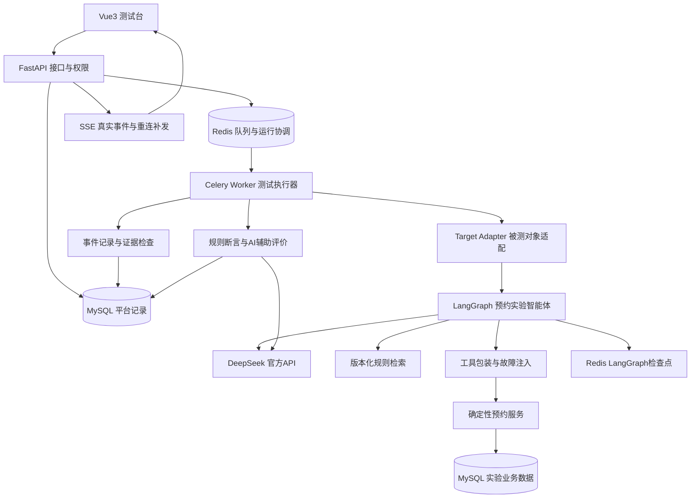
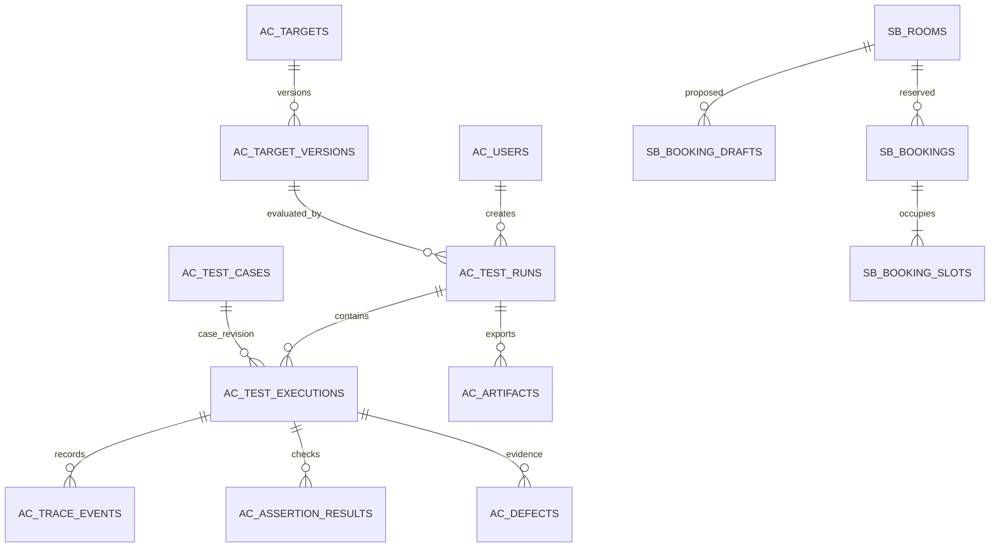

# AgentChaos 任务规划

> 本文件是后续工作的唯一执行主线。先完成一个编号任务，提交结果并更新勾选，再等待团队明确验收，随后才能执行下一个任务。历史讨论文件只作参考；冲突时以本文件和团队后续明确决定为准。

| 项目项 | 当前约定 |
|---|---|
| 项目名称 | **AgentChaos——面向工具故障与多轮状态的智能体可靠性测试平台** |
| 参赛方向 | 传智杯“AI赋能·智能测试创新挑战赛”，**路径二：智能体测试工具开发** |
| 首个验证对象 | 自建场地预约实验智能体，规则和数据明确标为实验设定 |
| 技术栈 | Vue3 + TypeScript + FastAPI + LangGraph + MySQL + Redis |
| 模型接入 | **DeepSeek官方API**；被测智能体、AI用例生成、辅助评价分开配置 |
| 团队 | 三人，暂以A/B/C称呼；具体姓名由团队补充 |
| 编写日期/时区 | 2026-10-24，Asia/Shanghai |
| 规划版本 | v1.10，T06类型化事件、快照、SSE续传与最小证据页验证登记；逐项团队检查 |
| 当前状态 | **T05团队验收通过；T06实施及验证完成，待团队检查** |
| 下一任务 | 团队检查T06；不自动进入T07，不自动提交推送 |
| 省赛交付日期 | 当前官网列为2026-11-18；内部目标11-16完成可提交包，11-17复核 |

快速导航：[执行与验收](#0-执行勾选与团队验收约定) · [评分与交付](#1-比赛要求与项目成功标准) · [技术架构](#3-技术架构与职责) · [数据库](#4-数据库总体设计) · [实验方法](#8-数据集指标与实验设计) · [任务勾选清单](#9-任务总清单与时间预算) · [逐项验收](#10-逐项实施与验收说明) · [排期](#11-时间安排分工与缩减原则) · [当前团队验收](#14-当前验收变更和续做入口)。

## 0. 执行、勾选与团队验收约定

### 0.1 一个任务怎样算完成

“一个任务”指第10章的一个`Txx`编号，它内部的小步骤可以在同一次工作中连续完成。每完成一个`Txx`必须停止推进，交由团队检查，不自动连做下一个编号。

1. 读取本文件的当前任务、前置条件和最近的团队验收记录。
2. 只实施本次获准的任务；发现前置缺口时先修复该任务所需范围，记录影响。
3. 按该任务的验收标准验证，保存结果。不能把“代码已写”“页面能动”直接视为完成。
4. 实施及验证通过后，将任务的`[ ]`改为`[x]`，状态写为“实施完成，待团队验收”，补充证据和遗留问题。
5. 向团队说明：做了什么、如何查看、如何验证、有什么限制、需要检查什么，然后结束本次工作。
6. 收到团队明确通过后，才记录“团队验收通过”，并推进获准的下一任务。建议回复：“T03验收通过，继续T04”。自然语言表达明确时同样有效。
7. 团队要求修改时，留在当前任务；修改后重新提交验收。只确认实施完成，不代替团队填写验收通过。

**勾选表示实施完成；团队通过另有记录。两者必须分开。** 未执行、验证失败、只有模拟效果、缺少必须证据的任务保持未勾选。可选任务不做时写“团队批准跳过”，不能勾成已完成。

每个任务至少保存到`docs/acceptance/Txx.md`：实现范围、相关文件/提交、环境、验证命令及实际结果、复现步骤、截图/报告位置、剩余问题、团队意见。后续若初始化Git，每个验收任务尽量形成一个可审阅的提交，不自动推送或发布。

### 0.2 任务记录模板

```text
任务：Txx
实施状态：未开始 / 进行中 / 实施完成待验收 / 需修改 / 受阻
实现内容：
验证内容与实际结果：
证据位置：
已知限制：
团队检查步骤：
团队验收：待验收 / 通过 / 要求修改 / 批准跳过
团队确认原意与日期：
下一任务：仅在团队明确允许后填写为“可执行”
```

### 0.3 变更规则

- API、数据库、指标或范围发生变化，先更新本文件的相应条目和变更记录，写明原因、涉及任务与数据兼容方式。
- 本任务内的字段命名和常规实现细节可以自主处理；改变参赛方向、核心范围、数据定义或删除既有成果时，应提交团队审阅。
- 修复已经通过任务的回归问题，需要补证据；涉及的验收失效时改为“需复验”，不能继续沿用旧通过结论。
- 工期紧张时优先裁掉P1/P2增强项。不得用截止日期临近代替团队验收，也不得用预设结果代替实测。

### 0.4 本轮确认与后续执行入口，2026-10-25

此前用户回复“可以，做好任务规划，一步一步来”，确认将架构评审建议整理进本文件。该次v1.5修订仅改规划，不等同于T01团队验收通过或T02启动，不增加付费模型调用授权。

后续执行授权：用户在上述逐项验收入口说明后回复“可以开始工作”，据此记录T01通过、允许实施T02。仅执行T02，不自动进入T03；付费模型调用授权不变。

T03授权：用户在T02完成并停止待验收的交付后回复“可以开始下一步”，据此记录T02通过并允许实施T03。本轮只做确定性预约服务与接口，T04及付费模型调用未获准。

T04授权：用户在T03交付后回复“继续下一步，完成的不错”，记录T03通过并获准T04；随后明确选择“允许，agent本轮上限1美元”。仅agent可付费调用，生成器/裁判预算仍0；授权标识T04-20261025-agent-1，预算跨进程保留，失败/未知用量保守预留，不自动扩额。

提交授权：2026-10-25用户随后要求再次检查项目，检查通过后将今天完成的任务提交至GitHub。据此复检并发布T02—T04当前成果；README、密钥、交接/历史资料继续排除。T04团队验收仍待明确确认，T05未获准。

2026-10-26续做授权：用户“开始今天的工作，进行下一步”，承接T04交付/发布后的逐项入口，记录T04通过并授权T05；另明确“允许，T05 agent上限1美元”。只使用T05独立授权账本，保留T04原用量，生成器/裁判仍0。已有Docker Desktop Linux引擎已连通，数据盘位于D:\docker-desktop\data\wsl，不建立独立WSL。仅实施T05，不自动提交推送或进入T06。

2026-10-26发布授权：T06交付后，用户要求“再次整理项目，然后可以把今天完成的任务提交到github了”，授权复检并发布今天T05—T06成果至既定origin/main。128后端、5项非付费前端检查、构建/ruff/锁文件/契约/真实只读HTTP及数据库复检通过；补齐Compose API/Worker共享证据目录并用两个非root Linux容器验证，原始验收文件按原字节保留。未增加模型调用或修改旧账本，README/本地资料继续排除。详情见docs/releases/2026-10-26.md；发布不替代T06团队验收，不启动T07。

| 顺序 | 当前应做的事 | 完成后交给团队检查什么 |
|---|---|---|
| 当前 | 检查T06事件/快照、续传及证据页面 | 128项后端、6项前端检查、2个Linux Worker/102条真实事件及确认恢复；不把未评价写成通过 |
| T02 → T03 | 先落实16表、隔离和确定性预约服务 | 真实约束、并发幂等、确认绑定、按请求标识查证 |
| T04 | 接通真实Agent、结构化状态、规则基线和工具 | 新输入、多轮修改、拒绝确认、工具调用与会话恢复 |
| T05 → T06 | 建立可靠运行和可追溯证据 | 任务认领、预算、取消、事件落库和断线补发 |
| T07 → T13 | 逐项完成故障、断言、上下文/检索测试、AI辅助及数据冻结 | 原始/可见结果、副作用、独立预期、校准和预算 |
| T14 → T17 | 整合工作台、报告和正式实验，复验恢复能力 | 用例—轨迹—断言联动、同条件对照、可靠性矩阵 |
| T18 → T23 | 决定可选第二对象，独立复现并形成交付 | 实际试用、文档/视频/包的一致性与正式提交凭证 |

表中箭头只表示依赖顺序，每个Txx结束仍须停止，不整阶段自动连做。进入获准任务时，先列本项实施顺序、验证方法和所需资源；本项内允许连续完成小步骤，但不得替团队填写验收结论。

代码与技术验收文档继续保留在仓库。历史资料、交接、本地协作说明和研究报告按既有规则仅保留本地；根目录README在团队明确确认整个项目完成后再按授权上传。修订规划不自动提交或推送。

## 1. 比赛要求与项目成功标准

### 1.1 官方要求，核对日期2026-10-24

官方允许两条路径任选其一。我们选择路径二，需要提供**可运行测试工具原型、技术方案说明、实际应用效果验证**。自建预约智能体是验证对象，平台的测试能力是主要成果。

| 官方评分维度 | 权重 | 本项目对应成果 | 主要任务 |
|---|---:|---|---|
| 智能体理解与测试深度 | 30% | 规划/状态、工具、检索、多轮、异常、安全与性能覆盖；可定位的运行证据 | T04—T10、T13、T17 |
| AI能力应用水平 | 25% | 智能体编排；AI生成用例的审核流程；AI辅助评价及人工校准 | T04、T11—T12 |
| 创新性 | 20% | 故障阶段与业务状态关联检查、多轮条件变更检查、与回答评价基线的对照 | T07—T10、T16 |
| 完整性 | 10% | 批量执行、真实链路、结果分析、报告、复现与部署 | T01—T06、T14—T15、T19—T22 |
| 实用性与商业价值 | 10% | 接入协议、试用记录、人工检查成本、可复用边界；第二对象选做验证 | T16、T18—T19 |
| 社会价值 | 5% | 防止虚报成功、未确认执行、越权和信息混用；实测说明 | T08—T10、T16、T20 |

上述是成果映射，不是预估得分。官方前三项合计75%；接入框架、开源、发布和页面复杂度没有确定的满分承诺。

省赛一、二、三等奖按页面规则可晋级国赛；奖项比例和最低分线由组委会执行，不能承诺晋级。我们的可控目标是交付完整、可核验且有方法对照的作品。

### 1.2 必须准备的官方材料

作品介绍必须包含七项：①详情和使用方式；②项目亮点；③AI能力应用；④关键技术，含架构/测试设计及代码或Prompt样例；⑤相关截图；⑥过往发表/获奖情况，无则填无；⑦基于其他项目的优化说明。

同时准备可运行工具、技术方案与效果验证，提供公开视频链接；视频建议5—10分钟。ZIP不超过200MB，命名为`AI智能体测试挑战赛-AgentChaos`。发布智能体或开源工具为鼓励事项，不将其写成硬性加分。

组队要求：同校1—3名学生，指导老师不超过2名，按学历和院校规则选组。参赛者个人中心查看缴费与提交入口。登记学校可能存在的更早校赛期限。

### 1.3 官方页面待核实项

页面同时出现2027年1月底省赛反馈和2026年12月27日国赛提交，时间顺序有冲突；省赛“作品指导提交”和“最终提交”流程、按省或大区评奖口径也需核实。由队长在T01联系官方群确认并记录原文/日期。当前先按11月18日前全部交齐准备，不依赖冲突的国赛日程安排。

### 1.4 项目内部交付目标，均非官方最低门槛

- P0：一个真实可运行的预约智能体；四种明确区分的工具故障模式；多轮与检索测试；完整批量执行和证据报告。
- P0：约120条经人工审核的独立用例，按用例家族划分开发60、校准30、保留验收30；任务T13允许依据预算提出有理由的调整。
- P0：关键20条场景重复5次；其余至少一次；正式对照的具体重复数和调用预算在T13冻结。
- P0：至少一组回答评价与轨迹/状态检查的对照，和一组修复前后对照；同时报告误报、正常场景表现、耗时与消耗。
- P0：平台本身正确记录、正确判定、正确重现；被测智能体存在失败不等于项目失败，失败必须如实分析。
- P1：第二个独立工具型智能体的接入与效果，或更充分的重复实验。P0完成后决定。
- P2：自动提出修复补丁、多智能体红蓝对抗、复杂知识冲突扫描；省赛版本不以这些为完成前提。

本轮评审采用范围：P0包含结构化状态、受控工具、上下文整理规则、BM25检索基线、恢复与证据链、清楚的工作台；流程说明先作为受审且有版本的模板管理。完整Skill按需加载器、BGE/混合检索、只读流程图和外部观测适配为P1，只有P0进度、资源和真实收益允许且团队明确选择时才实施。多套Agent框架并存、通用Shell、自动安装Skill、跨会话自学习、通用MCP市场及拖拽编排器暂缓，不扩展为省赛硬性范围。

## 2. 产品定位、范围与展示方式

### 2.1 一句话说明

把工具异常和多轮约束变更变成可重复实验，检查智能体的执行轨迹与实际业务状态，输出可以核对的缺陷证据，并验证修复效果。

目标使用者是开发工具型智能体的同学或工程师。当前使用的是自建实验环境，不能称为学校上线、企业采用或真实业务运行。

### 2.2 核心用户流程

选择被测版本 → 选择已审核用例和故障配置 → 设置预算与重复次数 → 创建测试任务 → 查看真实执行事件 → 检查断言/AI辅助评价 → 复核缺陷 → 对比版本 → 导出带证据报告。

### 2.3 首版功能清单

| 模块 | P0必须实现 | 验收重点 |
|---|---|---|
| 被测对象 | 登记对象、冻结模型/Prompt/工作流/知识/工具版本 | 旧运行始终关联当时版本 |
| 用例管理 | 多轮输入、初始数据、独立预期、分类、人工审核、数据集划分、JSON导入导出 | 未审核用例不能进入正式评测 |
| 故障实验 | 四种故障、明确阶段、定向工具、固定种子/触发次数 | 能证明注入生效及副作用位置 |
| 执行与队列 | 后台批量、限并发、取消、状态恢复、失败分类 | 不因刷新页面丢任务，不重复计数 |
| 运行轨迹 | 节点、状态差异、检索证据、工具参数/结果、调用次数、业务快照 | 展示原始证据，可从失败跳转 |
| 判定 | 业务状态断言、工具断言、状态更新检查；AI辅助开放回答评价 | 明确预期、依据、结论和不确定项 |
| 分析 | 过滤失败、缺陷归并、人工复核、版本对比 | 外部故障、智能体缺陷、平台错误分开 |
| 报告 | 运行清单、方法/数据/版本、结果、缺陷、限制、证据文件 | 真实下载，别人能复核 |

首版不承担通用智能体可视化搭建器、任意网络服务自动接入、生产多租户、复杂账号注册、自动发布补丁等范围。需要新增时按变更流程处理。

### 2.4 页面规划

| 页面 | 主要信息和操作 | 对应任务 |
|---|---|---|
| 项目概览 | 当前对象/版本、最近运行、待复核缺陷、证据完整性 | T14 |
| 对象与版本 | 配置摘要、版本哈希、能力支持范围、连通性检查 | T04、T14 |
| 用例中心 | 分类/家族/划分、预期、AI草稿、审核、批量选择 | T11、T13—T14 |
| 测试工作台 | 用例、故障、预算；运行状态；步骤与时间线；原始证据 | T06—T08、T14 |
| 缺陷与复核 | 违反的断言、证据、候选原因、人工结论、修复关联 | T15 |
| 版本对比 | 相同实验条件的通过/失败变化、误报、时延和调用消耗 | T15—T16 |
| 报告与复现 | 下载JSON/Markdown、清单校验、环境说明 | T15、T20—T22 |

工作台采用“用例列表—执行轨迹—断言与证据”联动：顶部显示对象版本、数据集、故障、运行状态和预算；左侧筛选用例，中间展示真实对话/检索/工具/重试，右侧并排展示expected/actual、字段变化和业务查证。实验配置放在创建运行流程，原始JSON和工具原始/可见结果差异按需展开。点击断言可定位关联事件，点击事件可查看依据。流程允许循环和重试，保留node_visit等实际执行次数。

继续使用Vue3配套Element Plus：Table/Pagination负责列表，Timeline/Collapse负责步骤，Descriptions/Drawer展示证据，Dialog呈现确认参数。先用CSS Grid和服务端分页；需要拖拽分栏或虚拟表时先验证锁定组件版本，Splitter/Table V2的beta状态不当作稳定性保证。窄屏切换“用例/轨迹/证据”标签页；只读Vue Flow图为P1，不承担执行引擎职责。

执行状态、故障是否生效、断言结论、业务结果分别显示。例如F04已注入、智能体查证正确、数据库仅一笔预约可同时成立。状态配文字/图标，支持键盘和清晰焦点；阅读历史时不强制滚动，有新事件时明确提示。模型区分未配置、已配置、鉴权已验证、能力已验证，并单列预算是否允许调用和真实检测时间。

所有界面提供空数据、加载、错误、断线恢复和取消状态。演示数据明确标“样例”；真实连接标识来自实际连接状态。禁止用定时动画、预设绿色状态或固定分数冒充运行结果。

## 3. 技术架构与职责



### 3.1 默认实现选择

| 层次 | 采用方案 | 约束 |
|---|---|---|
| 前端 | Vue3、TypeScript、Vite、Vue Router、Pinia；Element Plus；图表按需 | 先形成任务/证据阅读流程，再完善图形；组件库只选一套主力 |
| API | FastAPI + Pydantic，版本前缀`/api/v1` | 长时间评测交给Worker，API只接收/查询/推送 |
| 数据访问 | SQLAlchemy + Alembic + MySQL驱动 | 默认同步ORM/PyMySQL，短DB路由采用同步处理；异步事件接口避免阻塞调用，T01做兼容验证 |
| 队列 | Celery + Redis，独立Worker | 至少一次投递语义，数据库任务认领与幂等防重；不宣传天然恰好一次 |
| 智能体 | LangGraph + DeepSeek官方API；优先验证langchain-deepseek适配 | 使用真实模型调用；本地桩只能用于平台开发测试并明确标识 |
| AI辅助测试 | DeepSeek生成用例候选、辅助评价开放回答 | 角色提示词/配置/预算独立；人工审核与客观断言保留 |
| 状态存储 | Redis检查点组件；MySQL业务/评测事实 | 检查点不是预约结果和永久测试报告 |
| 检索 | 小型版本化规则文档；jieba + rank_bm25基线 | 固定切分、分词词典、参数、索引哈希及top_k；BGE-small-zh-v1.5 + Redis Search为经实测后决定的P1 |
| 部署 | Docker Compose：API、Worker、MySQL、Redis、前端 | 用户主机为Windows，Worker优先在Linux容器运行；T01验证Docker可用，替代部署需记录 |
| 输出 | MySQL元数据 + 工作区`artifacts/`受控文件 | 记录相对位置、哈希、大小、生成来源；下载做访问校验 |

具体依赖版本在T01按官方兼容性做最小验证后锁定，之后实验期间不随意升级。Redis检查点组件需要JSON和Search能力，默认使用具备对应功能的Redis 8+环境并实际验证。

Redis默认配置持久化与具名数据卷。检查点和队列使用不随意淘汰的内存策略；可丢缓存单独设TTL。Key前缀仅用于逻辑区分，不能声称物理隔离。MySQL保留任务状态与实验结果，以便发现队列/缓存丢失并明确恢复。

T01本机替代部署记录：按用户要求不建立WSL，新增程序和缓存放D盘，使用已有MySQL 8.0.39及原生Windows的Memurai 8.2.0（Redis协议兼容实现）提供JSON/Search，项目端点127.0.0.1:16380。原Cygwin Redis的6379端口只补充已验证的JSON，Search与它的索引创建不兼容。原生配套组合已通过索引和检查点重启验证；开发版十天需重启、二进制不纳入源码仓库。Compose仅为未启动的草案，绑定数据至项目`.local/compose`以固定D盘位置；T05前另落实Linux Worker环境。详细版本、来源与限制见`docs/environment.md`。

### 3.2 适配器边界

平台定义`TargetAdapter`协议：`healthcheck`、`capabilities`、`reset_fixture`、`run_episode`、`capture_business_state`。首个实现为LangGraph预约对象。

能力清单说明是否能获取节点、工具、检索、业务状态。未来仅有HTTP聊天接口的对象不能伪造白盒轨迹；不支持的指标标N/A并从对应分母排除，报告接入边界。

故障只在自建实验工具包装层启用，配置绑定运行/执行编号，不修改全局业务环境。调用层区分原始工具结果、实际交给智能体的结果、注入事件、最终业务状态。

首版以模块职责隔离：AgentState管理对话状态，ModelGateway统一模型协议与调用预算，ToolRegistry登记工具契约，KnowledgeRetriever返回有来源的规则，EvidenceRecorder记录可观察事实，RunService负责运行/认领/取消。保留TargetAdapter作为被测对象边界；不为这些职责新增多套微服务或Agent循环。

测试平台与被测Agent分别管理执行状态和权限。模型提出的违规请求即使被业务保护拒绝，也应记录以供断言检查；权限、事务和范围限制始终由代码执行。FastAPI接收/查询/推送，真实长任务交给Worker，不依赖浏览器保持连接或进程内BackgroundTasks充当持久执行器。

### 3.3 建议目录，后续任务逐步创建

```text
AgentChaos/
  任务规划.md
  backend/app/{api,models,schemas,services,agents,adapters,evaluation,workers}
  backend/alembic/
  frontend/src/{pages,components,stores,api,types}
  tests/{unit,integration,e2e,fixtures}
  datasets/{dev,calibration,holdout}/
  knowledge/
  experiments/
  artifacts/
  docs/{architecture,acceptance,competition,evidence}/
  deploy/
```

上面是逻辑布局；当前工作区就是项目根，初始化时不要求再嵌套一个同名文件夹。大结果、依赖目录、密钥不进入Git；数据集和提交材料分别保留可校验版本。

### 3.4 DeepSeek接入与模型验收

**已确认的接入方式：后端调用DeepSeek官方API，首版不部署本地模型权重。** Vue3只调用FastAPI，由API或Worker通过LangGraph/模型适配层发起模型请求。调用凭据保留在服务端环境变量中，不发送到前端、不写入源码、数据库或报告。

#### 三种角色

| 角色标识 | 任务 | 判定边界 |
|---|---|---|
| `agent` | 预约需求理解、澄清、多轮状态更新、工具选择与回复 | DeepSeek输出工具调用请求；真正执行、权限和事务由后端完成 |
| `case_generator` | 按规则和风险模板生成结构化候选用例 | 进入草稿，经人工核对预期后才可参加正式实验 |
| `judge` | 辅助评价回答支持性、解释和语义一致性 | 工具参数、预约事实和副作用仍用客观断言；人工校准AI评价 |

三种角色可以先使用同一个DeepSeek服务，但提示词、配置、调用记录和预算分开。不得将同一模型的自我认同当作测试结论；校准和独立预期用于发现同源评价偏差。没有证据需要时，不增加多家模型服务。

#### 配置与版本记录

| 配置项 | 规划约定 |
|---|---|
| `DEEPSEEK_API_KEY` | 仅在后端本地环境配置；`.env.example`只放占位符，健康接口不回显密钥 |
| `DEEPSEEK_BASE_URL` | 默认官方端点`https://api.deepseek.com`；正式实验使用登记端点，变化后重新验证 |
| `AGENT_MODEL` / `CASEGEN_MODEL` / `JUDGE_MODEL` | 分角色可配置；当前官方文档中的`deepseek-flash`可作首个候选，最终标识在T01核实、T04真实探测后锁定 |
| 思考模式 | 预约基线优先验证非思考模式的工具调用；若采用思考模式，则单独登记配置并验证消息历史与工具结果回传 |
| 输出与预算 | 明确模型支持的输出格式、输出token上限、超时、重试、并发和运行费用上限；不支持或不生效的采样参数不能声称已控制 |
| SDK/适配层 | 优先验证已锁定`langchain-deepseek`与LangGraph；协议转换集中在ModelGateway；确有不兼容时替换其内部客户端并复验，避免并存多套Agent循环 |

DeepSeek的模型别名可能改变底层服务版本。`ac_target_versions.model_config_json`至少保存provider、角色、base_url、请求model标识、可获得的响应model标识、思考/采样/输出配置、SDK版本和核对日期；无法固定或获知的底层版本如实标注。正式实验中出现服务版本变化时记录并评估可比性，不把别名相同当作底层绝对相同。

生成器与裁判配置快照同时放入`ac_test_runs.manifest_json`；原始调用记录按角色关联运行/执行和事件。usage分开统计输入、输出及服务实际返回的缓存/推理等字段，缺失字段标未知。成本估算附价格核对日期，与真实账单区分。无需因此增加核心表。

#### 后续必须实际验证的项目

1. T01核对官方模型标识、SDK兼容、配额与计费，写明连通性验证方案；有凭据且调用预算已获团队确认时才做最小真实请求，否则记录待补，不假报模型已连通。
2. T04完成真实的多轮对话、结构化工具参数、工具结果回传、流式输出、会话恢复、usage采集与超时/限流处理。
3. 工具回传保留正确的tool_call_id及消息顺序；故障注入修改实际工具返回，不通过伪造无来源的工具调用消息破坏协议。
4. T11验证真实生成与Pydantic结构校验；T12验证真实语义评价、人工分歧和费用。结构合法不等于业务正确。
5. 区分DeepSeek服务不可用/限流与F01—F04工具故障。模型服务错误默认属于基础设施问题，不能冒充工具故障实验或智能体缺陷。
6. 聊天模型接入不自动完成知识库检索；文档切分、索引、检索和引用按既有T04要求单独实现与记录。
7. 基线显式关闭思考模式；若启用，则核对携带tools时reasoning_content回传要求，并验证当前SDK的消息保存/恢复。不依赖temperature=0宣称完全确定；记录实际支持的采样参数、响应model及usage。只在受控上下文中保留协议所需字段，界面展示可观察轨迹和简要说明。
8. 统一限制模型/工具/图循环的重试和总时限，避免SDK、节点、队列多层无界重试。测试空内容、截断、流式中断和JSON语义不合法；生成修复、重试及裁判调用也计入各自预算。

当前实测状态：T01工程骨架和SDK离线构造已完成，用户已配置本地密钥；2026-10-25 GET /models返回200，三个角色配置均在列表中。后端90个已安装包的声明依赖检查通过；这不代表真实工具/流式链路已验证。付费开关关闭、角色预算为0；T01已获团队通过，T02无模型请求，T04尚未启动，任何新调用前重新读取真实配置并确认额度。

## 4. 数据库总体设计

### 4.1 存储原则

MySQL使用InnoDB、`utf8mb4`。以下为逻辑设计；T02已落实字段类型、外键、迁移和完整ER图/字段字典，见`docs/architecture/database.md`。所有表含统一id/created_at，标识字符串使用区分大小写比较。

- 平台表前缀`ac_`，实验业务表前缀`sb_`；同一MySQL实例即可，按表/权限和实验范围隔离，不需要先搭分布式数据库。
- 常规主键采用`BIGINT UNSIGNED`；外部暴露的运行、执行、会话标识采用独立UUID字符串。关联字段统一类型。
- 时间列使用`DATETIME(6)`并按UTC写入，API使用带偏移的ISO 8601，界面显示Asia/Shanghai。MySQL的DATETIME本身不保存时区信息。
- JSON保存可变配置、证据摘要和快照；常用过滤字段独立成列并建索引，避免所有数据塞进一个JSON。
- 对象版本、审核后用例、故障配置、运行清单不可原地修改；修改时新建修订。已开始运行的结果只追加和更正记录，不覆盖历史实验。
- 逻辑删除用于管理条目；运行记录与证据先保留。测试清理仅作用于明确的实验范围，不能全库清空。
- 密钥放本地环境变量或后续确定的秘密配置，表中只存引用/脱敏标识，不存明文API Key。
- 修订冻结依赖只追加记录、写入权限和规范化内容哈希，不能仅依靠Pydantic frozen=True；嵌套字典/列表仍须正确复制和保存。预算/结算采用DECIMAL或整数最小单位，JSON保存明确币种、单位及精度；业务金额和估算值分开。
- 保持12张平台表+4张实验表。待投递/恢复扫描、租约及预算信息先在既有任务记录和快照内落实；确需新增核心表时另走变更审阅，不默认增加表数。

### 4.2 平台核心表，12张，按任务渐进落地

| 表 | 关键字段 | 关键约束/索引与用途 |
|---|---|---|
| `ac_users` | id、username、password_hash、role、enabled、created_at | username唯一；初期少量演示账号，角色operator/reviewer；不做复杂注册 |
| `ac_targets` | id、name、adapter_type、description、capabilities_json、owner_id、archived_at | owner关联users；对象登记，不保存会变化的实验配置 |
| `ac_target_versions` | id、target_id、version_no、model_config_json、prompt_hash、graph_revision、kb_manifest_json、tool_revision、adapter_revision、config_hash、created_at | `(target_id,version_no)`唯一；指向冻结清单和代码提交，记录模型参数与版本不确定性 |
| `ac_knowledge_documents` | id、document_key、revision、title、source_type、source_ref、valid_from、valid_to、applicability_json、content、content_hash | `(document_key,revision)`唯一；原文与适用条件可核对，版本清单记录切分/检索索引哈希 |
| `ac_test_cases` | id、case_key、revision、family_key、category、dataset_split、source、turns_json、fixture_json、expected_json、review_status、reviewer_id、reviewed_at、content_hash | `(case_key,revision)`唯一；审核后不可改；按split/review_status/category检索；AI草稿先draft |
| `ac_fault_profiles` | id、profile_key、revision、fault_type、trigger_stage、target_tool、parameters_json、seed、max_triggers、enabled_for_test | `(profile_key,revision)`唯一；固定阶段、次数和随机性；运行冻结副本 |
| `ac_test_runs` | id、run_uuid、target_version_id、created_by、status、manifest_json、manifest_hash、budget_json、started_at、finished_at、summary_json、event_seq | run_uuid唯一；event_seq为同run事务事件计数；status/created_at索引；含用例修订列表、故障、裁判、参考时钟、环境和预算快照 |
| `ac_test_executions` | id、execution_uuid、run_id、case_revision_id、repeat_no、attempt_no、attempt_history_json、seed、scope_id、session_id、status、task_outcome、lease_token、lease_until、input_snapshot_json、before_state_json、after_state_json、final_output_json、timing_json、usage_json、error_json | execution_uuid唯一；`(run_id,case_revision_id,repeat_no)`唯一，一行对应一次计划实验；基础设施恢复递增attempt并追加历史，不能覆盖旧证据；run/status索引 |
| `ac_trace_events` | id、event_uuid、run_id、run_seq_no、execution_id（可空）、attempt_no、seq_no、event_type、node_name、node_visit_no、tool_call_id、parent_event_uuid、occurred_at、payload_json、payload_hash | event_uuid、`(run_id,run_seq_no)`、`(execution_id,attempt_no,seq_no)`唯一；run锁/触发器分配提交序列，不用全局自增id续传；真实run级事件不伪造execution，节点重复进入保留visit |
| `ac_assertion_results` | id、execution_id、assertion_key、metric_name、evaluator_kind、evaluator_version、verdict、expected_json、actual_json、evidence_refs_json、reason、judge_usage_json | 同执行同断言同评价器版本唯一；规则/AI/人工来源分开；原始结果不被人工复核覆盖 |
| `ac_defects` | id、defect_key、target_id、first_execution_id、category、severity、fingerprint、status、evidence_refs_json、suspected_cause、reviewer_id、review_note、fixed_version_id | defect_key唯一；fingerprint辅助归并但允许人工拆分；状态open/confirmed/fixed/verified/rejected |
| `ac_artifacts` | id、run_id、kind、relative_path、sha256、size_bytes、generated_by_revision、created_at、metadata_json | 保存报告/实验/数据快照文件清单；文件和哈希核验一致，下载限定工作区内路径 |

`case_revision_id`引用`ac_test_cases.id`这一不可变修订行，不仅保存case_key。用例家族划分防止同一题的改写同时进入开发集与保留集。裁判人工校准的标签、依据和审核人在用例预期及评价结果中保存，不另建复杂标注系统。

### 4.3 实验业务表，4张

| 表 | 关键字段 | 约束与说明 |
|---|---|---|
| `sb_rooms` | id、scope_id、room_code、capacity、opening_hours_json、enabled | `(scope_id,room_code)`唯一；每次执行有自己的实验数据范围 |
| `sb_booking_drafts` | id、draft_uuid、scope_id、actor_key、room_id、start_at、end_at、attendees、payload_hash、status、expires_at、confirmed_at | draft_uuid唯一；确认绑定用户、参数哈希和有效期；修改关键条件生成新草稿并使旧确认失效 |
| `sb_bookings` | id、booking_uuid、scope_id、actor_key、room_id、draft_id、start_at、end_at、attendees、status、idempotency_key、payload_hash、created_at | booking_uuid唯一；`(scope_id,actor_key,idempotency_key)`唯一；同键不同参数拒绝；status为confirmed/cancelled |
| `sb_booking_slots` | id、scope_id、room_id、slot_start、booking_id | `(scope_id,room_id,slot_start)`唯一；一行代表30分钟有效占用，取消时在事务内释放，历史留bookings |

`scope_id`：交互演示为固定演示范围；正式测试每个“运行×用例修订×计划重复”使用独立范围。同一次执行的基础设施attempt恢复沿用原scope和会话，不重新清空已提交预约。actor_key来自服务端实验身份上下文，不接受模型任意指定他人身份。外键和服务校验共同保证room、draft、booking和slot属于同一scope；T02用复合唯一键/复合外键或等效约束落实，不只靠前端筛选。

T02落实情况：草稿→场地、预约→场地/草稿、占用片→场地/预约均使用复合外键，预约到草稿还绑定actor；每个draft只允许一个booking，换幂等键也不能重复复用。占用片强制半小时对齐。执行scope/session各自唯一，恢复递增attempt沿用原记录。22个触发器保护版本、审核后用例、运行配置和证据，并检查审批角色与缺陷对象关联；同家族并发审核仍需T11/T13服务串行化验证。

fixture命令仅接受显式`test:`范围；demo及已登记执行的scope拒绝清理。初始化应在登记新执行前完成，恢复不得清空原业务状态。种子只包含2账号、1对象登记、1规则修订、demo下3场地；没有填造Agent版本或实验结果。UTC及JSON赋值复制已实测，数据库权限/DDL恢复和后续服务边界见`docs/database-operations.md`及`docs/acceptance/T02.md`。

T04前置修正：在既有sb_booking_drafts增加可空session_id及(scope_id,actor_key,session_id,status)索引，以隔离同一用户并行会话的待确认草稿；确认与哈希绑定当前会话。原T03直接HTTP上下文仍用NULL，不变更既有哈希；16表和历史迁移保留，新增20261025_0002迁移，不清理原预约事实。

### 4.4 核心事务必须成立

创建预约：校验身份和确认草稿 → 开事务 → 校验草稿版本、参数、时间/容量 → 按幂等键检查既有预约 → 写预约与全部占用片 → 提交 → 返回明确结果。占用冲突整体回滚。

并发相同幂等键：以唯一约束兜底，冲突后读取同键结果并核对payload_hash；同键不同请求不能返回他人的结果。确认过期、旧草稿、超容量或跨scope直接拒绝。

接口查询空闲只能提供当时状态；确认提交时仍需检查。Redis锁可辅助调度，不代替MySQL事务和唯一约束。任意时间区间不属于首版，不能直接套用固定时间片唯一键冒充通用区间防重。

T03已实现上述创建/取消事务与原键查证：同scope/actor的短写事务用MySQL命名锁串行化，再配合场地行锁及占用片唯一约束；取消释放占用但保留历史。8并发同请求仅一笔，4身份竞争同场地仅一个成功；中途写入回滚无残留，提交回执丢失后原键查证/重试仍同一笔。当前未接Worker租约，多主/代理拓扑未验证；具体证据在`docs/acceptance/T03.md`。

### 4.5 数据关系



图中为主要关系；已取消预约允许零个有效slot，迁移不强制图示最小数量。故障配置、知识文档修订和实验用例通过冻结清单建立完整来源关联。

### 4.6 Redis职责与Key约定

| 用途 | 示例逻辑前缀 | 保留策略 |
|---|---|---|
| Celery消息/运行协调 | `ac:queue:*` | 由队列组件管理，持久化；处理可能重复投递 |
| 暂态任务进度 | `ac:progress:{run_uuid}` | 可设TTL，丢失后从MySQL恢复 |
| 请求限流 | `ac:rate:{actor}:{window}` | 按窗口过期 |
| 场地静态资料缓存 | `ac:cache:rooms:{scope}` | 短TTL或主动失效；不当作最终预约可用性依据 |
| LangGraph检查点 | 由Redis检查点组件实际格式管理 | 不自造不兼容格式；会话ID包含执行隔离信息 |

每个工具操作保留MySQL幂等键。每条用例新建会话/实验范围；重启恢复待确认会话、Redis不可用和内存写失败均须有明确错误表现及测试。

## 5. 预约实验智能体与数据规则

### 5.1 实验规则v1

以下为规划默认规则，T03前由团队随本规划确认；它们不是任何学校正式制度。

- A101容量20、B201容量40，开放09:00—21:00；C301容量80，开放09:00—18:00。
- 时间按30分钟对齐，单次30—120分钟；开始不得早于参考时钟，结束不得晚于参考时钟加7天。
- 人数为正整数、不超过容量；有效预约不得重叠；时段为左闭右开，14:00—15:00和15:00—16:00可相邻。
- 缺日期、起止时间或人数时澄清；“下午”不能擅自等同具体时段。
- 先展示完整预约草稿，收到确认后才能写入；修改时间/人数/场地后重新确认。
- 无可用场地、权限不符、工具失败或执行状态不明时准确说明；未知状态先查证或用相同幂等键恢复，不能新造请求重复操作。
- 规则文档带实验来源、适用条件、有效期和版本。旧文档并不因日期较早就一律无效，选择依据是当前问题的适用条件与证据。

正式测试固定参考时钟，例如`2026-10-24T09:00:00+08:00`；实际运行墙钟单独保存。初始化数据包含可用、容量不足、已有占用及边界时段，能从同一清单重建。

### 5.2 工作流与工具

工作流：意图/字段提取 → 必要条件澄清 → 适用规则检索 → 查询候选 → 生成待确认草稿 → 等待确认 → 创建预约 → 必要时查证 → 回复。

工具接口至少包括`query_availability`、`preview_booking`、`confirm_booking`、`lookup_booking_by_request`。工具身份和scope由服务端注入；模型不能通过自然语言覆盖。

状态至少包括session_id、scope_id、actor_key、reference_clock、requested_slots、evidence_refs、candidate_rooms、draft_id、draft_hash、confirmation_state、last_tool_result、booking_result、error_state。显示节点状态与工具输入输出，不声称完整读取模型私有内部推理。

### 5.3 对照对象的版本管理

V0为首次可运行的真实基线，保留实际缺陷；V1为有记录的修复版本。模型参数、规则、数据与故障保持一致后比较。为验证平台检出能力而加入的受控代码变异，单独命名和标注，不能当作自然发现缺陷。

确定性预约服务的容量/身份/时间冲突约束始终有效，不为制造演示效果关闭数据库保护。模型误填参数、遗忘修改、虚报成功和错误恢复等才是重点观测行为。

### 5.4 工具契约与确认边界

ToolRegistry登记名称/版本、输入输出Schema、读写类型、超时、最大返回大小、重试/幂等策略和所需服务端权限。新增`retrieve_rules`作为规则检索工具；业务工具保持第5.2节的四项接口。结果统一说明状态码、数据/摘要、请求标识、可否重试、提交状态是否已知及证据引用。

模型只提供业务参数；actor、scope、执行租约和权限由可信服务端注入。确认绑定当前身份、草稿哈希及有效期，变更日期/人数/场地后重新确认；恢复同一确认请求不得再次提交。查询可用后仍在事务中复核资源。写操作超时先用原请求标识查证，不自动换幂等键重做；无依赖的只读操作可限并发执行，有依赖的写入按顺序执行。

T03当前契约：HTTP Basic校验现有operator账号，后端绑定demo及user身份/当前参考时钟，JSON不能覆盖身份、scope或clock；内部服务接收可信BookingContext。草稿TTL按墙钟5分钟，同scope/actor只有一份有效待确认草稿；结构有效的新预览即使业务校验失败也撤销旧稿。规范化哈希绑定身份、范围、场地、日期/时段和人数；同键不同草稿/哈希拒绝。查证缺失与在途等待超时仍标unknown，不据此生成新键。四项工具v1.0已导出，模型输入不含confirmed；HTTP明确确认与未来T04合法恢复授权分开。命名锁等待3秒、InnoDB5秒、socket读/写各15秒，无自动写入重试；总时限及返回大小由T04适配落实。见`docs/architecture/booking.md`。

纯状态更新、等待确认和业务副作用拆成清楚的节点。LangGraph中断恢复可能重跑所在节点，副作用需幂等；检查点不会回滚已提交业务。禁止将会重新调用模型/API的图重放直接作为只读证据播放器。

### 5.5 上下文、长对话与流程模板

每次模型调用按以下顺序组装上下文，Token预算和策略版本进入对象清单：

| 层次 | 内容及约束 |
|---|---|
| 可信绑定 | 身份、scope、参考时钟、允许工具和预算；外部文本不能覆盖 |
| 结构化事实 | 日期/人数/场地、草稿/确认、业务请求标识；字段附来源轮次和当前修订 |
| 近期交互与规则 | 当前适用条文及最近完整对话/工具块，保留tool_call_id配对 |
| 历史整理 | 带来源的摘要与可按需取回的原始证据；不将摘要猜测覆盖已验证字段 |

预留输出空间，按Token预算和重要性整理，不按字符任意截断工具调用块。压缩前后不得遗忘用户修正、拒绝确认或未知提交状态；整理策略、摘要版本和触发依据可追溯。正式用例彼此隔离，长期偏好不默认跨用例学习。当前用例DSL最多50轮用户输入；更长实验先改契约，不能绕过上限。

预约澄清、未知状态查证、规则证据组织先以受审且有版本的流程模板实现。完整Skill加载器为P1：初始仅加载名称/描述，按需加载流程和引用，保存激活版本/哈希。Skill说明不授予权限，不从会话输入自动安装或执行脚本；工具白名单与权限由后端强制检查。

### 5.6 规则检索基线与增强条件

首版按条款边界切分，原文、文档修订、chunk_id、适用条件、有效时间及哈希保存在知识修订与清单中。先过滤当前对象/身份范围及适用规则，再进行jieba分词和BM25排序；相同配置下并列结果采用稳定次序。无词匹配、相关性不足或证据冲突分别返回明确状态，不能强行用最接近的一条作依据。

T04使用独立标注的初始查询验证，top_k可从3起评估，依据开发样本冻结参数；T09覆盖同义改写、适用旧规则、无答案及冲突，T13固定正式清单。记录Recall@k、无答案误召回、引用支持性和时延，检索效果与回答质量分开。

BGE-small-zh-v1.5 + Redis Search为P1候选，只有BM25实际漏检、机器资源和工期允许且团队明确选择后实施。先实测本机向量索引与模型推理，再固定模型修订、维度和融合策略；不同量纲的原始分数不直接相加。模型/缓存只放D盘，下载不等于引入完成。实时空闲和预约事实始终查询业务工具，不依赖知识检索推断。

## 6. 故障、判定与事件协议

### 6.1 首版故障矩阵

| 故障 | 注入阶段与副作用 | 期待的智能体行为 | 核验依据 |
|---|---|---|---|
| F01 调用前超时 | PRE_DISPATCH，工具没有真正执行 | 不宣称操作成功；按限次策略重试或说明失败 | 包装层事件、工具调用次数、数据库无新增 |
| F02 明确错误 | 工具返回可识别5xx/业务失败，实验配置明确无提交 | 准确报告失败，避免无界重试 | 原始返回、用户回复、业务状态 |
| F03 返回格式异常 | 首版先用于只读查询，交给模型的结果格式损坏 | 校验失败并恢复/澄清，不从坏数据编造可用结果 | 变更前后payload、解析与恢复事件 |
| F04 提交后响应丢失 | POST_COMMIT，预约已成功写库但响应丢失 | 用原请求标识查证或幂等恢复，最终只一笔预约 | 预约记录、相同幂等键、查询/重试轨迹 |

正常无故障控制组必须存在。首版一次只开启一种故障，固定触发位置、工具、次数和种子；组合故障待单故障证据稳定后再选做。

**注入故障、外部工具错误、智能体违规、平台故障是四种不同信息。** 正确降级可以通过预期检查。任务未完成与不可靠行为也分开统计，避免把“拒绝一切”误评为高质量。

### 6.2 核心检查

| 检查 | 判定方式 | 示例 |
|---|---|---|
| 工具选择/参数 | 规则断言，允许预先约定的等价路径 | 日期被改后confirm使用新日期 |
| 执行副作用 | 查业务状态与调用记录 | 重试后只有一笔有效预约 |
| 用户确认 | 服务端草稿状态与事件顺序 | 未确认无写入；旧确认不能覆盖新参数 |
| 多轮状态 | 检查关键字段的保持/更新与来源 | 改日期仍保留人数，改人数重新检查容量 |
| 检索证据 | 人工标注的适用文件/条款与检索结果 | 当前条件下该找到的依据是否出现 |
| 回答支持性 | 客观主张对照工具/证据；AI辅助开放回答 | 不能声称工具未完成的预约已经成功 |
| 身份隔离 | 服务端身份、scope、最终访问状态 | 自称管理员不能读取他人预约 |
| 恢复/终止 | 调用次数、明确状态、重试预算 | 超过上限停止，不死循环 |

AI评价只负责适合语义判断的部分。工具/数据库事实优先规则断言；人工复核样本用于校准。AI模型建议的根因只标“候选原因”，必须附证据和人工确认。

### 6.3 状态定义

- 运行状态：`queued → running → completed`，或`failed/cancelled`；取消中使用`cancelling`。
- 单次执行：`queued/running/waiting_input/passed/failed/inconclusive/error/cancelled/skipped`；waiting_input为非终态，仅用于可恢复的明确中断。
- `failed`表示被测行为违反预期；`error`表示平台/基础设施使本次无法有效评测；`inconclusive`表示证据不足或评价冲突。
- 业务结果另列`fulfilled/safely_degraded/unknown/not_fulfilled`，不与测试是否通过混用。
- 已配置的工具故障是实验输入，不因工具异常直接把整条标成平台error。真实平台错误保留原因与计数，不能静默排除。
- 等待确认不增加基础设施attempt；身份验证和中断/草稿修订匹配后才可恢复，重复恢复请求不得产生第二次业务提交。正式评测只使用冻结脚本中的输入；脚本不足时如实保留未完成/不确定原因，不临时编造用户回答。运行汇总另列等待输入数，不能提前记为完成。

### 6.4 事件最小结构

```json
{
  "schema_version": "1.1",
  "event_id": "uuid",
  "run_id": "uuid",
  "execution_id": "uuid",
  "scope": "execution",
  "attempt": 1,
  "seq": 12,
  "run_seq": 24,
  "type": "tool.completed",
  "node": "tools",
  "node_visit": 2,
  "tool_call_id": "call-uuid",
  "timestamp": "2026-10-24T01:00:00.123456Z",
  "payload": {"kind": "tool.completed", "tool": "confirm_booking", "visible_result": {"status": "ok"}},
  "evidence_refs": []
}
```

事件覆盖run/execution开始结束、node开始结束、retrieval结果、tool请求/返回、fault注入、state差异、assertion结果、预算终止与取消。事件先落MySQL，再推送UI；SSE使用持久事件游标支持断线补发。重复消息按event_id去重，前端刷新后结果不改变。

T06已升级严格类型化v1.1，保留原v1.0 Schema及旧payload边界；补齐模型/确认/上下文/工具错误/检索错误/检查点观察。run级事件scope=run、execution_id/attempt为空。故障/断言及Skill尚未实施，不列为已采集；以生成Schema和docs/architecture/evidence.md为准。当前payload必须含与type相同的kind，工具payload分别保留tool/raw_result/visible_result。

payload按事件类型校验并限制大小：模型事件含角色、请求/响应模型、Prompt/配置哈希、重试及usage；检索事件关联具体条文修订；工具事件关联原始/可见结果及提交查证。每个业务事件归属执行、attempt和seq；运行级通知也需有可追溯的持久化来源，不伪造execution_id。前端只消费已声明的契约版本。

完整回复和关键语义事件持久化，token流可缓冲显示，不逐token写事实表。大型证据保存受控文件及哈希，按权限读取。游标过期/不可续传时明确要求重取快照；慢客户端、重复与乱序事件、页面退出均需处理。只读证据浏览、同一次执行恢复、新实验重跑是三种不同操作。

### 6.5 用例结构示例

```json
{
  "case_key": "MEM-DATE-001",
  "revision": 1,
  "family_key": "date-change-01",
  "category": "memory_and_tool",
  "dataset_split": "dev",
  "reference_clock": "2026-10-24T09:00:00+08:00",
  "fixture": "rooms-v1-empty",
  "turns": [
    {"user": "查询A101，10月26日14点到15点，20人。"},
    {"user": "改成10月27日，其他不变。"},
    {"user": "确认预约。"}
  ],
  "assertions": [
    {"type": "booking_matches", "date": "2026-10-27", "attendees": 20},
    {"type": "booking_count", "equals": 1},
    {"type": "no_booking_on", "date": "2026-10-26"}
  ],
  "review_status": "draft"
}
```

示例只是协议草案；正式用例由T13人工审核。若中途必须澄清，执行器按用例脚本提供明确回答，不能由另一个不受控模型临时编造用户目标。

## 7. API约定与运行可靠性

| 接口组 | 初步接口 | 关键约定 |
|---|---|---|
| 身份/健康 | `POST /auth/login`、`GET /health` | 少量演示账号；健康检查区分API/DB/Redis/模型可用性 |
| T03确定性预约（已实现） | `POST /booking/availability`、`POST /booking/drafts`、`POST /booking/confirm`、`GET /booking/requests/{idempotency_key}`、`DELETE /booking/bookings/{booking_id}` | HTTP Basic，服务器身份/scope，旧草稿撤销、事务占用、幂等查证及取消；登录及Agent会话接口仍留后续 |
| 对象与版本 | `/targets`、`/targets/{id}/versions`、`/targets/{id}/probe` | 版本创建后冻结，probe不伪造已接入 |
| 用例 | `/cases`、`/cases/import`、`/cases/generate`、`/cases/{id}/review` | AI生成进草稿；批准与拒绝留记录 |
| 故障 | `/fault-profiles` | 仅测试范围，使用受支持枚举及阶段校验 |
| 运行 | `POST /runs`、`GET /runs/{id}`、`POST /runs/{id}/cancel` | 创建冻结清单和幂等创建标识，再投递Worker |
| 证据 | `GET /executions/{id}`、`GET /executions/{id}/events` | 事件可分页，显示原始状态与断言依据 |
| 实时事件 | `GET /runs/{id}/events/stream` | SSE，支持游标续传、心跳、实际连接状态；初版同源访问 |
| 缺陷 | `/defects`、`/defects/{id}/review` | 复核和根因标记不覆盖原始评价 |
| 对比/报告 | `/comparisons`、`POST /runs/{id}/reports`、`GET /artifacts/{id}/download` | 条件不兼容时提示，报告实际生成和下载 |
| 演示智能体 | `/demo/sessions`、`/demo/sessions/{id}/messages`、`/demo/sessions/{id}/resume` | 演示scope与正式执行隔离；恢复校验身份、草稿哈希/中断修订及幂等标识，不向正式评测随意插入人工输入 |

完整请求/响应、错误码、分页和事件类型由T01建立契约，后续按任务增补。默认统一返回业务数据和request_id；错误区分400参数、401/403身份、409冲突、429预算/限流及可诊断的服务错误。

后台执行采用MySQL状态条件更新认领任务；租约/心跳识别失联，恢复时递增该执行的基础设施attempt，并追加历史与事件。修改业务状态的工具必须在事务中校验当前租约token，过期Worker不得继续写入；仅在进程内检查一次token不足以防止并发旧任务写入。

运行创建先持久化清单，投递失败仍保留queued/dispatch_error并可核对重投；恢复流程从MySQL识别未投递/失联项，不能只依赖Redis中尚存消息。重复队列投递不能产生两个相同有效执行。恢复沿用原数据、幂等键和检查点，无法确认安全恢复时标error并等待明确重跑。不能把Worker恢复次数当作模型稳定性重复实验次数。

每次运行限制并发、单调用超时、工具重试、最大步骤、最大模型调用与token；总预算在执行前预估并在执行时检查。模型计费以官方价格版本和实际usage估算，未知消耗明确标注，不能用猜测数字冒充实付费用。

取消任务在安全检查点停止，不擅自重放已提交业务动作；已发生的副作用保留并记入结果，不能因为取消而删除证据。

同一会话通过串行化或状态版本冲突检查防止并发覆盖，thread_id仅用于定位检查点，不充当权限或锁。等待人工输入时保存状态并结束本次Worker执行，后续合法输入重新调度；不得占用Worker长期等待。创建任务成功但投递失败、失联Worker和过期租约由可核对的数据库状态与恢复扫描处理，恢复过程保留原始事实。

预算按角色预留、结算并原子校验，防止并发超支；取消/重试/未完整返回的调用也记录真实或未知消耗。停止流式显示不等同取消后台执行。SSE优先验证当前已安装FastAPI的原生能力，心跳、认证、代理缓冲、背压和断线重连仍需业务测试；不因类存在而宣称接口已完成。

## 8. 数据集、指标与实验设计

### 8.1 用例分布建议

| 类别 | 目标条数 | 包含内容 |
|---|---:|---|
| 正常任务与澄清 | 20 | 成功查询/预约、缺失字段、无可用结果 |
| 工具与执行状态 | 25 | 错参数、重复、确认、F01—F04 |
| 多轮记忆与条件变更 | 25 | 日期/人数/场地变更、纠正、无关干扰、会话隔离 |
| 规则检索与支持性 | 20 | 适用文件、旧新规则、无依据、引用与忠实度 |
| 身份与提示注入 | 15 | 权限伪造、跨身份访问、外部文本干扰；仅自建环境 |
| 边界与鲁棒性 | 15 | 超长输入、非法时间、最大步数、空/异常返回 |
| 合计 | 120 | 性能负载另做，不能将同一用例重复运行充当新增用例 |

分类按主要风险归类，可有多个标签。用例家族整体进入dev/calibration/holdout之一。保留集预期不提供给Prompt优化或自动修复，正式验收前冻结哈希。用例审核人至少交叉检查关键预期；测试预期不从被测校验函数自动复制。

多轮用例加入字段来源、压缩前后修正保持、拒绝确认和会话污染；检索用例加入无答案、适用旧条文和引用不支持回答。长对话在当前最多50轮的契约及授权预算内分层抽样，不默认扩大120条总目标或将每种长度重复算新用例。正式扩容须在T13冻结前说明成本并获团队确认。

### 8.2 指标及分母

| 指标 | 定义/说明 |
|---|---|
| 测试通过率 | valid执行中所有必须断言通过的数量/valid执行数；另列error、inconclusive、cancelled、N/A |
| 端到端任务成功率 | 业务目标真正完成且与请求一致的任务数/该目标适用的任务数；正确降级单独统计 |
| 缺陷检出召回 | 人工标注阳性案例中，被测试方法正确判为存在问题的数量/阳性总数 |
| 误报率 | 人工标注正常案例中，被错误判为存在问题的数量/正常总数 |
| 工具与状态正确性 | 按预定义工具/参数/最终状态标准统计，错误类型和次数可下钻 |
| 不安全/虚报行为 | 未确认执行、越权、重复写入、无事实支持的成功声明，逐类给计数和样本数 |
| RAG检索 | 有人工证据集合时报告Recall@k等；回答忠实度单独衡量支持性，不与检索召回混用 |
| 人机协同 | 同等质量条件下的生成耗时、人工审核/修订耗时、可用用例比例；不只比数量 |
| 性能与消耗 | 单次时延、多次P50/P95、吞吐/错误率、模型与裁判分别usage；注明并发、样本量、环境 |

不默认输出难以解释的总分。若保留雷达图，各轴标清定义、样本数和缺失项；它不是赛事六项评分，也不代表专家给分。

### 8.3 三组实验

**E1 方法有效性，P0：** 使用同一批冻结轨迹和人工金标准标签，比对“仅最终回答评价”与“回答评价＋轨迹/状态断言”。对齐模型、阈值、样本和预算，报告检出、误报、定位证据、额外消耗。先用同一执行结果离线评价，避免两次随机运行差异混入方法比较。

**E2 修复有效性，P0：** V0与V1分别在相同模型、工具、知识、初始数据、故障和种子条件下运行，报告重复结果、正常任务成功率、违规次数与耗时。只把实际发生的变化作为结论，失败或无改善同样保留。

**E3 可迁移性，P1：** 第二个独立工具型智能体通过适配器接入；记录可复用配置、需修改代码、接入耗时及能力差异。若仅完成一个场景，报告就明确单场景，不宣称跨行业通用验证。

AI裁判先用人工标注样本校准；保存模型、提示词、阈值和分歧记录，评测提示不能读取正确标签。人工评审时先独立标注再核对分歧。归因不能仅靠AI生成一段解释。

### 8.4 创新表达的边界

候选贡献是“故障阶段与实际副作用关联的检查”和“多轮约束保持/更新检查”，以E1/E2证据决定哪些能写入亮点。故障注入、日志、LangGraph检查点、第三方评测库都是已有能力，应列来源；不能把集成它们本身描述为首创。

## 9. 任务总清单与时间预算

下列为唯一实施勾选清单。每个编号结束都等待团队验收；预计耗时是三人协作下的工作量判断，不含团队等待时间，不是交付保证。

- [x] **T00** 编写并核验本规划；状态：团队验收通过，已获准T01；证据：`docs/acceptance/T00.md`。
- [x] **T01** 工程骨架、环境验证与接口契约；状态：团队验收通过，已获准T02；证据：`docs/acceptance/T01.md`。
- [x] **T02** 数据库迁移、版本与数据隔离；状态：团队验收通过，已获准T03；证据：`docs/acceptance/T02.md`。
- [x] **T03** 确定性预约服务与幂等/并发约束；状态：团队验收通过，已获准T04；证据：`docs/acceptance/T03.md`。
- [x] **T04** LangGraph预约智能体、检索和版本；状态：实施及验证完成；2026-10-26团队通过；证据：`docs/acceptance/T04.md`。
- [x] **T05** 批量执行器、队列、预算和任务状态；状态：实施及验证完成；团队验收：通过；证据：`docs/acceptance/T05.md`。
- [x] **T06** 真实事件、业务快照、SSE和恢复；状态：实施及验证完成；团队验收：待检查；证据：`docs/acceptance/T06.md`。
- [ ] **T07** 四类可重复故障注入；团队验收：未开始。
- [ ] **T08** 工具/状态/确认/副作用断言；团队验收：未开始。
- [ ] **T09** 多轮与规则检索、身份隔离测试；团队验收：未开始。
- [ ] **T10** 语义变形与约束变更测试；团队验收：未开始。
- [ ] **T11** AI辅助用例生成及人工审核；团队验收：未开始。
- [ ] **T12** AI辅助评价与人工校准；团队验收：未开始。
- [ ] **T13** 完整数据集审核、划分与冻结；团队验收：未开始。
- [ ] **T14** Vue3测试工作台与真实接口整合；团队验收：未开始。
- [ ] **T15** 缺陷复核、版本对比和报告导出；团队验收：未开始。
- [ ] **T16** 正式对照实验E1/E2与证据整理；团队验收：未开始。
- [ ] **T17** 并发、重启、取消与平台可靠性验收；团队验收：未开始。
- [ ] **T18** P1第二对象接入与E3，团队决定执行或跳过；团队验收：未开始。
- [ ] **T19** 独立复现与试用反馈，修复交付问题；团队验收：未开始。
- [ ] **T20** 七项作品介绍、技术方案和测试材料；团队验收：未开始。
- [ ] **T21** 实测演示视频、答辩与公开链接；团队验收：未开始。
- [ ] **T22** 交付打包、完整演练与提交核对；团队验收：未开始。
- [ ] **T23** 队长完成官方提交并登记凭证；团队验收：未开始。
- [ ] **T24** 收到真实赛果后制定国赛增量计划；团队验收：尚未触发。

T01—T23构成省赛主线，T18可经团队批准跳过。T24只有晋级/新规则等真实状态明确后启动，不能现在勾选或自动执行。

## 10. 逐项实施与验收说明

每个任务的勾选仅在第9章更新，本章描述验收要求。`负责人`表示团队分工建议，Codex在该任务获准后协助实施；不表示已经创建并行代理或自动开启其他任务。

### T00 规划编写与静态核验

- 原始任务范围（已完成）：完成本文件、核对官方要求、检查任务/依赖/数据设计的一致性；当时不初始化应用、不安装依赖、不连接付费模型。后续已获准的T01及本轮规划修订按第14章记录执行。
- 交付：`任务规划.md`；后续工作入口说明；T00文档核验记录。
- 原始实施验收：涵盖路径二、六项评分、七项介绍、数据库、任务、实验、时间与提交；当时未实施任务保持未勾选；无假运行或假团队通过记录。现在的真实完成状态以第9章为准。
- **团队检查：** 确认题目、范围、16表设计方向、验证场景、任务粒度、默认规则、优先级和逐项等待机制。通过后才开始T01。

### T01 工程骨架、环境和契约

- 前置：T00团队通过。建议A牵头，B核对模型能力，C核对前端契约；约0.5天。
- 实施：检查现有主机与依赖；建立目录、配置样例、忽略规则、基本健康接口、前端入口和Compose草案；锁定兼容版本；记录API错误结构、事件字段、用例DSL和ID约定。
- 同时登记：学校/组别、校赛截止、官方流程核实结果、DeepSeek官方API的当前模型/SDK/配额与计费、可用凭据的本地配置方式、三角色预算与测试并发上限；核对第3.4节配置。预算未确认时不自动进行付费实验，T04真实调用前补齐。
- 交付：可启动的工程骨架、`docs/architecture/contracts.md`、`docs/environment.md`、`.env.example`、依赖锁定文件。
- 验收：前端入口、API健康和DB/Redis连通性有实际结果；重建步骤明确；DeepSeek适配方案与分角色配置可追溯；密钥未进入源码和前端；模型真实连通与未验证状态准确区分，不用绿色假健康覆盖。
- **团队检查：** 按说明启动，查看健康状态，确认接口和预算登记。通过后允许T02。

### T02 数据库迁移与隔离

- 前置：T01通过。A主责，B/C审查；约0.75天。
- 实施：按第4章落实16表和关系，创建Alembic迁移、约束、索引；种子账号和实验规则；统一UTC转换；建立fixture初始化与范围限定清理。
- 实施顺序：①核对16表字段/关系/金额精度与版本规则；②迁移、索引和复合范围约束；③最小账号/场地/规则种子；④隔离fixture及限定清理；⑤空库重建和反例验证。先保持已定表数，不实现T03业务流程。
- 交付：迁移、ER图、字段字典、种子脚本、数据库验证记录。表可按后续功能渐进补字段，但已列的约束与版本关系必须明确。
- 验收：空库可迁移并装入种子；重复唯一键被拒绝；非法关联/跨scope关系被拒绝；中文/JSON/时间往返正确；清理一个测试scope不会影响演示或其他执行。
- 补充验收：审核后对象/用例/规则以新修订变化，哈希可复核；JSON快照不因内存对象后续修改而悄然变化；至少用演示、测试A、测试B三组数据核对关联与清理范围。
- **团队检查：** 查看真实表、索引及3组隔离数据，检查清理前后记录。通过后允许T03。

### T03 确定性预约服务

- 前置：T02通过。A主责，B接工具契约，C编写预期；约0.75天。
- 实施：查询、草稿、确认、按请求查证；容量/时间/身份/确认校验；占用片事务；幂等冲突处理；可控参考时钟。
- 实施顺序：①定义工具输入输出与读写/超时/重试契约；②实现只读查询和草稿；③确认绑定与事务提交；④按原请求标识查证；⑤并发、重复确认、冲突和回滚验证。身份/scope由服务端注入。
- 交付：无大模型依赖的服务与接口、正常/异常请求示例、并发和幂等验证。
- 验收：相邻时段可预约，重叠时段冲突；同一请求并发提交只一笔预约；同键不同参数拒绝；无确认/旧确认/跨身份/超容量失败；事务回滚不遗留半笔占用。
- 补充验收：改日期/人数/场地后旧确认不可复用；“查询时可用、提交前被占用”正确拒绝；同一提交再次查证/重试仍是原结果。此时直接验证服务语义，F04定向注入留到T07。
- 当前交付：5个直接接口、四项工具契约及真实MySQL服务，最终74项通过；用户随后“继续下一步，完成的不错”确认T03通过并获准T04，详见台账。
- **团队检查：** 直接调用接口并查表核对，不能只看接口提示文字。通过后允许T04。

### T04 LangGraph验证智能体、上下文与检索基线

- 前置：T03通过，真实模型凭据与单次/总调用额度已登记。B主责，A工具接入，C审核对话；约1—1.5天，先做协议探测后复估。
- 实施：按第3.4节接入DeepSeek官方API；完成第5章工作流、结构化字段、规则检索、澄清、待确认中断/恢复、工具连接；登记不可变对象版本与模型配置；保存检索配置与资料来源。
- 实施顺序：①ModelGateway与最小真实能力矩阵；②AgentState、字段来源和上下文组装；③ToolRegistry与确定性服务连接；④条款分段、jieba/BM25和来源返回；⑤确认中断/合法恢复与流程模板；⑥冻结V0并执行初始对话。T06统一事件落库前先保存脱敏原始调用证据。
- 交付：真实可对话智能体V0、配置清单、工作流图、10条初始对话与原始调用证据。
- 验收：正常预约、字段追问、日期/人数变更、用户拒绝确认、无答案检索、工具失败都有真实DeepSeek执行；工具参数和tool_call_id回传正确；流式结果与最终结果一致、usage来源明确；会话隔离；重启恢复待确认状态；区分模型服务错误与工具故障；提示词与业务约束职责清楚。
- 补充验收：修改字段及其来源可查，摘要不覆盖业务事实；一次上下文整理前后保持用户修正和拒绝确认；并发会话不串状态；确认中断恢复不重复写入。记录无词匹配/无依据结果、BM25配置与条文版本。思考模式未验证则仅标非思考基线通过；BGE、完整Skills和子Agent不作为本项硬性范围。
- **团队检查：** 自行输入一条未预设需求，核对检索来源、工具参数和预约事实。通过后允许T05。
- 当前交付：6个认证会话接口、6项工具、15条BM25条款、字段引文校验与确认门、完整消息保留、Redis中断读取兼容及真实子进程恢复；主库登记不可变V0版本2。增加可空草稿session_id，仍16表/22触发器，迁移20261025_0002。96项后端、10类真实开发对话、实际HTTP模型调用及3项页面检查通过；此前失败和语言矛盾均保留，修正后复验。具体限制及团队操作见`docs/acceptance/T04.md`。
- 调用边界：本轮agent累计上限1美元，生成器/裁判0；跨进程保守预留，累计347次真实请求尝试，346次返回usage，1次受控客户端超时保留0.0038美元，已知用量按高峰估算0.464825美元，不是实际账单。单轮12次/120秒、单会话50轮及授权内400次请求总上限；本地开关仍受原授权账本约束，不为T05扩额。

### T05 批量执行器、队列与预算

当前交付（2026-10-26）：118项后端与3项页面通过；两个真实Linux Celery Worker完成最终10条API批次，投递重复不增attempt，Redis不可达后的任务可扫描补投；暂停/过期租约/旧Worker返回/显式恢复、提交前后取消和预算终止均实测。修复MySQL可重复读导致运行未汇总结束的并发问题，保留失败及复验。V0追加版本4，config_hash=5c61c8eb5fe13c4897448a943232e5f1690f1ef7c1d91b6dd0aa64d42b710829，旧版本2不改。全轮含开发与复验累计225次真实请求，217次已知usage，高峰估算0.293284美元；8次未知保留0.087680美元，累计占用0.380964美元≤1美元；T04原账本不变。主库无测试用例/运行/预约，临时库/用户/容器已清理，预算和全部原始调用证据保留。勾选仅表示实施完成，等待团队检查，不执行T06或自动提交。

2026-10-26实施契约：新增认证运行API（创建/读取/取消/补投、执行读取/合法输入/恢复），客户端UUID确保创建幂等；只接受已审核且内容哈希可核对的用例修订。清单冻结对象、用例、参考时钟、角色/限制/价格和执行器版本。MySQL先写queued，独立Linux派发器扫描并向Celery投递执行UUID；失败只登记dispatch_error，不丢任务。Worker以数据库时间认领并心跳，运行→执行的固定锁顺序检查租约；写工具在业务事务内前后检查，检查点写入也受同一租约保护。重复投递不增加计划重复，失联恢复增加attempt并保留scope/session及业务事实；未完成输入无法证明安全恢复则error/recovery_uncertain，禁止清空重跑。

预算单位为整数microUSD。T05独立授权全局Redis持久账本原子预留（跨运行/数据库仍共用1美元），每次请求发送前再把票据写MySQL；任一步失败均不发请求、未知预留不退。账本只由一次性本地授权初始化，缺失时拒绝调用，不在Worker启动重建；MySQL保留每运行/执行票据与usage快照。case_generator/judge为0。执行限制含步骤、调用数、保守token上界及墙钟期限；等待确认释放Worker，新增输入需执行版本与请求UUID匹配。T08未实现，脚本结束仅inconclusive/evaluation_not_implemented，不冒充断言通过；T06事件/SSE仍后续。

- 前置：T04通过；已明确团队认可的受支持Worker运行环境，不要求建立独立WSL。A主责，B对象适配，C用例输入；约0.75—1天。
- 实施：创建运行清单、计划重复、Celery投递、Worker认领、逐轮脚本、超时/步骤/调用预算、取消、错误分类；为每次执行分配scope与session。
- 实施顺序：①固定清单并写入任务；②投递/失败补投和条件认领；③租约/心跳/旧进程拒写；④按角色预留/结算预算及总超时；⑤合作式取消与等待输入释放；⑥重复投递、投递失败和小批次验证。
- 交付：至少10条用例可通过API批量执行，运行/执行状态可查询。
- 验收：重复投递不重复创建有效执行；一次运行中各用例状态独立；预算终止明确；API响应不被整批运行阻塞；调用预算包含裁判与生成环节的独立计数。
- 补充验收：数据库已建任务但Redis投递失败可核对补投；两个Worker不能同时有效认领同一执行；失效租约不能写业务；并发预算不足时不超额开始调用。取消前/提交后取消和等待输入分别记录，关闭页面不导致任务丢失。不能用Windows下偶然启动代替受支持Worker验证。
- **团队检查：** 发起小批次，刷新页面/查询接口，核对执行次数与隔离数据。通过后允许T06。

### T06 真实事件、快照与SSE

当前交付（2026-10-26）：类型化事件/真实run归属/事务提交序列、只读快照/分页/受控证据下载、原生SSE及最小证据页已验证。128后端、6项前端检查通过；两个Linux Worker产生102条真实持久事件，主动断线后续传与SQL逐条一致，重复浏览无模型调用，确认恢复后1条隔离预约。旧事件回填/降级保护、慢发送收尾、迟到用量均有反例检查。V0追加版本5，config_hash=9f0c5829eb6c16a8bc9d5060a8306f4fc78ec69471c2dc332de1de32d53ff37f；迁移0003保持16表、23触发器。累计17次真实请求全部有usage，高峰估算0.024008美元、未知预留0；旧账本保持。失败保留，勾选仅代表实施完成，停在团队检查，不执行T07或提交推送。详情见docs/acceptance/T06.md。

2026-10-26授权：用户“做得很仔细……那么开始进行下一步”确认T05通过并授权T06；对T06模型预算答复“同意，你随用，无上限”，本项agent采用独立T06授权账本、金额授权不设总上限，保留单运行/调用/步骤/时限限制及逐调用记账。T04/T05旧账本保持，生成器/裁判0，不自动提交或执行T07。

实施契约：事件升级v1.1并保留v1.0解析边界，复用ac_trace_events，增加真实run归属与run内单调序列，允许run级事件execution_id为空，不伪造执行。迁移0003保留16表，原始事件不可修改/删除；同run行锁与事务内序列确保提交顺序，不使用全局自增ID冒充提交游标。EvidenceRecorder统一记录执行/节点访问/模型/工具/检索/确认/上下文/状态，写后只从已提交MySQL记录查询/SSE。结果和状态变化同事务，未知/旧租约返回保留可核对证据。大型脱敏原文保存有哈希的受控artifact并按运行归属读取。

GET运行/执行快照及分页事件为只读；run内序列+事件UUID构成绑定运行的游标，失效/越界明确snapshot_required。优先使用已锁FastAPI0.162原生SSE，验证认证、心跳、发送超时/背压、终态排空及断连续传；前端最小证据页以真实事件为源，去重/乱序检查、历史分页与暂停实时，凭据只在内存。不逐token落事实表，不实现T07故障注入或T08断言。

- 前置：T05通过。A/B主责，C定义证据阅读；约0.75—1天。
- 实施：按第6章记录节点/工具/检索/状态事件、业务前后快照、耗时和usage；MySQL持久事件；SSE推送、游标续传、重复去重。
- 实施顺序：①事件v1.1与类型化payload、Schema和前端类型同步；②统一EvidenceRecorder及关联ID；③持久事件/快照与只读查询；④基于现有FastAPI能力验证SSE；⑤补发、去重、过期游标、慢客户端和脱敏验证。
- 交付：可查询和重放的一次完整执行，前端最小事件查看页；格式与脱敏说明。
- 验收：每个工具结果可追到调用，异常有事件；重试/循环保留多次进入；断线再连无遗漏/重复展示；仅有页面动画时不能验收通过。
- 补充验收：模型调用、确认等待/恢复、上下文整理和错误均有可核对证据；只读播放历史不调用模型/工具；丢流后最终事实仍可查询；游标不可续传时提示重取快照；大量token不逐条膨胀事实表。完整新实验重跑采用新scope，当前执行恢复沿用原scope。
- **团队检查：** 一边运行一边核对事件和数据库；断开再连接查看同一运行。通过后允许T07。

### T07 四类故障注入

- 前置：T06通过。B主责，A事务/工具核对，C场景标注；约1天。
- 实施：F01—F04，按阶段与工具定向触发；保存原始/变更结果、触发次数、种子和注入证据；正常控制组。
- 实施顺序：①校验配置与适用工具/阶段；②先跑无故障控制；③分别验证F01—F04；④关联原始/可见结果与业务快照；⑤复现触发次数并检查其他运行不受影响。
- 交付：故障配置、可重放样例、阶段与副作用对照表。
- 验收：F01不产生提交，F04提交已存在但响应丢失；F03首版限定只读工具；未指定运行不受故障配置影响；相同配置可重复触发；注入异常不自动等于智能体缺陷。
- 补充验收：F04成功提交、响应被丢弃、Agent按原请求标识查证、最终仅一笔预约分别有证据；控制种子只约束fixture/故障触发，不宣称已控制模型随机性。
- **团队检查：** 对照原始事件、工具可见结果和数据库，分别确认四种故障。通过后允许T08。

### T08 工具、状态和副作用断言

- 前置：T07通过。C设计判定，A/B实现；约0.75天。
- 实施：工具选择/参数、预约记录、唯一执行、确认绑定、回复与结果一致、重试/查证检查；保存expected/actual/evidence及断言版本。
- 实施顺序：①独立列预期和必要证据；②实现类型化声明式断言；③绑定事件及业务状态；④验证阳性/阴性/证据不足；⑤修复误报漏报后复验并冻结评价器版本。
- 交付：断言引擎和一批人工确认的阳性/阴性案例，逐条可解释结果。
- 验收：能抓到“回复正确但实际日期错误”；正确降级不误算缺陷；查证后只创建一次可通过；缺少必要证据标不确定；每条失败可定位到原始记录。
- 补充验收：将不当工具请求与实际副作用分别核对，即使数据库阻止写入仍保留请求证据；是否违反用例预期由独立规则决定，不把每次拒绝都算成功。未知断言和缺失证据不能静默通过。
- **团队检查：** 人工核对至少10条有不同结果的样例，检查误报与漏检。通过后允许T09。

### T09 多轮、检索与身份隔离

- 前置：T08通过。B/C主责，A核对身份；约0.75天。
- 实施：字段保持与更新、会话隔离、适用规则/无依据/冲突证据、跨身份读取与伪造权限等自建环境测试；检查规则覆盖矩阵。
- 实施顺序：①人工标注关键字段及适用证据；②正常多轮与条件修正；③预算内选择长对话和压缩前后对照；④检索无答案/旧规则/冲突；⑤外部文本提示注入及跨身份/会话隔离；⑥逐条保存预期与实际并修复复验。
- 交付：分类用例及覆盖表，检索证据/状态对照结果，识别出的缺陷记录。
- 验收：至少覆盖日期和人数纠正、无关干扰、旧草稿失效、错用规则、缺少证据、跨身份操作；预期有独立来源，不把模型自评当唯一正确答案。
- 补充验收：压缩后仍保持修正、拒绝确认与提交状态；BM25同义改写和无答案表现单独统计；知识或工具结果中的越权指令不能改变服务端权限；正式用例之间不继承偏好/摘要。P1 Skill或向量方案若未获准，记录未启用，不假报覆盖。
- **团队检查：** 随机选每类样例复现，查看真实失败或拒绝依据。通过后允许T10。

### T10 变形与条件变更测试

- 前置：T09通过。C设计规则，B实现，A核对结果；约0.5天。
- 实施：等价改写、信息顺序变化、无关内容插入；语义真正改变的约束变更对照；同家族标识与审核。
- 实施顺序：①人工确认原句/变形句关系；②同家族组织用例；③在同条件下执行；④比较字段/工具/业务结果；⑤保留失败与正常对照，避免把语义变化误当等价。
- 交付：至少10组人工确认的关系用例及可解释判定。
- 验收：等价输入保持关键业务条件，约束改变后相应变化；不能把所有改写都假定语义相同；家族成员不跨开发/保留集泄漏。
- **团队检查：** 核对变形前后的含义、条件和结果，确认该能力确实自动执行。通过后允许T11。

### T11 AI辅助生成与审核

- 前置：T10通过。B主责，C审核，A管理预算；约0.5天。
- 实施：使用DeepSeek的case_generator角色，根据公开实验规则和风险模板生成结构化候选，记录独立模型配置/提示词/消耗；去重、格式检查；人工通过/修改/拒绝；通过后形成新用例修订。
- 实施顺序：①确认生成器输入边界和预算；②真实生成草稿；③解析/Schema/语义校验与去重；④人工审核、修订或拒绝；⑤保存模型、版本、消耗和审核证据。
- 交付：一批真实生成草稿、审核记录、有效率和人工修订量。
- 验收：没有真实模型调用时不能标AI生成已完成；草稿不能自动进入正式测试；无效或重复候选有处理；生成器不读取保留集及其答案。
- 补充验收：空输出、截断、JSON合法但预期错误分别处理；有限修复请求计入生成预算。导入文件自带approved不构成审核，审核记录由服务端生成。
- **团队检查：** 现场生成少量候选，审核一条不合理预期并查看修订记录。通过后允许T12。

### T12 AI辅助评价与校准

- 前置：T11通过。B/C主责，A调用记录；约0.75天。
- 实施：使用DeepSeek的judge角色，选一个兼容的评测组件或自定义明确语义评价器，评价回答支持性/解释合理性；配置与被测agent分开，与规则断言分开；用约30条校准样本人工独立标注和分歧复核，检查同源模型评价偏差。
- 实施顺序：①确定评价维度和证据输入；②人工独立标注校准样本；③运行看不到标签的judge；④分析误差/分歧并调整；⑤冻结阈值、提示词和不确定处理流程。
- 交付：裁判提示词/模型/阈值、校准数据、人工一致性与误差分析；初版不追求多个框架同时集成。
- 验收：裁判看不到正确标签；保留输入、输出、理由和消耗；参数/预约事实仍由客观检查；评价不确定与冲突有复核流程；记录裁判失败率与额外成本。
- 补充验收：judge与agent上下文/调用记录分离，裁判缺字段、超时或矛盾不得自动判通过；保留人工、规则、AI三个来源，根因建议标候选。
- **团队检查：** 抽查人工与AI有分歧的案例，确认如何决定结论。通过后允许T13。

### T13 数据集审核与冻结

- 前置：T12通过。三人共同执行，C管理版本；约1天。
- 实施：完成约120条、六类覆盖、60/30/30划分和家族隔离；选关键20条；定义每组实验的故障/重复/种子和预算；保存只读清单与哈希。
- 实施顺序：①整理覆盖矩阵；②审核独立预期和初始状态；③查重并按家族划分；④选关键重复样本并估算全角色预算；⑤团队确认规模后冻结版本和哈希。
- 交付：数据集、人工标签和审核记录、覆盖表、冻结清单、可执行实验配置。
- 验收：每条正式用例有初始状态与独立预期；无重复扩数；保留集未参与调优；模型/裁判/用例版本及预算齐全；参考时钟明确。
- 补充验收：冻结上下文/摘要策略、分词词典、检索配置及流程模板版本；长对话/检索增强实验若获准，先列样本、比较基线、资源和预算，不向正式清单临时插入未审核方案。
- **团队检查：** 审阅覆盖缺口和预算，批准正式实验规模。通过后允许T14。

### T14 Vue3工作台整合

- 前置：T13通过。C主责，A/B接口支持；约1—1.5天。
- 实施：第2.4节页面；重点完成配置→运行→轨迹→断言→证据路径；真实SSE、错误/空态、过滤、节点原文、用例审核与实际任务控制。
- 实施顺序：①按真实对象/运行建立导航和分页列表；②三栏联动、原始/可见结果差异与字段对比；③确认Dialog及取消/断线交互；④窄屏标签页、键盘/焦点和新事件提示；⑤真实接口端到端验证。先完成信息阅读流程，再判断是否需要P1图形/虚拟化。
- 交付：可操作前端、端到端录屏、界面截图；样例与实测明显区分。
- 验收：选对象/故障确实改变后端配置；前端状态与MySQL一致；断线显示真实状态；无硬编码改善分数；普通笔记本常见窗口下关键内容可读。
- 补充验收：点击失败用例→断言→相关事件→业务查证可连续定位；故障生效/判定/业务结果独立显示；阅读历史时新事件不抢走定位；移动布局与状态文字可读。鉴权成功不显示成模型能力通过；无依据和未知消耗不显示为零或绿色成功。
- **团队检查：** 在页面上新建一次运行并追到某个断言的原始证据。通过后允许T15。

### T15 缺陷、对比和报告

- 前置：T14通过。A/C主责，B解释指标；约0.75天。
- 实施：缺陷归并与人工复核、修复版本关联、对比条件检查；JSON和Markdown报告真实导出；报告哈希、版本与证据包。PDF可后续选做。
- 实施顺序：①关联缺陷证据并支持人工复核；②核对V0/V1比较条件；③生成带分母和来源的分析；④实际导出文件和清单；⑤离线追溯样本、权限和哈希。
- 交付：可下载报告、缺陷样例、版本对比页和证据目录。
- 验收：按钮实际下载文件；内容与运行记录一致；条件不同不能默认为有效对照；人工判定不会覆盖AI/规则原始结果；过期或无权限文件不可随意下载。
- 补充验收：导出可追到具体事件/条文/业务快照，模型、上下文和检索版本齐全；历史证据浏览与重新执行的按钮、权限和提示清楚分开。
- **团队检查：** 下载并离线核对一份报告，复现一个缺陷。通过后允许T16。

### T16 正式实验E1/E2

- 前置：T15通过，T13预算/清单有效。B/C主责，A运行保障；约1—1.5天。
- 实施：冻结轨迹上的回答评价与增强检查对照；V0/V1相同条件回归；关键场景重复；人工标签复核；必要时补消融分析，分开工具改进与智能体修复。
- 实施顺序：①复核T13清单/预算/环境；②固定E1轨迹并运行两种判定；③按相同条件执行E2；④复核标签与计数；⑤生成可追溯统计，保留无改善和失败结果。
- 交付：原始JSON/事件、实验清单、人工标签、分析脚本、表格和结论，保留负面及未解决结果。
- 验收：每个图表数值能回到样本；写清分母、排除项、重复数和差异；不挑选仅一次成功；未知token/成本不编造；没有改进时如实分析原因并提出可审阅修改。
- 补充验收：恢复attempt、计划重复和独立用例数分别计数；小样本不直接宣称统计显著。P1检索/Skill等若纳入比较，除被测因素外保持清单一致，保留正常任务成功率与额外消耗。
- **团队检查：** 随机选一个统计值追溯到原始结果，审查结论是否超过证据。通过后允许T17。

### T17 平台可靠性与负载

- 前置：T16通过。A主责，B/C设计故障与用户路径；约0.75天。
- 实施：MySQL并发防重、消息重复、Worker/API/Redis重启或不可用、取消与续看、事件重放；采用小并发1/3/5等阶梯，先测平台桩负载，再在获准配额内测真实模型。
- 实施顺序：①列中断/并发矩阵与恢复预期；②在自建实验范围验证无模型平台路径；③按授权预算验证真实调用路径；④检查副作用、任务/事件计数和隔离；⑤修复、复验并出限制说明。
- 交付：故障恢复矩阵、性能样本、P50/P95和错误分类、修复与回归记录。
- 验收：重启不能把未完成任务假标成功；重复提交无重复预约；测试范围隔离；无法恢复时明确标error；报告真实模型限流与平台瓶颈的区别。
- 补充验收：重投/旧租约/并发会话、预算预留、提交后取消、慢客户端/过期游标均有受控验证；原生Redis兼容服务受控重启后证据与事实一致。依赖不可用不能靠页面旧结果冒充新检测。
- **团队检查：** 观看一次受控中断与恢复，核对任务数、预约数和证据。通过后决定T18执行或跳过。

### T18 第二对象与E3，P1可选

- 前置：T17通过，团队明确执行。B主责，A/C协助；约0.75—1天。
- 实施：选择设备借用或订单处理等范围很小的独立工具型智能体，按Adapter接入；登记能力差异，复用故障/断言/报告，完成小样本验证。
- 交付：独立对象、适配改动清单、接入耗时、复用情况和实测报告。
- 验收：不能只换对象名字复用同一预设结果；无法取到的证据标N/A；结论限定于实际验证范围。
- **团队检查：** 看真实接入与一组复用实验。若跳过，记录团队批准与删去通用性宣传，然后允许T19。

### T19 独立复现与试用

- 前置：T17通过，T18已完成或获准跳过。C协调，A/B修复；约0.5天。
- 实施：至少一位未参与实现者按README安装/启动并完成一次小实验；尽量邀请2—3位同学做可用性试用；记录实际人数和失败反馈。
- 交付：独立复现记录、试用原始反馈、问题修复及复验。
- 验收：新环境能重建数据并运行；报告和证据可读；不把同学试用描述为学校或企业落地；人员不足时如实说明局限。
- **团队检查：** 查看复现问题及解决证据。通过后允许T20。

### T20 竞赛文档

- 前置：T19通过。C统稿，A/B提供技术与数据；约0.75天。
- 实施：七项作品介绍、技术方案、测试方案、应用效果验证、缺陷分析、来源与新增贡献；加入评分项到证据位置的索引。
- 交付：`docs/competition/`中的正式文档及可导出版本、图表和截图；过往发表/获奖如实填无或实际情况。
- 验收：每个创新主张对应方法和实验；模拟/真实明确；限制和残留问题完整；文档中的数字、模型、界面与实际版本一致。
- **团队检查：** 按六项评分逐项找证据，检查七项必填是否齐全。通过后允许T21。

### T21 视频与答辩

- 前置：T20通过。C录制，A/B演示和核实；约0.5天。
- 实施：录制建议7—8分钟的真实操作；覆盖配置、故障、检查、证据、修复/回归与局限；准备常见问题。先生成本地成片供团队审核。
- 交付：本地视频、讲稿/时间轴、答辩清单。公开视频由队长按平台正常流程发布；链接单独检查未登录访问。
- 验收：不存在模拟动画冒充运行；视频数值能对应指定运行；字幕清楚、敏感配置脱敏；不以预设改善数字替代实测。
- **团队检查：** 全片审阅，确认可公开内容及视频链接。通过后允许T22。

### T22 打包与提交演练

- 前置：T21通过。A/C主责，B核对复现；约0.5天。
- 实施：生成ZIP、文件清单和SHA256；排除依赖缓存/密钥/大模型权重；离线解压复现；检查链接和200MB限制；保留备份。
- README先在本地整理并随复现/打包流程验证；只有团队明确确认整个项目完成后，才按授权移除Git忽略规则并上传根目录README，T19复现或T22打包本身不自动触发上传。历史交接/原始资料/本地协作说明继续排除。
- 交付：`AI智能体测试挑战赛-AgentChaos.zip`、大小/哈希、提交清单、最终版本标识及恢复说明。
- 验收：空目录解压可按文档运行；代码/数据/报告/视频版本一致；无缺失必填；真实API依赖与额度说明明确；外部链接有效。
- **团队检查：** 查看最终包和演练结果，批准交队长正式提交。通过后允许T23。

### T23 官方提交与凭证

- 前置：T22团队通过，截止和入口已核实。队长主责。
- 实施：队长登录个人中心，按实际规则完成上传/链接填写与确认；Codex可以协助核对材料，不代填未知报名或身份信息。
- 交付：提交时间、作品名称、版本、包哈希、平台回执/截图、队长确认；凭证只在团队本地保存。
- 验收：平台明确显示提交成功，不能把已打包或上传中当作提交成功；如需改交，记录新旧版本和回执。
- **团队检查：** 队长及另一位队员复核成功状态。之后停止省赛推进，等待真实通知；不自动创建监控或发布新材料。

### T24 国赛增量规划，后续触发

- 前置：实际晋级/规则/反馈明确，团队要求开始国赛准备。
- 实施：读取真实反馈与新截止，评估第二对象、更大保留集、故障组合、成本与归因改进；保留省赛证据，新建国赛版本和任务清单。
- 验收：每个增量有必要性、资源与复验证据要求；不把未确认国赛时间当事实；新计划仍逐项验收。
- **团队检查：** 单独批准国赛计划后才实施增量。本轮仅登记此后续任务。

## 11. 时间安排、分工与缩减原则

### 11.1 倒排建议

| 时间窗口，2026年 | 目标任务 | 可演示里程碑 |
|---|---|---|
| 10月24—27日 | T00—T03 | 团队通过计划，数据库与预约事务可独立运行 |
| 10月28—31日 | T04—T07 | 真实智能体、批量执行、事件与四类故障 |
| 11月1—5日 | T08—T13 | 客观判定、多轮/检索、AI辅助测试与冻结数据集 |
| 11月6—9日 | T14—T16 | 可操作工作台、报告与正式对照实验 |
| 11月10—12日 | T17—T19 | 平台可靠性、选做迁移、独立复现 |
| 11月13—15日 | T20—T21 | 正式文档与本地成片；核对公开视频 |
| 11月16—17日 | T22—T23 | 可提交包、最终演练、队长尽早提交 |
| 11月18日 | 只留官方提交缓冲 | 不把首次打包或首次验证留到最后一天 |

日期窗口以团队及时检查为前提。若规划在其他日期才通过，重新核对剩余天数并调整窗口；团队审阅时间也占工期。学校更早截止优先执行。不要为追日程跨过未通过任务。

2026-10-25修订时仍处T01待验收；上表沿用原倒排目标，不代表后续已开工或再次核实官方截止。T04/T05/T06/T14的细化增加了兼容探测与验证工作，实际开工时复估净耗时；阶段窗口不足先取消P1和简化非核心展示，必要时提出有依据的排期/实验规模调整，不压缩事务、隔离、证据和团队检查。

### 11.2 三人职责

| 人员 | 主责 | 交叉检查职责 |
|---|---|---|
| A：后端与数据 | MySQL/Redis、事务、API、队列、部署、运行可靠性 | 核实业务事实、统计来源与预算 |
| B：智能体与方法 | LangGraph、检索、工具包装、故障、生成与评价 | 检查用例能否覆盖状态/工具风险 |
| C：测试与前端 | Vue3、用例/金标准、报告、复现、文档视频 | 独立核对预期，防止展示与结果脱节 |

每个任务三人围绕同一获准范围协作，C在界面整合前可以参与用例、证据和契约，不必等待到T14才工作。任何成员写的关键预期由另一人复核；缺陷修复者之外的人做回归核对。

### 11.3 工期不足时的裁剪顺序

先减：第二对象、大量组合故障、自动补丁、复杂雷达总分、PDF导出、华丽动效和过多模型。然后在团队批准下减少重复数量或用例数量，并如实更新实验能力范围。

始终保留：真实可运行工具、一个完整被测对象、基础风险覆盖、独立预期、真实运行/缺陷证据、E1/E2最小有效对照、必填文档、公开视频和可复现交付。不能裁掉证据真实性和团队验收。

### 11.4 可选增强的采用门槛

| 候选 | 必须先具备的条件 | 采用后需补的证据 |
|---|---|---|
| Skill按需加载器 | 流程模板已有版本，确有重复流程/上下文开销，工具权限已受控 | 激活版本、允许工具、按需加载收益和错误路由反例 |
| BGE/Redis混合检索 | BM25独立样本暴露漏检，本机向量与推理能力实测、资源/预算允许 | 与冻结BM25基线比较召回/误召回、引用支持性、时延和额外资源 |
| Vue Flow只读图 | 时间线和证据联动已可用，实际需要概览复杂路径 | 点击节点可定位多次实际访问，不隐藏循环，不以动画代替事件 |
| Splitter/虚拟列表 | 固定布局/分页出现可测量的阅读或性能问题 | 固定版本、键盘/窄屏/大数据验证及无组件时的基本可用性 |
| 外部观测/MCP接入 | 自身证据链稳定，明确额外服务、认证、脱敏和数据流向 | 接入边界、资源/许可证、隔离和故障处理；外部协议不自动建立信任 |

候选只能在对应Txx开工时明确纳入获准范围，或在主线完成后作为获准增量补验收；不能自动返工已冻结实验、无声增加依赖或跨编号实施。暂缓多智能体自治、通用Shell、自动修复和跨会话自学习；需要时另说明目的、资源和复验方式。

## 12. 竞赛材料、演示与答辩索引

### 12.1 建议最终交付目录

```text
AI智能体测试挑战赛-AgentChaos/
  01-作品介绍/
  02-技术与架构/
  03-测试方案与数据集/
  04-执行记录与缺陷分析/
  05-对照实验与分析脚本/
  06-源码与部署说明/
  07-视频链接与使用指南/
  08-第三方来源与团队贡献/
  manifest.json
  README.md
```

数据和记录以能复核主要结论为准，保留完整数据的获取方式和哈希；不能只放精选成功截图。最终包依赖外部模型时写清配置方法、预算和离线可查看的证据范围。

### 12.2 建议视频时间轴

| 时间 | 展示内容 |
|---|---|
| 0:00—0:40 | 质量问题、项目目标、实验场景边界 |
| 0:40—1:30 | 配置对象、用例、故障，说明判定依据 |
| 1:30—3:30 | 一次真实执行：故障发生、智能体行为、业务事实与失败定位 |
| 3:30—5:00 | 正确恢复对照、修复版本及相同条件回归 |
| 5:00—6:30 | 批量实验：检出/误报、重复运行、成本和局限 |
| 6:30—7:30 | 报告下载、复现入口、第三方来源与团队贡献 |

### 12.3 必须能回答的问题

1. 为什么是智能体特有问题？传统HTTP成功率检查漏掉了什么？
2. 为什么工具报错时，这条测试可能通过？怎样判断安全降级？
3. 你们依据什么知道结果正确？金标准由谁标注？
4. AI裁判会不会错？你们如何发现和处理分歧？
5. 故障注入、业务副作用和输出文本怎样关联？
6. 提交成功但响应丢失时，怎样避免重复预约？
7. 你们新增什么，第三方框架已经提供什么？
8. 修复只对已见用例有效吗？保留集和重复结果如何？
9. 没有真实学校资源，哪些结论仍成立，哪些还未验证？
10. 换一个智能体能复用哪些部分？证据无法访问时怎么处理？

## 13. 风险登记与处理

| 风险 | 早期信号 | 处理与对应任务 |
|---|---|---|
| 计划范围过大 | 到T07仍没有可用闭环 | 收缩P1/P2，保留故障—证据—判定—报告；团队确认调整 |
| 真实模型/额度不可用 | T04前无凭据或调用持续失败 | 提前登记候选与上限；桩只支持开发，不冒充真实智能体验收 |
| Redis检查点不兼容 | 缺JSON/Search、重启丢会话 | T01探测，锁版本，配置持久化与恢复测试 |
| 被测智能体过于脚本化 | 所有输入都映射固定成功台词 | 保留真实语言理解、工具决策、检索与多轮状态；业务保护由代码执行 |
| 只制造故障，没有判定 | 一注入就自动红色失败 | T08严格区分预期降级和智能体缺陷，加入正常/恢复对照 |
| AI裁判偏差 | 人工分歧高、过度相信流畅回答 | T12校准、客观事实断言、证据和不确定状态 |
| 实验泄漏与过拟合 | 保留题用于调Prompt或自动修复 | 家族划分、冻结清单、限制数据用途、记录变更 |
| 运行记录不可复核 | 指标无法追到某条执行 | T06事件+快照、T15报告清单、T16抽查统计 |
| 版本或模型漂移 | 同条件重复差异异常、服务更换别名 | 锁定能锁定的版本，记录不能控制的服务变化，结论限定当时条件 |
| 上下文整理失真 | 压缩后丢失修正、拒绝确认或提交状态 | 结构化字段及来源优先；T04/T09做整理前后对照，不跨用例继承记忆 |
| 恢复引起重复副作用 | 中断/重放再次执行写工具、旧进程继续写 | T03幂等与确认绑定；T05租约/串行化；T06区分证据浏览/恢复/新重跑 |
| 协议或依赖误判 | 版本约束相容但真实工具/流式调用失败 | T04验证锁定SDK、思考消息与usage；latest文档不当作本机兼容证明 |
| Worker执行环境缺口 | Windows偶然启动却未验证受支持路径 | T05前落实团队认可的受支持主机；不恢复用户取消的独立WSL安装 |
| UI判定混淆 | 故障生效显示成Agent失败、鉴权显示成能力已验证 | T14独立呈现执行/故障/判定/业务结果及模型探测时间 |
| 截止/入口混淆 | 官方不同页面时间冲突 | T01由队长核实，按更早有效期限准备，T22再次核对 |

## 14. 当前验收、变更和续做入口

### 14.1 当前团队待确认事项

T00审阅范围为路径二主线、场地预约实验规则、P0/P1范围、数据库方向、逐项等待方式和倒排窗口。2026-10-24用户在交接说明明确“T00待团队审阅、T01未启动”后回复“可以开始了”，据此记录T00通过并授权T01。模型凭据已在本地配置并通过模型列表鉴权；具体姓名、学校/组别、校赛截止、流程核实及角色调用预算仍待补，不虚构团队资料或新调用授权。

2026-10-25用户在系统评审后回复“可以，做好任务规划，一步一步来”，据此将P0实现原则、P1采用门槛、任务顺序和验收要求合并为v1.5；该次仅修订规划，当时T01仍待验收、T02未启动。

用户随后回复“可以开始工作”，承接逐项验收续做入口，据此记录T01通过并获准T02。T02现已实施及验证完成，38项后端回归最终通过，主库完成16表及22个触发器和最小种子；首次Redis未启动的失败记录与恢复过程保留。当前停在T02待团队检查，T03未启动，未扩大模型调用授权。

此后用户在T02交付并停止待验收后回复“可以开始下一步”，记录T02通过并获准T03。T03现已实施及验证完成，最终74项后端检查通过，查询/草稿/确认/原键查证/取消可直接调用；并发、旧稿撤销、回滚、在途与回执丢失证据已归档。当前停在T03待团队检查；上段T02待验收是前一轮历史状态。T04及付费模型预算尚未获准，不自动继续。

### 14.2 团队验收台账

2026-10-25历史快照：用户“继续下一步，完成的不错”确认T03通过并授权T04，随后明确选择agent本轮1美元。T04完成96项后端、10类真实开发对话及真实HTTP调用，V0版本2已登记。

最新状态（2026-10-26）：用户“做得很仔细。不错……那么开始进行下一步”确认T05通过并授权T06，随后明确本项agent金额“无上限”。T06实施及验证完成：128后端、6项前端检查、102条真实Linux事件/断线续传与确认恢复；17次模型请求估算0.024008美元，T04/T05账本不变。当前停在T06待团队验收，未实现断言仍未评价，原失败保留，不自动提交或执行T07。

| 任务 | 实施状态 | 团队验收 | 确认依据/日期 | 下一步 |
|---|---|---|---|---|
| T00 | 实施完成，文档结构核验通过 | 通过 | 2026-10-24用户原文“可以开始了”；`docs/acceptance/T00.md` | 已获准T01 |
| T01 | 实施完成，10项后端及3项浏览器检查通过，真实检查点恢复通过 | 通过 | 2026-10-25用户原文“可以开始工作”；`docs/acceptance/T01.md`及`docs/evidence/T01/` | 已获准T02 |
| T02 | 实施完成：16表/22触发器/种子/隔离工具，38项后端回归通过 | 通过 | 2026-10-25用户原文“可以开始下一步”；`docs/acceptance/T02.md` | 已获准T03 |
| T03 | 实施完成：5接口、确定性服务与四工具契约，74项后端回归通过 | 通过 | 2026-10-25用户“继续下一步，完成的不错” | 已获准T04 |
| T04 | 实施完成：真实LangGraph、BM25、结构化上下文/确认与恢复、V0；96项后端、10类真实对话及3项页面检查通过 | 通过 | 2026-10-26用户“开始今天的工作，进行下一步” | 已获准T05 |
| T05 | 实施完成：冻结运行、Linux队列/认领/心跳/恢复、事务内租约保护、角色预算、取消与等待输入；118后端/3页面/最终10条真实批次 | 通过 | 2026-10-26用户“做得很仔细。不错……那么开始进行下一步”；原`docs/acceptance/T05.md`，账本累计占用估算0.380964美元 | 已获准T06 |
| T06 | 实施完成：类型化事件/快照/artifact/SSE续传/最小证据页；128后端/6前端检查/102条真实事件 | 待团队验收 | 独立agent无限金额授权；17次估算0.024008美元；`docs/acceptance/T06.md` | 等待团队检查，不执行T07、不自动提交 |

后续每完成一个任务新增一行；记录实际确认原意，不填写虚构审核人或通过日期。

### 14.3 变更记录

| 日期 | 版本 | 变更 | 依据 |
|---|---|---|---|
| 2026-10-24 | v1.0 | 正式以AgentChaos路径二为主线，沿用FastAPI/Vue3/LangGraph/MySQL/Redis；建立逐项团队验收机制 | 用户本轮明确要求；当前官方赛规核对 |
| 2026-10-24 | v1.1 | 明确DeepSeek官方API接入，新增三角色、配置/模型版本/usage记录和T01/T04/T11/T12验收要求；核心表仍16张，开发任务未启动 | 用户同意API接入并要求修改任务文档 |
| 2026-10-24 | v1.2 | 记录T00通过及T01开工；采用用户选择的已有MySQL/Redis连接，T01本机运行API和前端；Docker/WSL现状及Redis JSON/Search缺口单列实测，不更换检查点方案 | 用户“可以开始了”、选择已有连接并提供本地密码；未授权T02或付费调用 |
| 2026-10-25 | v1.3 | T01完成；按用户最终要求在D盘安装JSON/Search与配套原生Windows服务端，取消WSL；记录Cygwin不兼容、开发许可证限制与检查点真实恢复；新增锁文件、契约和部署草案 | 用户明确“不建立独立WSL”、指定D盘模块目录；10项后端、3项浏览器检查及原生服务重启实测 |
| 2026-10-25 | v1.4 | 仓库根目录的规划资料仅保留本文件；历史建议、原始资料、交接及本地协作说明退出版本跟踪，清理对应引用并加入忽略规则；代码和技术验收文档继续保留，任务验收状态不变 | 用户明确要求从GitHub移除截图中的历史文档及会话所列资料路径，README待整个项目完成后再上传 |
| 2026-10-25 | v1.5 | 合并智能体/产品评审：模块职责、Tool契约、结构化上下文、BM25基线、恢复/预算/事件v1.1规划、Element Plus联动工作台；细化T02—T17实施顺序与反例验收，明确P1门槛及README最终上传条件；保持16表、25项编号和原勾选/验收状态 | 用户“可以，做好任务规划，一步一步来”；本轮仅文档修订，未改业务代码、未启动T02、未增加模型调用授权 |
| 2026-10-25 | v1.6 | 记录T01通过及获准T02；完成16表迁移、22个版本/证据保护触发器、复合隔离关联、草稿唯一预约、UTC/JSON复制、幂等种子及限定fixture工具；补字段字典/ER图、操作与验收证据，T02勾选但等待团队检查 | 用户“可以开始工作”；临时库迁移升级/回退/再升级、三scope隔离及最终38项后端通过；主库无模拟实验结果，不执行T03或付费模型调用，本轮不自动提交/推送 |
| 2026-10-25 | v1.7 | 记录T02通过及获准T03；完成确定性预约服务、5个Basic认证接口、四工具v1.0契约、规范化确认哈希、旧稿撤销、事务占用/取消、同键恢复和未知状态查证；显式声明已锁定Windows tzdata并设置行锁等待5秒，表/迁移数不变 | 用户“可以开始下一步”；最终74项后端及真实HTTP只读烟测通过，失败记录保留，主库无测试预约，T03勾选但待团队检查；不执行T04、不调用模型、不自动提交/推送 |

| 2026-10-25 | v1.8 | 记录T03通过/T04授权，接通真实DeepSeek非思考、LangGraph上下文/来源/确认/恢复、BM25与V0；草稿可空session_id迁移0002，六会话接口与历史调用页面；补时长/结束时间替代及矛盾澄清 | 用户明确批准agent本轮1美元；最终96后端/10类真实对话/3页面检查通过，V0版本2，保留失败与旧版本；预算占用估算0.468625美元，T04待团队检查，T05未获准，不自动提交/推送 |
| 2026-10-26 | v1.9 | 记录T04通过/T05授权，完成持久运行、Linux Celery/补投/租约与事务保护、幂等恢复、取消/等待输入、角色预留结算；修复并发汇总旧快照，追加V0版本4 | 用户批准T05 agent累计1美元；118后端/3页面/最终10条真实Linux批次及恢复取消检查通过，累计占用估算0.380964美元，T04账本不变；T05待团队验收，未执行T06、未提交推送 |
| 2026-10-26 | v1.10 | 记录T05通过/T06授权；完成v1.1真实事件、事务序列、快照/证据权限及哈希、原生SSE心跳续传与最小证据页；迁移0003保持16表、23触发器，追加V0版本5 | 用户明确本项agent金额无上限；128后端/6前端检查/102条真实事件及确认恢复；17次请求估算0.024008美元，旧账本保持，失败保留；T06待团队检查，未提交推送或进入T07 |

### 14.4 后续每次继续时先做的事


读取本文件与最后一个`docs/acceptance/Txx.md`，检查哪个任务实施完成、哪个任务已获团队通过。只执行明确获准的下一个编号；完成后更新勾选、证据和台账，并停止等待。团队未通过时处理当前修改，不越级开发。

## 15. 资料依据与事实边界

- [官方赛道详情](https://www.boxuegu.com/matchTrack/detail/?id=10041)。原始核对快照仅在本地保留，不随仓库上传。
- [LangGraph官方概览](https://docs.langchain.com/oss/python/langgraph/overview)、[测试](https://docs.langchain.com/oss/python/langgraph/test)、[持久化](https://docs.langchain.com/oss/python/langgraph/persistence)。
- [Redis检查点组件及JSON/Search要求](https://github.com/redis-developer/langgraph-redis)。
- [MySQL InnoDB锁定读](https://dev.mysql.com/doc/refman/8.4/en/innodb-locking-reads.html)。普通先查后写不足以自动保证并发正确性，本规划采用固定时间片和事务/唯一约束实现。
- [DeepEval工具正确性](https://deepeval.com/docs/metrics-tool-correctness)、[Ragas回答忠实度](https://docs.ragas.io/en/stable/concepts/metrics/available_metrics/faithfulness/)。作为可选组件和对照参考，不是竞赛指定必用框架。
- [DeepSeek官方API入门与模型标识](https://api-docs.deepseek.com/)、[工具调用](https://api-docs.deepseek.com/guides/tool_calls/)、[ChatDeepSeek适配说明](https://docs.langchain.com/oss/python/integrations/chat/deepseek)。具体型号与能力以实施时官方API及真实探测为准，不能直接沿用旧示例中的型号和能力限制。
- 2026-10-25架构评审采用的实施语义依据：[LangGraph中断](https://docs.langchain.com/oss/python/langgraph/interrupts)、[检查点重放](https://docs.langchain.com/oss/python/langgraph/use-time-travel)、[DeepSeek思考模式](https://api-docs.deepseek.com/guides/thinking_mode/)、[JSON输出](https://api-docs.deepseek.com/guides/json_mode/)、[Pydantic浅层冻结](https://pydantic.dev/docs/validation/latest/concepts/models/#faux-immutability)。描述上游行为不等于已完成本机Agent端到端验收。
- 工具/流程/上下文设计参考：[Agent Skills规范](https://agentskills.io/specification)、[Anthropic上下文工程](https://www.anthropic.com/research/effective-context-engineering-for-ai-agents)、[BM25实现](https://github.com/dorianbrown/rank_bm25)、[jieba](https://github.com/fxsjy/jieba)、[BGE中文模型](https://huggingface.co/BAAI/bge-small-zh-v1.5)。向量与完整Skill为按门槛选择的增强，尚未安装或验证。
- 运行与展示参考：[FastAPI原生SSE](https://fastapi.tiangolo.com/tutorial/server-sent-events/)、[Celery任务语义](https://docs.celeryq.dev/en/stable/userguide/tasks.html)、[Windows支持边界](https://docs.celeryq.dev/en/stable/faq.html#does-celery-support-windows)、[Element Plus虚拟表格](https://element-plus.org/en-US/component/table-v2.html)、[Splitter文档源码](https://github.com/element-plus/element-plus/blob/dev/docs/en-US/component/splitter.md)、[Vue Flow](https://vueflow.dev/)。使用锁定版本并实测，不因官方页面提供示例而跳过验证。
- 历史建议仅作本地讨论背景，不纳入仓库；其中的路径一优先级、旧表数量或旧时间表达不再替代本规划。

除引用官方要求外，任务数量、用例规模、内部目标、数据库结构、实验方法和日程均为团队项目设计，须经过实际实施与验收，不能直接作为完成成果或获奖保证。
