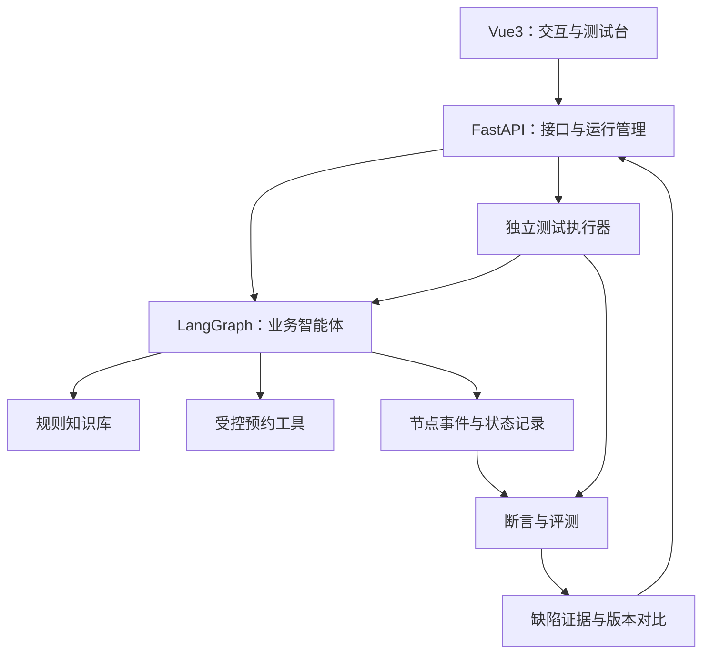

# 传智杯智能测试赛道：团队备赛建议

核对日期：2026年10月24日。本文是基于公开赛规形成的备赛建议，不代表主办方承诺或评审意见。用户已明确拟用FastAPI + Vue3、可投入时间较充足、目标为冲击国赛奖项；推荐智能体编排使用LangGraph。人数与具体经验尚待确认，分工暂按3人安排。用户后续确认暂时没有真实业务资源，因此当前建议以自定义规则的场地预约实验场景筹备，尚未由团队最终确定题目，不应描述为学校实际部署。

数据库设计、首周任务、接口约定与首批10条测试见同目录《开工方案-数据库与首周任务.md》。后续讨论的数据库组合为MySQL + Redis；持久业务与评测记录放MySQL，Redis按需要承担缓存、任务协调及检查点。

官方详情：https://www.boxuegu.com/matchTrack/detail/?id=10041

同页面公开数据接口：https://gateway.boxuegu.com/portal-marketing/competition/track/detail?id=10041&includeDetail=true

## 1. 先抓住比赛的重点

比赛为“2026第九届传智杯全国大学生数智创新与AI应用大赛”的“AI赋能·智能测试创新挑战赛”，正文称“AI智能体测试挑战赛”。主题是让AI智能体更可靠。

主办方允许任选一条路径：

- 路径一：先搭建一个具体场景的智能体，再设计和执行系统测试。需提交应用介绍、完整测试方案、测试用例集、执行记录及缺陷分析报告。
- 路径二：开发面向智能体的测试辅助工具或平台。需提交可运行原型、技术方案及实际效果验证。

建议：以路径一为省赛参赛主线，自建具体业务智能体，并用FastAPI + Vue3实现可视化测试台。测试台用于执行、记录和分析测试，增强这条路径的成果。若后续能在第二个独立智能体上验证通用性，再根据官方规则评估是否以路径二提交。框架选择本身没有单独评分项，国赛竞争力来自方法及验证效果。

时间投入应围绕：可测的智能体 → 有依据的测试用例 → 真实执行 → 缺陷定位 → 修复 → 独立验收与回归。

## 2. 官方评分与对应证据

省赛和国赛页面列出的评分维度相同：

| 评分维度 | 官方权重 | 应提供的证据 |
|---|---:|---|
| 智能体理解与测试深度 | 30% | 架构图、风险与测试对应关系、RAG/工具/多轮/异常测试、能够定位失败节点的记录 |
| AI能力应用水平 | 25% | 提示词、工作流、工具配置；AI辅助生成用例与判定的实际效果；人工复核机制 |
| 创新性 | 20% | 与普通问答测试的明确差异，例如链路级断言、语义等价变形测试；用对照实验验证作用 |
| 完整性 | 10% | 可运行应用、可执行测试、可查看结果、可复现失败与修复 |
| 实用性与商业价值 | 10% | 具体使用者和使用场景、接入成本、节省的人工步骤、试用记录 |
| 社会价值 | 5% | 有效减少无依据回答、未确认执行、越权操作；用实测结果支撑 |

前三项合计75%。这是选题和时间分配的主要依据。页面展示的评分项已对应100分总量；团队自评可按30/25/20/10/10/5汇总，不要把各项分数再次重复乘权重。最终计分由组委会执行。

## 3. 推荐命题

**当前推荐题目：可信约——场地预约实验智能体的全链路测试与缺陷定位。**

一句话介绍：围绕校园场地预约中的政策查询、条件补全、空闲查询与预约确认，构建智能体，并验证它能否在多轮修改、规则变化和工具故障下正确完成任务。

推荐这一题目的原因是：使用者容易接触，规则可人工核对，工具结果可在受控系统中验证，能够自然覆盖RAG、记忆、工具调用和异常处理。校园背景只是载体，作品的主要贡献应是测试方法及其效果。

### 最小可交付范围

1. 规则查询：回答可预约时段、容量等问题，并给出文件出处与适用日期。
2. 条件澄清：缺少日期、时间、人数等条件时主动追问。
3. 查询空闲：调用查询工具，解释真实返回结果。
4. 确认预约：完整复述预约信息，经用户确认后写入测试系统，返回预约结果。

先不扩展到选课、就业、校园百科等多个业务。取消预约可作为完成上述闭环后的选做功能。

知识库使用本校公开规则或经授权资料，并记录来源和版本；没有真实规则时，可以建立明确标注为“实验规则”的受控知识库，但不能将其描述成本校正式制度。预约工具先连接自建测试服务；模拟数据、模拟接口与真实试用结果须分别说明。

### 其他可选命题

| 题目方向 | 适用条件 | 可形成的测试亮点 |
|---|---|---|
| 实验室设备预约智能体测试 | 能获得设备使用规则及实验室老师反馈 | 权限、时间冲突、重复执行、异常恢复 |
| 售后客服智能体测试 | 能获得明确售后规则和商品测试数据 | 规则版本、计算边界、多轮变更、工具执行 |
| 智能体回归测试工具 | 已有较强后端和自动化测试能力 | 多应用接入、判定校准、缺陷归因；必须用实际智能体验证 |

选题时优先检查：能否找到用户、能否获得合法数据、能否写出正确答案与正确状态、能否稳定演示、能否在截止前完成。对团队而言，这些比题目覆盖的行业数量更有用。

## 4. 核心测试方案

以下数量、重复次数和指标均为建议，不是官方最低要求。

先制作80—120条有明确预期的用例，再按效果决定是否扩充。AI可以辅助改写和补充，但需人工确认语义、预期答案和判定条件。

| 测试维度 | 例子 | 判定依据 |
|---|---|---|
| 功能与RAG | 当前规则能否回答；旧版与新版冲突时如何选用；没有相关依据时是否编造 | 人工标注的适用条款、来源、日期和必要回答要点 |
| 工具调用 | 日期、人数、场地等参数是否正确；是否重复提交；是否提前执行 | 工具名称、参数、调用次数和数据库最终状态 |
| 多轮交互 | 先说周五后改为周六；人数从10人改为30人；信息缺失时追问 | 最终确认信息及实际工具参数、状态是否一致 |
| 边界与异常 | 无可用场地、工具超时、返回空数据、请求失败 | 是否准确说明失败、合理重试、避免谎称预约成功 |
| 安全与隔离 | 未确认就要求预约；尝试查询他人记录；知识库文本夹带非业务指令 | 服务端权限校验、确认机制、会话隔离和实际执行记录 |
| 性能与成本 | 不同并发量下的响应与成功情况 | 任务成功率、P95时延、错误率、请求消耗；记录运行环境 |

### 一条适合演示的用例

- 输入1：“帮我查周五下午、能容纳20人的活动室。”
- 输入2：“改成周六，其他条件不变。”
- 输入3：“确认预约。”
- 预期：按澄清后确定的具体日期预约周六场地，人数仍为20人；只成功创建一次预约；最终回复与预约记录一致。
- 采集：工作流节点、检索证据、工具名与参数、工具返回、最终预约记录。
- 失败例：回复说预约了周六，工具却使用周五日期。即使回答流畅，也应判定失败。

测试依据是这些可观察记录，不需要取得或展示模型私有的内部思维过程。

### 两个优先实现的亮点

**链路级断言。** 对最终文本之外的关键节点设置检查：该查规则时是否取得证据、该调用工具时参数是否正确、用户是否确认、最终状态是否符合预期。用实验证明它比只看回答文本多发现了哪些问题。

**语义等价变形测试。** 将同一需求改成不同措辞、调换信息顺序、加入无关句子，检查任务结果是否保持一致；同时加入真正改变约束的对照用例，检查系统是否正确改变结果。人工确认变形确实保留或改变了指定含义。

故障注入可以作为补充，例如在自建工具中模拟超时、过期数据或格式错误，并验证恢复策略。应明确标注“注入故障”和“自然发现的缺陷”，避免将人为植入的问题包装成自然发现。

## 5. 怎样让测试结果可信

1. 保留开发用例和独立验收用例。独立验收的答案不用于反复调提示词；同一模板的改写尽量放在同一组，降低近似重复带来的偏差。
2. 固定并记录模型名称/版本、提示词、工作流、知识库版本和运行参数。记录执行日期与外部依赖，承认托管模型更新可能影响复现。
3. 对关键用例重复运行3—5次，报告“通过次数/运行次数”，不能只展示一次成功。
4. 客观事项优先规则判定：工具参数、数据库状态、调用次数、必要引用。开放回答可以使用AI辅助评价，但需人工标注样本校准，并记录争议与复核。
5. 修复前后使用相同验收条件，展示具体失败用例及整体结果，同时观察时延和费用是否增加。
6. 如果宣称AI提高效率，记录人工流程与AI辅助流程的耗时、人工修订量和最终质量；不要只报告生成了多少条用例。

建议报告以下指标，不必自创一个难解释的综合分：

- 端到端任务成功率：回答、工具执行及最终状态均符合预期的任务数/任务总数。
- 工具调用正确率：按预先定义的工具选择与参数标准判定；另列重复、漏调、未确认执行等失败数。
- 证据支持情况：人工核对可核查主张与检索材料是否一致；同时报告无依据问题的正确拒答或澄清情况。
- 安全测试通过情况：按攻击或异常类型报告成功次数与总次数；零次违规只代表该测试集内的观测结果。
- 性能：注明并发量、运行次数和环境，报告P95时延、错误率及每任务消耗。

所有数字都应来自实际运行。尚未测试的指标写“待测”，不要把示意图或目标值当成结果。

## 6. 从现在到提交的倒排安排

按2026年10月24日到11月18日约25天规划。若学校有更早的校赛或材料截止，应整体前移。

| 时间 | 必须完成的结果 |
|---|---|
| 10月24—26日 | 确定路径、题目、目标用户和范围；核对组别；收集规则资料；定义成功与失败标准 |
| 10月27—31日 | 智能体与测试服务跑通完整预约流程；保留首版；已有30条人工审核用例 |
| 11月1—6日 | 扩充到80—120条用例；实现自动执行与基础报告；跑出首轮结果并登记缺陷 |
| 11月7—11日 | 修复主要问题；加入链路断言和变形测试；运行独立验收及关键用例重复测试 |
| 11月12—15日 | 完成对照结果、应用说明、测试文档和视频；请一位未参与开发的人按说明复现 |
| 11月16—17日 | 检查压缩包、链接和公开访问情况；尽早完成提交并保留提交凭证 |
| 11月18日 | 截止日缓冲；不要把首次打包与首次提交留到当天 |

三人分工建议：

- 队员A负责智能体、知识库和测试工具接口，修复业务实现问题。
- 队员B负责测试设计、自动执行、链路记录和缺陷复现。
- 队员C负责用户需求核对、人工标注、数据分析、文档和视频整合。

三人都需理解核心链路。用例预期至少交叉审核；缺陷修复由另一位队员复测。若只有两人，将C的资料与表达工作分配给A、B，缩小功能范围。

技术选择以已有能力为先。针对团队已选定的FastAPI + Vue3，具体建议见下一节。赛规中的框架列表是示例和推荐，命题范围没有要求必须采用其中某个框架。

## 6A. FastAPI + Vue3的具体技术方案

**主选：LangGraph。LangChain组件按需使用。**

LangGraph提供有状态图编排、持久化、流式输出、人工介入等机制；官方也提供节点、整图及部分执行路径的测试示例。这些能力适合把业务决策做成可检查流程。LangGraph可以独立使用，并不要求整套引入LangChain。

主选LangGraph是基于本赛题和团队技术栈的工程判断，不意味着采用该框架就能获得更高分。Dify同样有工作流和执行追踪能力，适合快速搭建；团队在自定义状态断言、故障注入和测试前端方面投入较多时，代码编排更便于直接控制。

| 层次 | 建议实现 | 负责内容 |
|---|---|---|
| 前端 | Vue3 | 智能体交互、用例管理、运行状态、链路查看、版本对比与报告 |
| API服务 | FastAPI | 鉴权、项目/用例接口、启动测试、查询结果、推送运行事件 |
| 智能体 | LangGraph，模型/检索组件按需引入 | 条件提取、澄清、检索、工具调用、确认与状态管理 |
| 测试执行 | Python + Pytest或独立执行器 | 多轮用例、断言、受控异常注入、重复执行、汇总 |
| 数据 | MySQL + Redis | MySQL保存预约、用例、版本、运行结果及缺陷证据；Redis用于缓存、任务协调，可按组件要求保存智能体检查点 |

这个图是建议架构，需要团队实现事件采集、判定与报告的连接。LangGraph的检查点保存状态；工具输入输出、检索证据、时延和费用等完整运行证据仍需按需要采集。节点持久化也不能自动保证外部预约操作只执行一次，工具服务应自行实现幂等与权限检查。

运行时需要几分钟的批量评测，应交给独立执行进程或任务执行器，并记录任务状态，再由FastAPI提供进度。Vue3可以通过SSE或轮询获取更新。第一版使用简单可靠的任务实现，按实际并发需求再加复杂队列。

建议的业务图：提取条件 → 缺失字段澄清 → 检索规则 → 查询空闲 → 展示确认信息 → 用户确认 → 创建预约 → 核验结果。规则、用户身份和确认条件不能只依赖模型自行遵守，需有后端校验。

状态示例：会话标识、请求日期/时段/人数、已检索证据、候选场地、待确认预约、确认状态、工具结果、错误信息。测试独立记录运行ID与版本，确保不同测试不会复用残留会话。

## 6B. 冲击国赛的验证重点

优先把以下两项做扎实：

1. **链路断言与缺陷定位。** 对工具参数、状态更新、用户确认、最终业务状态设置可解释的检查。对失败输出“哪个检查失败、对应哪个节点、原始证据是什么”；对根因给候选判断并由人工确认。
2. **多轮变更与变形测试。** 围绕时间、人数、场地等约束的修改设计多轮脚本，并生成语义等价的措辞/顺序变形，检查智能体是否保留或更新正确条件。

建议的对照实验：

| 实验 | 对照设置 | 报告指标 |
|---|---|---|
| 测试方法是否有用 | 仅评价最终回答 vs 加入节点与状态断言，使用相同人工标注案例 | 缺陷检出率、误报、额外耗时与费用、漏检实例 |
| 修复是否有效 | 同一模型及验收条件下，修复前 vs 修复后 | 端到端成功率、关键违规次数、重复运行表现、成本变化 |
| 能否迁移，选做 | 接入第二个范围较小、规则不同的智能体 | 可复用用例/断言、需修改的适配代码、接入耗时 |

缺陷检出率需要有人工确认的缺陷标签；受控注入的故障与自然缺陷分开报告。实验时分离“发现问题的测试方法改进”和“修复业务智能体的改进”，否则无法解释究竟是哪一部分产生收益。

原始轨迹展示、框架已有检查点和第三方评测功能应注明来源。团队贡献体现在具体断言、变形规则、定位方法及实验证据，避免将现有框架能力表述为原创。

技术依据，核对日期同上：

- LangGraph概览：https://docs.langchain.com/oss/python/langgraph/overview
- 官方测试指南：https://docs.langchain.com/oss/python/langgraph/test
- 持久化说明：https://docs.langchain.com/oss/python/langgraph/persistence
- 人工介入与恢复：https://docs.langchain.com/oss/python/langgraph/interrupts
- Dify工作流说明：https://dify.ai/workflows

## 7. 让评委快速看懂作品

文档首页先写明三件事：解决什么可靠性问题、测试方法有什么具体贡献、证据在哪里。随后给一张“评分项→成果→文件/视频位置”的导航表。

建议以7—8分钟视频组织演示；官方建议时长为5—10分钟：

- 0:00—0:45：场景与质量风险。
- 0:45—1:30：应用与测试架构。
- 1:30—3:00：展示一条失败链路，给出预期、实际行为和定位证据。
- 3:00—4:30：运行测试，查看不同维度的失败与报告。
- 4:30—6:15：展示修复及相同条件下的回归，对照未解决问题。
- 6:15—7:30：说明创新作用、适用范围、复现入口和后续改进。

最好回答得出：为什么这些用例覆盖主要风险？如何知道答案正确？为什么不能只让大模型给自己打分？你们相比已有工具新增了什么？换场景后哪些部分可复用？修复是否带来额外费用或时延？

外观应做到阅读清楚、报告易查、操作稳定。最值得展示的是“发现一个可复现问题，并用证据证明修复有效”。

## 8. 官方提交要求核对

- 同校1—3名学生组成一队，指导老师不超过2名。核对研究生/A/B/C组规则，避免选错组别。
- 页面当前列出的省赛报名及作品提交截止均为2026年11月18日；提交入口在完成缴费后登录赛事个人中心查看。
- 附件仅接受ZIP，大小不超过200MB。压缩包命名按官方要求使用“AI智能体测试挑战赛-作品名称”。
- 作品介绍必须包含：①项目详情与使用方式；②亮点；③AI能力应用说明；④关键技术；⑤项目图片/截图；⑥过往发表或获奖情况，无则写“无”；⑦基于其他项目的优化说明。
- 路径一还应提交完整测试方案、用例、执行记录和缺陷分析。路径二应提供可运行工具原型、技术方案和实际效果验证。
- 讲解视频上传到可公开访问的视频平台，提交视频链接；建议5—10分钟。检查评委在未登录、非本人账号下是否能够访问。
- 页面鼓励发布智能体或开源测试工具代码，属于鼓励事项。引用第三方项目、代码、数据时说明来源及团队新增部分。

建议压缩包包含作品介绍、应用与测试源码/工作流导出、用例数据、执行结果与缺陷报告、复现说明、视频链接和第三方来源说明。不要放入依赖缓存、模型权重或API密钥。提供配置样例，并说明需要的外部服务。

## 9. 需要向组委会核实的页面矛盾

页面一处写2027年1月底发布省赛专家反馈，另一处写2026年12月27日国赛提交截止，时间顺序不一致；省赛“作品指导提交”和“最终提交”的流程也需要确认。

此外，国赛奖项比例在不同段落有不同表述，省赛也同时出现按省和按大区评奖的说明。因此不能据此计算获奖概率。以个人中心及组委会最新明确通知核实：省赛最终提交时间与入口、国赛日程、评奖范围。当前工作先按11月18日前完成全部省赛材料安排。

## 10. 开始时的三项任务

1. 明确选择路径一或路径二，写出一句话选题和四项以内的核心功能。
2. 获取一份真实可核对的规则资料，写出10条有预期结果的用例。
3. 跑通一个端到端任务，记录节点、证据、工具参数和最终状态。

完成这三项后，再根据实际难点扩展用例和工具。先有能够验证的闭环，随后再提高覆盖与表达质量。
